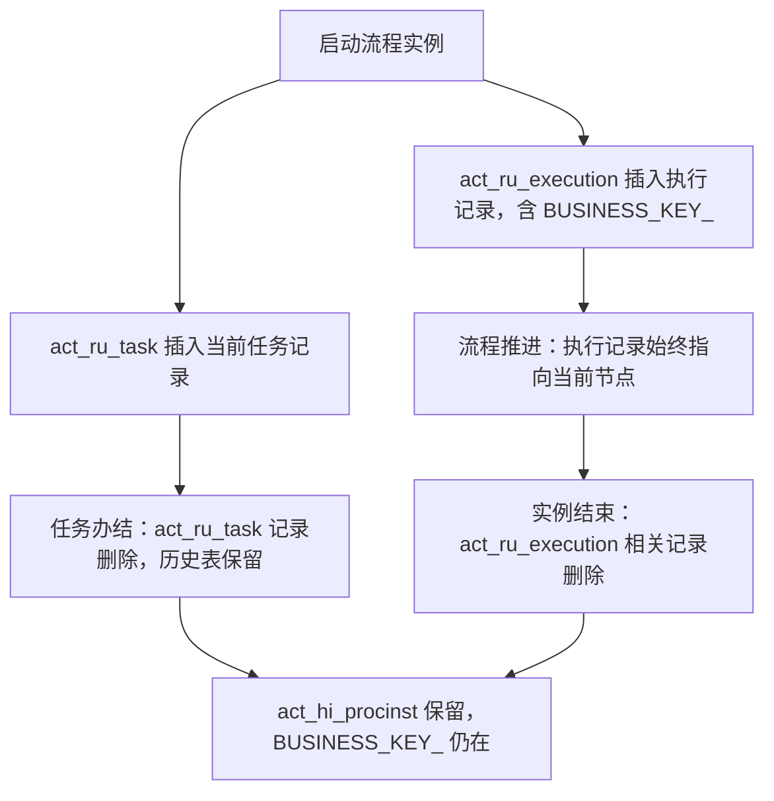

# 业务主键存在哪：act_ru_execution 的 BUSINESS_KEY_ 字段

整合原理那一步讲清了分工：业务数据进业务库，引擎数据进引擎库，中间靠 businessKey 打通。落到数据库层面马上有一个具体问题：引擎 25 张表里，业务主键究竟存在哪张表的哪个字段？启动实例时不传它行不行？流程跑完之后它还在不在？

答案集中在一张表上：`act_ru_execution`，流程实例执行表。这一课把它的结构和「当前」语义拆开看清楚。

## 先给结论

- businessKey 的落点是 `act_ru_execution` 表的 `BUSINESS_KEY_` 列，该表记录流程实例当前的执行情况。
- 执行表只记「现在」：单分支时只有一条记录，且其主键 `ID_` 与流程实例 `PROC_INST_ID_` 相同；多分支并行时出现多条记录；流程实例结束，相关记录被删除。
- 当前任务记在 `act_ru_task`，任务办结即删除；要查历史，走 `act_hi_procinst`、`act_hi_taskinst`、`act_hi_actinst`，其中 `act_hi_procinst` 同样有 `BUSINESS_KEY_` 列且记录永不删除。
- 双表互查的通道：业务表主键等于执行表的 `BUSINESS_KEY_`，两边各拿对方的主键查自己。
- `BUSINESS_KEY_` 不会自动生成，必须在启动流程实例时显式传入。

## 一、打开执行表：字段就在这里

用 SQL 直接看表（字段名与引擎建表结果一致）：

```sql
-- 流程实例执行表，记录当前流程实例的执行情况
SELECT * FROM act_ru_execution;

-- 关键列：ID_（执行记录主键）、PROC_INST_ID_（所属流程实例id）、
-- BUSINESS_KEY_（业务标识）、PROC_DEF_ID_（所属流程定义id）、PARENT_ID_（父执行分支）
```

请假单主键是 1 的那次启动，引擎会在这条执行记录的 `BUSINESS_KEY_` 里写入 1。于是引擎在推进每一步时，随时都能从当前执行记录里读出「这是 1 号请假单在走」。原理解析里说的业务标识，存储位置就是这一列，设计上不需要为整合新加任何表。

把一条单分支实例的记录形态摆出来看更直观：

| ID_ | PROC_INST_ID_ | BUSINESS_KEY_ | PROC_DEF_ID_ |
|---|---|---|---|
| 2501 | 2501 | 1001 | holiday:1:4 |

单分支时 `ID_` 与 `PROC_INST_ID_` 是同一个值，这条记录既代表实例本身也代表唯一的执行分支。`PARENT_ID_` 为空，因为没有父分支。

## 二、执行表的「当前」语义

课程讲义对这两张运行时表的描述值得整段记住：

```sql
-- act_ru_execution：单分支时一条记录，且执行表主键id与流程实例id相同；
-- 多分支并行时存在多条记录，出现主键与流程实例id不相同的记录；
-- 但不论几个分支，总有一条记录的主键与流程实例id相同。
-- 一个流程实例运行完成，此表中与该实例相关的记录删除。

-- act_ru_task：记录当前执行的任务。
-- 流程走到某个任务节点就插入一条记录，任务完成记录删除。
```

两个「删除」划出了运行时表与历史表的边界。对比历史侧：`act_hi_procinst` 在实例启动时插入一条记录，实例运行完成也不删除；`act_hi_taskinst` 与 `act_hi_actinst` 同样只增不删。

多分支的记录形态也要认识：并行网关之后每个分支在执行表里各占一条记录，这些分支记录的 `ID_` 不再等于 `PROC_INST_ID_`，`PARENT_ID_` 指向实例主记录；`BUSINESS_KEY_` 只写在实例主记录上，分支记录此列为空，查业务关联时认准主键等于流程实例 id 的那条即可。



图里的分叉点在「结束」：运行时两张表清空，历史表的 `act_hi_procinst` 把 businessKey 长期保留下来。查询时选表，取决于要查的是进行中的单子还是已办结的单子。

## 三、双表互查怎么跑

业务库的 `holiday` 表与引擎库的 `act_ru_execution` 各持对方一半信息，互查的方向有两个：

```sql
-- 方向一：引擎侧回查业务详情（已知流程实例id为2501）
SELECT BUSINESS_KEY_ FROM act_ru_execution WHERE PROC_INST_ID_ = '2501';
-- 得到 1001 后，再查业务库
SELECT * FROM holiday WHERE id = 1001;

-- 方向二：业务侧反查流程进度（已知请假单id为1001）
SELECT PROC_INST_ID_ FROM act_ru_execution WHERE BUSINESS_KEY_ = '1001';
```

方向一服务审批人：接到任务后要知道审的是谁的什么单。方向二服务提交人：想看自己的单子批到哪了。两边都不需要跨库外键，逻辑关联靠这一列值完成。

## 四、按流程定义查运行中的实例

讲义给出的实例查询代码，把当前所有运行中的实例列出来（课程讲义代码，按本课写法整理，包名改为 `com.example`）：

```java
package com.example.day03.activiti;

import org.activiti.engine.ProcessEngine;
import org.activiti.engine.ProcessEngines;
import org.activiti.engine.RuntimeService;
import org.activiti.engine.runtime.ProcessInstance;
import org.junit.Test;

import java.util.List;

public class QueryProcessInstance {

    @Test
    public void queryProcessInstance() {
        // 流程定义key
        String processDefinitionKey = "holiday";
        // 获取RuntimeService
        RuntimeService runtimeService = processEngine.getRuntimeService();
        // 查询该流程定义下所有运行中的实例
        List<ProcessInstance> list = runtimeService.createProcessInstanceQuery()
                .processDefinitionKey(processDefinitionKey)
                .list();

        for (ProcessInstance processInstance : list) {
            System.out.println("流程实例Id：" + processInstance.getProcessInstanceId());
            System.out.println("所属流程定义Id：" + processInstance.getProcessDefinitionId());
            System.out.println("业务标识：" + processInstance.getBusinessKey());
            System.out.println("是否执行完成：" + processInstance.isEnded());
        }
    }
}
```

遍历里的 `getBusinessKey()` 就是方向一的代码化：从实例对象上直接读出业务标识，拿去业务表查详情即可，不必手写 SQL 翻执行表。

## 常见误区

- **流程结束后去 `act_ru_execution` 查 businessKey**：实例结束相关记录已删除，查出空集。已办结的单子去 `act_hi_procinst` 查，它的 `BUSINESS_KEY_` 永不删除。
- **以为不传 businessKey 引擎会自动关联业务表**：引擎不认识任何业务表，`BUSINESS_KEY_` 只能由启动代码显式传入，不传就是 null。
- **把执行表多条记录当成异常**：并行分支会让执行表出现多条记录，其中主键等于流程实例 id 的那条才是实例本身，其余是分支。
- **把 `act_ru_task` 当任务历史表用**：它只存当前任务，办结即删；历史任务在 `act_hi_taskinst`。

## 面试可能被问到的问题

1. 面试官追问：「businessKey 最终落在哪张表哪个字段？」
   答：落在流程实例执行表 act_ru_execution 的 BUSINESS_KEY_ 列，随执行记录一起更新；实例结束后该记录删除，但历史表 act_hi_procinst 中同样存有 BUSINESS_KEY_，长期保留。

2. 面试官追问：「act_ru_execution 一条实例为什么可能有多条记录？」
   答：单分支时只有一条，主键 ID_ 与流程实例 ID_ 相同；出现并行分支时每个分支各一条记录。总有一条记录的主键与流程实例 id 相同，它代表实例本身，其余是分支。

3. 面试官追问：「运行时表和历史表的记录生命周期有什么区别？」
   答：act_ru_execution 与 act_ru_task 只反映当前状态，实例结束或任务办结即删除；act_hi_procinst、act_hi_taskinst、act_hi_actinst 只增不删，服务审计与追溯。

4. 面试官追问：「审批页面要显示请假单详情，数据从哪来？」
   答：从当前任务拿到流程实例 id，再到 act_ru_execution 读 BUSINESS_KEY_，用这个业务主键查业务库的请假表。流程数据与业务数据分库存放，靠主键互查拼接出完整视图。

5. 面试官追问：「已办结的请假单还能按 businessKey 追溯吗？」
   答：可以。act_hi_procinst 在实例启动时写入且永不删除，BUSINESS_KEY_ 一直在，用它过滤历史流程实例查询即可还原当时的关联关系。

## 配套资料

- 运行时表结构与表说明：课程讲义「查询流程实例」小节（`act_ru_execution`、`act_ru_task`、`act_hi_*` 的记录规则），第二节引用其原文
- 实例查询代码：讲义 `queryProcessInstance` 代码按本课写法整理补全为可运行类，课程源码包内无同名文件
- 引擎与数据源配置：`materials/code/02/Activiti7-day03-进阶1/Activiti7-day03-进阶1/代码/更新到第三天/代码/src/main/resources/activiti.cfg.xml`
- 双表互查 SQL 为按本课表结构补全的示例
