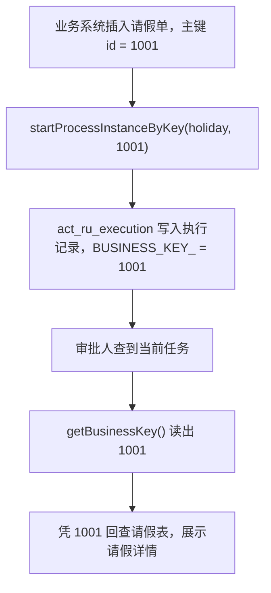

# 启动流程实例带上 businessKey：存进去，取出来

原理层面已经明确：业务数据归业务库，businessKey 是两边的关联键。轮到写代码时问题很具体：这个值从哪传给引擎？传进去之后怎么拿回来？数据库里到底变成了什么样？

这一课把存、取、验三个动作走完整。核心 API 只有一个重载：启动流程实例的方法多了第二个参数。

## 先给结论

- 存：`runtimeService.startProcessInstanceByKey(流程定义key, businessKey)`，第二个参数就是业务表主键，启动实例时一并写入。
- 取：从流程实例对象上直接调 `getBusinessKey()`，把业务标识读回来。
- 验证：跑完代码到 `act_ru_execution` 表看 `BUSINESS_KEY_` 列，出现传入的值即关联成功；课程实测为流程实例 2501 关联请假单 1001。
- businessKey 的类型是 String，取值应当是业务表的主键，业务标识与流程实例一一对应。
- 机制与业务类型无关：请假流程存请假单 id，调薪流程存调薪申请单 id，同一套写法复用。

## 一、存：启动时多传一个参数

课程实现类 `BusinessKeyAdd` 的完整代码如下（包名已改为 `com.example`）：

```java
package com.example.day03.activiti;

import org.activiti.engine.ProcessEngine;
import org.activiti.engine.ProcessEngines;
import org.activiti.engine.RuntimeService;
import org.activiti.engine.runtime.ProcessInstance;

/**
 * 启动流程实例，添加进businessKey
 *
 * 本质：act_ru_execution表中的businessKey的字段要存入业务标识
 */
public class BusinessKeyAdd {

    public static void main(String[] args) {
        //1.得到ProcessEngine对象
        ProcessEngine processEngine = ProcessEngines.getDefaultProcessEngine();

        //2.得到RuntimeService对象
        RuntimeService runtimeService = processEngine.getRuntimeService();

        //3.启动流程实例,同时还要指定业务标识businessKey  它本身就是请假单的id
        //第一个参数：是指流程定义key
        //第二个参数：业务标识businessKey
        ProcessInstance processInstance = runtimeService.startProcessInstanceByKey("holiday", "1001");

        //4.输出processInstance相关的属性,取出businessKey使用:processInstance.getBusinessKey()
        System.out.println(processInstance.getBusinessKey());
    }
}
```

对照此前只传一个参数的启动方式，变化只在第二个参数：`"1001"`，即业务系统请假表里某一条记录的主键。第一个参数 `holiday` 仍然回答「按哪套流程走」，第二个参数回答「这套流程是为哪张业务单跑的」。

## 二、取：getBusinessKey 拿回来

运行上面的类，控制台输出 `1001`，正是存进去的那个值。取出动作由 `processInstance.getBusinessKey()` 完成，方法在流程实例对象上，谁持有实例谁就能读。

审批场景的典型用法是从任务反查业务单（示例为按本课写法补全）：

```java
// 审批人处理任务时，凭任务反查业务单（示例）
//1.查询当前审批人的任务
Task task = taskService.createTaskQuery()
        .processDefinitionKey("holiday")
        .taskAssignee("jingli")
        .singleResult();

//2.由任务拿到流程实例，读出businessKey
ProcessInstance pi = runtimeService.createProcessInstanceQuery()
        .processInstanceId(task.getProcessInstanceId())
        .singleResult();
String businessKey = pi.getBusinessKey();   // 1001

//3.拿businessKey去业务库查请假单详情
Holiday holiday = holidayService.getById(businessKey);
```

链路一气呵成：任务 id 到流程实例 id 是引擎内部的关系，流程实例 id 到请假单 id 就是 businessKey 这座桥。

## 三、验：数据库里长什么样

代码跑完不算数，到引擎库里确认。刷新 `act_ru_execution` 表：

```sql
-- 流程实例与业务单的关联结果
SELECT ID_, PROC_INST_ID_, BUSINESS_KEY_, PROC_DEF_ID_ FROM act_ru_execution;
-- 本课实测：PROC_INST_ID_ = 2501，BUSINESS_KEY_ = 1001，PROC_DEF_ID_ 对应 holiday 的流程定义
```

流程实例 2501 与请假单 1001 从此绑定。引擎后续每推进一步（部门经理审核、总经理审核），这条执行记录的 `BUSINESS_KEY_` 始终是 1001，任何时刻读它都能定位到具体请假单。



这张图把存、取、验串成闭环：值的源头是业务表主键，落点是执行表的 `BUSINESS_KEY_` 列，中间不需要任何手工同步。

## 四、换一种业务也成立

businessKey 只是个「钥匙位」，不关心里面放的是哪类业务的 id。请假流程放请假单主键；换成调薪审批，放调薪申请单的主键；面试审批同理。约束只有两条：值必须是该业务表某条记录的主键，业务标识与流程实例一一对应，一次启动只挂一张单。业务侧由此可以在启动代码处做一层封装，按流程 key 决定取哪张表的主键传进去，模式完全统一。

配套的顺序约定也固定下来：先落业务表，再启动流程。请假单必须先插入拿到主键，才有 id 可以传给引擎；反过来如果先启动流程，businessKey 就无值可传。另外业务侧反查进度不必先查执行表，查询器直接支持按业务标识过滤（示例为按本课写法补全）：

```java
// 业务侧凭请假单主键反查流程进度（示例）
ProcessInstance pi = runtimeService.createProcessInstanceQuery()
        .processInstanceBusinessKey("1001")     // 按businessKey过滤
        .singleResult();
System.out.println("所属流程定义：" + pi.getProcessDefinitionId());
System.out.println("是否执行完成：" + pi.isEnded());
```

员工在「我的请假单」页面点开任意一条记录，后端拿单据 id 走这段查询，就能给出该单当前是审批中还是已办结，与引擎侧的 `getBusinessKey()` 正好凑成双向通道。

## 常见误区

- **把 businessKey 当流程实例 id 用**：一个来自业务表主键，一个由引擎生成，含义、来源、取值范围都不同，互查方向别搞反。
- **传了业务表主键以外的值**：比如传员工 id，后续回查请假表就查不到记录。businessKey 必须取本次流程对应业务单的主键。
- **想通过手工改表补 businessKey**：不需要也不应该直接 update 引擎表，启动时传第二参数，引擎自己完成落库。
- **忽略 String 类型**：businessKey 参数是字符串，业务主键若是整型要转成字符串再传，如 `"1001"`。

## 面试可能被问到的问题

1. 面试官追问：「启动流程实例时怎么把业务单关联进去？」
   答：调用 startProcessInstanceByKey 的双参重载，第一参数是流程定义 key，第二参数传业务表主键。引擎启动实例的同时把这个值写入执行记录的 BUSINESS_KEY_ 字段。

2. 面试官追问：「代码里怎么把 businessKey 读回来？」
   答：从流程实例对象上调 getBusinessKey。典型链路是任务到流程实例 id，再查实例取 businessKey，最后凭它回查业务表。

3. 面试官追问：「businessKey 与流程实例是什么对应关系？」
   答：一对一。一次启动携带一个业务标识，实例记录里只存这一个值；同一张业务单重复发起会生成新实例，应使用新的业务主键。

4. 面试官追问：「怎么验证 businessKey 真的存进去了？」
   答：查 act_ru_execution 表看 BUSINESS_KEY_ 列。课程实测启动后该列为 1001，与传入值一致，流程实例 2501 与请假单 1001 建立关联。

5. 面试官追问：「如果业务主键是 Long 类型，直接传行吗？」
   答：参数类型是 String，需要先转字符串。取回时拿到的是字符串，业务侧按需再转回数值类型比较或查询。

6. 面试官追问：「系统里同时有请假、调薪、调岗审批，businessKey 怎么设计？」
   答：规则统一，都存各自业务表的主键，由业务侧在启动时决定取哪张表的 id。引擎侧只认字符串值，不区分业务类型，查询时按流程定义 key 圈定范围即可。

## 配套资料

- businessKey 添加实现类：`materials/code/02/Activiti7-day03-进阶1/Activiti7-day03-进阶1/代码/更新到第三天/代码/src/main/java/` 下 day03 流程包中的 `BusinessKeyAdd.java`（包名已改为 `com.example`）
- 引擎与数据源配置：同工程 `src/main/resources/activiti.cfg.xml`
- 第二节审批人反查业务单的代码为按本课写法补全的示例，课程源码包内无对应文件
