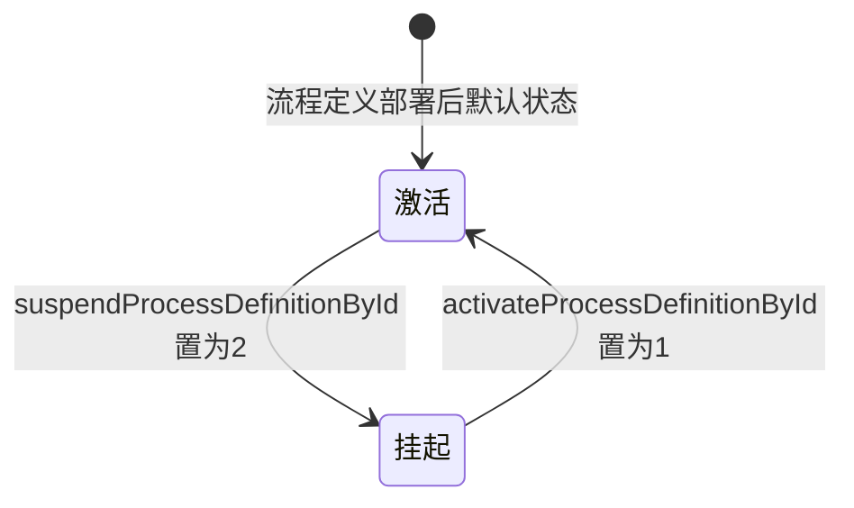

# 制度变了，没批完的请假单怎么办：流程定义的挂起与激活

公司运行中的请假流程突然遇上制度调整：100 个人发起过请假，70 个人的已经批完，剩下 30 个人的正卡在部门经理或总经理环节。新制度生效后，这 30 张单子怎么办？总不能让引擎继续按老规矩把流程跑完，也不能武断地把数据一删了之。

这时引擎需要一种「暂停」能力：把整套流程按住不动，等公司定了处理方案再放行或收尾。这就是流程定义的挂起与激活，入口在 RepositoryService。

## 先给结论

- 全部挂起的操作对象是流程定义：`suspendProcessDefinitionById(id, true, null)` 挂起，`activateProcessDefinitionById(id, true, null)` 激活，均在 RepositoryService 上调用。
- 操作前先 `isSuspended()` 判断当前状态，处于什么状态就做相反的操作，避免对已挂起的定义重复挂起。
- 第二个参数控制级联：传 true 会把该流程定义下所有运行中的流程实例一并挂起或激活；第三个参数是生效日期，传 null 表示立即执行。
- 状态落在数据库的 `SUSPENSION_STATE_` 字段，1 代表激活，2 代表挂起，流程定义表与运行时相关表都有这一列。
- 挂起生效后，该流程定义不允许再启动新实例，级联挂起的存量实例也不能继续办理任务；激活后一切恢复。

## 一、挂起解决的是「过渡期」问题

制度变更时，存量流程大致有三种处理策略，对应三种动作：

**第一种，按老制度走完。** 存量实例保持激活，引擎继续推进，直到全部办结后再让新流程上线，不需要任何挂起操作。

**第二种，统一打回重走。** 未批完的流程作废，员工按新制度重新发起，涉及实例删除与业务表状态回退，动作最重。

**第三种，整体暂停，等方案落地。** 这正是挂起的用武之地：引擎把这套流程定义连同在途实例一起按住，谁都不能再动，制度细则定了之后要么激活走完，要么走删除。

个别员工的单子需要单独暂停时，操作对象从流程定义换成单个流程实例，方法族同构，后面单独看。

## 二、全部挂起与激活：判断加执行

课程实现类 `SuspendProcessInstance` 的完整代码如下（包名已改为 `com.example`）：

```java
package com.example.day03.activiti;

import org.activiti.engine.ProcessEngine;
import org.activiti.engine.ProcessEngines;
import org.activiti.engine.RepositoryService;
import org.activiti.engine.repository.ProcessDefinition;

/**
 * 全部流程实例挂起与激活
 */
public class SuspendProcessInstance {

    public static void main(String[] args) {
        //1.得到ProcessEngine对象
        ProcessEngine processEngine = ProcessEngines.getDefaultProcessEngine();

        //2.得到RepositoryService
        RepositoryService repositoryService = processEngine.getRepositoryService();

        //3.查询流程定义的对象
        ProcessDefinition processDefinition = repositoryService.createProcessDefinitionQuery()
                .processDefinitionKey("holiday").singleResult();

        //4.得到当前流程定义的实例是否都为暂停状态
        boolean suspended = processDefinition.isSuspended();

        String processDefinitionId = processDefinition.getId();
        //5.判断
        if (suspended) {
            //说明是暂停，就可以激活操作
            repositoryService.activateProcessDefinitionById(processDefinitionId, true, null);
            System.out.println("流程定义：" + processDefinitionId + "激活");
        } else {
            repositoryService.suspendProcessDefinitionById(processDefinitionId, true, null);
            System.out.println("流程定义：" + processDefinitionId + "挂起");
        }
    }
}
```

代码结构是「查询、判断、执行」三步。查询用 `processDefinitionKey("holiday")` 锁定流程定义；`isSuspended()` 从流程定义对象上读出当前是否挂起；随后按状态取反执行。重复运行这个类，效果就在挂起与激活之间来回切换。

三个参数各自的角色值得点一下：第一个是流程定义 id；第二个 `suspendProcessInstances`（激活方法中同理）为 true 时级联处理该定义下所有存量实例，false 则只拦新实例的启动；第三个是生效日期，null 即立即生效。

## 三、状态字段与挂起之后的引擎行为

挂起与激活最终都体现为一个字段的变化：`SUSPENSION_STATE_`，值为 1 是激活，值为 2 是挂起。流程定义所在的 `act_re_procdef` 有这一列，运行时的 `act_ru_execution`、`act_ru_task` 也有，级联操作时引擎会把定义和存量实例、在途任务的状态一起改写。



状态翻转之后引擎的行为随之改变：挂起状态下对该流程定义执行 `startProcessInstanceByKey` 会被直接拒绝，抛出实例无法启动的异常；对被级联挂起的实例办理任务同样会被拒绝。这些拦截不需要业务代码配合，引擎在执行动作前自行校验状态。挂起不是删除，所有记录原样保留，`BUSINESS_KEY_` 与流程数据都在，激活后无缝继续。

## 四、对照：单个流程实例的挂起

操作粒度降一级，就是单个实例的挂起与激活，服务换成了 RuntimeService。课程实现类 `SuspendProcessInstance2` 的核心逻辑（包名已改为 `com.example`）：

```java
package com.example.day03.activiti;

import org.activiti.engine.ProcessEngine;
import org.activiti.engine.ProcessEngines;
import org.activiti.engine.RuntimeService;
import org.activiti.engine.runtime.ProcessInstance;

/**
 * 单个流程实例挂起与激活
 */
public class SuspendProcessInstance2 {

    public static void main(String[] args) {
        //1.得到ProcessEngine对象
        ProcessEngine processEngine = ProcessEngines.getDefaultProcessEngine();

        //2.得到RuntimeService
        RuntimeService runtimeService = processEngine.getRuntimeService();

        //3.查询流程实例对象
        ProcessInstance processInstance = runtimeService.createProcessInstanceQuery()
                .processInstanceId("2501").singleResult();

        //4.得到当前流程实例是否为暂停状态
        boolean suspended = processInstance.isSuspended();

        String processInstanceId = processInstance.getId();
        //5.判断
        if (suspended) {
            //说明是暂停，就可以激活操作
            runtimeService.activateProcessInstanceById(processInstanceId);
            System.out.println("流程：" + processInstanceId + "激活");
        } else {
            runtimeService.suspendProcessInstanceById(processInstanceId);
            System.out.println("流程：" + processInstanceId + "挂起");
        }
    }
}
```

两段代码的骨架完全一致，差异只在三点：查询对象从流程定义换成流程实例；服务从 RepositoryService 换成 RuntimeService；实例级方法只有 id 一个参数，没有级联与日期。制度变更这种全局动作走定义级，个别单子的临时冻结走实例级。

## 常见误区

- **不判断 `isSuspended()` 直接操作**：对已挂起的定义再挂起、对已激活的定义再激活，引擎会抛状态冲突异常。先查状态再做相反操作是固定套路。
- **以为挂起流程定义会自动暂停存量实例**：不传级联参数（或传 false）时只有新实例启动被拦，在途实例照常运转，要冻结全局必须把第二参数设为 true。
- **把挂起当删除**：挂起只翻转 `SUSPENSION_STATE_` 字段，数据全在，激活即恢复；删除是另一套操作，不可逆。
- **用错服务对象**：定义级的挂起激活在 RepositoryService，实例级的在 RuntimeService，拿错服务直接编译不过。

## 面试可能被问到的问题

1. 面试官追问：「公司流程制度调整，在途审批怎么处理？」
   答：视制度要求选三种动作之一：保持激活按老制度走完、级联挂起整体冻结等方案落地、或删除实例让员工按新制度重新发起。挂起是最稳妥的过渡手段，数据不动，随时可激活或清理。

2. 面试官追问：「suspendProcessDefinitionById 的三个参数分别是什么？」
   答：第一个是流程定义 id；第二个 suspendProcessInstances 控制是否级联挂起该定义下所有运行中的流程实例；第三个是生效日期，传 null 表示立即生效。

3. 面试官追问：「挂起在数据库层面改变了什么？」
   答：改写 SUSPENSION_STATE_ 字段，1 为激活、2 为挂起。流程定义表 act_re_procdef 与运行时的执行、任务相关表都有此列，级联时引擎统一更新。

4. 面试官追问：「流程定义挂起后，还能启动新实例吗？存量实例还能办理吗？」
   答：新实例会被引擎直接拒绝启动；存量实例是否受影响取决于第二参数是否级联。级联挂起后在途任务办理同样被拒绝，直到激活恢复。

5. 面试官追问：「只想暂停某一个员工的流程，怎么做？」
   答：用 RuntimeService 的 suspendProcessInstanceById 按流程实例 id 操作，粒度是单个实例，不影响同一定义下其他实例，判断方式同样是实例对象的 isSuspended。

6. 面试官追问：「挂起和删除流程定义有什么区别？」
   答：挂起是状态冻结，数据与关联关系原样保留，激活即可继续，可逆；删除是移除部署信息，未走完的流程存在时删除会失败，强制级联删除则丢掉在途数据，不可逆。

## 配套资料

- 全部挂起与激活实现类：`materials/code/02/Activiti7-day03-进阶1/Activiti7-day03-进阶1/代码/更新到第三天/代码/src/main/java/` 下 day03 流程包中的 `SuspendProcessInstance.java`（包名已改为 `com.example`）
- 单个实例挂起与激活实现类：同目录 `SuspendProcessInstance2.java`
- 引擎与数据源配置：同工程 `src/main/resources/activiti.cfg.xml`
