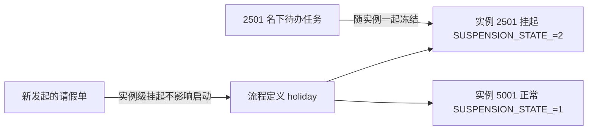

# 只按住某一张请假单：单个流程实例的挂起与激活

定义级挂起是把整套流程一刀切按停的全局开关，但更多时候需要的是精细操作：某张请假单走到总经理审批环节被发现有问题，先按住等核实，其余员工的请假照常流转；又如公司按月控制请假额度，这个月的单子超额了，超出的部分先挂起，下个月额度放出来再激活。这两种场景的共同点是：动的对象不是流程定义，而是某一条流程实例。

实例级挂起与激活的方法族和定义级同构，但服务的对象、查询方式、参数个数都有差异，这一篇把它们对齐讲清，顺带记录一次课堂实录里的 NullPointerException，它暴露的是 `singleResult()` 的使用前提。

## 先给结论

- 实例级挂起用 RuntimeService：`suspendProcessInstanceById` 与 `activateProcessInstanceById`，只有 ById 一种，没有 ByKey 版本。
- 操作前先用 `createProcessInstanceQuery` 查出实例，`isSuspended()` 判断状态后做反向操作，套路与定义级一致。
- 影响范围只有这一条实例：同一定义下其他实例不受影响，新实例也照常能启动。
- 查询条件用 `processInstanceId` 最稳；条件写错匹配不到数据时 `singleResult()` 返回 null，后续调用直接 NullPointerException。
- 状态落在 `act_ru_execution` 的 `SUSPENSION_STATE_` 字段，只翻转这一行。

## 一、定义级管全局，实例级管单子

两个粒度的差异集中在一对比对表里：

| 维度 | 定义级挂起 | 实例级挂起 |
|---|---|---|
| 操作对象 | 流程定义 | 某一条流程实例 |
| 所属服务 | RepositoryService | RuntimeService |
| 方法 | `suspend/activateProcessDefinitionById` | `suspend/activateProcessInstanceById` |
| 参数 | id、级联布尔、生效日期 | 只有实例 id |
| 新实例启动 | 被拒绝 | 不影响 |
| 同定义其他实例 | 级联时全部挂起 | 完全不受影响 |
| 典型场景 | 制度变更、年度规则调整 | 单张单子有问题、月度额度控制 |

选型的判断标准就一条：要停的是「这一类流程」还是「这一单流程」。前者动定义，后者动实例。

实例级挂起有两个典型场景。一是审批中发现问题：员工请假单走到总经理环节，总经理发现内容有疑问，可以把这一单挂起，跑下去也是无效的，等核实清楚再激活或处理。二是额度控制：假设公司每月放行一百个请假额度，这个月已经批满，后续申请的单子可以挂起排队，下个月把额度对应的实例激活放行。挂起期间实例无法继续执行，激活之后从当前节点继续推进。

## 二、实现：换服务、换查询、少两个参数

课程实现类 `SuspendProcessInstance2` 的完整代码如下（包名已改为 `com.example`）：

```java
package com.example.day03.activiti;

import org.activiti.engine.ProcessEngine;
import org.activiti.engine.ProcessEngines;
import org.activiti.engine.RuntimeService;
import org.activiti.engine.runtime.ProcessInstance;

/**
 * 单个流程实例挂起与激活
 */
public class SuspendProcessInstance2 {

    public static void main(String[] args) {
        //1.得到ProcessEngine对象
        ProcessEngine processEngine = ProcessEngines.getDefaultProcessEngine();

        //2.得到RuntimeService
        RuntimeService runtimeService = processEngine.getRuntimeService();

        //3.查询流程实例对象
        ProcessInstance processInstance = runtimeService.createProcessInstanceQuery()
                .processInstanceId("2501").singleResult();

        //4.得到当前流程实例是否为暂停状态
        boolean suspended = processInstance.isSuspended();

        String processInstanceId = processInstance.getId();
        //5.判断
        if (suspended) {
            //说明是暂停，就可以激活操作
            runtimeService.activateProcessInstanceById(processInstanceId);
            System.out.println("流程：" + processInstanceId + "激活");
        } else {
            runtimeService.suspendProcessInstanceById(processInstanceId);
            System.out.println("流程：" + processInstanceId + "挂起");
        }
    }
}
```

与定义级代码逐行对照，差异集中在三处。服务从 RepositoryService 换成 RuntimeService，因为流程实例是运行时对象，归 RuntimeService 管；查询从 `createProcessDefinitionQuery` 换成 `createProcessInstanceQuery`；方法签名少了级联布尔与日期两个参数，实例级挂起天然就是精确打击，不存在级联问题。

运行效果同样是开关式的：库里 2501 这条实例当前处于激活状态，运行后输出 `流程：2501挂起`；再运行一次，输出 `流程：2501激活`。

## 三、一次真实的 NPE：查询条件写错的代价

课堂实录里这个类第一次跑就翻车了。写代码时把查询条件敲成了 `processInstanceBusinessKey("holiday")`，而启动 2501 这条实例时并没有传 businessKey，条件在库里匹配不到任何行，`singleResult()` 返回 null，接着在 null 上调 `isSuspended()`，直接抛出：

```text
Exception in thread "main" java.lang.NullPointerException
```

修正方式是换条件：流程实例表开头带 `processInstanceId` 前缀的条件里，直接用实例 id 查询最直接，改成 `processInstanceId("2501")` 之后一次跑通。这次翻车给出两个可复用的经验：

**第一，`singleResult()` 的两个前提必须自己保证。** 查询命中零条时返回 null，命中多条时抛异常，异常和空指针都不发生在查询本身，而是发生在后续解引用上。用之前要么确保条件足够精确，要么先判空。

**第二，businessKey 查询要求启动时真的传了值。** `processInstanceBusinessKey` 是按业务单号找流程的正规通道，但前提是 `startProcessInstanceByKey(key, businessKey)` 启动时写入过这个值，空着不写，这条通道就查不出东西。

## 四、影响范围到表里确认

挂起 2501 之后，到运行时执行表确认影响范围：

```sql
SELECT ID_, BUSINESS_KEY_, SUSPENSION_STATE_ FROM act_ru_execution;
```

只有 2501 对应的行翻成 2，同一定义下其他实例的行仍是 1；此时再启动一个新实例也能正常成功。这正是实例级挂起与定义级的本质区别，用图表示两种粒度的作用范围：



图里能读出两层含义：实例挂起只圈住自己这一条执行链，连带名下的在途任务一起冻结；定义与其余实例构成的旁支完全不受波及，业务可以照常发起、照常审批。

## 常见误区

- **用 businessKey 查实例却没在启动时传值**：查询结果为 null，`isSuspended()` 抛 NPE。启动实例时把请假单 id 作为 businessKey 传入，这条查询通道才可用。
- **想找实例级的 ByKey 方法**：实例级挂起激活只有 `ById` 一种签名，先查出实例对象再拿 id，不要对着 IDE 报错硬凑。
- **以为实例挂起会影响同定义的其他实例**：`SUSPENSION_STATE_` 只翻转这一行，其他实例照常运转，这正是它与定义级挂起的分界线。
- **对 `singleResult()` 的返回值直接调方法**：命中零条返回 null、多条抛异常，先判空或确认条件唯一性再取状态。

## 面试可能被问到的问题

1. 面试官追问：「实例级挂起和定义级挂起分别在什么场景下使用？」
   答：定义级挂起针对制度类变更，例如请假规则调整，要把整套流程连同在途实例全部冻结；实例级挂起针对个别单子，例如某张请假单审批中发现问题需要核实，或月度额度满员后把超额单子排队，只冻结这一条实例。

2. 面试官追问：「实例级挂起有级联参数吗？」
   答：没有。`suspendProcessInstanceById` 只接收实例 id 一个参数，实例本身已经是最小粒度，名下的在途任务随实例一起被冻结，不存在再往下级联的对象。

3. 面试官追问：「实例挂起后，它的待办任务在任务列表里还能查到吗？」
   答：能。`act_ru_task` 里的记录还在，任务查询不校验挂起状态，审批人仍能看到这条待办；但办理动作 `complete` 会被引擎拒绝，查询与办理是两回事。

4. 面试官追问：「`singleResult()` 什么时候会出问题？」
   答：两种情况：查询命中多条时抛异常，命中零条时返回 null，后续解引用抛 NullPointerException。使用前要保证条件唯一性，或改用 `list()` 后自行判断。

5. 面试官追问：「怎么按业务单号定位流程实例？」
   答：启动实例时调用 `startProcessInstanceByKey(key, businessKey)` 把业务单 id 写入，之后用 `createProcessInstanceQuery().processInstanceBusinessKey(单号)` 查询。前提是启动时确实传入了该值。

## 配套资料

- 单个实例挂起与激活实现类：`materials/code/02/Activiti7-day03-进阶1/Activiti7-day03-进阶1/代码/更新到第三天/代码/src/main/java/` 下 day03 流程包中的 `SuspendProcessInstance2.java`（文中包名已改为 `com.example`）
- 引擎与数据源配置：同工程 `src/main/resources/activiti.cfg.xml`
