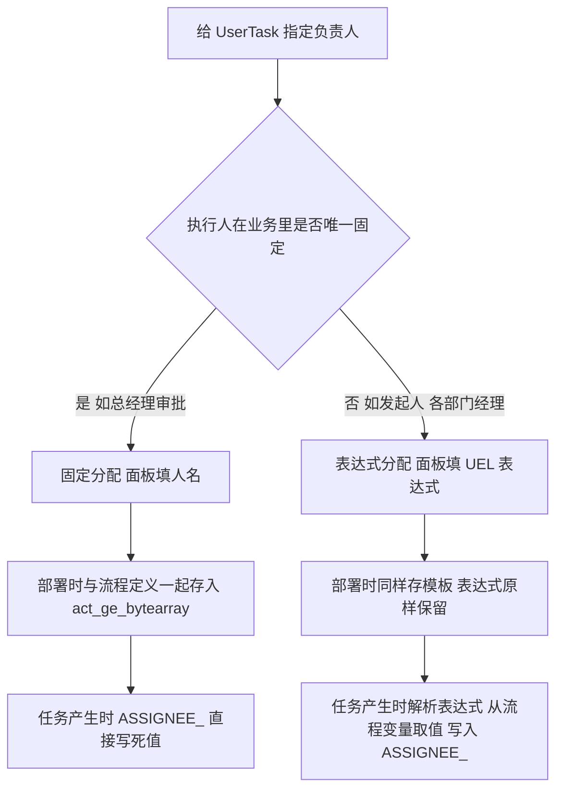

# 个人任务分配两条路：properties 里写死 assignee，还是交给 UEL 表达式

给 UserTask 指定负责人的入口，在流程设计器右侧的 properties 视图里。打开 holiday2 流程的部门经理审批节点，面板里 Assignee 一栏填什么，决定了这个任务将来归谁办。填人名是固定分配，填表达式是动态分配，两种方式课程都用 holiday2 流程演示了一遍，下面把两条路的写法、适用边界和底层机制一次说清。

## 先给结论

- 个人任务指 assignee 唯一确定的任务，配置入口是 properties 视图的 Assignee 项，落盘到 bpmn 就是 `activiti:assignee` 属性。
- 固定分配直接写人名（如 `lisi`），建模即定死，所有流程实例共用同一个负责人。
- UEL 即 Unified Expression Language 统一表达式语言，是 Java EE 6 规范的一部分，不是 Activiti 的新发明，JSP 里的 EL 表达式与之同源。
- UEL 分 UEL-value 与 UEL-method 两类：`${assignee1}` 直接取流程变量，`${user.assignee}` 对象打点自动调 getter，UEL-method 调用 bean 的方法拿返回值。
- 选固定还是选表达式不取决于技术偏好，取决于这个节点的执行人在业务里是否唯一确定。

## 一、固定分配：properties 视图里把人钉死

课程演示用的是最直观的操作：选中任务节点，在 properties 面板的 Assignee 项填 `lisi`。面板上和任务分配相关的几项可以这样对号入座：

| 面板属性 | 课程演示值 | 含义 |
|---|---|---|
| Name | 部门经理审批 | 节点显示名 |
| Assignee | lisi，后改为表达式 | 负责人，个人任务的核心属性 |
| Candidate Users | 空 | 候选用户，候选人任务的入口 |
| Candidate Group | 空 | 候选组，按组分配的入口 |
| Due Date / Priority | 空 | 到期时间与优先级，与分配无关 |

注意事项课件里专门强调过一句：在 properties 视图中填写 Assignee 项为任务负责人。也就是说负责人不推荐在 XML 里手敲，设计器会根据面板输入自动生成属性。固定分配在 bpmn 里对应这样的写法（示例，holiday2.bpmn 未随资料包提供，按课程操作写法补全）：

```xml
<!-- 固定分配：负责人生涯与流程定义同生命周期，改人要改图重新部署 -->
<userTask id="usertask2" name="部门经理审批" activiti:assignee="lisi"/>
```

**固定分配的适用边界很清楚。** 请假流程里，「填写请假申请单」这个节点的执行人可以是公司一千名员工中的任何一个，写死等于宣判业务不可用；「部门经理审批」在公司有五个部门时，执行人随发起人所在部门变化，写死其中一个，其余四个部门的单子会全堆到一个人头上。反过来，「总经理审批」如果负责人确实长期是一个人，写死反而最简单可靠，还省去了每次启动传值的动作。

## 二、表达式分配：把负责人变成变量

执行人不唯一的节点，Assignee 里填的就不再是人名，而是一个 UEL 表达式。课程把 holiday2 的三个任务节点分别填上了 `${assignee0}`、`${assignee1}`、`${assignee2}`，设计器面板里看到的不再是 `lisi` 而是表达式，bpmn 落盘后长这样（示例，按课程操作写法补全）：

```xml
<!-- 表达式分配：assignee1 是占位变量，每个流程实例启动时各自解析 -->
<userTask id="usertask2" name="部门经理审批" activiti:assignee="${assignee1}"/>
```

变量名本身没有约束，写 `assignee1` 还是 `abc` 都行，它只是一个 key，将来在代码里按这个名字传值即可。画面里还出现过 `${user.deptName}` 这类对象打点的写法，说明表达式能取的不只是顶层变量，也能沿着对象属性往下走一层。

UEL 的三类常用形态可以整理成一张对照表：

| 形态 | 写法示例 | 取值方式 |
|---|---|---|
| UEL-value | `${assignee1}` | 直接读取名为 assignee1 的流程变量 |
| UEL-value 对象点 | `${user.assignee}` | user 是流程变量中的 bean，自动调用 `getAssignee()` 取值 |
| UEL-method | `${auditService.findManager(emp)}`（示例） | 调用 bean 的方法，返回值作为表达式结果 |

对象点写法对 Java 开发者毫无门槛，JSP 里写 EL 表达式就是同样的味道：`user.assignee` 会被表达式引擎按 JavaBean 规范翻译成 `user.getAssignee()`。UEL-method 则更进一步，把「算出负责人」这件事交给一段 Java 逻辑，比如按员工号查直属经理，查询封装在 bean 方法里，表达式只负责调用。

## 三、两种方式在运行期的分岔

固定分配与表达式分配，写法只差几个字符，运行期走的路径却不同。这张图把分岔点画了出来：



关键分岔在「任务产生时」这一步：固定值不需要任何计算，引擎照抄即可；表达式则要现场解析，值来自当时那个流程实例携带的流程变量。这也解释了为什么表达式必须配一套传值机制，那就是流程变量，赋值入口在 `startProcessInstanceByKey` 的 Map 参数上，具体代码留到下一篇展开。

表达式解析的时机值得点一句：不是部署时解析，而是每个任务节点被流程推进创建时解析。同一个流程定义启动一百次，`${assignee1}` 就会被解析一百次，每次取的是当次实例的变量值，这正是「一套定义服务全公司」的机制基础。

## 常见误区

- **在 XML 里手写负责人导致设计器与文件不同步**：正规路径是在 properties 视图里填 Assignee，由设计器生成 `activiti:assignee` 属性。直接改 XML 再回设计器编辑，面板不识别的写法可能被覆盖丢失。
- **把 UEL 当成 Activiti 专属语法**：UEL 是 Java EE 6 规范里的统一表达式语言，JSP 的 EL 与之同源。理解了这一点，`${}`、对象打点这些写法不需要重新学。
- **表达式变量名随手起导致对不上号**：变量名 `assignee1` 与代码里 Map 的 key 必须完全一致，图里写 abc 代码就要放 abc。名字对不上，解析时找不到变量，流程启动或推进就会报错。
- **以为固定分配完全不能用**：负责人天然唯一固定的节点（如总经理审批），固定分配是最稳妥的选择，表达式的价值只在执行人需要按实例变化的场景。

## 面试可能被问到的问题

1. 面试官追问：「UEL-value 和 UEL-method 的区别是什么？」
   答：UEL-value 取变量的值，如 `${assignee1}` 直接读流程变量，`${user.assignee}` 沿 bean 属性调 getter；UEL-method 调用 bean 的方法并用返回值，如 `${auditService.findManager(emp)}`。前者适合「值已经有了」的场景，后者适合「值需要算出来」的场景，比如按员工查直属经理。

2. 面试官追问：「`${user.assignee}` 引擎是怎么取到值的？」
   答：user 先从流程变量里取到，它是一个 JavaBean；表达式引擎按 JavaBean 规范把 `assignee` 属性访问翻译成 `getAssignee()` 调用。这与 JSP EL 的行为一致，对象不存在或没有对应 getter 都会导致解析失败。

3. 面试官追问：「什么情况下你会接受固定分配？」
   答：节点的执行人在业务上唯一且长期确定时，比如固定由总经理终审。此时固定分配省去传值链路，出问题也好排查。判断标准始终是业务，而不是「表达式更高级」。

4. 面试官追问：「个人任务与候选人任务在分配机制上有什么差别？」
   答：个人任务的负责人在任务产生时写入 `act_ru_task` 的 `ASSIGNEE_` 字段，任务直接出现在该用户待办里；候选人任务写入的是 `act_ru_identitylink` 的候选关系，`ASSIGNEE_` 为空，需要候选人 claim 认领后才绑定到个人。properties 面板上对应的入口分别是 Assignee 与 Candidate Users、Candidate Group。

5. 面试官追问：「UEL 表达式是什么时候解析的？」
   答：在任务节点被流程推进创建时解析，不是部署时。部署只保存含表达式的模板；每个流程实例推进到该节点，都会用自己携带的流程变量现场求值并写入 `ASSIGNEE_`，所以同一套定义的不同实例可以分给不同的人。

## 配套资料

- day04 源码工程：`materials/code/02/Activiti7-day04-进阶2/Activiti7-day04-进阶2/源码/更新后的代码/代码/src/main/java/` 下 day04 流程包中的 `AssigneeUEL.java`（表达式传值的主线代码，文中包名已改为 `com.example`）
- 引擎与数据源配置：同工程 `src/main/resources/activiti.cfg.xml`
- holiday2 流程的 bpmn 文件未随资料包提供，文中 XML 片段为按课程操作写法补全的示例；UEL-method 一行为按主流写法补全的示意
