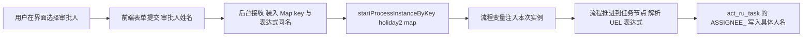

# assignee 的 UEL 实现：表达式只是 key，值在启动流程实例时给

holiday2 流程的三个任务节点，Assignee 已经全部换成了 UEL 表达式。此时打开 bpmn 文件看，`${assignee0}`、`${assignee1}`、`${assignee2}` 都还只是占位的 key，类似 Java 方法里的形参，真正的实参还没给。课程这一段要做的就是补上另一半：在 Java 代码里、在启动流程实例的那一刻，把每个 key 对应的值装进去。

## 先给结论

- 赋值时机是启动流程实例那一刻：`runtimeService.startProcessInstanceByKey(key, map)`，第二参数是一个 Map，一次可以给多个表达式 key 供值。
- Map 的 key 必须与 bpmn 中 UEL 表达式的变量名完全一致，图里写 abc 代码就放 abc，一字不差。
- 值的真实来源是用户在界面上选择或填写，前端传给后台，后台装进 Map；测试代码里写死 zhangsan 只是模拟这一步。
- `startProcessInstanceByKey` 是一组重载，Map 参数与 businessKey 参数是两个不同的重载，别混淆。
- 启动之前要先部署 holiday2 的流程定义，表达式在任务节点产生时才解析，变量是流程级的，部署不消费它。

## 一、表达式此刻只是形参

把 bpmn 里的三个表达式摊开看：填写请假申请单节点用 `${assignee0}`，部门经理审批节点用 `${assignee1}`，总经理审批节点用 `${assignee2}`。三个表达式在流程定义里只承担 key 的角色，key 与 value 的配对关系要在运行期才能成立。这个设计与 Java 的形参完全同构：方法定义时写 `void approve(String manager)`，manager 是什么值方法定义说了不算，调用时传什么就是什么。

形参没有实参就不能调用，表达式没有变量值流程就推进不动。引擎推进到任务节点时按表达式取值，取不到会抛 `Unknown property used in expression` 一类异常。所以「图里写了表达式」与「代码里传了值」是一套机制的两半，两边 key 对齐是这套机制的唯一契约。

## 二、代码实现：五步把值装进去

课程在 day04 流程包里新建了一个专门给 assignee 赋值的类，完整代码如下（包名已改为 `com.example`）：

```java
package com.example.day04;

import org.activiti.engine.ProcessEngine;
import org.activiti.engine.ProcessEngines;
import org.activiti.engine.RuntimeService;
import org.activiti.engine.runtime.ProcessInstance;

import java.util.HashMap;
import java.util.Map;

/**
 * 启动流程实例，动态设置 assignee
 */
public class AssigneeUEL {

    public static void main(String[] args) {
        //1. 得到 ProcessEngine 对象
        ProcessEngine processEngine = ProcessEngines.getDefaultProcessEngine();

        //2. 得到 RuntimeService 对象
        RuntimeService runtimeService = processEngine.getRuntimeService();

        //3. 设置 assignee 的取值，用户可以在界面上设置流程的执行人
        Map<String, Object> map = new HashMap<>();
        map.put("assignee0", "zhangsan");
        map.put("assignee1", "lishi");
        map.put("assignee2", "wangwu");

        //4. 启动流程实例，同时还要设置流程定义的 assignee 的值
        ProcessInstance processInstance = runtimeService.startProcessInstanceByKey("holiday2", map);

        //5. 输出
        System.out.println(processEngine.getName());
    }
}
```

前两步是常规动作：拿引擎、拿 RuntimeService。流程变量的设置与查询归 RuntimeService 管，启动实例也归它管，所以赋值与启动天然在同一个服务里完成。

第三步建 Map 并放入三对值。key 是 `assignee0`、`assignee1`、`assignee2`，与三个节点上的表达式一一对应；value 先用写死的 zhangsan、lishi、wangwu 占位，真实场景里这三个值来自前端表单。Map 用泛型 `Map<String, Object>` 而不是 `Map<String, String>`，因为流程变量不只能装字符串，还能装对象（配合 `${user.assignee}` 这类对象点写法）与序列化实体。

第四步是核心：`startProcessInstanceByKey("holiday2", map)`。第一个参数是流程定义的 key，第二个参数把整个 Map 作为流程变量注入这次实例。等价逻辑在课件注意事项里还有一个单变量版本：

```java
// 定义流程变量
Map<String, Object> variables = new HashMap<String, Object>();
// 设置流程变量 assignee
variables.put("assignee", "张三");
ProcessInstance processInstance = runtimeService
        .startProcessInstanceByKey(processDefinitionKey, variables);
```

单个表达式就 put 一对，三个表达式就 put 三对，机制完全一样。

## 三、key 对齐：这套机制的唯一契约

Map 的 key 与图中表达式的对应关系值得单独强调，课程里点名的关键点就是这个：

| bpmn 表达式 | Map 的 key | 本次实例解析出的 value |
|---|---|---|
| `${assignee0}`（填写请假申请单） | `assignee0` | zhangsan |
| `${assignee1}`（部门经理审批） | `assignee1` | lishi |
| `${assignee2}`（总经理审批） | `assignee2` | wangwu |

改名的规则同样成立：流程图里的表达式将来如果改成 `abc`，代码里的 `map.put("abc", ...)` 也要跟着改。key 对不上，表达式解析时找不到同名变量，流程启动或推进直接失败。

另一个容易踩的点是重载混淆。`startProcessInstanceByKey` 有多个重载：单参数只传 key；第二参数是 String 时是 businessKey（关联业务单）；第二参数是 `Map<String, Object>` 时是流程变量。传 Map 走的是变量重载，引擎会把每个 entry 存为流程变量，供表达式解析与后续查询使用，这与 businessKey 那个重载是两回事。

## 四、值从哪里来：界面选人是终点形态

测试代码把 zhangsan 写死，是为了先把机制跑通。真实的来源链路是用户在界面上操作：请假页面除了填请假信息，往往还要选择审批人。比如部门这一级有部门经理，经理底下配了两名助理，申请人可以指定「经理批」还是「某位助理批」；再比如公司有五个部门，系统按发起人所在部门自动带出对应的经理。无论哪种交互，用户选定的值最终通过表单提交到后台，后台把前端传来的值装进 Map，再启动流程：

```java
// 值来自前端表单，这里用变量示意（示例）
String manager = request.getParameter("manager");
map.put("assignee1", manager);
```

这一段是机制的终点形态：流程定义不变，值随实例变。三个表达式变量在启动时一起注入，流程每推进到一个节点，引擎就用当次实例的变量解析该节点的表达式，把负责人写进任务的 `ASSIGNEE_` 字段。整条数据链路如下：



图里最后一环是验证锚点：启动完成后到 `act_ru_task` 查 `ASSIGNEE_`，看到的是 zhangsan 这类具体人名而不是表达式原文，说明解析已经发生。完整的三步实测（部署、带变量启动、办任务看表）在下一篇展开。

## 常见误区

- **key 拼写不一致**：图里写 `${assignee0}`，代码里 put 成 `assigneeO`（字母 O 结尾）或大小写不同，解析即报 Unknown property 异常。表达式与 key 是精确字符串匹配，建议图与代码用同一份命名清单核对。
- **以为赋值发生在部署时**：部署只是把含表达式的模板存进引擎，不消费任何变量；变量随实例启动注入，表达式在任务节点产生时解析。把传值提前到部署阶段做是无效的。
- **把 Map 参数当成 businessKey**：`startProcessInstanceByKey` 的 String 第二参数是业务标识，Map 第二参数才是流程变量，两者是不同重载。想同时带业务单 id 与变量，用三参数重载 `(key, businessKey, variables)`。
- **值只能是字符串**：Map 的 value 类型是 Object，可以放 bean 对象，配合 `${user.assignee}` 的对象点写法一次带出一组相关数据，不必拆成一堆散变量。

## 面试可能被问到的问题

1. 面试官追问：「bpmn 里 `${assignee1}` 的值是什么时候、由谁赋的？」
   答：启动流程实例时由程序赋值。`startProcessInstanceByKey(key, map)` 的 Map 参数作为流程变量注入实例，引擎推进到该任务节点时解析表达式，从变量中取出同名 key 的值写入任务的 `ASSIGNEE_` 字段。

2. 面试官追问：「Map 里的 key 和图里的表达式对不上会怎样？」
   答：表达式解析时找不到同名流程变量，引擎抛出 Unknown property used in expression 一类异常，流程启动或推进失败。两边是精确字符串匹配，改名必须图与代码同步。

3. 面试官追问：「`startProcessInstanceByKey` 的多个重载有什么区别？」
   答：单参数只按定义 key 启动；第二参数 String 是 businessKey，用于关联业务单；第二参数 Map 是流程变量；三参数版本同时带 businessKey 与变量。选错重载要么业务关联丢失，要么变量没传进去。

4. 面试官追问：「流程变量的值只能来自硬编码吗？实际项目里从哪来？」
   答：硬编码只是测试手段。真实来源是用户在界面上的选择或输入，前端提交到后台后由后台装进 Map 再启动实例；也可以来自组织架构的自动计算，比如按发起人部门查出审批经理。

5. 面试官追问：「一个 Map 里同时供三个表达式的值，引擎怎么知道哪个 key 对应哪个节点？」
   答：所有 entry 都存为流程变量，成为本次实例的全局上下文；每个任务节点的表达式各自按自己的变量名去上下文里取值。变量是实例级的，不是绑定某个节点的，所以一个 Map 可以同时服务多个节点。

## 配套资料

- 赋值主线类：`materials/code/02/Activiti7-day04-进阶2/Activiti7-day04-进阶2/源码/更新后的代码/代码/src/main/java/` 下 day04 流程包中的 `AssigneeUEL.java`（第二节完整代码即出自该类，文中包名已改为 `com.example`）
- 引擎与数据源配置：同工程 `src/main/resources/activiti.cfg.xml`
- holiday2 流程的 bpmn 文件未随资料包提供，图中三个节点表达式为按课程操作描述还原；界面取值一行为按主流写法补全的示意
