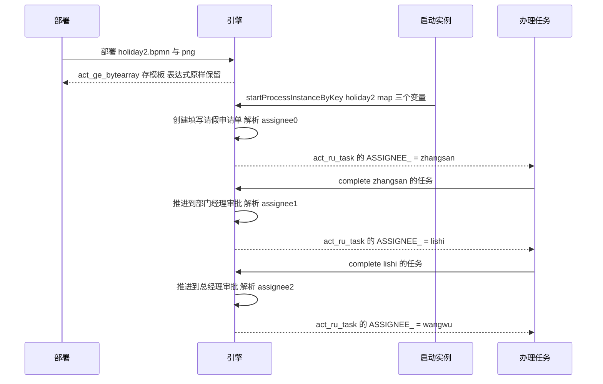

# UEL 动态分配实测：部署、带变量启动、办任务，用表验证每一步

代码写完了，机制是否真的成立，要用数据库说话。这一篇按课程实测的顺序走完整链路：先部署 holiday2 流程定义，确认资源进了引擎；再带 Map 启动实例；然后盯着 `act_ru_task` 与 `act_ru_identitylink` 两张表，看负责人如何从表达式变成 zhangsan，再随任务办结依次流转到 lishi、wangwu。

## 先给结论

- 实测顺序固定：部署 holiday2、带变量启动实例、按 `taskAssignee` 查任务并办结，三步各自对应一批表变化。
- 部署成功后 `act_ge_bytearray` 里能看到 holiday2 的 bpmn 与 png 两条资源记录，`act_re_deployment`、`act_re_procdef` 同步生成。
- 启动后 `act_ru_task` 的 `ASSIGNEE_` 字段是 zhangsan 这类具体人名，而不是 `${assignee0}` 原文，证明引擎在任务产生时完成了表达式解析。
- bpmn 里的表达式不会出现在任何表里，表里永远只有解析结果；表达式本身随流程定义存在 `act_ge_bytearray` 中。
- zhangsan 办结后任务流转到 lishi，再办结流转到 wangwu，三个表达式变量按流程推进顺序依次生效。

## 一、第一步：部署与资源确认

流程定义是启动实例的前提，holiday2 必须先部署进 Activiti 的表。为了观察干净，课程先把库清空重建：

```sql
drop database if exists activiti;
create database activiti;
```

部署代码沿用之前的套路，把 bpmn 与 png 一起加进来：

```java
//1. 引擎定义
ProcessEngine processEngine = ProcessEngines.getDefaultProcessEngine();
//2. 获取 RepositoryService 实例
RepositoryService repositoryService = processEngine.getRepositoryService();
//3. 部署流程
Deployment deployment = repositoryService.createDeployment()
        .addClasspathResource("diagram/holiday2.bpmn") //bpmn 文件
        .addClasspathResource("diagram/holiday2.png")
        .name("请假申请流程")
        .deploy();
//4. 打印部署信息
System.out.println(deployment.getName());
System.out.println(deployment.getId());
```

执行后在数据库里查字节数组表确认资源落库：

```sql
SELECT * FROM act_ge_bytearray;
-- 应看到 diagram/holiday2.bpmn 与 diagram/holiday2.png 两条资源记录
```

两条记录说明 bpmn 模板（含 `${assignee0}` 等表达式原文）与流程图图片都已进入引擎。png 是给人看的图，引擎执行读的是 bpmn，两者一起部署是课程一贯的做法，脱离 IDE 插件环境后 png 是唯一能直接看图的方式。

## 二、第二步：带变量启动实例

部署完成，启动实例时跟上 Map 参数，三个 key 与图中表达式同名（包名已改为 `com.example`）：

```java
//1. 得到 ProcessEngine 对象
ProcessEngine processEngine = ProcessEngines.getDefaultProcessEngine();
//2. 得到 RuntimeService 对象
RuntimeService runtimeService = processEngine.getRuntimeService();
//3. 定义 assignee 的值，用户可以在界面上设置当前的执行人
Map<String, Object> map = new HashMap<>();
map.put("assignee0", "zhangsan");
map.put("assignee1", "lishi");
map.put("assignee2", "wangwu");
//4. 启动流程实例，同时设置流程定义的 assignee 的值
ProcessInstance processInstance = runtimeService.startProcessInstanceByKey("holiday2", map);
//5. 输出
System.out.println(processEngine.getName());
```

Map 里的三个 value 不必是 zhangsan、lishi、wangwu，实际业务里它们来自前端表单或组织架构查询。启动完成后，第一站验证 `act_ru_task`：

```sql
SELECT ID_, NAME_, ASSIGNEE_ FROM act_ru_task;
-- NAME_ 为填写请假申请单，ASSIGNEE_ 为 zhangsan
```

`ASSIGNEE_` 列是关键证据：bpmn 里这个节点写的是 `${assignee0}`，表里落的是 zhangsan。表达式没有进表，进表的是解析结果，解析用的变量正是第二参数 Map 里那个 key 为 `assignee0` 的值。同时查参与者表 `act_ru_identitylink`，能看到当前任务参与人 zhangsan 的记录。

## 三、第三步：办任务，看负责人依次接管

流程停在 zhangsan 的「填写请假申请单」上，让他把自己的任务办结，看下一个执行人是否如预期接管：

```java
//1. 得到 ProcessEngine 对象
ProcessEngine processEngine = ProcessEngines.getDefaultProcessEngine();
//2. 得到 TaskService 对象
TaskService taskService = processEngine.getTaskService();
//3. 查询当前用户的任务
Task task = taskService.createTaskQuery()
        .processDefinitionKey("holiday2")
        .taskAssignee("zhangsan")
        .singleResult();
//4. 处理任务，结合当前用户任务列表的查询操作，任务 id 用 task.getId()
taskService.complete(task.getId());
//5. 输出任务的 id
System.out.println(task.getId());
```

查询条件是流程定义 key 加 `taskAssignee("zhangsan")`，这就是「谁的任务谁来查、谁来办」的运行时表现，背后按 `act_ru_task` 的 `ASSIGNEE_` 字段过滤。complete 执行后，任务从 zhangsan 名下消失，流程推进到「部门经理审批」节点，引擎再次解析该节点的 `${assignee1}`，从流程变量取出 lishi 写入新任务的 `ASSIGNEE_`。刷新 `act_ru_task` 看到负责人变成 lishi，参与者表同步新增一条记录；再办结一步，wangwu 接管「总经理审批」。三个节点、三次解析、三个不同的人，动态分配的闭环至此走完：



顺着图读：引擎做了三次独立的解析动作，每次都发生在任务节点被创建的时刻，变量是实例启动时注入的那一份。这也意味着如果三个节点的表达式用了同一个变量名，三次解析会取到同一个值；想分给不同人，就得像课程这样用 `assignee0`、`assignee1`、`assignee2` 三个不同的 key。

## 四、对象点写法同样成立

课程在实测收尾时补了一句：值不仅可以是散装的字符串变量，也可以是对象。把启动时的 Map 换成一个 user 对象，节点表达式写成对象点属性的形式（示例，按本课写法补全）：

```java
// user 为流程变量，携带审批人相关属性（示例）
map.put("user", user);
// 节点表达式写 ${user.assignee}，引擎自动调用 getAssignee() 取值
```

引擎对 `${user.assignee}` 的处理是按 JavaBean 规范调用 user 的 `getAssignee()`，前提是这个对象确实有对应 getter。这种写法适合一次带出一组相关数据的场景，比如审批人姓名与部门一起传，表达式各取所需。

## 常见误区

- **以为表里会存表达式**：`act_ru_task` 的 `ASSIGNEE_` 永远是解析后的值，表达式原文只存在于 `act_ge_bytearray` 的 bpmn 模板里。排查「负责人为什么是这个人」时，看表没用，要看节点表达式与 Map 的 key。
- **启动前忘了部署**：`startProcessInstanceByKey("holiday2", map)` 按定义 key 找不到已部署的流程定义时直接抛异常。清库重建后必须先跑一遍部署代码，再启动实例。
- **办结任务不分人**：直接用写死的任务 id 办结能跑通，但失去验证意义。规范做法是按 `taskAssignee` 查出自己的任务再 complete，业务上也只有这个查询能上线。
- **三个节点共用一个变量名**：表达式全写 `${assignee}`，启动时只传一个值，三个节点解析出同一个负责人。要让不同节点分给不同人，每个节点需要自己的变量名。

## 面试可能被问到的问题

1. 面试官追问：「怎么证明 UEL 表达式真的被解析了，而不是负责人恰好叫 zhangsan？」
   答：对照两处即可。bpmn 模板（`act_ge_bytearray`）里存的是 `${assignee0}` 原文，而 `act_ru_task` 的 `ASSIGNEE_` 落的是 zhangsan；换一组合适的值再启动一次，`ASSIGNEE_` 跟着变，说明值来自 Map 的解析，不是写死的。

2. 面试官追问：「`taskAssignee("zhangsan")` 查询的底层条件是什么？」
   答：在 `act_ru_task` 表上按 `ASSIGNEE_` 字段等于 zhangsan 过滤，再叠加流程定义 key 条件。个人任务与执行人的对应关系就落在这个字段上，任务办结后相关数据转入历史表。

3. 面试官追问：「任务办结后，下一个任务的负责人从哪来？」
   答：流程推进到下一个任务节点时，引擎读取该节点的 assignee 表达式，从当前实例的流程变量中按变量名解析出值，写入新任务的 `ASSIGNEE_`。每个节点独立解析一次，变量在实例启动时已随 Map 注入。

4. 面试官追问：「部署的 png 文件引擎会用吗？」
   答：不会。引擎执行读的是 bpmn 描述，png 是给人看的流程图，用于脱离设计器环境后回看流程。部署时一并上传只是课程与工程惯例，删除 png 不影响流程运行。

5. 面试官追问：「启动实例时传的变量在后续节点还能用吗？」
   答：能。启动时注入的是流程实例级的变量，整个实例生命周期内所有节点都可读取，任务表达式、网关条件表达式都能消费它。实例办结后运行时变量清除，需要留档的走历史表或业务库。

## 配套资料

- 部署代码：`materials/code/02/Activiti7-day04-进阶2/Activiti7-day04-进阶2/源码/更新后的代码/代码/src/main/java/` 下 activiti 流程包中的 `ActivitiDeployment.java`
- 带变量启动代码：同目录 day04 流程包中的 `AssigneeUEL.java`
- 办任务代码：同目录 activiti 流程包中的 `ActivitiCompleteTask.java`（含按 zhangsan 查询并办结的完整实现，文中包名已改为 `com.example`）
- 引擎与数据源配置：同工程 `src/main/resources/activiti.cfg.xml`
- holiday2 流程的 bpmn 与 png 未随资料包提供，实测表中数据以课程运行结果描述为准；对象点写法一节为按本课写法补全的示例
