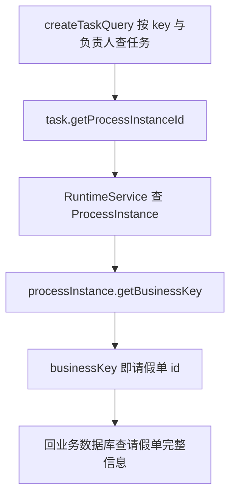

# 个人任务收口：查询、顺着 businessKey 找业务单、带权限校验地办结

个人任务的分配方式已经写完三种，这条线可以收口了。收口要回答的是三个动作怎么串起来：负责人怎么查到名下的任务；查到任务后，怎么顺着它拿到请假单这类业务数据；办结时为什么必须先校验权限。查询与办理的 API 前面章节都单独用过，这里把它们按真实使用顺序串成一条链。

## 先给结论

- 查个人任务用 TaskService 的 `createTaskQuery()`，核心条件是 `processDefinitionKey` 加 `taskAssignee`。
- 拿业务数据的链路固定：task 取 `processInstanceId` → RuntimeService 查出 ProcessInstance → `getBusinessKey()` → 拿业务主键回业务数据库查详情。
- 办理任务就是 `taskService.complete(taskId)`，complete 只认任务 id，不认人。
- 所以办结前要先校验：查询条件同时给 taskId 和 taskAssignee，查得到才办，相当于提前做了一次权限判断。
- 三种分配方式（固定值、UEL 表达式、监听器）只影响负责人怎么落库，查询与办理的代码对三者完全一致。

## 一、从任务对象追到业务单据

查任务和关联业务单的代码在课件里是连在一起给的，组合成完整链路如下：

```java
//2.创建RuntimeService对象
RuntimeService runtimeService = processEngine.getRuntimeService();
TaskService taskService = processEngine.getTaskService();

//3.通过TaskService查询到个人任务
Task task = taskService.createTaskQuery().processDefinitionKey("holiday")
        .taskAssignee("zhangsan").singleResult();

//4.通过task对象，得到任务所属流程实例的id
String processInstanceId = task.getProcessInstanceId();

//5.通过流程实例id，得到流程实例对象
ProcessInstance processInstance = runtimeService.createProcessInstanceQuery()
        .processInstanceId(processInstanceId)
        .singleResult();

//6.通过processInstance对象，得到businessKey
String businessKey = processInstance.getBusinessKey();

//7.根据businessKey就可以得到请假单的信息
System.out.println("businessKey:"+businessKey);
```

businessKey 是启动实例时传进去的业务主键，课程源码里是 `startProcessInstanceByKey("holiday", "1001")` 这种形式，本质落在运行时执行表 `act_ru_execution` 的 businessKey 字段上。查出来的值就是请假单这条记录的 id，拿着它再查一次业务数据库，就能得到请假单的详细信息：请假人是谁、从哪天到哪天、请几天、请的是事假还是病假、事由是什么。

整条链路可以这样看：



图里最关键的一环是 businessKey 起到的桥梁作用：工作流引擎不存业务表单详情，它只保存一个业务主键，业务数据始终在业务库里，两边靠这个键互相找到对方。

## 二、办理任务：complete 之前先校验权限

把任务办结的代码本身非常短：

```java
String taskId = "18035";
// 创建TaskService
TaskService taskService = processEngine.getTaskService();
taskService.complete(taskId);
System.out.println("完成任务");
```

问题出在这段代码的语义上：complete 只认任务 id，不认调用者是谁。课件对这一点有专门提醒：在实际应用中，完成任务前需要校验任务的负责人是否具有该任务的办理权限。校验的做法是把负责人也加进查询条件：

```java
// 指定要办理任务id
String taskId = "2802";
// 任务负责人
String assignee = "zhaoliu";

TaskService takService = processEngine.getTaskService();

// 这里只指定任务id并没有指定任务负责人，只要调用complete，该任务就完成
// 所以说必须校验任务权限
// 校验方法：
Task task = takService.createTaskQuery().taskId(taskId)
        .taskAssignee(assignee).singleResult();

if (task != null) {
    takService.complete(taskId);
    System.out.println("完成任务！！！");
}
```

查询条件同时给了 taskId 和 taskAssignee，等于在问引擎「这个任务确实在这个人名下吗」。task 不为 null 才执行 complete，这就把「先查一查你有没有任务，有才让你执行」变成了系统行为，而不是一上来就直接办结。这个动作相当于提前做了一次权限判断，线上代码里不能省。

## 三、三种分配方式一张表

个人任务部分到此覆盖了分配、查询、办理三个环节，把三种分配方式放在一起对比：

| 分配方式 | assignee 的值从哪来 | 分配生效时机 | 适用场景 |
|---|---|---|---|
| 固定方式 | bpmn 节点属性里写死，如 `activiti:assignee="zhangsan"` | 流程定义时 | 测试验证、负责人恒定不变的节点 |
| UEL 表达式 | 节点写 `${assignee0}`，值在启动实例的 Map 里 | 启动流程实例时 | 主力方式，负责人由业务侧在启动时决定 |
| 监听器 | 节点挂 taskListener，`notify` 方法里 `setAssignee` | 监听事件（通常 create）发生时 | 分配规则需要执行一段查询或计算逻辑 |

无论哪种方式分配，最终都落在 `act_ru_task` 的 ASSIGNEE_ 字段上，查询用 `taskAssignee` 过滤、办理用 `complete` 推进，这三段 API 对三种方式通用。分配方式的选择只影响「负责人怎么来」，不影响「任务怎么查、怎么办」。

## 常见误区

- **拿写死的任务 id 直接 complete**：演示环境能跑通，但它绕过了负责人校验，任何人拿到 id 都能办掉别人的任务。规范做法是先按 taskId 加 assignee 查询，查到再办。
- **把 businessKey 当成业务数据本身**：它只是一个业务主键，请假单详情存在业务库里。引擎表里翻不出请假天数和事由，要回业务数据库按这个键再查一次。
- **查询结果不确定还用 singleResult**：同一个负责人在同一定义下有多个任务时，`singleResult()` 期望的 0 或 1 条结果被打破会直接抛异常，这类场景应改用 `list()`。
- **task 为 null 还继续取属性**：查询前先判断 `task != null`，查无任务时直接调 `task.getProcessInstanceId()` 是这类脚本最常见的空指针来源。

## 面试可能被问到的问题

1. 面试官追问：「工作流引擎怎么和业务表单关联起来？」
   答：靠 businessKey。启动流程实例时把业务主键传进去，引擎存在执行表里；运行期从任务对象拿到流程实例 id，查流程实例再取 businessKey，就回到业务主键，按它查业务库即可获得表单详情。引擎只存键不存详情，两边互不侵入。

2. 面试官追问：「为什么 complete 之前一定要校验 assignee？」
   答：`complete(taskId)` 只认任务 id，不校验调用者身份，谁拿到 id 都能办掉任务。把 taskId 和 taskAssignee 同时放进查询条件，task 非空说明任务确在该负责人名下，这一步等价于权限校验，生产代码必须保留。

3. 面试官追问：「查个人任务的核心条件有哪些？」
   答：`processDefinitionKey` 限定哪套流程定义，`taskAssignee` 限定负责人，两者组合后用 `singleResult()` 取唯一任务；需要办理指定任务时再叠加 `taskId()`。底层是对运行时任务表的 ASSIGNEE_ 字段过滤。

4. 面试官追问：「三种分配方式怎么选？」
   答：负责人固定不变用固定方式；负责人在启动时由业务侧确定用 UEL 表达式，这是主力；分配需要执行查询或计算逻辑用监听器。三者最终落库结果一致，查询与办理代码完全通用。

5. 面试官追问：「任务办结后引擎里发生了什么？」
   答：当前任务在运行时任务表结束，相关数据转入历史表，流程推进到下一个节点生成新任务。如果节点表达式引用了流程变量，引擎会在创建新任务时解析并落新的负责人。

## 配套资料

- businessKey 启动实例源码：`materials/code/02/Activiti7-day04-进阶2/Activiti7-day04-进阶2/源码/更新后的代码/代码/src/main/java/` 下 day03 流程包中的 `BusinessKeyAdd.java`
- 个人任务查询源码：同工程 activiti 流程包中的 `ActivitiTaskQuery.java`
- 任务办理源码：同工程 activiti 流程包中的 `ActivitiCompleteTask.java`（类注释列出了 complete 背后操作的 5 张表）
- 第二节「任务到 businessKey」的组合链路代码以课件片段为准，工程中对应逻辑分散在上述类中
