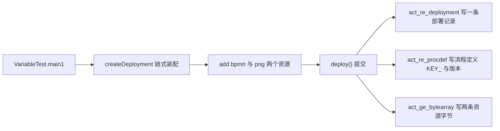
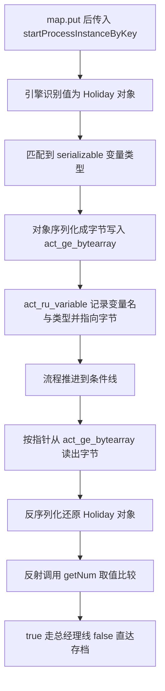
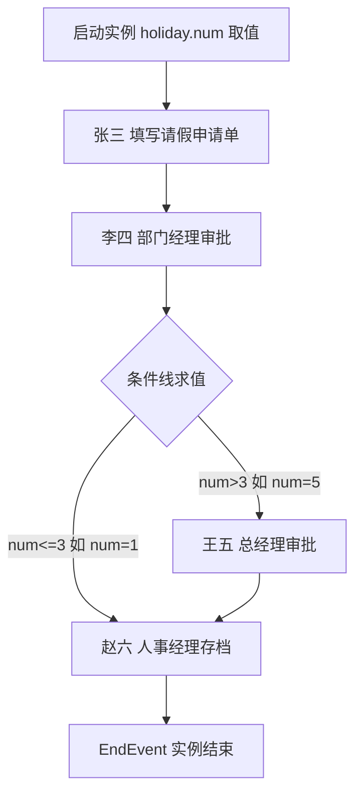
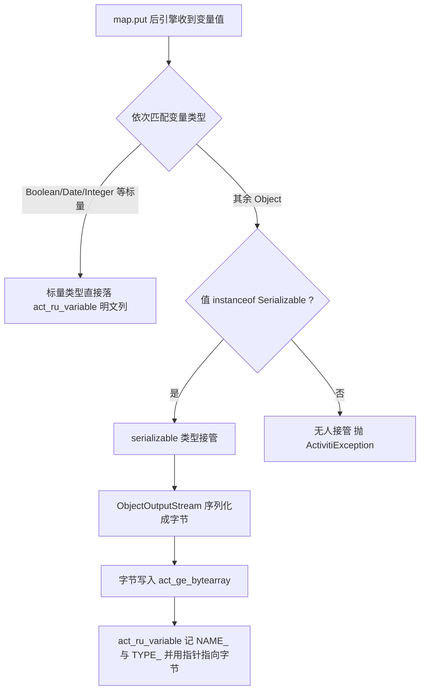
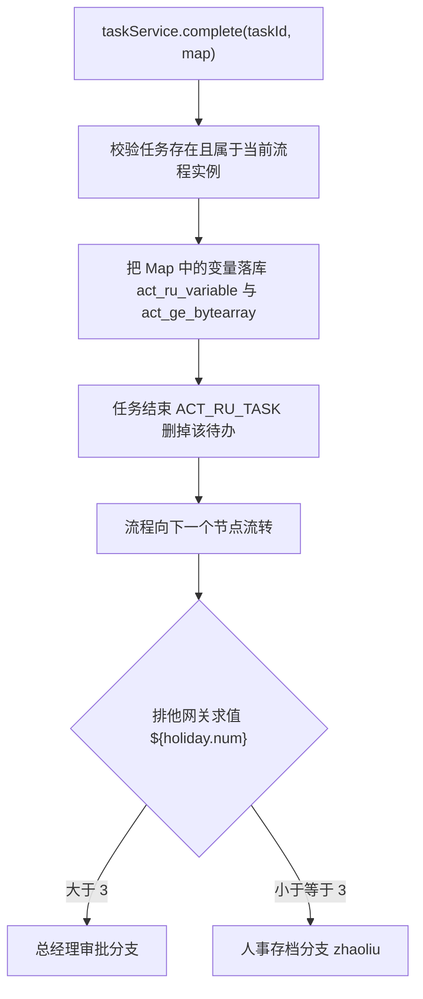
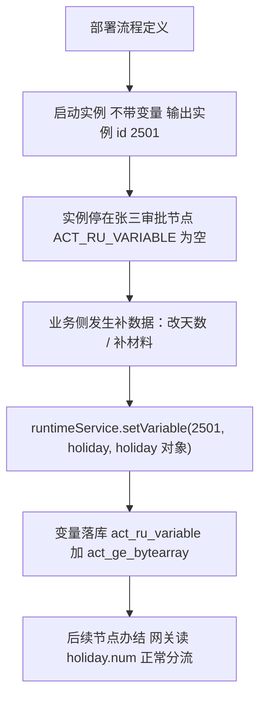
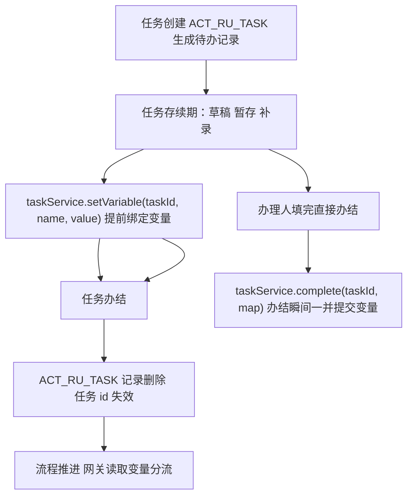
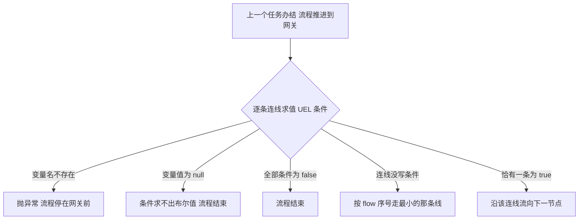
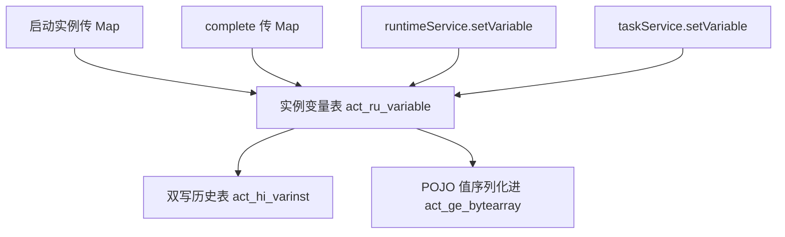

# Activiti 流程变量从部署到网关：一个请假案例吃透全部设置方式

## 先给结论

- 整个系列围绕一条带条件分支的请假流程展开：holiday4 的两条连线挂着 `${holiday.num<=3}` 与 `${holiday.num>3}`，num 是 Holiday 对象的字段，全部演示都靠它驱动。
- 对象进流程变量必须实现 `Serializable`：引擎按变量类型依次匹配，serializable 类型把对象 Java 原生序列化成字节压进 `act_ge_bytearray`，`act_ru_variable` 里只留变量名、类型与字节指针。
- 设置变量的时机有四种，归成两类：实例相关的启动实例时传 Map、按实例 ID 调 `runtimeService.setVariable`；任务相关的办结时传 Map、按任务 ID 调 `taskService.setVariable`。
- 时机有硬约束：变量必须在网关求值之前就位，办结事务里设置的变量天然赶得上同一次流转；按任务 ID 设置的前提是任务还在 `ACT_RU_TASK` 里，办结即失效。
- 落库动作统一是「双写加一字节」：`act_ru_variable` 一条记录、`act_hi_varinst` 一条历史留痕，POJO 值再压一份字节进 `act_ge_bytearray`。
- 分支裁决只认实例变量里的值：流程推进到条件线时反序列化出对象、反射取值求 UEL 表达式；没设变量报错卡在网关前，设了 null 流程直接结束，条件全不满足时流程走到头。
- global 变量挂在实例上全流程可见，local 变量绑定任务只在任务内可见，落库看 `TASK_ID_` 列区分。
- 连线不设条件时网关默认走 flow 序号小的那条，这是引擎的排序兜底，明确的默认分支应该用网关的 default 属性声明。

## 第1部分：Activiti流程变量案例-部署流程定义

holiday4 流程图已经画完，两条条件线写着 `${holiday.num<=3}` 与 `${holiday.num>3}`，png 也导出了。但此刻它只是 classpath 下的一个文件，引擎不认识它；不部署，后面的启动实例、设置变量、测试分支全是空谈。写法上这一步与此前任何一次部署没有区别，真正的看点在部署之后：数据库里新建了哪些表、三张 act_ 表各自进了什么内容、到哪里验证这次部署真的成功了。

### 一、测试类与部署代码
新建一个测试类 `VariableTest`，它的任务是把整个案例串下来：这一步先用它的部署方法，后面启动实例、设置变量、办任务还会继续往里加方法。课程源码里的部署方法长这样（包名已改为 `com.example`）：

```java
package com.example.day04;

import org.activiti.engine.*;
import org.activiti.engine.repository.Deployment;

/**
 * 流程变量的测试
 */
public class VariableTest {

    //新的请假流程定义的部署
    public static void main1(String[] args) {
        //1.得到ProcessEngine
        ProcessEngine processEngine = ProcessEngines.getDefaultProcessEngine();

        //2.得到RepositoryService对象
        RepositoryService repositoryService = processEngine.getRepositoryService();

        //3.部署
        Deployment deploy = repositoryService.createDeployment()
                .addClasspathResource("diagram/holiday4.bpmn")
                .addClasspathResource("diagram/holiday4.png")
                .name("请假流程-流程变量")
                .deploy();

        System.out.println(deploy.getId());
        System.out.println(deploy.getName());
    }
}
```

三个注释对应三步：引擎、仓库服务、部署。`RepositoryService` 主管流程定义的仓储类操作，`createDeployment()` 返回一个 `DeploymentBuilder`，资源可以链式地一直往上加，最后 `deploy()` 才真正提交。`deploy()` 的返回值 `Deployment` 带着本次部署的 id 与名字，打印出来就是为了和数据库核对。

**资源一次加两个。** bpmn 是给引擎执行的流程定义，png 是给人看的流程图图片，两张一起 `addClasspathResource`。部署名的「流程变量」三个字不是装饰，这版流程的连线上带着 `${holiday.num...}` 表达式，名字里点明它的身份，之后在 `act_re_deployment` 里一眼能认出是哪一版。

### 二、先清库，再看表是怎么长出来的
为了让部署效果从零开始看，录课时先把库推平了重来：

```sql
drop database activiti;
create database activiti;
```

此刻库里一张表都没有。跑 `main1`，控制台打出部署 id 和「请假流程-流程变量」，回头刷新数据库，整套以 act_ 开头的表自动建了出来，课时实测是 23 张。建表动作不是部署代码干的，是引擎初始化时干的，开关在 `activiti.cfg.xml` 里（真实配置节选，数据源部分从略）：

```xml
<bean id="processEngineConfiguration"
      class="org.activiti.engine.impl.cfg.StandaloneProcessEngineConfiguration">
    <property name="dataSource" ref="dataSource"/>
    <!--代表是否生成表结构-->
    <property name="databaseSchemaUpdate" value="true"/>
</bean>
```

`databaseSchemaUpdate` 设为 `true` 时，引擎启动发现缺哪张表就补建哪张。`getDefaultProcessEngine()` 第一次被调用时按配置读 `activiti.cfg.xml`、建数据源、检查并补齐表结构，这一连串动作都发生在跑部署代码之前，所以「部署一次冒出 23 张表」的实际顺序是：引擎初始化建表，部署动作往表里写数据。

### 三、部署结果落在哪几张表
一次部署牵动三张表，各管一段：

| 表 | 存什么 | 部署后能看到的 |
|---|---|---|
| `act_re_deployment` | 部署记录本身 | NAME_ 为「请假流程-流程变量」的一条记录 |
| `act_re_procdef` | 流程定义 | KEY_ 为 `myProcess_1`，VERSION_ 为 1，DEPLOYMENT_ID_ 指回部署 |
| `act_ge_bytearray` | 通用字节仓库 | bpmn 与 png 两条资源字节，按部署 id 关联 |

验证 SQL：

```sql
SELECT * FROM act_re_deployment;   -- 部署记录与名字
SELECT * FROM act_re_procdef;      -- KEY_=myProcess_1, VERSION_=1
SELECT * FROM act_ge_bytearray;    -- 两条资源字节记录
```

整条链路可以这样看：



图里三条出口是同一次 `deploy()` 提交后的三个写入动作，`act_re_procdef` 的 DEPLOYMENT_ID_ 与 `act_ge_bytearray` 的 DEPLOYMENT_ID_ 都指向 `act_re_deployment` 那条记录，三张表靠它串成一个整体。

最有说服力的验证在 `act_ge_bytearray`：点开 png 那条记录，展开的字节就是流程图本身，图上张三、李四、王五、赵六四个节点清晰可辨，部门经理审批引出的两条线上还带着条件表达式。看见这张图，就等于看见「带流程变量的流程定义」完整落了库。KEY_ 显示为 `myProcess_1` 而不是 holiday4，是建模时 process id 沿用了默认值，部署按 id 原样登记，后面启动实例时就按这个名字取。

KEY_ 相同的定义再部署一次，VERSION_ 自动加一，新旧版本并存且互不覆盖，已经跑着的实例继续用旧版本，新实例取最高版本。这套版本机制是 `act_re_procdef` 用 KEY_ 加 VERSION_ 两个字段撑起来的。
## 第2部分：Activiti流程变量案例-设置POJO类型的值

部署好的 holiday4 流程，条件线上写着 `${holiday.num<=3}` 这样的表达式。条件要比较 num，实例的变量表里就得真有一个叫 holiday 的对象。设置变量的时机有三种，案例选了最常用的第一种：启动流程实例的同时把变量带进去。这一步表面上是往 Map 里放一个对象，背后是引擎识别类型、序列化、落两张表的完整动作，链路上每一环都值得看清。

### 一、启动实例并设置变量：五步代码
把上一节部署方法注释掉，在同一个 `VariableTest` 里写启动实例的方法。课程源码如下（录制本节时天数设的是 1 天，后面测另一条分支才改成 5）：

```java
//启动流程实例，同时还要设置流程变量的值
// act_ge_bytearray
// act_ru_variable
public static void main(String[] args) {
    //1.得到ProcessEngine
    ProcessEngine processEngine = ProcessEngines.getDefaultProcessEngine();

    //2.得到RuntimeService
    RuntimeService runtimeService = processEngine.getRuntimeService();

    //3.流程定义的key问题   myProcess_1
    String key = "myProcess_1";
    Map<String, Object> map = new HashMap<>();

    Holiday holiday = new Holiday();
    holiday.setNum(1F);
    map.put("holiday", holiday);

    //4.启动流程实例，并且设置流程变量的值
    ProcessInstance processInstance = runtimeService.startProcessInstanceByKey(key, map);

    //5.输出实例信息
    System.out.println(processInstance.getName());
    System.out.println(processInstance.getProcessDefinitionId());
}
```

方法注释里直接点出了要观察的两张表：`act_ge_bytearray` 与 `act_ru_variable`，跑完就去这两张表验收。

**key 从哪来。** `startProcessInstanceByKey` 的 key 是 BPMN 里的 process id。画 holiday4 时沿用了设计器给的默认 id，流程定义的 key 就是 `myProcess_1`。两个选择：改掉 id 重新部署一次，或者将错就错，代码里按 `myProcess_1` 写。录课时选了后者，代价只是名字不好看，逻辑上完全等价，前提是代码与库里的 KEY_ 对得上。

**Map 的 key 就是变量名。** `map.put("holiday", holiday)` 的第一个参数必须与表达式 `${holiday.num}` 的前缀一致。放的是对象整体而不是只放 num 标量，因为流程定义里的表达式写的是对象点属性；如果当初表达式写的是 `${num>3}`，这里就该放 `map.put("num", holiday.getNum())`，两边必须配套。

**天数的字面量带 F。** Holiday 的 num 字段是 `Float`，`setNum(1F)` 里的 F 不能省，`setNum(1)` 传的是 int，往 Float 参数上放编译不过。录制过程中还踩过另一个编辑器层面的坑：判断条件少写一个等号，编译器报变量未初始化，跟流程变量无关，纯属手误，但也说明这段代码是一行行现场敲的。

**按 key 启动取的是最高版本。** `startProcessInstanceByKey` 拿 key 去 `act_re_procdef` 找该 KEY_ 下 VERSION_ 最大的那条定义来实例化，与 `startProcessInstanceById` 需要给完整的 `key:version:id` 串不同。方法名结尾的 ByKey 与 ById 别混用，传错参数类型查不到定义。

### 二、跑完之后，两张表里多了什么
控制台输出的第二行是 `processDefinitionId`，形如 `myProcess_1:1:4`，三段依次是 key、版本号、定义记录的 id，实例与哪个流程定义关联一眼可见。数据库这边，验证 SQL 如下（表内字段值与录制时的观察一致）：

```sql
SELECT * FROM act_ru_variable;    -- NAME_=holiday, TYPE_=serializable, 指向字节记录
SELECT * FROM act_ge_bytearray;   -- 新增的字节记录就是序列化后的 Holiday 对象
```

`act_ru_variable` 插入一条变量记录，NAME_ 是 holiday，TYPE_ 标为 serializable，值那一列看不到明文，只有一个指向 `act_ge_bytearray` 的字节数组指针。`act_ge_bytearray` 里则多出新的字节记录，点开是一串二进制，录制时观察约 287 字节，这就是 holiday 对象被序列化后的样子。变量名与变量值分开存：名字、类型、归属在 `act_ru_variable`，真正的大对象字节进通用的 `act_ge_bytearray`，之前部署时存的 bpmn 与 png 也在这一张表里。

### 三、${holiday.num} 的取值链路
从放进 Map 到条件线完成比较，完整走一遍是这样的：



图的后半段解释了上一篇留下的伏笔：变量不在启动时求值，而是流程推进到带条件的连线时才去取。取值走的是一条反向链路，从 `act_ru_variable` 找到变量，顺着字节指针在 `act_ge_bytearray` 里读出二进制，反序列化还原成对象，再按属性名 num 反射调用 `getNum`。这也解释了两条硬性要求的分工：实现 `Serializable` 管的是「存得进去」，缺了这一步启动实例当场抛异常，下一节专门实测；getter 齐全管的是「取得出来」，缺了 getNum 条件线求值直接失败。只有这条链全程通畅，请假天数才能真正指挥分支走向。
## 第3部分：Activiti流程变量案例-测试流程的第一个分支

变量能存能取了，还差最后一验：num 的值真的能决定分支吗？案例把两条线各实测了一遍。天数设 1，流程办完部门经理审批后直达人事存档，总经理整条线不出现；天数改成 5，同一份代码再跑，走向变成先总经理审批再进存档。两次走向的痕迹分别留在 `act_ru_execution` 与 `act_ru_task` 里，对着表看比对着控制台看清楚得多。

### 一、办任务的通用模板
`RuntimeService` 管启动与变量，办任务换 `TaskService` 出场。课程源码里的办任务方法：

```java
//完成任务  zhangsan  -----lishi----判断流程变量的请假天数,1天----分支：人事经理存档(zhaoliu)
public static void main3(String[] args) {
    //1.得到ProcessEngine
    ProcessEngine processEngine = ProcessEngines.getDefaultProcessEngine();

    //2.得到TaskService
    TaskService taskService = processEngine.getTaskService();

    //3.查询当前用户是否有任务
    String key = "myProcess_1";
    Task task = taskService.createTaskQuery().processDefinitionKey(key)
            .taskAssignee("zhangsan").singleResult();

    //4.判断task!=null,说明当前用户有任务
    if(task!=null){
        taskService.complete(task.getId());
        System.out.println("任务执行完毕");
    }
}
```

方法注释就是实验剧本：张三办完给李四，李四办完引擎按请假天数挑分支，1 天的结局是人事经理存档由赵六办。查询条件用了两层：`processDefinitionKey` 把范围锁到这类流程，`taskAssignee` 锁到具体人。案例里同一个时刻一个候选人只有一条任务，`singleResult()` 才敢直接用；换人办任务时只改 `taskAssignee` 的字符串，其余原样。`task` 为 null 说明这个人当前没活儿，判断后再 `complete` 是稳妥写法，`complete` 收的任务 id 取自刚查出来的 `task` 对象。

### 二、第一遍实测：num=1 走直达线
启动实例时 `setNum(1F)`（启动代码见上一篇），然后依次让张三、李四、赵六跑上面这个方法，每跑一次只改一次 `taskAssignee`。

**张三办完。** 控制台打出「任务执行完毕」。到 `act_ru_execution` 里看，张三所在节点有了结束时间，实例推进到李四的节点，李四的结束时间还是空。

**李四办完。** 引擎在条件线上求值 `${holiday.num<=3}`，1 小于等于 3 成立，选中直达人事存档的线。此时 `act_ru_execution` 里从 start_event 到当前节点的记录里找不到任何总经理环节，王五这条线一次都没被踩到。1 大于 3 不成立，去总经理那条线的条件为假，引擎连门都没让它进。

**赵六办完。** 存档任务办结，end event 到达，实例结束。`act_ru_task` 里按时间排序能看到完整的经手链：zhangsan、lishi、zhaoliu，没有 wangwu。

### 三、第二遍实测：num=5 走总经理线
天数改成 5，重新启动一个实例。课程源码里的启动方法：

```java
//启动流程实例，同时还要设置流程变量的值
// act_ge_bytearray
// act_ru_variable
public static void main(String[] args) {
    //1.得到ProcessEngine
    ProcessEngine processEngine = ProcessEngines.getDefaultProcessEngine();

    //2.得到RuntimeService
    RuntimeService runtimeService = processEngine.getRuntimeService();

    //3.流程定义的key问题   myProcess_1
    String key = "myProcess_1";
    Map<String, Object> map = new HashMap<>();

    Holiday holiday = new Holiday();
    holiday.setNum(5F);
    map.put("holiday", holiday);

    //4.启动流程实例，并且设置流程变量的值
    ProcessInstance processInstance = runtimeService.startProcessInstanceByKey(key, map);

    //5.输出实例信息
    System.out.println(processInstance.getName());
    System.out.println(processInstance.getProcessDefinitionId());
}
```

录制时把几个方法轮换改名让入口方法腾位置，跑一步换个 `taskAssignee` 再跑一次，一步步把实例往前推。新实例启动后，`act_ru_execution` 里 start_event 与张三都变成了两条：旧实例一条，新实例一条，新实例那条张三的结束时间还空着。张三、李四办完之后，5 大于 3 成立，这次引擎选中的是去总经理审批的线：



图上从岔路口分出的两条路就是两遍实验的结果：左路直达，右路绕行总经理。落库的验证照样有据可查：

```sql
SELECT * FROM act_ru_execution;   -- 节点走向与开始结束时间
SELECT * FROM act_ru_task;        -- assignee 顺序与任务起止时间
```

**王五的记录只出现一次。** 第一遍流程根本没经过总经理节点，第二遍 5 大于 3 才轮到他，`act_ru_task` 里 wangwu 只有一条已完成记录。**赵六出现两次、end event 也是两次。** 两条线殊途同归，都汇到人事存档。对着这两处计数，两条分支的走向就全部对上了。

整场实验的价值在对照组：两次运行除了 `setNum` 的值从 1 换成 5，部署没动、流程定义没动、办任务代码没动，走向却完全不同。审批链路是数据驱动的，这就是流程变量在分支场景下的全部意义。
## 第4部分：Activiti流程变量案例-POJO实现Serializable接口的测试

实体类上方挂着一句注释：「请实现 Serializable 接口，否则在存储这个 pojo 时就会报异常」。这句话拦的到底是什么？验证的成本极低：把 Holiday 的 `implements Serializable` 删掉，其余代码一行不动，再启动一次流程实例，引擎当场翻脸。现在把这个实验做完，顺带把对象变量为什么必须序列化、字节最终去了哪，一次讲透。

### 一、实验：只改一行的对照
资料包里的 `Holiday.java` 是正确版本，类声明带着接口。做实验时先把它摘掉（以下为复现报错的示例写法，字段与 getter/setter 与资料包一致，测完记得改回来）：

```java
// 示例：去掉 Serializable，用于复现报错
package com.example.day04;

import java.util.Date;

public class Holiday {   // 注意：没有 implements Serializable
    private Integer id;
    private String holidayName;   // 申请人的名字
    private Date beginDate;       // 开始时间
    private Date endDate;         // 结束日期
    private Float num;            // 请假天数
    private String reason;        // 事由
    private String type;          // 请假类型
    // getter/setter 省略
}
```

启动实例的代码与上一节完全相同，num 设为 5：

```java
//启动流程实例，同时还要设置流程变量的值
public static void main(String[] args) {
    //1.得到ProcessEngine
    ProcessEngine processEngine = ProcessEngines.getDefaultProcessEngine();

    //2.得到RuntimeService
    RuntimeService runtimeService = processEngine.getRuntimeService();

    //3.流程定义的key问题   myProcess_1
    String key = "myProcess_1";
    Map<String, Object> map = new HashMap<>();

    Holiday holiday = new Holiday();
    holiday.setNum(5F);
    map.put("holiday", holiday);

    //4.启动流程实例，并且设置流程变量的值
    ProcessInstance processInstance = runtimeService.startProcessInstanceByKey(key, map);
}
```

跑 `main`，控制台没有等来实例 id，取而代之的是引擎抛出的异常，核心信息按控制台实录还原如下：

```text
org.activiti.engine.ActivitiException:
    Could not find a variable type that is able to serialize com.example.day04.Holiday
```

报错的大意是「找不到能处理这个值的变量类型」，并且直接点名了 Holiday 类。JDK 序列化层面对应的就是 `NotSerializableException` 一族，两层报错说的是同一件事：这个对象存不下去。方法当场中断，实例没有创建成功，回到数据库刷新，`act_ru_variable` 与 `act_ge_bytearray` 里干干净净，没有半个变量记录，事务回滚得很彻底。

### 二、报错从哪来：变量类型的匹配机制
引擎里维护着一串变量类型处理器，boolean、date、integer、long、double、string 直到 serializable，各管一类值的存储。设置变量时引擎从前往后挨个问「这个值你能处理吗」，谁应答就按谁的方式落库，并在 `act_ru_variable` 的 TYPE_ 列记下类型名。整条链的走向如下：



图上 F 节点就是实验里撞上的那面墙：Holiday 是自定义对象，前面的标量类型都不认；serializable 类型接手前先查 `instanceof Serializable`，接口没实现，它也摆手。整串类型问完没人接活，引擎只能抛异常。反过来讲，只要接口在，serializable 类型永远愿意兜底，任何实现过序列化的对象都能进变量。

### 三、act_ge_bytearray：一张通用字节仓库
对象为什么要压成字节？看 `act_ru_variable` 的表结构就明白了：它的列是变量名、类型、归属的实例与任务，外加一个装标量明文的 TEXT_ 列，任何一张固定结构的表都装不下「任意 Java 对象」。引擎的做法是把对象类变量统一序列化成字节数组，放进通用的 `act_ge_bytearray`，部署时的 bpmn 与 png 也在这一张表里，它就是整个引擎的字节仓库，变量记录里只留一个字节数组指针。

序列化还带来一个重要语义：**快照。** 落库的是对象当时字段的副本，之后业务代码再改内存里的 holiday 对象，库里的变量不会跟着变；条件线读到的也是从字节还原出来的副本。这个特性让分支裁决有了确定性，但也提示一件事：类演进有风险，没有显式 `serialVersionUID` 时，实体类新增或删除字段，库里留存的旧字节在反序列化时可能失败，条件线读变量就会在运行期炸雷。所以生产代码要在实现接口之外，再补上版本号声明：

```java
public class Holiday implements Serializable {
    private static final long serialVersionUID = 1L;
    // 字段与 getter/setter 略
}
```

修复实验现场只做了第一步，把接口加回去，启动实例恢复正常，控制台重新打出实例信息，两张表里也重新出现变量记录与字节记录，与上一篇看到的落库结果一致。
## 第5部分：Activiti流程变量案例-完成任务时设置变量的值

holiday4 这条请假流程的岔路口上写着 `${holiday.num>3}` 和 `${holiday.num<=3}` 两个条件，实例的变量表里必须先有一个叫 holiday 的对象，网关才有东西可比。前面已经试过在启动实例的同时把变量塞进去，但真实的审批业务里，请假天数常常是审批人自己在办理节点上填的：张三提交申请时只有一个事由，部门经理批完才知道批了几天。变量能不能不跟着实例启动走，而是等到某个任务被办结的那一刻才出现？这一节就把 `taskService.complete` 的第二个参数用起来。

### 一、时机为什么重要
流程变量在引擎里就是实例身上的一个键值对，条件线在流转经过时才去取值。取值的动作发生在「上一个任务办结、流程向网关推进」的那一瞬间，所以变量只要在那之前落进 `act_ru_variable`，网关就能拿到。

类比一下：网关是路口的裁判，变量是裁判要看的成绩单。成绩单可以在考生入场前就交上去（启动实例时设置），也可以在进场那一刻由本人递上去（办结任务时设置），唯独不能等裁判已经开卷打分之后才补交。这也是本节演示的核心：先启动一个不带任何变量的实例，让它停在张三的待办任务上，再在张三办结时把 Holiday 对象递进去。

### 二、准备：部署一版干净的流程
为了排除之前测试留下的干扰，先把库清空重建，再重新部署一份流程定义。部署代码沿用 day04 的写法，放在 `VariableTest2` 的部署方法里：

```java
//新的请假流程定义的部署
public static void main1(String[] args) {
    //1.得到ProcessEngine
    ProcessEngine processEngine = ProcessEngines.getDefaultProcessEngine();

    //2.得到RepositoryService对象
    RepositoryService repositoryService = processEngine.getRepositoryService();

    //3.部署
    Deployment deploy = repositoryService.createDeployment()
            .addClasspathResource("diagram/holiday4.bpmn")
            .addClasspathResource("diagram/holiday4.png")
            .name("请假流程-流程变量")
            .deploy();

    System.out.println(deploy.getId());
    System.out.println(deploy.getName());
}
```

### 三、启动实例：这次不带变量
启动方法与之前唯一的区别，是把设置变量的那几行注释掉，只传 key 不传 Map：

```java
//启动流程实例
// act_ge_bytearray
// act_ru_variable
public static void main2(String[] args) {
    //1.得到ProcessEngine
    ProcessEngine processEngine = ProcessEngines.getDefaultProcessEngine();

    //2.得到RuntimeService
    RuntimeService runtimeService = processEngine.getRuntimeService();

    //3.流程定义的key问题   myProcess_1
    String key = "myProcess_1";

    //设置变量的代码整体注释掉，本次启动不带流程变量

    //4.启动流程实例
    ProcessInstance processInstance = runtimeService.startProcessInstanceByKey(key);

    //5.输出实例信息
    System.out.println(processInstance.getName());
    System.out.println(processInstance.getProcessDefinitionId());
}
```

跑完去 `act_ru_variable` 里刷新，变量记录一条都没有，实例安安静静停在张三的节点上。这个空窗状态正是后面要验证的前提：变量还没人设，等着办结动作来补。

### 四、办结时带上变量：complete 的第二个参数
查任务、组 Map、办结，三步走。课程源码如下（包名已改为中性的 `com.example`）：

```java
//完成任务  zhangsan -----lishi----判断流程变量的请假天数----分支：人事经理存档(zhaoliu)
public static void main(String[] args) {
    //1.得到ProcessEngine
    ProcessEngine processEngine = ProcessEngines.getDefaultProcessEngine();

    //2.得到TaskService
    TaskService taskService = processEngine.getTaskService();

    //3.查询当前用户是否有任务
    String key = "myProcess_1";
    Task task = taskService.createTaskQuery().processDefinitionKey(key)
            .taskAssignee("zhangsan").singleResult();

    //初始化一些参数
    Map<String, Object> map = new HashMap<>();

    Holiday holiday = new Holiday();
    holiday.setNum(5F);
    map.put("holiday", holiday);

    //4.判断task!=null,说明当前用户有任务
    if (task != null) {
        taskService.complete(task.getId(), map);//完成任务时，设置流程变量的值
        System.out.println("任务执行完毕");
    }
}
```

与单参数版本逐字对比，变化只有一处：`complete` 后面多了一个逗号和 Map。`holiday.setNum(5F)` 里的 `F` 不能省，`num` 字段是 `Float` 类型，传 `int` 字面量编译不过。

执行成功后立刻去两张表验收：`act_ru_variable` 多出一条 `NAME_=holiday`、`TYPE_=serializable` 的记录，`BYTEARRAY_` 列填上了指针；顺着指针去 `act_ge_bytearray`，能看到序列化后的 Holiday 字节。与启动实例时设置变量的落库结果逐字段一致，差别只剩一个：设置动作发生在办结事务里，而不是启动事务里。

### 五、这张图在讲什么


关键路径在 C 到 F 之间：变量落库与网关求值处在同一个办结事务的先后两端，所以就算实例启动时两手空空，只要办结的人把值带上来，岔路口照样能裁决。H 节点还提示了另一种合法时机：把这套带变量的办结放到李四（部门经理）节点上同样可行，因为网关在李四之后；唯独不能把设置动作安排到网关已经走过的节点上，那时候裁判早打完分了。
## 第6部分：Activiti流程变量-通过流程实例ID设置

启动实例时设变量，要求启动那一刻所有数据都齐；办结任务时设变量，要求正好轮到某个人办任务。还有一类更被动的场景：实例已经跑起来了，停在部门经理审批，这时申请人补交了材料、或者审批人把三天改成五天，变量得在不属于任何办结动作的时刻补进去。这时候能用的锚点只有实例自己的 ID，对应的 API 是 `RuntimeService` 的 `setVariable`。

### 一、方法签名：一个与一组
`RuntimeService` 为变量准备了成对的方法。`setVariable` 一次绑一个键值对；要一次设一串，用复数形式的 `setVariables`，第二个参数换成 Map 集合，Map 里放几组键值对就落几条变量记录。课程 PPT 上的写法如下：

```java
public void setGlobalVariableByExecutionId() {
    //当前流程实例执行id，通常设置为当前执行的流程实例id
    String executionId = "2601";
    RuntimeService runtimeService = processEngine.getRuntimeService();
    Holiday holiday = new Holiday();
    holiday.setNum(3);
    //通过流程实例id设置流程变量
    runtimeService.setVariable(executionId, "holiday", holiday);
    //一次设置多个值
    //runtimeService.setVariables(executionId, variables);
}
```

PPT 上紧跟着一行注意事项：executionId 必须是当前未执行完成的流程实例，通常此 id 就传流程实例的 id。这句话里藏着这个 API 最容易踩的两个坑，第三节展开。

### 二、先启动实例，把 ID 拿到手
演示前照例把库重建、重新部署 holiday4 流程。启动实例的方法与之前一样不带变量，唯一的新增是末尾多打一行 `getId()`，不然实例 ID 是多少根本没处查：

```java
//启动流程实例
public static void main2(String[] args) {
    //1.得到ProcessEngine
    ProcessEngine processEngine = ProcessEngines.getDefaultProcessEngine();

    //2.得到RuntimeService
    RuntimeService runtimeService = processEngine.getRuntimeService();

    //3.流程定义的key问题   myProcess_1
    String key = "myProcess_1";

    //4.启动流程实例
    ProcessInstance processInstance = runtimeService.startProcessInstanceByKey(key);

    //5.输出实例信息
    System.out.println(processInstance.getName());
    System.out.println(processInstance.getProcessDefinitionId());
    System.out.println(processInstance.getId());
}
```

控制台第三行输出 `2501`，这就是实例 ID。此刻 `act_ru_variable` 里没有变量记录，实例停在第一个任务上等着。

### 三、按 ID 设置变量
拿到 `2501`，新加一个方法专门做补设。课程源码如下（包名已改为中性的 `com.example`，注释按三个参数的实义整理）：

```java
//新加入的：通过流程实例id，来测试流程变量
public static void main(String[] args) {
    //1.得到ProcessEngine
    ProcessEngine processEngine = ProcessEngines.getDefaultProcessEngine();

    //2.得到RuntimeService
    RuntimeService runtimeService = processEngine.getRuntimeService();

    Holiday holiday = new Holiday();
    holiday.setNum(5F);

    //3.通过实例id来设置流程变量
    //第一个参数：流程实例的id
    //第二个参数：流程变量名
    //第三个参数：流程变量名所对应的值
    runtimeService.setVariable("2501", "holiday", holiday);
}
```

跑完刷新 `act_ru_variable`，多出一条 `NAME_=holiday`、`TYPE_=serializable` 的记录，`BYTEARRAY_` 列带着指向 `act_ge_bytearray` 的指针。与启动时、办结时设置变量相比，落库动作一模一样，入口从 `startProcessInstanceByKey` 的 Map、`complete` 的第二个参数，换成了显式的 `setVariable` 调用而已。

生产代码里 ID 不应该像示例这样硬编码，而是先按业务键查实例再设置：

```java
//按业务键找到运行中的实例，再补设变量
ProcessInstance instance = runtimeService.createProcessInstanceQuery()
        .processInstanceBusinessKey("LEAVE-2024-001").singleResult();
if (instance != null) {
    runtimeService.setVariable(instance.getId(), "holiday", holiday);
}
```

示例为按本课写法补全的常见变体，用 `businessKey` 把业务单据号和实例绑起来查，避免把 `2501` 这类自增 ID 写死在代码里。

### 四、这张图在讲什么


关键在 C 到 F 这一段：实例在生命周期内的任意静止时刻，都能凭 ID 被找到并补上变量，这正是前两种时机覆盖不到的空档。G 节点说明补设的变量与启动时设置的完全等价，网关无感。

### 五、executionId 与实例 ID 是什么关系
引擎里一次流程实例运行对应一棵执行树：主干是一条 execution，遇到并行网关会分出子 execution。`setVariable` 的第一个参数收的是 executionId，而流程实例的 ID 恰好等于主干 execution 的 ID，所以直接传实例 ID，引擎把变量挂到实例身上，全流程可见。传子 execution 的 ID 时变量挂到那个分支上，作用范围会缩小，这是局部执行流级别的用法，本课的 global 变量统一用实例 ID。
## 第7部分：Activiti流程变量-通过当前任务ID来设置流程变量

办结时传 Map 的写法有个隐含约束：变量和「通过」这个动作绑在一起，要么一起发生，要么都不发生。实际审批里存在另一种诉求：审批人还在看单子，没点通过，先把审批意见、核定天数暂存进流程；或者前端表单做草稿，保存时任务还没办完。这时锚点从「办结动作」换成「任务本身」，API 是 `TaskService` 的 `setVariable`。它和办结时设置同属任务入口，差别只在时间点。

### 一、写法：三参数与 Map 两个版本
课程 PPT 给出的写法如下：

```java
@Test
public void setGlobalVariableByTaskId() {
    //当前待办任务id
    String taskId = "1404";
    TaskService taskService = processEngine.getTaskService();
    Holiday holiday = new Holiday();
    holiday.setNum(3);
    //通过任务设置流程变量
    taskService.setVariable(taskId, "holiday", holiday);
    //一次设置多个值
    //taskService.setVariables(taskId, variables);
}
```

`1404` 是演示库里的待办任务 ID。生产代码不会硬编码它，而是先按本课一直在用的查询方式把任务查出来，再拿 `getId()` 去设置。下面是按本课工程风格补全的可运行版本（day04 源码包没有单独收录这个方法，写法与本包其他方法保持一致，包名已改为中性的 `com.example`）：

```java
//通过当前任务id设置流程变量
public static void main(String[] args) {
    //1.得到ProcessEngine
    ProcessEngine processEngine = ProcessEngines.getDefaultProcessEngine();

    //2.得到TaskService
    TaskService taskService = processEngine.getTaskService();

    //3.查询 zhangsan 当前待办任务
    String key = "myProcess_1";
    Task task = taskService.createTaskQuery().processDefinitionKey(key)
            .taskAssignee("zhangsan").singleResult();

    Holiday holiday = new Holiday();
    holiday.setNum(3F);

    //4.任务办结前，任意时刻都可以按任务id绑定流程变量
    taskService.setVariable(task.getId(), "holiday", holiday);
}
```

跑完观察数据库，落库结果与前三种方式完全一致：`act_ru_variable` 里多一条 `NAME_=holiday` 的变量记录，POJO 值序列化进 `act_ge_bytearray`。引擎不关心变量是哪种入口进来的，只关心实例变量表里有没有这个键。

### 二、与办结时设置只差一个时间点
把任务相关的两种方式摆在同一条时间线上，差异一目了然：



C 与 F 是两个合法的设置窗口：C 在任务存续期内任意时刻，适合暂存草稿、分步填单；F 在办结事务里，适合办结即提交。两条路最终都汇到 D，变量都在网关求值前就位。任务办结之后，G 节点标出的失效点就来了：待办记录被删，`1404` 这样的任务 ID 变成死 ID，第四种方式彻底用不了，此时只能改走实例 ID 入口。

### 三、任务入口背后发生了什么
`taskService.setVariable` 收到任务 ID 后，先去 `ACT_RU_TASK` 定位这条任务，再顺着任务记录里挂的执行流 ID 找到所属的流程实例，最后把变量写到实例的变量表上。也就是说，任务 ID 在这里只是一张「门票」，用它验到实例之后，落库动作与按实例 ID 设置别无二致，`Execution_id_` 与 `PROC_INST_ID_` 两列填的是实例侧的编号，`TASK_ID_` 列不填（local 变量才填）。

这也解释了前四种方式在数据库里留下的痕迹为什么高度相似：入口可以是实例、任务或办结动作，最终都汇进同一张变量表。选哪种入口，看的是调用方手里有什么、以及业务动作发生在什么时刻，而不是落库结果的差别。
## 第8部分：Activiti流程变量-Global全局变量的注意事项及小结

四种设置方式都跑通了，但条件线能不能稳定工作，光会设置还不够：变量名拼错、值是 null、条件全不命中、连线没写条件，每一种都会让流程在岔路口走出意料之外的结果。这一节把 Global 变量的注意事项逐条过掉，再把它背后的三张表盘成一本总账，最后给出四种方式的选择依据。

### 一、四个注意事项，逐条说清成因
**第一，变量名不存在会报错。** 条件线上写的是 `${holiday.num>3}`，网关求值时按名字去实例变量表里取 holiday，取不到就抛异常。前面演示「启动实例不带变量」时已经预演过这个状态：变量没设，任务一办结流程就撞墙。成因与对策都明确：表达式里的变量名是契约，任何一条入口设置变量时都要对得上。

**第二，值为 null 比不存在更隐蔽。** 变量存在但值是 null 时，表达式求不出布尔结果，流程不按 UEL 表达式执行，而是直接结束。它不报错、不留半路待办，实例悄悄走到终点，线上排查时最难发现。典型来源是业务代码把没赋值的 Holiday 对象放进 Map，或者把 null 显式 put 进去，防御办法是设置变量前先做非空校验。

**第三，条件全不命中，流程结束。** 排他网关要的是「恰好一条线为 true」。天数判断只写了 `>3` 与 `<=3` 两条互补条件，怎么都命中一条；一旦条件写成了 `>3` 与 `>5`，num 等于 4 时两条都为 false，流程直接结束。建模时让互斥分支的条件互补，是排他网关的基本功。

**第四，不设条件的线走序号小的。** 网关的连线一条条件都没写时，引擎不报错，而是按连线的 flow 序号排序，走序号最小的那条。这个行为当作「默认通道」用是合理的（配合 default 属性更规范），当成疏忽出现时，流程会一直走同一条线，另一个分支永远冷宫。画 BPMN 时每条出口连线要么写条件，要么显式声明 default，别留空白。

四条规则指向同一个节点，串成一张图：



C 到 F 是四种异常出口，G 是唯一健康路径。条件线稳定工作的前提由此收拢成一句话：变量在网关前按约定的名字、非空的值、可比较的类型就位。

### 二、落库总账：三张表的分工
设置变量的动作在数据库里留下三条痕迹，验证 SQL 如下（课程 PPT 原样）：

```sql
SELECT * FROM act_ru_variable;   -- 当前流程变量表
SELECT * FROM act_hi_varinst;    -- 历史流程变量表
```

`act_ru_variable` 记录当前运行中实例可用的变量，global 与 local 都在这里；`act_hi_varinst` 记录所有创建过的变量，实例结束后运行时记录清空，历史记录仍在。设置变量时两张表同时插，一个是「现在时」，一个是「存档」。字段结构与分工如下（global 与 local 的区别在 `TASK_ID_` 列上见分晓）：

| 字段 | 含义 |
|---|---|
| `ID_` | 主键 |
| `TYPE_` | 变量类型 |
| `NAME_` | 变量名称 |
| `EXECUTION_ID_` | 所属执行流 id，global 与 local 都存 |
| `PROC_INST_ID_` | 所属流程实例 id，global 与 local 都存 |
| `TASK_ID_` | 所属任务 id，只有 local 变量才填 |
| `BYTEARRAY_ID_` | serializable 类型变量指向 `act_ge_bytearray` 的 id |
| `DOUBLE_` / `LONG_` / `TEXT_` | 各标量类型变量值的明文列 |

`TYPE_` 列是理解落库的钥匙：引擎按值的具体 Java 类型归类，integer、long、double、boolean、string、date 这些标量直接把值写进同名明文列； Holiday 这类 POJO 匹配到 serializable 类型，值压成字节进 `act_ge_bytearray`，变量表里只留 `BYTEARRAY_ID_` 指针。所以对着表看变量，标量一眼见值，对象要顺着指针再跳一张表。

### 三、四种方式的总账与选择
四种设置方式在这张总账上摊开对比：

| 方式 | 调用 | 时机 | 手里的锚点 |
|---|---|---|---|
| 启动实例时设置 | `runtimeService.startProcessInstanceByKey(key, map)` | 实例启动那一刻 | 流程定义 key |
| 完成任务时设置 | `taskService.complete(taskId, map)` | 办结事务内 | 任务 id |
| 按流程实例 ID 设置 | `runtimeService.setVariable(executionId, name, value)` | 实例存续期任意时刻 | 实例 id |
| 按当前任务 ID 设置 | `taskService.setVariable(taskId, name, value)` | 任务存续期任意时刻 | 任务 id |

四条入口最后汇进同一张变量表：



选择的判断题只有两道：调用方手里握着实例还是任务，业务动作发生在什么时刻。启动数据齐全走第一行；数据由办理人产生走第二行；办结之外的时刻补数据按手里锚点选第三、第四行。无论选哪行，注意事项一节里的四条雷区同样生效，因为网关只认变量表，不认变量的来路。
## 常见误区

- **只部署 bpmn 不部署 png**：流程定义照样能执行，但运行中查流程图预览时无图可看。png 部署进来才有图，两个资源要一起加。
- **资源路径写成文件系统路径**：`addClasspathResource` 的根是 classpath，文件放在 `src/main/resources/diagram/` 下就写 `diagram/holiday4.bpmn`，写成绝对路径或带 `src/main/resources` 前缀都找不到。
- **清库只删几张表**：表结构残缺会让引擎补建时行为怪异，要还原就 `drop database` 后 `create database`，让引擎整套重建。
- **忽略 deploy() 的返回值**：`Deployment` 的 id 与名字就是后续在 `act_re_deployment` 里核对的凭据，测试代码里打印这两个值是排查部署问题的第一手资料。
- **Map 的 key 与表达式前缀对不上**：代码里 put 的是 holiday，表达式却写 `${vacation.num}`，条件线求值时找不到变量，实例停在岔路口。变量名两端必须一字不差。
- **ByKey 与 ById 混用**：`startProcessInstanceById` 要传 `myProcess_1:1:4` 这种完整 id，传成 key 查不到定义直接抛异常；按 key 启动则不用自己拼版本号。
- **只想放天数却写成 `setNum(1)`**：num 是 `Float` 类型，整数字面量编译不过，写成 `1F`。字段类型定成 Float 本身是为了支持半天、一天半这类小数天数。
- **以为变量是明文存在 `act_ru_variable` 里**：标量类型确实有明文列，对象类型只有指针，字节在 `act_ge_bytearray`。查数据时翻错表会得出「变量没存进去」的错误结论。
- **指望改代码换分支**：分支由变量值裁决，改的是 `setNum` 里的数据；在 Java 里写 if-else 模拟走向，等于把工作流引擎的决策能力架空了。
- **观察到的方法错位**：控制台只有一句「任务执行完毕」，不含任何走向信息；走向要看 `act_ru_execution` 的节点时间与 `act_ru_task` 的 assignee，只盯控制台等于白测。
- **`singleResult()` 用在会出多条的场景**：同一 assignee 同一 key 名下有多条任务时它直接抛异常，查到多条应改用 `list()`。案例成立的前提是单人单任务逐步推进。
- **两个实例的变量互相串**：变量默认是实例级 global 作用域，按实例隔离，第一个实例的 num 不会影响第二个实例的裁决；误以为会串而去重复设变量反而多余。
- **以为存不进去只是警告**：不实现 `Serializable` 是当场抛异常、事务回滚，实例都建不出来，不是静默存个 null 留到后面出问题。
- **拿 JSON 字符串代替对象**：把请假单转成 JSON 塞进 string 变量确实能落库，但表达式取属性、类型检查全没了，`${holiday.num}` 这种写法直接失效。POJO 加接口才是正路。
- **只查外层类**：序列化是深递归，Holiday 里若再嵌一个自定义类型的 Address，嵌套对象同样要实现接口，任何一层漏了都在同一处抛异常。
- **把异常当数据库故障**：类型匹配失败发生在引擎内存里，SQL 都没执行到，去改表结构、重启数据库都没有意义，改实体类才有用。
- **变量名前后不一致**：初始化时把 Map 命名成 `variables`，传参时又写成 `map`，编译器直接报变量不存在。录制时就现场踩了一次，把两处统一成 `map` 才跑通。命名统一这种小事在长方法里最容易翻车。
- **放在网关之后才设置**：变量在网关求值后才落库，等于裁判看完空成绩单。条件线取不到变量会抛异常或直接结束流程，设置时机必须排在所有用到该变量的网关之前。
- **以为双参数 complete 只对当前任务生效**：第二个 Map 里的变量默认是 global 级别，挂在流程实例身上，后面所有节点都能读，不是只在办结的那个任务里可见。
- **POJO 忘记实现 `Serializable`**：办结事务里设置变量当场抛异常，整个办结动作回滚，任务还在待办列表里，看起来像「任务办不掉」，根因却在实体类。
- **实例结束后再设置**：流程跑完，`ACT_RU_*` 运行时表里的记录已清空，再按旧 ID 调 `setVariable` 报「找不到执行流」。补变量必须在实例结束前，历史数据要走别的通道，而不是补运行时变量。
- **把流程定义 ID 当实例 ID 传入**：定义 ID 形如 `myProcess_1:1:4`，是模板的编号；实例 ID 是 `2501` 这种运行时编号。传错对象同样报找不到，两者从 `ACT_RE_PROCDEF` 与 `ACT_RU_EXECUTION` 两张表里查。
- **硬编码实例 ID 上生产**：演示时写死 `2501` 是为了对着数据库看效果，真实代码必须通过查询接口或 businessKey 动态获取，否则换个环境必炸。
- **以为 setVariable 只能设标量**：Holiday 这样的 POJO 照样能设，前提是实现 `Serializable`，落库走 serializable 类型通道，与启动时设置无差别。
- **拿已办结的任务 ID 设置变量**：办结后 `ACT_RU_TASK` 记录已删，调用报「找不到任务」。设置前要么先查询确认任务还在，要么改用实例 ID 入口。
- **以为按任务设置的变量只有该任务可见**：`setVariable` 走的是 global 通道，变量挂在实例上，后续节点全都能读；要任务私有的暂存数据得用 `setVariablesLocal`，落库时 `TASK_ID_` 列才有值。
- **任务 ID 与实例 ID 混传**：`taskService.setVariable` 收任务 ID，`runtimeService.setVariable` 收实例 ID，两套 API 的第一参数不可互换，传错直接报找不到对象。
- **重复设置不同类型的值**：同一变量名先挂 `Float` 再挂 `String`，第二次会覆盖第一次的类型与值，条件线上写 `${holiday.num>3}` 时类型对不上就求值失败，变量名与类型要当契约管理。
- **把 null 当「没设」处理**：两者在网关前的表现不同，没设报错、设了 null 流程悄悄结束。设置变量前的非空校验针对的是后者，别以为抛了异常才叫出事。
- **依赖「走序号小的」当业务规则**：无条件的网关行为只是排序兜底，连线顺序一调整分支就变。明确的默认分支应该用网关的 default 属性声明，而不是靠序号巧合。
- **以为历史表只是运行表的备份**：`act_hi_varinst` 在变量每次被覆盖时留痕，实例结束后它是查变量演变的唯一入口，运行表里此时已经空了。
- **对象变量在变量表里找值**：`act_ru_variable` 里 POJO 变量只有 `BYTEARRAY_ID_` 指针，肉眼看不到业务值，要拿着指针去 `act_ge_bytearray` 看字节，或用 API 反序列化读取。

## 面试可能被问到的问题

1. 面试官追问：「部署一次流程定义，数据库里发生了哪几件事？」
   答：三个写入动作。`act_re_deployment` 插入部署记录，`act_re_procdef` 插入流程定义并登记 KEY_ 与版本号，`act_ge_bytearray` 写入 bpmn 与 png 的资源字节，三张表通过部署 id 关联。若引擎是首次启动，此前还有按 `databaseSchemaUpdate` 补建全套表的动作。

2. 面试官追问：「act_re_deployment 和 act_re_procdef 是什么关系？」
   答：一对多。一次部署可以携带多个流程定义文件，每个文件在 `act_re_procdef` 里对应一条定义记录，定义记录的 DEPLOYMENT_ID_ 指向所属部署。删除部署时级联删除其下定义。

3. 面试官追问：「为什么第一次运行就自动建出了全套表？」
   答：引擎配置里 `databaseSchemaUpdate` 为 `true`，`getDefaultProcessEngine()` 初始化时检查库结构、缺表补建。生产环境通常建好后改为 `false` 或 `no`，避免每次启动都做结构校验。

4. 面试官追问：「同一个 key 部署多次会怎样？」
   答：版本号自增，`act_re_procdef` 里出现多条 KEY_ 相同、VERSION_ 递增的记录。启动实例用 key 取最高版本，历史版本保留供在途实例继续执行，互不影响。

5. 面试官追问：「png 存进去有什么用？」
   答：运行中的流程实例可以按流程定义 id 取出部署时携带的 png 做流程图高亮预览，当前走到哪个节点一目了然。它不参与执行，纯给人看，但不部署就没有图可看。

6. 面试官追问：「启动流程实例时设置流程变量，引擎内部做了什么？」
   答：按 Map 逐个识别变量值，匹配变量类型。Holiday 对象匹配到 serializable 类型，序列化成字节写入 `act_ge_bytearray`，同时在 `act_ru_variable` 插入变量记录，登记变量名、类型与字节数组指针，全程与实例创建在同一个事务里。

7. 面试官追问：「act_ru_variable 和 act_ge_bytearray 怎么配合？」
   答：`act_ru_variable` 是变量索引，存变量名、类型、归属的实例与任务，对象类变量在其中只留一个字节数组指针；`act_ge_bytearray` 是通用字节仓库，存序列化后的值。读变量时按指针取字节反序列化。

8. 面试官追问：「startProcessInstanceByKey 和 startProcessInstanceById 的区别？」
   答：ByKey 按 key 取该 key 下版本号最高的流程定义，不用关心版本演进；ById 需要传 key、version、id 拼成的完整串，精确到某一版。业务代码通常用 ByKey，回溯历史实例时才用 ById。

9. 面试官追问：「表达式 ${holiday.num>3} 是什么时候求值的？」
   答：流程推进到带该条件的连线或网关出口时才求值，启动时不做。求值时从实例变量表取 holiday，反序列化后反射调 getNum 与 3 比较，结果为 true 的那条线被执行。

10. 面试官追问：「变量放对象和放标量有什么区别？」
   答：放标量如 `map.put("num", 1F)`，表达式写 `${num>3}`，存储走标量类型通道，有明文列；放对象则表达式写 `${holiday.num>3}`，走序列化通道。对象能把整张请假单带给下游节点使用，信息量大，代价是存取都要序列化。

11. 面试官追问：「排他分支的裁决时机和依据是什么？」
   答：流程推进到带条件的出口线（或网关出口）时，引擎对每条线的 conditionExpression 求 UEL 值，取第一条为 true 的线走。依据是实例变量表里的值，如 `${holiday.num>3}` 里的 num 从变量反序列化得来。

12. 面试官追问：「怎么验证一个实例走到了哪个节点？」
   答：查 `act_ru_execution`，看 ACT_ID_ 与开始、结束时间确定当前活动节点；任务类节点再查 `act_ru_task` 看未办结记录的 assignee。实例结束后运行时表清空，可查 `act_hi_actinst` 历史表回放完整走向。

13. 面试官追问：「两个流程实例各自设了同名变量，会互相影响吗？」
   答：不会。global 变量的作用域是单个流程实例，`act_ru_variable` 里每条变量记录挂着 PROC_INST_ID_，裁决时按本实例取值，实例之间天然隔离。

14. 面试官追问：「查任务时 singleResult 什么时候会出问题？」
   答：查询结果不止一条时抛异常。同一人同一流程下挂多条任务、或查询条件太宽捞到多个实例的任务都会触发。业务上无法保证唯一时用 list 分页处理，确保唯一时才用 singleResult。

15. 面试官追问：「为什么流程变量里的 POJO 必须实现 Serializable？」
   答：对象变量以 Java 原生序列化的形式存入 `act_ge_bytearray`，引擎的 serializable 变量类型要求值实现该接口，匹配不到任何变量类型时设置变量的调用当场抛异常，实例启动失败。

16. 面试官追问：「引擎怎么决定一个变量用什么类型存？」
   答：内部维护一组变量类型处理器，设置变量时按序询问谁能否处理该值，标量走各自的类型通道留明文，对象走 serializable 通道序列化成字节，选中的类型名记入 `act_ru_variable` 的 TYPE_ 列。

17. 面试官追问：「NotSerializableException 和引擎抛的 ActivitiException 是什么关系？」
   答：一个在 JDK 层，一个在引擎层。引擎的变量类型匹配发现值没实现 `Serializable` 时，根本走不到 JDK 序列化那一步，先抛出「找不到能序列化该类型的变量」的 `ActivitiException`；JDK 的序列化异常出现在真去做对象输出流的场景，两层报错同源。

18. 面试官追问：「对象存进流程变量后，再修改原对象会影响变量值吗？」
   答：不会。落库的是序列化后的字节快照，条件线读取时反序列化还原出新副本。要更新变量需显式调用 `setVariable` 或在办任务时传新 Map 覆盖。

19. 面试官追问：「serialVersionUID 有什么用，不加行不行？」
   答：不加也能跑，序列化机制会用类结构自动算一个。风险在于实体类演进后自动值变化，库里留存的旧变量字节无法反序列化，历史实例查变量时报错。显式声明并保持稳定，是流程变量场景的必要防线。

20. 面试官追问：「`taskService.complete(taskId, variables)` 和先 `complete` 再 `setVariable` 有什么区别？」
   答：双参数版本把变量设置与任务办结放进同一个事务、同一个流转过程，网关在这次流转里就能读到值。拆开做则存在时间窗，办结后流程可能已经推进到网关，变量还没设置，条件求值就会失败，还多一次数据库交互。

21. 面试官追问：「办结时设置的变量，作用域是任务级还是实例级？」
   答：默认是实例级的 global 变量，写入 `act_ru_variable` 时不带任务 id，流程实例后续所有节点都能读取。要任务内私有得用 `setVariablesLocal` 这类 local 方法，落库时 `TASK_ID_` 列才有值。

22. 面试官追问：「流程启动时没设变量，走到网关会发生什么？」
   答：UEL 表达式按变量名查实例的变量表，查不到就抛异常，流程停在网关前。所以变量必须在网关之前由某个节点办结动作、或按实例 id 补设进去，这也是「办结时设置」这种时机的业务价值。

23. 面试官追问：「同一个变量办结时设置，能覆盖启动时设置的值吗？」
   答：能。变量按名称覆盖，后设置的值直接替换 `act_ru_variable` 里的旧记录（对象类型会换新的字节数组指针），条件线永远读最新值，这个特性常被用来在审批中修正天数。

24. 面试官追问：「`complete` 的第二个 Map 里能放多个变量吗？」
   答：可以，Map 本身就是多组键值对，一次办结能把 holiday 对象、审批意见、批注等多种变量一并落库，对应 `act_ru_variable` 里多条记录，比逐个 `setVariable` 少几次往返。

25. 面试官追问：「`setVariable` 的第一个参数为什么叫 executionId，传实例 ID 为什么也行？」
   答：流程实例在引擎内部就是一条主干 execution，实例 ID 与主干执行流 ID 是同一个值，所以传实例 ID 合法。传并行分支的 executionId 时变量挂到该分支，作用域变窄，global 变量统一传实例 ID。

26. 面试官追问：「实例已经结束还能补变量吗？」
   答：不能。运行时变量表 `act_ru_variable` 的记录随实例结束被清理，executionId 查不到对应执行流，调用直接报错。需要事后留痕的数据应该在结束前设置，由历史表 `act_hi_varinst` 保留。

27. 面试官追问：「setVariable 和 setVariables 怎么选？」
   答：设一个用 `setVariable`，三参数清晰；一次设多个用 `setVariables` 传 Map，引擎在同一次交互里批量落库，减少与数据库的往返。两者落表行为一致。

28. 面试官追问：「按实例 ID 设置变量，与办结任务时传 Map 相比各适合什么场景？」
   答：办结传 Map 适合「谁办任务谁带数据」的常规路径，一次事务完成；按 ID 设置适合办结动作之外的时刻，比如审批中途申请人补充材料、系统回调修正数据，不依赖任何任务的办结动作。

29. 面试官追问：「运行时变量怎么和业务单据关联查询？」
   答：启动实例时通过 `startProcessInstanceByKey(key, businessKey, variables)` 传入业务键，之后用 `createProcessInstanceQuery().processInstanceBusinessKey()` 反查实例，再按实例 ID 补设或读取变量，业务主键是两边对账的锚点。

30. 面试官追问：「taskService.setVariable 内部是怎么定位到流程实例的？」
   答：先用任务 ID 查 `ACT_RU_TASK` 拿到任务记录，记录上有执行流 ID，顺着它找到所属流程实例，再把变量写入实例的变量表。任务 ID 只是入口，落库结果与按实例 ID 设置一致。

31. 面试官追问：「按任务 ID 设置和办结时传 Map，什么时候选前者？」
   答：变量产生在办结动作之前时选前者，比如审批草稿暂存、分步表单、系统定时回填数据；变量与办结意见天然一体时选后者，一次事务提交，减少交互次数。

32. 面试官追问：「任务办结后变量还能修改吗？」
   答：能，但入口要换。任务 ID 失效后用 `runtimeService.setVariable` 按实例 ID 设置，实例没结束之前变量始终可改可覆盖，历史值由 `act_hi_varinst` 留痕。

33. 面试官追问：「global 变量和 local 变量在按任务设置时怎么区分？」
   答：`setVariable` 设置的是 global，全实例可见；`setVariablesLocal` 或 `setVariableLocal` 设置的是 local，只在当前任务作用域内可见，落库时 `TASK_ID_` 列填当前任务 ID，实例级的表达式读不到它。

34. 面试官追问：「四种设置流程变量的方式怎么归类记忆？」
   答：按锚点分两类：实例相关的两种，启动实例时传 Map、按实例 ID 调 `setVariable`；任务相关的两种，办结时传 Map、按任务 ID 调 `setVariable`。同类内部只是时间点不同，跨类的差别在调用方手里握着实例还是任务。

35. 面试官追问：「流程变量值为 null 和没设置，网关的表现有什么区别？」
   答：没设置时 UEL 按变量名查不到，求值抛异常，流程停在网关前；设置为 null 时变量存在但求不出布尔结果，流程不按 UEL 表达式执行而是直接结束。后者不报错，更需要设置前的非空校验来防御。

36. 面试官追问：「排他网关所有条件都不满足会怎样？」
   答：没有任何一条出线为 true 时流程直接结束，不会自动选线。建模上要么让互斥分支条件互补，要么给网关配置 default 连线承接其余情况，保证任何取值都有出路。

37. 面试官追问：「连线不设条件为什么走 flow 序号小的那条？」
   答：引擎对网关出线做确定性排序兜底，连线按定义时的 flow 序号取最小者执行。这是引擎行为而非业务语义，生产上默认分支应显式声明，避免依赖建模顺序。

38. 面试官追问：「流程变量涉及哪几张表，各自承担什么职责？」
   答：三张。`act_ru_variable` 存运行中实例的当前变量，global 与 local 都在；`act_hi_varinst` 存所有创建过的变量并保留覆盖历史；`act_ge_bytearray` 存 serializable 类型变量的序列化字节，变量表用 `BYTEARRAY_ID_` 指针指向它。

39. 面试官追问：「act_ru_variable 里怎么区分 global 和 local 变量？」
   答：看 `TASK_ID_` 列。global 变量挂在执行流与实例上，该列为空；local 变量绑定具体任务，该列填任务 id。两者共用 `EXECUTION_ID_` 与 `PROC_INST_ID_` 归属列。

40. 面试官追问：「四种设置方式你会怎么向团队推荐？」
   答：按数据产生的时刻选：启动时已知走 `startProcessInstanceByKey` 带 Map；办理人产生走 `complete` 带 Map；办结之外的时刻补数据，手里有任务 ID 用 `taskService.setVariable`，只有实例 ID 用 `runtimeService.setVariable`。落库结果一致，差异只在时机与锚点。

## 配套资料

- 部署方法：`materials/code/02/Activiti7-day04-进阶2/Activiti7-day04-进阶2/源码/更新后的代码/代码/src/main/java/` 下 day04 流程包中的 `VariableTest.java`（文中包名已改为 `com.example`）
- 引擎配置：同工程 `src/main/resources/` 下的 `activiti.cfg.xml`（dbcp 数据源与 `databaseSchemaUpdate` 配置）
- `diagram/holiday4.bpmn` 与 `holiday4.png` 为课程视频里用设计器绘制导出，源码资料包未附这两个文件，文中按部署代码里的资源路径如实引用
- 启动实例并设置变量：`materials/code/02/Activiti7-day04-进阶2/Activiti7-day04-进阶2/源码/更新后的代码/代码/src/main/java/` 下 day04 流程包中的 `VariableTest.java`（文中包名已改为 `com.example`）
- 实体类：同 day04 流程包中的 `Holiday.java`
- 验证 SQL 为按课程库表结构整理的示例写法，字段值与录制时的表内观察一致
- 办任务方法：`materials/code/02/Activiti7-day04-进阶2/Activiti7-day04-进阶2/源码/更新后的代码/代码/src/main/java/` 下 day04 流程包中的 `VariableTest.java`（main3，文中包名已改为 `com.example`）
- 第二遍实验的启动方法：同 day04 流程包中的 `VariableTest.java`（main，num 设为 5F）
- 办任务时顺带传变量的写法：同 day04 流程包中的 `VariableTest2.java`
- 验证 SQL 为按课程库表名整理的示例写法，与录制时的验证方式一致
- 实体类（带 `Serializable` 的正确版本）：`materials/code/02/Activiti7-day04-进阶2/Activiti7-day04-进阶2/源码/更新后的代码/代码/src/main/java/` 下 day04 流程包中的 `Holiday.java`（文中包名已改为 `com.example`）
- 启动实例方法：同 day04 流程包中的 `VariableTest.java`
- 报错控制台信息与去掉接口的示例写法为按课程视频实录还原，源码包未附报错版本
- 办结时设置变量的完整方法：`materials/code/02/Activiti7-day04-进阶2/Activiti7-day04-进阶2/源码/更新后的代码/代码/src/main/java/` 下 day04 包中的 `VariableTest2.java`（文中包名已改为 `com.example`）
- 无变量启动实例的方法与部署方法：同 day04 包中的 `VariableTest2.java` 与 `VariableTest.java`
- 实体类：同 day04 包中的 `Holiday.java`（实现 `Serializable`）
- 按流程实例 ID 设置变量的方法与启动实例输出 ID 的方法：`materials/code/02/Activiti7-day04-进阶2/Activiti7-day04-进阶2/源码/更新后的代码/代码/src/main/java/` 下 day04 包中的 `VariableTest3.java`（文中包名已改为 `com.example`）
- 实体类：同 day04 包中的 `Holiday.java`
- businessKey 查询变体为按本课写法补全的示例，源码包未单独提供
- PPT 写法出处为本课「通过当前任务设置」一节；`taskService.setVariable` 的完整方法在源码包中未单独收录，文中可运行版本为按本课工程写法补全，参照：
  `materials/code/02/Activiti7-day04-进阶2/Activiti7-day04-进阶2/源码/更新后的代码/代码/src/main/java/` 下 day04 包中的 `VariableTest2.java` 与 `VariableTest3.java`（任务查询写法同源，文中包名已改为 `com.example`）
- 变量测试三件套（启动设置、办结设置、按实例 ID 设置）：`materials/code/02/Activiti7-day04-进阶2/Activiti7-day04-进阶2/源码/更新后的代码/代码/src/main/java/` 下 day04 包中的 `VariableTest.java`、`VariableTest2.java`、`VariableTest3.java`（文中包名已改为 `com.example`）
- 注意事项与表结构说明出自本课讲义 PPT 的「注意事项」与「操作数据库表」两节，源码包中无对应独立文件
