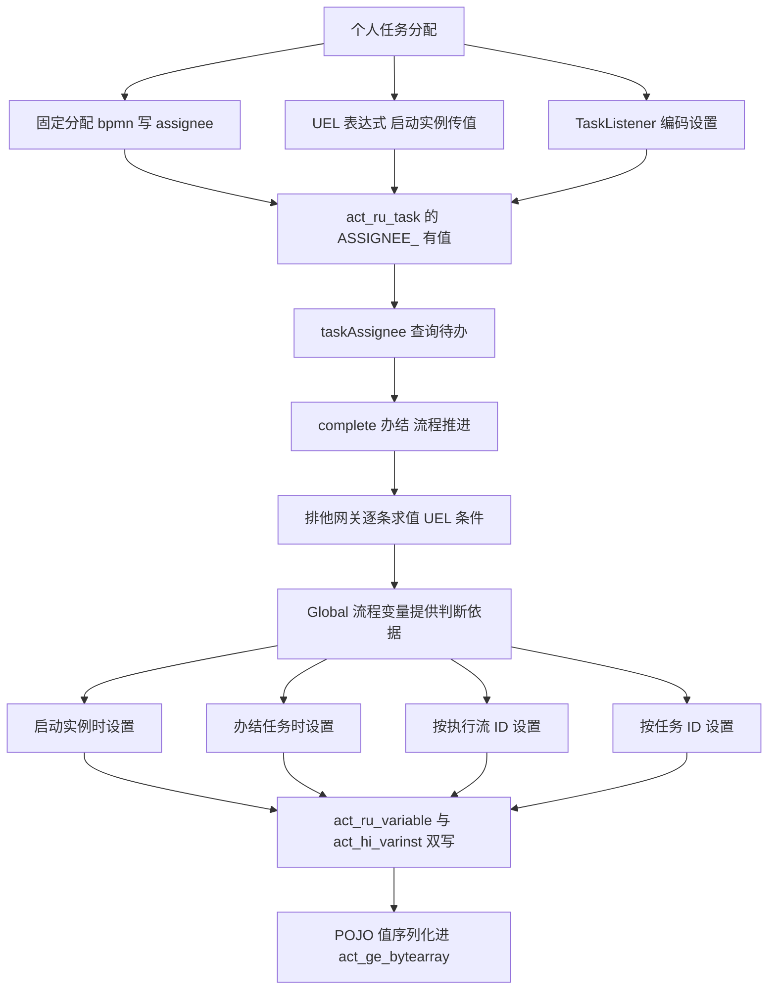

# 个人任务分配与 Global 流程变量：一张图复盘两条主线

Activiti 进阶前半程的内容密度陡增：任务分配换了三种姿势，流程变量从概念一路讲到落库。单个知识点都不难，散在十几个测试类里，隔一段时间回看就容易断线。这一节把两条主线并排铺开：任务怎么落到具体的人头上，流程执行要用的数据怎么存、何时设、进了哪张表。

## 先给结论

- 个人任务分配三种方式：bpmn 里写死 `assignee`、UEL 表达式动态指定、`TaskListener` 监听器编码设置，灵活度依次升高。
- 分配之后是通用两步：`taskService.createTaskQuery().taskAssignee(...)` 查待办，`taskService.complete(taskId)` 办结，背后动的是 `act_ru_task`。
- 流程变量只存流程执行需要的量，业务数据的存储与查询归业务系统，Activiti 只为流程推进负责。
- POJO 类型变量走 serializable 通道，实体类必须实现 `Serializable` 接口，值序列化进 `act_ge_bytearray`。
- Global 变量四种设法：启动实例时、办结任务时、按执行流 ID、按任务 ID，落库结果一致，差异只在时机与锚点。

## 一、任务分配：三种方式，一个目标

**第一种，固定分配。** 建模时在用户任务的属性面板里直接填 Assignee，比如「张三丰」，生成的 bpmn 就是 `activiti:assignee="张三丰"`。最直观，缺点也明显：人一变动就要改图、重新部署。

**第二种，UEL 表达式。** 把 assignee 写成 `${assignee0}` 这样的占位符，值在启动流程实例时用 Map 传入，负责人就不再固定在图里：

```java
Map<String, Object> map = new HashMap<>();
map.put("assignee0", "zhangsan");
map.put("assignee1", "lishi");
map.put("assignee2", "wangwu");
// 启动实例的同时，给 UEL 表达式赋值
ProcessInstance processInstance = runtimeService.startProcessInstanceByKey("holiday2", map);
```

**第三种，监听器。** 写一个实现 `TaskListener` 的类，把分配逻辑放进 `notify` 方法，再在 userTask 上配置监听器与触发事件：

```java
public class MyTaskListener implements TaskListener {
    @Override
    public void notify(DelegateTask delegateTask) {
        delegateTask.setAssignee("zhangsan");
    }
}
```

监听器可挂四种事件：create（任务创建后）、assignment（任务分配后）、delete（任务完成后）、all（所有事件都触发）。三种方式产出的结果一致：`act_ru_task` 表的 `ASSIGNEE_` 列有值，任务成为某人的个人任务。三种方式并不互斥，工程里常组合使用：默认负责人用固定分配打底，特殊场景由 UEL 或监听器覆盖。选型的分水岭是「负责人什么时候确定」：画图时就确定用固定分配，启动时才确定用 UEL，任务创建那一刻才能确定用监听器，按这条时间线想，选型不会乱。

## 二、分配之后：查询与办理

这一段没有新知识点，却是全流程里复用率最高的两行：

```java
// 按流程定义 key 与负责人查询当前用户待办
Task task = taskService.createTaskQuery()
        .processDefinitionKey("holiday")
        .taskAssignee("wangwu")
        .singleResult();
System.out.println("任务名称: " + task.getName());

// 办结任务，流程推进到下一节点
taskService.complete(task.getId());
```

`complete` 背后同时动运行时与历史两侧的表（`act_ru_task`、`act_hi_taskinst`、`act_hi_actinst` 等），任务从运行时消失、历史留痕，流程实例推进到下一个节点。

## 三、一张图串起整章



关键路径在 D 到 F：任务办结只是推着令牌往前走，到了网关能不能选对分支，靠的是变量表里那个值。分配与变量两条主线在此汇合。

## 四、Global 变量：四种设法与两条纪律

四种方式对应的入口方法与手里要有的锚点：

| 方式 | 调用 | 锚点 |
|---|---|---|
| 启动实例时设置 | `runtimeService.startProcessInstanceByKey(key, map)` | 流程定义 key |
| 办结任务时设置 | `taskService.complete(taskId, map)` | 任务 id |
| 按执行流 ID 设置 | `runtimeService.setVariable(executionId, name, value)` | 执行流 id |
| 按任务 ID 设置 | `taskService.setVariable(taskId, name, value)` | 当前待办任务 id |

两段代表代码，其余同理：

```java
// 启动实例时设置：Map 里放 holiday 对象
Map<String, Object> map = new HashMap<>();
Holiday holiday = new Holiday();
holiday.setNum(5F);
map.put("holiday", holiday);
ProcessInstance processInstance = runtimeService.startProcessInstanceByKey(key, map);
```

```java
// 按执行流 ID 设置：单个变量
runtimeService.setVariable("2501", "holiday", holiday);
// 一次设多个值用 runtimeService.setVariables(executionId, map)
```

两条纪律要守住：其一，按任务 ID 设置时任务必须是当前待办任务，任务已办结再设会报错；其二，变量名是契约，四种入口设置同名变量时后设的覆盖先设的，命名混乱会让网关在岔路口走出意外分支。

时序上还有一层值得理解：办结任务时传 Map，变量在任务办结的同一事务里落库，紧随其后的网关求值就能读到，「办结时设变量、网关处用变量」因此是最顺的组合。若某个值要等到网关前才产生，而设置动作又晚于上一次办结，就换成按执行流 ID 或按任务 ID 的设法补挂上去，四种入口本质上就是给不同时机准备的口子。

## 五、落库：三张表的分工

```sql
SELECT * FROM act_ru_variable;   -- 运行时变量表，global 与 local 都在这
SELECT * FROM act_hi_varinst;    -- 历史变量表，变量创建与覆盖全程留痕
SELECT * FROM act_ge_bytearray;  -- serializable 类型变量的序列化字节
```

标量类型（integer、string、double 等）的值直接写在变量表的 `LONG_`、`TEXT_`、`DOUBLE_` 明文列里；POJO 类型匹配 serializable，变量表只留 `BYTEARRAY_ID_` 指针，真身要拿指针去 `act_ge_bytearray` 找。local 变量与 global 变量同住一张变量表，靠 `TASK_ID_` 列区分，这是后续篇章要展开的主线。

## 常见误区

- **把业务数据整包塞进流程变量**：变量表随实例膨胀，POJO 还要序列化占 `act_ge_bytearray`，而业务查询终究要回业务表。变量只放驱动流程的量：天数、金额、审批结论。
- **以为改个字符串就能换负责人**：写死在 bpmn 里的 assignee 是部署产物，改人要改图重部署；动态需求用 UEL 或监听器承接。
- **POJO 忘了实现 `Serializable`**：存储时直接抛异常，实体类注释里专门强调了这一点。
- **四种入口随意起名**：`map.put("holiday", ...)` 与 `${holiday.num}` 必须对得上，变量名拼错网关求值直接报错。

## 面试可能被问到的问题

1. 面试官追问：「个人任务分配有哪几种方式，分别适用什么场景？」
   答：固定分配、UEL 表达式、监听器三种。负责人固定且极少变动用固定分配；负责人由运行时决定（界面选择、上级指派）用 UEL；分配规则带逻辑（按部门路由、按条件挑选）用监听器在代码里设置。

2. 面试官追问：「流程变量和业务数据的边界怎么划？」
   答：流程变量只存流程推进必须的量，如网关判断用的天数、金额；业务明细归业务系统存储与查询。变量表读写成本高，把业务表数据整包塞进变量是典型反模式。

3. 面试官追问：「POJO 类型的流程变量落库到哪，为什么不直接存变量表？」
   答：类型归类为 serializable，值序列化成字节存进 `act_ge_bytearray`，变量表只留 `BYTEARRAY_ID_` 指针。变量表用明文列存标量，对象放不进明文列，统一走字节流才能兼容任意可序列化类型。

4. 面试官追问：「四种设置 Global 变量的方式怎么选？」
   答：按数据产生的时刻与手里的锚点选。启动时已知走 `startProcessInstanceByKey` 带 Map；数据由办理人产生走 `complete` 带 Map；办结之外补数据，有任务 ID 用 `taskService.setVariable`，只有执行流 ID 用 `runtimeService.setVariable`。

5. 面试官追问：「TaskListener 有哪些触发事件？」
   答：create 任务创建后、assignment 任务分配后、delete 任务完成后、all 全部事件都触发。设置负责人通常挂 create 或 assignment 事件，在 `notify` 方法里调 `delegateTask.setAssignee`。

## 配套资料

- 查询与办理：`materials/code/02/Activiti7-day04-进阶2/Activiti7-day04-进阶2/源码/更新后的代码/代码/src/main/java/` 下 activiti 包中的 `ActivitiTaskQuery.java`、`ActivitiCompleteTask.java`
- 分配三法：同目录 day04 包中的 `AssigneeUEL.java`、`MyTaskListener.java`
- 变量四设法与实体类：同 day04 包中的 `VariableTest.java`、`VariableTest2.java`、`VariableTest3.java`、`Holiday.java`（文中包名已统一改为 `com.example`）
