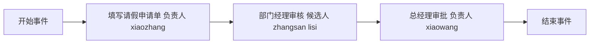

# 候选用户 Candidate Users：把任务先交给一组人

任务分配用 `assignee` 指定负责人，写的是一个人。人总有不在的时候：负责人今天请假，任务就压在他一个人的待办里，谁也动不了。换个场景，公司有三个总经理，正职、两个副职都能批请假单，流程走到总经理审批这一站时写死哪个名字都不合适。Activiti 为这种「一组人都能办」的需求准备了候选用户 Candidate Users。

## 先给结论

- 候选用户设置在 userTask 的 `activiti:candidateUsers` 属性上，多个用户用英文逗号分隔。
- 候选组里的每个人都能查询到这个任务，但任务的 assignee 为 null，任何候选人都不能直接办理。
- 候选关系落在 `act_ru_identitylink` 表，`TYPE_` 列为 candidate，一个候选人一行记录。
- 从候选人变成负责人必须显式拾取（claim），拾取是组任务办理流程的核心动作。

## 一、从单点到一组人

固定 assignee 的风险是单点：人不在，流程停。候选人机制把「这个任务谁来办」和「这个任务现在归谁」拆成了两件事：建模时只圈定候选范围，运行时由某个人显式认领后才产生真正的负责人。一张图看懂这个流程长什么样：



只有部门经理审核这一站是组任务，前后两站仍是普通的个人任务，同一个流程里两种分配方式可以混用。把「谁来办」和「现在归谁」拆开还有一层现实好处：建模的人不用关心当天谁在岗。流程定义里写的是部门经理审核这一站允许谁接，至于运行时谁顺手、谁先看到，由候选组内部协作决定。工程上常见的配套规则是先到先得加超时自动归还，候选机制恰好提供了这两条规则的实现抓手：claim 拾取完成认领，claim 传 null 完成超时退回。

## 二、在属性面板与 bpmn 里设置

设计器里选中用户任务，在 Candidate users 属性填 `zhangsan,lisi`，保存后打开 bpmn 文件，userTask 节点上会多出一个属性：

```xml
<userTask activiti:assignee="xiaozhang" activiti:exclusive="true" id="4" name="填写请假申请单"/>
<userTask activiti:candidateUsers="zhangsan,lisi" activiti:exclusive="true" id="5" name="部门经理审核"/>
<userTask activiti:assignee="xiaowang" activiti:exclusive="true" id="6" name="总经理审批"/>
```

三个节点并排一对比，差别一目了然：个人任务用 `activiti:assignee`，组任务用 `activiti:candidateUsers`。候选人更多时继续用英文逗号往后追加即可，`zhangsan,lisi,zhaoliu` 就是一组三个人。属性面板里反复出现的 `activiti:exclusive` 顺带解释一下：它标识任务是否独占执行，默认 true，含义是这一站同一时刻只允许一个人处理，引擎在异步调度时会据此做锁优化。它与候选机制并不冲突，候选解决「谁有资格接」，exclusive 约束「同一时刻一人办」。userTask 的 name 属性就是任务查询结果里 getName() 的返回值，候选人在待办列表里看到的那行文字就来自它，命名见文知义能省掉大量点开详情确认的功夫。

## 三、落库：act_ru_identitylink

部署并启动实例后，引擎把候选关系写进身份联系表：

```sql
SELECT * FROM act_ru_identitylink WHERE TYPE_ = 'candidate';
```

查询会得到两行，zhangsan 与 lisi 各一行，都指向部门经理审核那条任务。这张表存的是任务的参与者关系，`TYPE_` 列区分关系类型：candidate 是候选人，assignee 是负责人，owner、participant 等类型在别的场景出现。判断一个任务是不是组任务，两个特征一起看最稳：`act_ru_task` 的 `ASSIGNEE_` 是否为空，`act_ru_identitylink` 里有没有 candidate 记录。表的主键 `ID_` 由引擎自动生成，两个候选人各占一行，正是这种一行一人的结构让候选名单可增可减。历史侧还有对应的 `act_hi_identitylink`，任务办结后运行时记录清理，「谁曾候选、谁最终办理」沉淀在历史表里，事后追溯候选变动靠的就是它。

对候选人来说，此刻查询要换条件，`taskService.createTaskQuery().taskCandidateUser("zhangsan")` 才能查到这个任务，用 `taskAssignee` 查是查不到的，因为 `ASSIGNEE_` 还是空。任务量大时这条查询要配分页：`listPage(firstResult, maxResults)`，首页传 0 和 10，次页传 10 和 10，避免待办堆积后一次拉全量拖慢接口。

## 常见误区

- **以为设了候选人任务就有了办理人**：`ASSIGNEE_` 仍为 null，候选人用 `taskAssignee` 查询永远空手，必须改用 `taskCandidateUser` 查询组任务。
- **候选人直接去办结任务**：个人任务列表里根本没有这条任务，办结无从谈起；这是引擎的设计而不是缺陷，先拾取再办理。
- **分隔符写错**：多个候选人用英文逗号分隔，写成中文逗号或混入多余空格，名单解析就不再是预期的独立用户。
- **名单越拉越长**：拾取是先到先得，不该办这个任务的人放进候选组，手快的人会把任务捡走，候选组要按职责圈定。

## 面试可能被问到的问题

1. 面试官追问：「candidateUsers 和 assignee 的区别是什么？」
   答：assignee 直接指定唯一负责人，任务落进他的个人待办；candidateUsers 指定一组候选人，任务在有人拾取前没有负责人，`act_ru_task` 的 `ASSIGNEE_` 为空，候选人靠 `act_ru_identitylink` 里的 candidate 记录与任务关联。

2. 面试官追问：「候选人的数据存在哪张表，怎么区分类型？」
   答：存在 `act_ru_identitylink`，`TYPE_` 列标记关系类型，候选人是 candidate，负责人是 assignee，此外还有 owner、participant 等类型。一个任务有几个候选人就有几行 candidate 记录。

3. 面试官追问：「候选人能直接办理组任务吗？」
   答：不能。候选人只有知情权，查询组任务要用 `taskCandidateUser`；要办理必须先 `claim` 拾取，拾取后任务才有负责人，再按个人任务的查询与办理走。

4. 面试官追问：「什么业务场景适合候选用户？」
   答：一个岗位多个人能办的场景：多个总经理都能批的请假单、客服组的工单派接。它解决的是单点负责人不在场时流程停摆的问题，同时保留「谁认领谁负责」的责任归属。

## 配套资料

- 组任务查询与拾取的落地代码：`materials/code/02/Activiti7-day05-进阶3/Activiti7-day05-进阶3/源码/activiti01/src/main/java/` 下 day05 包中的 `GroupTest.java`（含部署 `holiday5.bpmn` 的注释代码，包名已改 `com.example`）
- bpmn 片段出自本课 PPT「查看 bpmn 文件」一节，`holiday5.bpmn` 文件未随源码包提供
