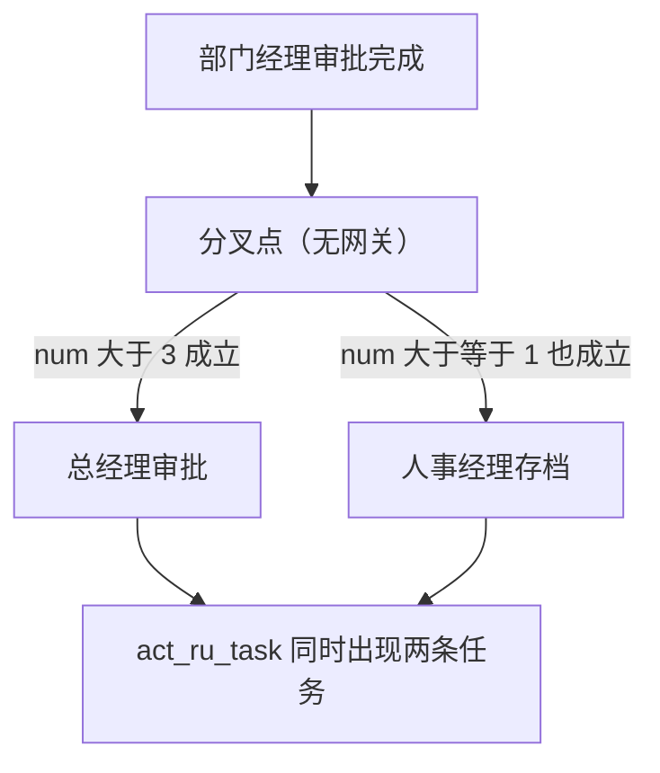
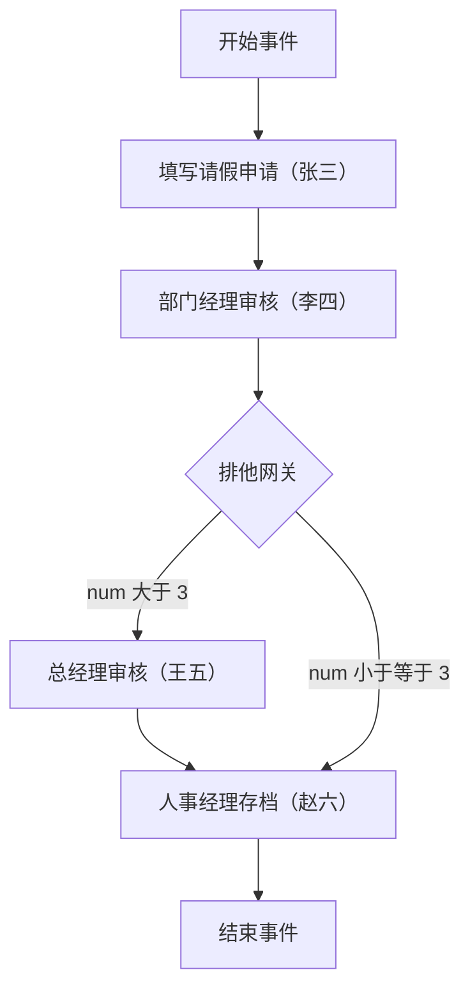
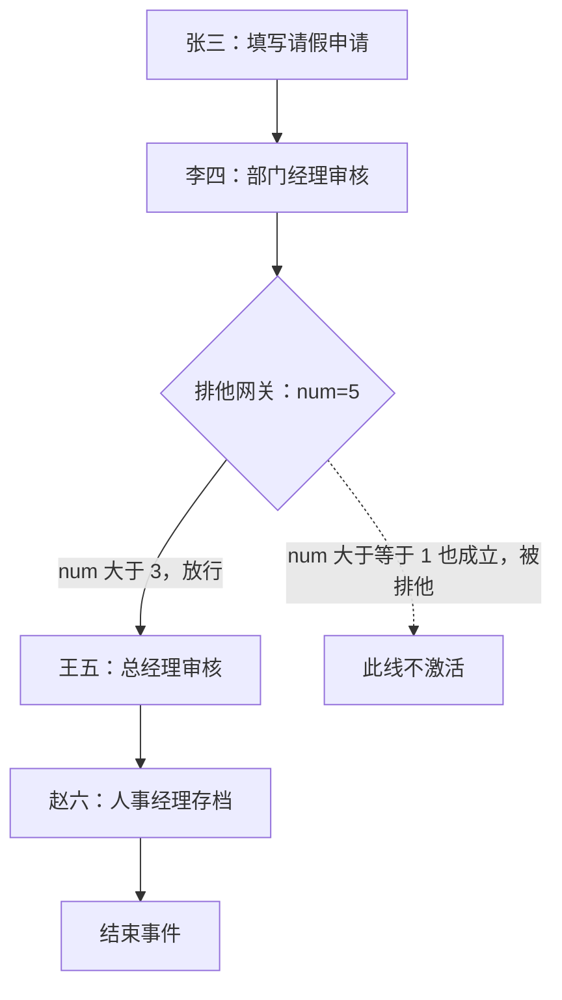

# Activiti排他网关：从条件重叠分裂到请假流程裁决与实测

## 先给结论

- 系列定位：Activiti 分支控制的关键一课，从「为什么裸条件连线会出事」讲到网关流程的画法与实测，三篇层层递进。
- 问题引入：两条带条件的出线同时为 true 时，无网关流程会把两条全部激活，`act_ru_task` 凭空多出一份并行审批；把 holiday4 的条件改成重叠区间即可复现。
- 排他网关（异或网关）补上的正是裁决：流程到达后对所有外出顺序流逐条求值 UEL 条件，即使多条同时为 true 也只放行一条，选择权收口到网关。
- 画法要点：节点连线不多不少，条件写在顺序流的 conditionExpression 上（如 `${holiday.num > 3}`），网关元素本身没有条件可填；流程 key 换成新名字后，启动代码要同步改。
- 实测确认两个边界行为：同时为 true 时按流程定义里出线的先后顺序取第一条满足的；所有条件都不满足时直接抛 `No outgoing sequence flow` 异常，流程停在网关。
- 部署细节：png 只服务流程图展示，缺失不影响执行，报找不到资源注释掉对应行即可。
- 工程建议：条件区间要互斥完备，必要时配默认流转兜底，不依赖出线的隐式顺序。
- 示例代码位于 Activiti7-day05 进阶资料的 day05 包，BPMN 片段与流程图为按课程写法补全的示例。

## 第1部分：两条出线同时为 true 流程就乱套：排他网关是什么，为什么非加不可

请假流程用两条带条件的顺序流就能分支：num 大于 3 走总经理审批，num 小于等于 3 进人事存档。把其中一条的条件从 `num<=3` 改成 `num>=1`，两条线的条件区间就重叠了：num=5 时同时为 true，部门经理审批刚完成，待办里同时冒出总经理审批和人事存档两个任务。排他网关（exclusive gateway）就是给这种分叉点补上的正式裁决者，先把「为什么非加不可」用实验说清楚。

### 一、排他网关是什么
一句话：排他网关是 BPMN 里专门做「多选一」决策的节点。流程推进到它这里，它把所有外出顺序流挨个求值，挑出条件为 true 的一条让流程走过去，其余的线一律不激活。

「排他」说的是结果：多个分支条件同时成立时它们互相排斥，最终只有一个能走，所以它也叫异或网关，异或（XOR）正是布尔运算里的「二者取一」。图形记号是菱形里画一个叉号 X，靠这个图案与并行网关的加号、包含网关的圆圈区分。

它解决的问题是分支控制权的归属。带条件的顺序流散落在每条线上，谁 true 谁走，多条同时为 true 就一起走，没有任何东西在做「收敛到一条」的裁决。排他网关把裁决收口到一个节点上，语义变成：从这里出去，有且只有一条路。

### 二、场景引入：把互斥条件改成重叠会怎样
原 holiday4 流程的两条出线是互斥的：`${holiday.num > 3}` 走总经理审批，`${holiday.num <= 3}` 走人事经理存档，任何天数都恰好命中一条。现在做一个小改动，把 `<=3` 改成 `>=1`，单独看每条线都合理，合起来看区间重叠了：num=5 既大于 3，也大于等于 1。



这张图讲的是 num=5 时两条出线同时被激活的分裂现场：引擎在分叉点对每条线独立判断，谁 true 谁走，互不知晓，两条全 true 就一起走。总经理审批和人事存档同时挂进待办，一边还没审完另一边已经往下跑，流程等于被复制成了两份。

### 三、动手复现：没有网关时的真实表现
工程里的 `ExclusiveGateWayTest01` 留了这场实验的完整三步：部署、启动、推进任务。

部署的是改完条件的 holiday4（包名已改为 `com.example`）：

```java
// 1. 部署流程定义
ProcessEngine processEngine = ProcessEngines.getDefaultProcessEngine();
RepositoryService repositoryService = processEngine.getRepositoryService();
Deployment deployment = repositoryService.createDeployment()
        .addClasspathResource("diagram/holiday4.bpmn")  // 添加 bpmn 资源
        .addClasspathResource("diagram/holiday4.png")
        .name("请假申请单流程")
        .deploy();
System.out.println(deployment.getName());
System.out.println(deployment.getId());
```

启动实例时把 num 赋成 5，让两条条件同时成立：

```java
// 2. 启动流程实例，同时给流程变量赋初值
RuntimeService runtimeService = processEngine.getRuntimeService();
Holiday holiday = new Holiday();
holiday.setNum(5F);
Map<String, Object> map = new HashMap<>();
map.put("holiday", holiday);   // 流程变量赋值
ProcessInstance processInstance = runtimeService.startProcessInstanceByKey("myProcess_1", map);
```

推进任务用日常的查询加完成：

```java
// 3. 查询并完成当前用户任务
TaskService taskService = processEngine.getTaskService();
Task task = taskService.createTaskQuery()
        .processDefinitionKey("myProcess_1")
        .taskAssignee("lishi")     // 部门经理审批的执行人
        .singleResult();
if (task != null) {
    taskService.complete(task.getId());
    System.out.println("用户任务执行完毕...");
}
```

张三填完请假单，李四完成部门经理审批，此刻刷新 `act_ru_task` 表：表里不是一条任务，而是两条，一条总经理审批，一条人事经理存档。原因前面已经说清：没有网关时，每条条件为 true 的出线都会各自走出一条分支，5 大于 3 成立、5 大于等于 1 也成立，两条线就都走了。

### 四、排他网关补上的正是这个裁决
同样两条线，中间插一个排他网关，行为立刻不同：两条条件即使同时为 true，网关也只放行一条，另一个节点不可能同时出现在待办里。至于两条都为 true 时具体走哪条、两条都不为 true 时怎么办，这两个边界行为留给实测环节拆开看。

给流程加排他网关的改动其实很小：原来两条线直接从部门经理任务后面分出去，现在先汇到网关，再由网关分出去。任务节点一个不多一个不少，多出来的只是那个做裁决的菱形。

## 第2部分：把排他网关画进请假流程：holiday5 流程定义的完整画法

没有网关的流程，两条条件同时为 true 会分裂成两份审批；解法是把分叉点的裁决交给排他网关。现在把网关真正画进流程定义：新建 `holiday5.bpmn`，摆节点、连出线、写条件，再对齐部署资源与流程 key。

### 一、节点与连线怎么摆
holiday5 的完整拓扑如下：



这张图是 holiday5 的节点与连线关系：两条出线都从网关出发，num 大于 3 时先总经理审核再人事存档，num 小于等于 3 时跳过总经理直接存档，两条线最终都汇到人事存档与结束事件。

节点属性按平时的写法填：四个用户任务分别指定 `activiti:assignee` 为 zhangsan、lishi、wangwu、zhaoliu；排他网关的名称随意，改不改不影响执行，显示成「排他网关」更易读。连线时从网关拖出两条出线再分别填条件，布局尽量横平竖直，图乱不影响执行，但会给后面看图排查添堵。网关在 BPMN 里是独立节点类型，与 userTask 平级，xml 里一个 `exclusiveGateway` 标签对应画布上一个菱形；这个元素属于 BPMN 规范的标准件，流程文件在遵循规范的引擎之间迁移时，排他网关的写法是通用的。

### 二、出线条件怎么写
连到总经理审核的那条线，Condition 填 `${holiday.num > 3}`；连到人事存档的那条线，按业务互斥区间应填 `${holiday.num <= 3}`。两个条件合起来覆盖所有天数且互不重叠，网关在任何取值下都恰有一条线命中。

课堂为了让「两条同时成立」的场景可测，把人事存档那条线临时写成了 `${holiday.num >= 1}`，与 `>3` 构成重叠区间：num=5 时两条都为 true。这个改法只用于验证网关的排他性，业务落地要回到互斥区间，或者给网关配默认流转兜底。

对应的 BPMN 片段长这样（资料包未附带 bpmn 源文件，片段为按本课写法补全的示例）：

```xml
<process id="holidayExclusive" name="请假审批-排他网关" isExecutable="true">
    <startEvent id="startEvent1"/>
    <userTask id="usertask1" name="填写请假申请" activiti:assignee="zhangsan"/>
    <userTask id="usertask2" name="部门经理审核" activiti:assignee="lishi"/>
    <exclusiveGateway id="exclusivegateway1" name="排他网关"/>
    <userTask id="usertask3" name="总经理审核" activiti:assignee="wangwu"/>
    <userTask id="usertask4" name="人事经理存档" activiti:assignee="zhaoliu"/>
    <endEvent id="endEvent1"/>

    <sequenceFlow id="flow1" sourceRef="startEvent1" targetRef="usertask1"/>
    <sequenceFlow id="flow2" sourceRef="usertask1" targetRef="usertask2"/>
    <sequenceFlow id="flow3" sourceRef="usertask2" targetRef="exclusivegateway1"/>
    <sequenceFlow id="flow4" sourceRef="exclusivegateway1" targetRef="usertask3">
        <conditionExpression xsi:type="tFormalExpression">${holiday.num &gt; 3}</conditionExpression>
    </sequenceFlow>
    <sequenceFlow id="flow5" sourceRef="exclusivegateway1" targetRef="usertask4">
        <conditionExpression xsi:type="tFormalExpression">${holiday.num &lt;= 3}</conditionExpression>
    </sequenceFlow>
    <sequenceFlow id="flow6" sourceRef="usertask3" targetRef="usertask4"/>
    <sequenceFlow id="flow7" sourceRef="usertask4" targetRef="endEvent1"/>
</process>
```

对照 XML 能看清结构：网关本身只有一个 `exclusiveGateway` 元素，条件不在网关上，而在它后面的两条 `sequenceFlow` 里，各包一个 `conditionExpression`。总经理审核到人事存档的那条线没有条件，是普通顺序流，因为那里不存在选择。

### 三、部署代码要跟着改的两处
流程定义画完，部署代码里有两处要对齐（真实代码见 day05 包 `ExclusiveGateWayTest02`，包名已改为 `com.example`）：

```java
Deployment deployment = repositoryService.createDeployment()
        .addClasspathResource("diagram/day05/holiday5.bpmn")  // 新流程的 bpmn 资源
        .name("请假申请单流程")
        .deploy();
System.out.println(deployment.getName());
System.out.println(deployment.getId());
```

**第一，资源路径换成 holiday5。** 新流程的 bpmn 放在 `resources` 的 day05 目录下，部署路径要写 `diagram/day05/holiday5.bpmn`，指错路径部署进引擎的就是旧流程。

**第二，流程 key 换成 holidayExclusive。** 流程定义的 id 改名后，启动实例的 `startProcessInstanceByKey` 必须用同一个 key，两边对不上，启动时就会报找不到流程。改名还牵动一串联动：启动实例的 key、按定义查询流程的 key、bpmn 里 process 标签的 id，三处必须是同一个值。建议把 key 定义成常量放在测试类顶部，多处引用一处声明，重命名时只改一行。

### 四、画完之后的检查清单
- 两条出线都有条件，或有一条显式设为默认流转；网关不能挂着无条件出线。
- 出线条件合起来覆盖业务全域且互斥不重叠，保证任何取值下恰有一条命中。
- 总经理审核之后仍要接人事存档再到结束事件，别为了省一条线把存档跳掉。
- 流程 key、bpmn 资源路径与启动、部署代码保持一致；png 可以不部署，不影响执行。

## 第3部分：num=5 只走一条线：排他网关流程实测与两个边界行为

holiday5 已经把排他网关画进流程定义，人事存档那条出线的条件特意写成 `num>=1`，与 `num>3` 留出重叠区间，就等着 num=5 时两条同时成立。实测要验证三件事：多条同时为 true 时走几条、走哪条、全都不满足时会发生什么。

### 一、部署 holiday5
部署代码出自 day05 包 `ExclusiveGateWayTest02`（包名已改为 `com.example`）：

```java
// 1. 部署流程定义
ProcessEngine processEngine = ProcessEngines.getDefaultProcessEngine();
RepositoryService repositoryService = processEngine.getRepositoryService();
Deployment deployment = repositoryService.createDeployment()
        .addClasspathResource("diagram/day05/holiday5.bpmn")  // 添加 bpmn 资源
        //.addClasspathResource("diagram/day05/holiday5.png") // png 未生成，注释掉
        .name("请假申请单流程")
        .deploy();
System.out.println(deployment.getName());
System.out.println(deployment.getId());
```

第一次带着 png 部署时报了找不到文件：png 图没有从 bpmn 生成。png 只服务于图示展示，把那一行注释掉重新部署，流程执行全程不受任何影响。顺带说明两类资源的分工：bpmn 是流程的可执行定义，引擎解析它生成执行计划；png 只是给人看的快照，流程图页面加载不到时显示空白，不会抛业务异常。png 的生成不必手工维护，常用做法是用设计器的导出功能按需补一份，或部署后通过流程图接口动态生成。

### 二、启动实例：key 对不上就起不来
```java
// 2. 启动流程实例，num=5 让两条条件同时成立
RuntimeService runtimeService = processEngine.getRuntimeService();
Holiday holiday = new Holiday();
holiday.setNum(5F);
Map<String, Object> map = new HashMap<>();
map.put("holiday", holiday);   // 流程变量赋值
ProcessInstance processInstance = runtimeService.startProcessInstanceByKey("holidayExclusive", map);
System.out.println("流程定义ID：" + processInstance.getProcessDefinitionId());
System.out.println("流程实例ID：" + processInstance.getId());   // 2501
```

第一次启动沿用了旧 key `myProcess_1`，直接报 `no processes deployed with key`：库里部署的流程定义 id 已经改成 `holidayExclusive`，key 匹配不上，就不存在可启动的流程定义。改用新 key 后实例正常启动，实例 id 为 2501。`setNum(5F)` 里的 F 表示浮点字面量，Holiday 的 num 字段是 Float 类型，表达式 `${holiday.num > 3}` 就是拿这个浮点数与 3 比较；map 里的 key 必须与表达式里的变量名 holiday 完全一致，对不上表达式同样求值失败。

### 三、推进任务，逐表验证
每一步用查询加完成推进，换环节换执行人：

```java
// 3. 查询并完成当前环节的任务
TaskService taskService = processEngine.getTaskService();
Task task = taskService.createTaskQuery()
        .processDefinitionKey("holidayExclusive")
        .taskAssignee("zhaoliu")   // 每换一个环节换执行人
        .singleResult();
if (task != null) {
    taskService.complete(task.getId());
    System.out.println("用户任务执行完毕...");
}
```

num=5 时的推进路径与网关裁决如下：



这张图讲的是 num=5 时网关的裁决过程：两条出线都为 true，实线是真正被放行的一条，虚线因为排他语义被压掉。关键路径在李四完成任务之后：待办里只出现王五的总经理审核，而不是两个任务并存。

逐表核对的结果：

- 李四完成后查 `act_ru_task`：只有一条任务，总经理审核，办理人是王五。没有网关时这里是两条，排他网关的裁决生效。
- 王五完成任务，流转到赵六的人事存档；赵六完成，`act_ru_task` 清空，流程实例走完。
- 查 `act_ru_execution` 与历史信息，能还原整条路径：填写请假单 → 部门经理审核 → 总经理审核 → 人事存档 → 结束事件，与流程设计一致。

### 四、两个边界行为
**第一，多条同时为 true 走哪条。** 实验结果是走 id 更小的那条：总经理线 id 为 5，人事存档线 id 为 7，于是走了总经理。从引擎实现看，它按流程定义里出线的先后顺序逐条求值，取第一条为 true 的；图形编辑器生成 XML 时先画的线排在前，本例恰好 id 顺序与定义顺序一致。这个顺序是实现细节而非规范承诺，业务上别依赖它，条件区间设计成互斥才可靠。

**第二，全部条件都不满足怎么办。** 把 num 设成一个两条线都不满足的值，或者干脆忘了赋值，流程推进到网关时直接抛异常：`No outgoing sequence flow of the exclusive gateway 'xxx' could be selected for continuing the process`，含义是网关找不到任何可走的外出顺序流。排他网关的承诺是「多条 true 只走一条」，它不负责「全 false 时替你挑一条」，那是默认流转（default flow）的职责。

## 常见误区

- **以为写了条件就天然互斥**：条件区间是人写的，`>3` 与 `>=1` 就重叠。裸连线上重叠即分裂，要么把区间设计成互斥，要么用排他网关兜底。
- **把多出来的任务当引擎 bug**：无网关时「每条 true 出线都激活」是引擎的既定行为，不是并发错误；要只走一条，就得显式使用排他网关。
- **以为排他网关是性能优化**：它不做任何并行加速，只做选择；引入它的动机是分支语义正确，不是效率。
- **给单出口的节点强加网关**：只有一个出口就谈不上选择，网关的价值在两条及以上出线的分叉点。
- **条件表达式写错属性路径**：把 `holiday.num` 拼成别的名字，运行时求值报错或恒不成立；`holiday` 是放进流程变量的那个 POJO 的变量名，表达式按它的属性取值。
- **网关出线忘写条件**：无条件出线恒为可走，多条并存时先命中先走，分支语义立刻失控。
- **把条件写在网关节点上找属性**：判断依据只在外出顺序流的 `conditionExpression`，网关元素本身没有条件可填。
- **把重叠区间当最终写法**：`>3` 配 `>=1` 是课堂实验用的重叠写法，专门用来构造两条同时为 true 的场景；上线要改回互斥区间。
- **以为网关会按「业务上更合理」的分支走**：它只认条件求值结果与出线顺序；想让某条优先命中，就把区间写成互斥，或者设置默认流转。
- **认为 png 必须与 bpmn 同时部署**：png 缺失只影响流程图展示，把部署代码里那一行注释掉即可，执行不受影响。
- **流程改名后忘改启动代码**：`startProcessInstanceByKey` 匹配的是流程定义的 key，改了流程 id 却不同步启动 key，报 `no processes deployed with key`。
- **把全 false 报错当成环境问题**：报 `No outgoing sequence flow` 说明变量值没落进任何条件区间，先查流程变量有没有赋值、条件表达式是否写对。

## 面试可能被问到的问题

1. 面试官追问：「排他网关和带条件的顺序流有什么区别？」
   答：带条件的顺序流把判断散在各条线上，多条同时为 true 时会全部激活；排他网关把决策收口到一个节点，所有出线一起求值，有且只有一条被放行，即使多条同时为 true 也只走一条。

2. 面试官追问：「为什么排他网关又叫异或网关？」
   答：异或（XOR）是布尔运算里的「二者取一」，排他网关的多条出线在它眼里互斥，最终恰好激活一条，语义与异或一致；图形记号是菱形内的叉号 X。

3. 面试官追问：「不用网关、两条条件同时为 true，流程会怎样？」
   答：两条出线各自产生一个分支同时推进，`act_ru_task` 里同时出现两个任务，流程相当于分裂成两份，这是无网关连线的既定行为。

4. 面试官追问：「排他网关在哪里做条件判断？」
   答：流程推进到网关节点时，引擎对它的外出顺序流逐条求值 UEL 条件表达式（如 `${holiday.num > 3}`），取一条为 true 的出线继续，其余出线不激活。

5. 面试官追问：「排他网关的所有条件都不满足会怎样？」
   答：找不到可走的出线，引擎抛出没有可走外出顺序流的异常，流程实例停在网关处；工程上应规划互斥完备的条件区间，或用默认流转兜底。

6. 面试官追问：「排他网关的分支条件写在哪里？」
   答：写在网关外出顺序流的 `conditionExpression` 里，是 UEL 表达式，如 `${holiday.num > 3}`；流程到达网关时逐条求值这些表达式，取一条为 true 的出线继续。

7. 面试官追问：「`${holiday.num > 3}` 里的 holiday 从哪来？」
   答：它是启动实例或完成任务时放进流程变量的 POJO，`map.put("holiday", holiday)` 之后引擎按表达式读取其 `num` 属性；POJO 需实现 `Serializable` 才能作为变量入库存放。

8. 面试官追问：「加入排他网关对流程结构有什么影响？」
   答：几乎无影响，只是把原来散在两条线上的分支起点收口到网关节点，任务节点数量不变；改变的是分支的裁决方式，不是流程拓扑。

9. 面试官追问：「两条出线条件写成重叠区间可以吗？」
   答：语法合法，运行时网关仍只走一条，但走哪条取决于出线在流程定义里的顺序；业务上不应依赖这种隐式顺序，条件区间要互斥完备，必要时配默认流转。

10. 面试官追问：「部署流程时 png 文件必须一起带吗？」
   答：不是必须，png 只用于流程图展示，缺失不影响流程执行；部署代码里把对应的 `addClasspathResource` 行注释掉即可。

11. 面试官追问：「排他网关在多条出线同时为 true 时如何选择？」
   答：引擎按流程定义里出线的先后顺序逐条求值，取第一条为 true 的出线；实验里表现为走 ID 更小的那条，但这依赖编辑器的生成顺序，业务上应设计互斥的条件区间，不依赖隐式顺序。

12. 面试官追问：「排他网关所有条件都不满足会怎样？」
   答：抛出 `No outgoing sequence flow of the exclusive gateway` 异常，流程停在网关无法继续；工程上用默认流转兜底，或保证条件区间覆盖全域。

13. 面试官追问：「启动实例报 no processes deployed with key 是什么原因？」
   答：传入的 key 与已部署流程定义的 key 不一致，常见于流程定义改名后启动代码没同步；也可能是该定义尚未部署或已被删除。

14. 面试官追问：「png 资源缺失会影响流程运行吗？」
   答：不会。png 只用于流程图展示，流程执行只消费 bpmn 资源；部署时省略 png 即可，需要图示时再补生成。

15. 面试官追问：「为什么测试要故意把条件写成重叠区间？」
   答：为了构造两条出线同时为 true 的极端场景，验证排他网关「即使多条成立也只走一条」的核心承诺，这正是它与裸条件连线最直接的行为差异。

## 配套资料

- 代码：`materials/code/02/Activiti7-day05-进阶3/Activiti7-day05-进阶3/源码/activiti01/` 下 `src/main/java` 的 day05 包 `ExclusiveGateWayTest01.java`（无网关场景的部署、启动、推进三段代码）
- 同工程 day04 包 `Holiday.java`（流程变量 POJO，`num` 为 `Float` 类型并实现 `Serializable`）
- 文中条件表达式与流程图为按本课写法补全的示例，部署代码引用的流程资源为工程内的 `diagram/holiday4.bpmn`
- 代码：`materials/code/02/Activiti7-day05-进阶3/Activiti7-day05-进阶3/源码/activiti01/` 下 `src/main/java` 的 day05 包 `ExclusiveGateWayTest02.java`（部署 holiday5、按 holidayExclusive 启动、推进任务的代码）
- 工程部署代码引用的流程资源为 `diagram/day05/holiday5.bpmn`；资料包未附带 bpmn 源文件，文中 BPMN 片段与流程图为按本课写法补全的示例
- 代码：`materials/code/02/Activiti7-day05-进阶3/Activiti7-day05-进阶3/源码/activiti01/` 下 `src/main/java` 的 day05 包 `ExclusiveGateWayTest02.java`（部署 holiday5.bpmn、以 holidayExclusive 为 key 启动实例、按执行人推进任务的完整代码）
- 同工程 day04 包 `Holiday.java`（流程变量 POJO）
- 文中异常信息按 Activiti 实际报错原文引用，BPMN 片段与流程图为按本课写法补全的示例
