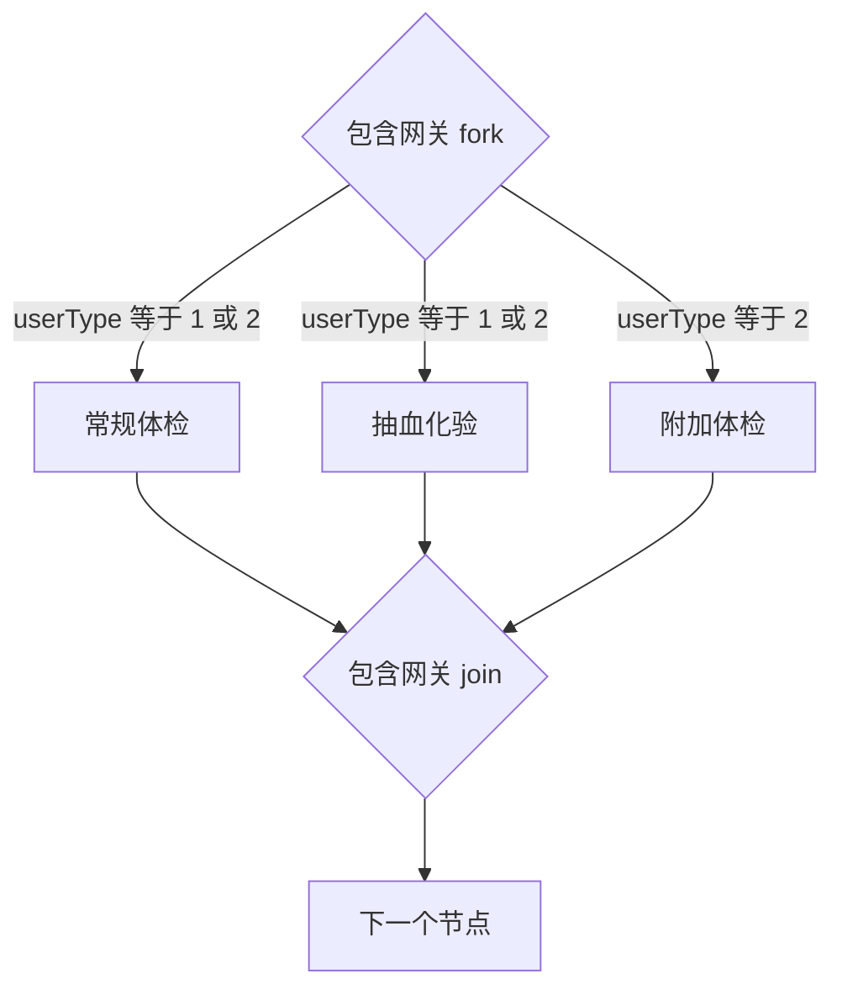
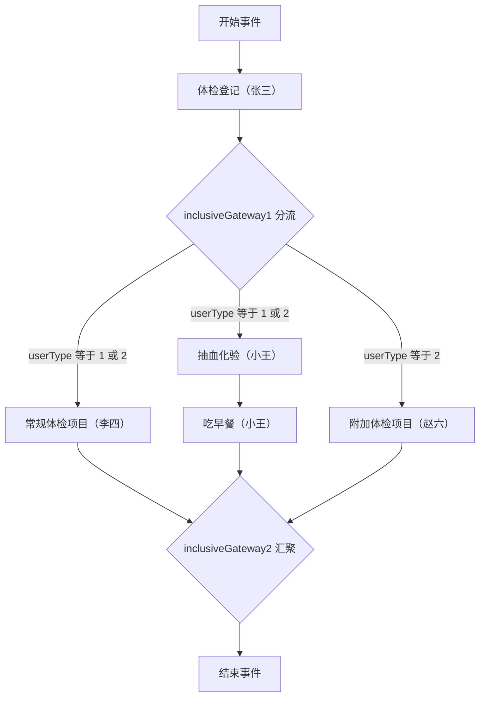
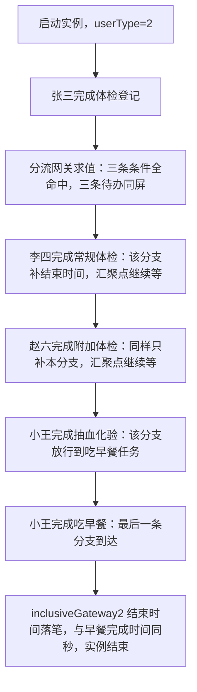

# Activiti 包含网关：条件多分支并行、不等长汇聚与体检流程实测

## 先给结论

- 三篇内容讲透包含网关：基本概述、体检流程定义图、全流程演示效果，三步从概念走到实测。
- 包含网关是排他与并行的结合体：像排他一样在外出顺序流上定义条件，像并行一样多条出线同时激活，条件为 true 的分支各自创建一条并行分支。
- 与排他的区别是可同时激活多于一条出线，与并行的区别是条件会被解析；汇聚只等被条件选中的分支，被选中的全部到达汇聚点才聚合放行，流程才推进。
- 体检示例结构：开始 → 体检登记 → 包含网关三条出线（常规体检项目、抽血化验、附加体检项目）→ 汇聚网关 → 结束；条件写 `${userType == 1 || userType == 2}` 这类表达式，分支可以不一样长。
- 实测 userType 给 2，三条待办同时插进 act_ru_task；汇聚网关一被触及就有开始时间，但结束时间一直空到最后一单完成，吃早餐完成时间与汇聚结束时间落在同一秒是聚合发生的确凿证据。
- 没有任何出线为 true、或条件引用的流程变量不存在，执行到网关直接抛异常，条件区间要覆盖业务全域或配默认流转兜底。

## 第1部分：包含网关：按条件开多条并行分支，开几条等几条

网关学到第三种，选择困难来了：排他网关只放行一条，条件再好也只挑一条走；并行网关把所有出线全开，写不写条件一个样。可业务里大量需求卡在两者之间：按条件决定开几条，开出来的几条并行走，全走完再汇聚。公司体检就是典型，普通员工查两项，管理层要多查一项，公共部分还不想画两遍。包含网关（inclusiveGateway）就是为这类需求准备的。

### 一、一句话讲清它的行为

把三种网关类比成三种选择题：排他网关是单选按钮，永远只选一个；并行网关是全选，根本不看选项内容；包含网关是一组按条件自动勾选的复选框，条件满足的自动打勾，勾上的全部执行，全部办完才允许提交。

讲义里对它的定义是：所有外出顺序流的条件都会被解析，结果为 true 的顺序流会以并行方式继续执行，并且会为每条顺序流创建一个并行分支；汇聚侧，这些并行分支全部到达汇聚点后，包含网关才继续向后推进。分支与汇聚各管一半：分支管「开几条」，汇聚管「等几条」，两边等的是同一批被条件选中的分支。

落到具体数字上：网关后画了五条出线，其中三条的条件为 true，那三条同时开，剩下两条根本不会创建分支；三条分支先后到达汇聚点，前两条到了不放行，第三条到了才一起放行。十个分支里五个条件成立，就是五条并行、等五条。

### 二、三种网关摆在一起看

| 维度 | 排他网关 | 并行网关 | 包含网关 |
|---|---|---|---|
| 出线条件 | 解析，逐条求值 | 解析，写了也忽略 | 解析，为 true 的才开 |
| 同时激活条数 | 有且只有一条 | 全部 | 至少一条，可能多条 |
| 汇聚等待 | 不等待，走完即走 | 等所有分支 | 等所有被条件选中的分支 |
| 典型场景 | 按天数选审批路线 | 考勤与工资齐头并进 | 全员公共项，特定人群加项 |

包含网关的分支汇聚行为用图看更直接：



这张图讲的是同一网关在两种变量取值下的行为：userType 等于 1 时只有前两条出线为 true，附加体检的分支根本不创建，join 只等两条；userType 等于 2 时三条全为 true，三条并行走，join 等三条。关键路径在 join：等的是「被选中的」，不是「画出来的」。

### 三、体检场景为什么非它不可

需求是：公司全体员工做常规检查、抽血化验，管理层除此之外还要做附加项检查。用流程变量 `userType` 区分人群，等于 1 是普通员工，等于 2 是领导。

用排他网关做，公共的常规检查与抽血化验得复制成两条线：员工一条线、领导一条线，图立刻膨胀，后续每加一种人群就再复制一遍。用并行网关做，附加项会被开给所有员工，语义直接错了。包含网关把「谁可以走这条线」写成出线条件：常规与抽血两条线的条件是 `userType` 等于 1 或 2，附加那条线只认 `userType` 等于 2。员工实例激活两条分支，领导实例三条全激活，公共部分始终只画一遍。

### 四、启动实例时变量怎么给

包含网关解析条件靠流程变量，启动实例时必须把它放进去。工程 day05 包 `InclusiveGateWayTest` 里的启动代码（包名已改为 `com.example`）：

```java
// 2. 启动流程实例
ProcessEngine processEngine = ProcessEngines.getDefaultProcessEngine();
RuntimeService runtimeService = processEngine.getRuntimeService();

Integer userType = 2;   // 代表管理者
Map<String, Object> map = new HashMap<>();
map.put("userType", userType);   // 流程变量赋值

ProcessInstance processInstance = runtimeService.startProcessInstanceByKey("examine", map);
System.out.println("流程定义ID：" + processInstance.getProcessDefinitionId());
System.out.println("流程实例ID：" + processInstance.getId());
```

`userType` 给 2，领导实例启动后三条分支同时开。对应的部署代码引用 `diagram/day05/examine.bpmn`，流程 key 是 `examine`，画法留到下一节细说。分支任务的查询与完成和并行网关的用法完全一样，区别只在 fork 时刻激活了几条。

## 第2部分：画出体检流程定义：包含网关的条件出线与不等长汇聚

概述里把包含网关的行为说清了，现在把它落成一张能部署的流程定义图。场景是公司体检：全体员工做常规检查与抽血化验，管理层额外多做一项附加检查。图上要回答三个问题：网关怎么摆、出线条件怎么写、汇聚网关等几条。

### 一、需求拆成节点与连线

把需求翻译成图：领取体检单是起点任务，之后进入包含网关按人群分发；三条体检项目是三条并行分支；做完的项目各自汇到第二个包含网关，聚合完流程结束。拓扑如下：



这张图讲的是 examine 流程的完整拓扑：分流网关按 `userType` 决定开几条出线，普通员工激活常规与抽血两条，领导三条全开；抽血化验那条分支做完还顺路吃个早餐再汇聚，说明分支内部可以继续挂自己的任务。关键路径在汇聚网关：它逐条确认被选中分支的到达情况，最后一条到达时聚合才发生。

网关的 id 命名成 `inclusiveGateway1` 与 `inclusiveGateway2` 有实际用处：日志、表记录里出现的就是这些 id，排查时一眼能认出是分流还是汇聚。

### 二、三条出线的条件怎么写

条件写在顺序流的 Condition 属性上，UEL 表达式直接引用流程变量：

| 出线 | 条件表达式 | 命中人群 |
|---|---|---|
| 常规体检项目 | `${userType == 1 || userType == 2}` | 全体 |
| 抽血化验 | `${userType == 1 || userType == 2}` | 全体 |
| 附加体检项目 | `${userType == 2}` | 仅领导 |

两个竖线 `||` 表示「或」：`userType` 取 1 或取 2 都命中，所以这两条线对所有人生效。附加那条线只认 2，普通员工走到分流网关时这条出线求值为 false，分支根本不创建。三个条件的并集覆盖了变量全域，任何取值下至少一条命中，不会出现全 false 报错。

对应的 BPMN 片段长这样（资料包未附带 bpmn 源文件，片段为按本课写法补全的示例）：

```xml
<process id="examine" name="体检流程" isExecutable="true">
    <startEvent id="startEvent1"/>
    <userTask id="usertask1" name="体检登记" activiti:assignee="zhangsan"/>
    <inclusiveGateway id="inclusiveGateway1"/>
    <userTask id="usertask2" name="常规体检项目" activiti:assignee="lishi"/>
    <userTask id="usertask3" name="抽血化验" activiti:assignee="xiaowang"/>
    <userTask id="usertask4" name="附加体检项目" activiti:assignee="zhaoliu"/>
    <userTask id="usertask5" name="吃早餐" activiti:assignee="xiaowang"/>
    <inclusiveGateway id="inclusiveGateway2"/>
    <endEvent id="endEvent1"/>

    <sequenceFlow id="flow1" sourceRef="startEvent1" targetRef="usertask1"/>
    <sequenceFlow id="flow2" sourceRef="usertask1" targetRef="inclusiveGateway1"/>
    <sequenceFlow id="flow3" sourceRef="inclusiveGateway1" targetRef="usertask2">
        <conditionExpression xsi:type="tFormalExpression">${userType == 1 || userType == 2}</conditionExpression>
    </sequenceFlow>
    <sequenceFlow id="flow4" sourceRef="inclusiveGateway1" targetRef="usertask3">
        <conditionExpression xsi:type="tFormalExpression">${userType == 1 || userType == 2}</conditionExpression>
    </sequenceFlow>
    <sequenceFlow id="flow5" sourceRef="inclusiveGateway1" targetRef="usertask4">
        <conditionExpression xsi:type="tFormalExpression">${userType == 2}</conditionExpression>
    </sequenceFlow>
    <sequenceFlow id="flow6" sourceRef="usertask2" targetRef="inclusiveGateway2"/>
    <sequenceFlow id="flow7" sourceRef="usertask3" targetRef="usertask5"/>
    <sequenceFlow id="flow8" sourceRef="usertask5" targetRef="inclusiveGateway2"/>
    <sequenceFlow id="flow9" sourceRef="usertask4" targetRef="inclusiveGateway2"/>
    <sequenceFlow id="flow10" sourceRef="inclusiveGateway2" targetRef="endEvent1"/>
</process>
```

对照 XML 能看到包含网关的全部要点：条件在 `conditionExpression` 里而不在网关上；同一个网关元素，进一条出三条是分流，进三条出一条是汇聚，全靠连线数量决定；三条分支的回线都指向同一个汇聚网关，一条都不能少。

### 三、分支可以不一样长

常规体检做完就直接回汇聚点，抽血化验做完却要先吃早餐再回，两条分支一长一短。包含网关对此毫不在意：它按到达计数，先到的分支在汇聚点等着，每个后续分支到达就多记一次，被选中的分支全部到齐才放行。这和排他网关当汇聚点用完全不同，排他不计数，第一条到达的分支会直接推着流程往下走，后续分支到达还会重复触发，用错网关流程直接乱掉。

办理人一列全是写死的人名，这是课堂演示的偷懒写法，目的只有一个：测试代码按人名查任务、逐条推进时看得清楚。按道理办理人应该由流程变量或监听器动态决定，正式项目里别把人名硬编码进 bpmn。

### 四、部署与启动对齐两处

流程图存盘后，部署代码出自 day05 包 `InclusiveGateWayTest`（包名已改为 `com.example`）：

```java
// 1. 部署流程定义
ProcessEngine processEngine = ProcessEngines.getDefaultProcessEngine();
RepositoryService repositoryService = processEngine.getRepositoryService();
Deployment deployment = repositoryService.createDeployment()
        .addClasspathResource("diagram/day05/examine.bpmn")  // 添加 bpmn 资源
        .name("体检流程")
        .deploy();
System.out.println(deployment.getName());
System.out.println(deployment.getId());
```

资源路径指到 `diagram/day05/examine.bpmn`；启动实例用同一个 key `examine`，并在变量 map 里放好 `userType`，给 1 得到普通员工的两条分支，给 2 得到领导的三条分支。部署、启动、按人名推进任务，套路与并行网关那节完全一致，差别全部在图里。

## 第3部分：三条分支一次全开、最后一刻才放行：包含网关体检流程全流程实测

上一节把 `examine` 体检流程的定义图画完了，三个问题还悬在半空：`userType` 给 2 的时候到底几条分支会开？三条分支长度不一样，汇聚网关等到什么时候？聚合发生的那一秒，数据库里留下什么痕迹？这些纸上说不清，得把流程跑起来对着表看。

包含网关的测试类照抄并行网关的骨架改个名就行，工程里叫 `InclusiveGateWayTest`，一套 main 方法按「部署、启动、办任务」分三段轮换使用。

### 一、清库、部署、带变量启动

观察分支行为最怕旧数据掺和，先把库整个重建（仅限测试库）：

```sql
drop database activiti;
create database activiti;
```

引擎重启自动建表后，部署体检流程。部署代码从并行网关那节复制过来，资源与 key 都换成 `examine`：

```java
// 3. 进行部署
RepositoryService repositoryService = processEngine.getRepositoryService();
Deployment deployment = repositoryService.createDeployment()
        .addClasspathResource("diagram/day05/examine.bpmn")  // 添加 bpmn 资源
        .name("体检流程")
        .deploy();
System.out.println(deployment.getName());
System.out.println(deployment.getId());
```

刷新 `act_re_deployment` 与 `act_ge_bytearray`，部署记录与 bpmn 资源都进去了，说明流程定义就绪。启动实例要带流程变量，变量类型在设计时定的是整数，`userType` 给 2 代表管理者：

```java
// 2. 启动流程实例
RuntimeService runtimeService = processEngine.getRuntimeService();

Integer userType = 2;   // 代表管理者
Map<String, Object> map = new HashMap<>();
map.put("userType", userType);   // 流程变量赋值

ProcessInstance processInstance = runtimeService.startProcessInstanceByKey("examine", map);
System.out.println("流程定义ID：" + processInstance.getProcessDefinitionId());
System.out.println("流程实例ID：" + processInstance.getId());
```

### 二、张三办完登记，三条待办同屏

实例刚启动时流程还没走到网关，`act_ru_task` 里只有张三的一条体检登记。让张三完成任务：

```java
// 3. 查询并完成当前环节的任务
TaskService taskService = processEngine.getTaskService();
Task task = taskService.createTaskQuery()
        .processDefinitionKey("examine")
        .taskAssignee("zhangsan")
        .singleResult();
if (task != null) {
    taskService.complete(task.getId());
    System.out.println("用户任务执行完毕...");
}
```

这一步完成后刷三张表，变化一次看全：

```sql
SELECT * FROM act_ru_task        # 当前任务表
SELECT * FROM act_ru_execution   # 执行流表
SELECT * FROM act_hi_actinst     # 历史活动实例表
```

`act_ru_task` 里李四、小王、赵六三条待办同时出现，对应常规体检项目、抽血化验、附加体检项目。原因是张三的任务一完成，流程进入包含网关 `inclusiveGateway1`，三条出线条件逐条求值：常规体检与抽血化验写的是 `${userType == 1 || userType == 2}`，附加体检写的是 `${userType == 2}`，`userType` 等于 2 时三条全部为 true，每条命中的出线各创建一个并行分支。

`act_ru_execution` 里能看到实例本身、分流网关、三条活动分支的记录，任务还没办完，每条分支都是一个活着的 execution。`act_hi_actinst` 里分流网关的记录已经有开始时间和结束时间，它的工作在分发那一刻就做完了。

### 三、不等长分支逐条推进，汇聚点一直等

三条待办先办哪条都行，让李四先做常规体检：

```java
Task task = taskService.createTaskQuery()
        .processDefinitionKey("examine")
        .taskAssignee("lisi")
        .singleResult();
if (task != null) {
    taskService.complete(task.getId());
    System.out.println("用户任务执行完毕...");
}
```

刷表验证：`act_ru_task` 少一条，李四的记录没了；`act_hi_actinst` 里常规体检项目的记录补上了结束时间，抽血化验和附加体检项目仍然没有。汇聚网关 `inclusiveGateway2` 的记录在第一条分支到达时就出现了，但它同样没有结束时间。

接着让赵六完成附加体检项目，表的变化同款：任务表再少一条，附加项目的历史记录补上结束时间，`inclusiveGateway2` 的结束时间还是空。再让小王完成抽血化验，这次 `act_ru_task` 里出现的不是减少而是新增：吃早餐的任务挂出来了，办理人还是小王。分支可以比别的分支长出好几站，这正是包含网关与并行网关共存于同一张图的价值。

### 四、最后一单完成，聚合在那一刻发生

吃早餐是三条分支里被走到的最后一站，让小王办完它：

```java
Task task = taskService.createTaskQuery()
        .processDefinitionKey("examine")
        .taskAssignee("xiaowang")
        .singleResult();
if (task != null) {
    taskService.complete(task.getId());
    System.out.println("用户任务执行完毕...");
}
```

这一步之后三张表一起收尾：`act_ru_task` 清空，`act_ru_execution` 的分支记录合并消失，`act_hi_actinst` 里 `inclusiveGateway2` 的结束时间终于出现。对一下时间戳，它与吃早餐任务的完成时间几乎精确到同一秒，聚合就发生在最后一条分支完成任务的那一刻。汇聚点后面连着结束事件，实例随即结束；如果后面还是普通任务节点，流程会把待办推给下一个人继续办。



这张图讲的是包含网关从分发到聚合的完整时序：分靠条件，合靠等待，等待的对象是「条件命中」的分支集合，而不是图上画出的全部分支。与并行网关的区别也在这里显形：并行网关的 join 每条分支到达都会留下记录，聚合语义是「画了几条等几条」；包含网关的汇聚记录开始时间虽早，结束时间却只在全部命中分支完成时才写，条件求值结果参与决定聚合名单。

## 常见误区

- **以为汇聚点等所有画出来的分支**：没被条件选中的分支不创建 execution，也不参与聚合；join 等的是条件为 true 的那批。
- **条件区间没覆盖全域还不配兜底**：所有出线都为 false 时引擎直接报错，流程停在网关；要么条件互斥完备覆盖全域，要么给网关配默认流转。
- **启动实例忘了放流程变量**：条件求值时取不到 `userType`，要么报错要么恒不成立；变量得在 `startProcessInstanceByKey` 的第二个参数里给足。
- **出线一个条件都不写当并行网关用**：无条件出线恒为 true，所有出线全开，行为退化成并行网关；真要全开就明用并行网关，语义更清楚。
- **附加项的条件写错人群**：把 `${userType == 2}` 写成 `${userType == 1 || userType == 2}`，普通员工也会被开附加检查；条件上线前按每个人群取值过一遍，确认激活的分支集合正确。
- **汇聚点用了排他网关**：排他不等待不计数，第一条到达的分支就把流程推走了，其余分支到达还会重复触发；汇聚必须用包含网关或并行网关。
- **条件表达式写成中文或拼错变量名**：`||` 是 UEL 的或运算符，写成「或者」或把 `userType` 拼错，求值时要么报错要么恒不成立，分支永远不开。
- **漏连某条分支的回线**：三条分支必须全部指回汇聚网关，漏一条那条分支走完流程就停在半空，汇聚网关永远等不齐。
- **看到汇聚点不动就以为流程卡死**：`act_ru_task` 里还躺着没办完的分支待办，去把对应执行人的任务办掉流程自然往前走；不是引擎出了问题，是汇聚网关在等人。
- **以为三条出线条件都命中会报错**：并行开出多条分支正是包含网关的本职，排他网关才要求只命中一条；两者别混。
- **只盯 `act_ru_task` 不看历史表**：任务表只能看到待办增减，分支什么时候到达、汇聚什么时候完成，都要去 `act_hi_actinst` 里对开始与结束时间。
- **清库后直接启动实例**：库重建后流程定义没了，按 key 启动会报找不到定义；清库之后必须先重新部署。

## 面试可能被问到的问题

1. 面试官追问：「包含网关和排他网关、并行网关分别是什么关系？」
   答：与排他网关一样在外出顺序流上定义并解析条件，与并行网关一样允许多条出线同时激活并要求汇聚等待；可以理解为排他的条件选择加上并行的分支聚合，取两者交集的行为。

2. 面试官追问：「包含网关的汇聚点等多少条分支？」
   答：只等条件求值为 true 的那些分支。fork 时刻引擎只为命中的出线创建并行分支，这些分支全部到达汇聚点，包含网关才认为执行完成并向后推进。

3. 面试官追问：「没有任何出线条件为 true 会怎样？」
   答：引擎抛出找不到可继续的外出顺序流异常，流程停在网关。工程上保证条件区间互斥且覆盖全域，或为网关配置默认流转兜底。

4. 面试官追问：「什么场景必须用包含网关？」
   答：既要按条件筛分支、命中条件又可能不止一条、筛出来的分支还要求全部完成后才继续的场景，如全员公共检查项加特定人群加项、按订单属性叠加多项审核。

5. 面试官追问：「包含网关与并行网关同时不写条件，行为一样吗？」
   答：一样，无条件出线恒为 true，包含网关会全部激活并等全部分支，退化成并行网关的行为；但这属于语义混用，全开的意图应该用并行网关表达。

6. 面试官追问：「包含网关的汇聚等几条分支由什么决定？」
   答：由分流时刻条件求值的命中结果决定。为 true 的出线各自创建并行分支，这些分支全部到达汇聚点，包含网关才算执行完成；没被选中的出线不创建分支也不参与等待。

7. 面试官追问：「各分支长度不一样，汇聚会出问题吗？」
   答：不会。汇聚网关按到达计数，短分支先到就在汇聚点等，长分支中途还可以再挂自己的任务，最后一条被选中的分支到达时聚合放行。

8. 面试官追问：「`||` 在条件表达式里是什么含义？」
   答：UEL 的逻辑或，两个条件任意一个成立表达式即为 true。体检流程里常规与抽血两条出线用它覆盖全部人群，附加项那条线只写等于 2。

9. 面试官追问：「为什么汇聚不能用排他网关凑合？」
   答：排他网关没有等待语义，第一条到达的分支直接触发它把流程推走，其余分支到达时还会各自再触发一次，流程被重复推进、数据被重复处理，汇聚语义必须由包含或并行网关承担。

10. 面试官追问：「这个流程的办理人为什么写死？生产上怎么处理？」
   答：写死是为了测试时代码能按人名查询并逐条推进任务，方便观察分支行为。生产上办理人应由流程变量、任务监听器或组织关系动态解析，避免把人员信息硬编码进流程定义。

11. 面试官追问：「包含网关同时命中多条条件，引擎怎么处理？」
   答：每条命中的出线各创建一个并行分支，互不干扰地推进；没命中的出线不创建分支，也不参与后续聚合。它本质上把排他网关的条件求值与并行网关的分支并行组合在了一起。

12. 面试官追问：「分支长度不一样，汇聚会乱吗？」
   答：不会。汇聚网关按到达计数，短分支先到就在汇聚点挂起等待，长分支中途还能继续产生新任务，被选中的最后一条分支完成任务时聚合才发生。

13. 面试官追问：「怎么从数据库判断包含网关的聚合已经完成？」
   答：看 `act_hi_actinst` 里汇聚网关记录的结束时间，它会与最后一条分支末尾任务的完成时间几乎同一秒；同时 `act_ru_task` 清空、`act_ru_execution` 的分支记录合并消失。

14. 面试官追问：「包含网关和并行网关的汇聚有什么区别？」
   答：并行网关所有画出分支无条件参与等待，join 的记录随每条分支到达陆续更新；包含网关只等条件求值命中的那部分分支，条件决定聚合名单，这是两者汇聚语义的核心差异。

15. 面试官追问：「条件全部不成立或流程变量缺失会怎样？」
   答：流程推进到网关时直接抛异常，实例停在网关前。网关条件求值必须有确定结果，上线前要保证变量在到达网关前已设置，且所有出线条件组合能覆盖业务上的取值空间。

## 配套资料

- 代码：`materials/code/02/Activiti7-day05-进阶3/Activiti7-day05-进阶3/源码/activiti01/` 下 `src/main/java` 的 day05 包 `InclusiveGateWayTest.java`（以 userType 为流程变量启动 examine 实例、推进分支任务的真实代码）
- 工程部署代码引用的流程资源为 `diagram/day05/examine.bpmn`；资料包未附带 bpmn 源文件，文中流程图与画法为按本课写法补全的示例
- 代码：`materials/code/02/Activiti7-day05-进阶3/Activiti7-day05-进阶3/源码/activiti01/` 下 `src/main/java` 的 day05 包 `InclusiveGateWayTest.java`（部署 examine.bpmn、以 examine 为 key 携 userType 启动实例、按执行人推进任务的真实代码）
- 工程部署代码引用的流程资源为 `diagram/day05/examine.bpmn`；资料包未附带 bpmn 源文件，文中 BPMN 片段与流程图为按本课写法补全的示例
- 代码：`materials/code/02/Activiti7-day05-进阶3/Activiti7-day05-进阶3/源码/activiti01/` 下 `src/main/java` 的 day05 包 `InclusiveGateWayTest.java`（以 `examine` 为 key 携 `userType` 启动实例、按执行人推进任务的真实代码，部署段见文件内注释块）
- 工程部署代码引用的流程资源为 `diagram/day05/examine.bpmn`，流程结构见上一篇的包含网关流程定义；资料包未附带 bpmn 源文件，文中流程图为按本课写法补全的示例
