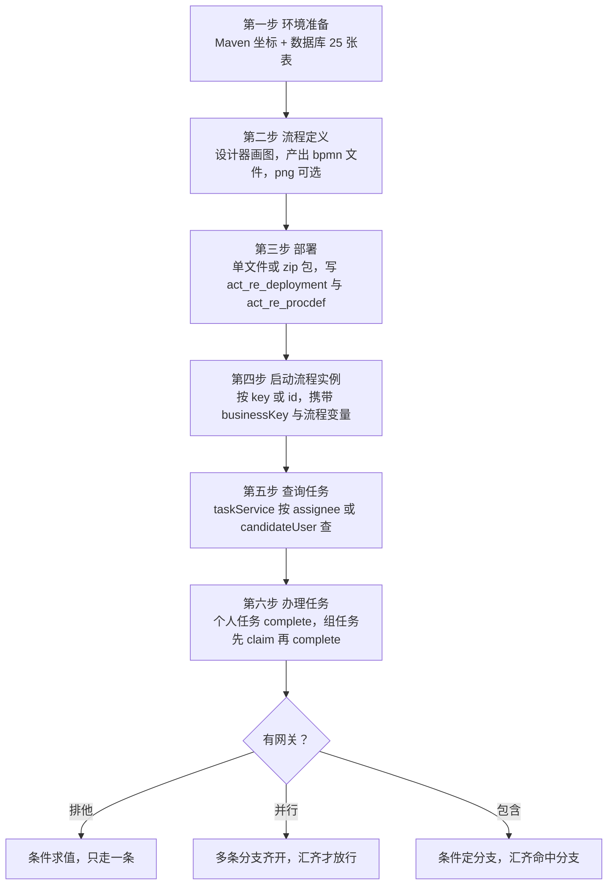

# 环境到网关六步走完：Activiti 基础与进阶的知识地图

五天的内容散落在坐标、25 张表、七套 Service 和三种网关里，收尾不把这些串成一条线，用的时候就得翻回去找。工作流解决的是计算机对业务流程的自动化管理，Activiti 是实现这件事的开源工作流引擎，按 BPMN 2.0 规范画图、按固定六步开发，后面与业务系统结合的综合案例全靠这张地图导航。

## 先给结论

- 开发主线六步：搭环境、画流程定义、部署、启动流程实例、查询任务、办理任务，每一步都有对应的 Service 和表。
- 环境准备两件事：Maven 坐标加数据库，引擎启动后自动建 25 张表；与 Spring、Spring Boot 的整合放到后续案例里讲。
- 流程定义生成 `.bpmn` 文件，`.png` 图片不是必须的，前面所有演示都没带 png 照样跑通。
- `businessKey` 是业务系统与工作流整合的桥梁，请假流程里它就是请假单 id；流程变量是全局变量，生命周期覆盖整个流程实例。
- 组任务先 `claim` 拾取把候选人变成负责人，再 `complete` 办理；三种网关一句话记：排他只走一条，并行多条必汇齐，包含用条件定分支。

## 一、六步开发法全景

从零到一个跑通的流程，路径是固定的：



这条主线里每一步都落到具体的表和 API 上，展开看最容易忘的几处。

## 二、部署：两张表与两种方式

部署是流程进入引擎的入口，单个文件部署和 zip 包部署都常用，单个文件写起来更直接，Web 程序里资源多时打成 zip 一次带走。部署完成后查两张表：

```sql
SELECT * FROM act_re_deployment  # 流程定义部署表，一次部署插入一条记录
SELECT * FROM act_re_procdef     # 流程定义表，一次部署两个流程定义就插两条记录
```

建议一次部署只放一个流程定义，让 `act_re_deployment` 与 `act_re_procdef` 保持一对一，查数据时不用对账。部署的 bpmn 资源本体存在 `act_ge_bytearray`，部署图、流程图都能从这张表还原出来。

## 三、启动实例：key、businessKey 与流程变量

启动实例按流程定义的 key 走，引擎自动取该 key 的最新版本；按 id 启动则精确锁定某个版本。业务系统与工作流的结合点在这一步埋下：把请假单 id 作为 `businessKey` 传进去，运行时表的 `BUSINESS_KEY_` 字段就有了业务锚点：

```java
ProcessEngine processEngine = ProcessEngines.getDefaultProcessEngine();
RuntimeService runtimeService = processEngine.getRuntimeService();

// 第一个参数：流程定义 key；第二个参数：业务标识 businessKey，它本身就是请假单的 id
ProcessInstance processInstance = runtimeService.startProcessInstanceByKey("holiday", "1001");

// 取出 businessKey 使用
System.out.println(processInstance.getBusinessKey());
```

流程变量在同一时刻设置，它是全局变量，生命周期覆盖整个流程实例，实例结束变量随之消失；排他网关与包含网关的条件求值吃的正是这些变量。

## 四、查询与办理：个人任务和组任务两条线

查询用 `taskService`，个人任务按 `taskAssignee` 过滤，组任务按 `taskCandidateUser` 过滤，查出来的组任务 `assignee` 字段是空的，因为候选人还不等于负责人。办理个人任务直接 `complete`；组任务多一步拾取：

```java
// zhangsan 拾取组任务：把候选用户转化为任务负责人，让 assignee 有值
Task task = taskService.createTaskQuery()
        .processDefinitionKey(key)
        .taskCandidateUser("zhangsan")
        .singleResult();
if (task != null) {
    taskService.claim(task.getId(), "zhangsan");
    System.out.println("任务拾取完毕!");
}
```

拾取之后组任务变成个人任务，zhangsan 就能按 `taskAssignee` 查到并 `complete` 它。拾取错了还有归还与交接两个补救动作，本质都是改 `assignee` 的值。整个办理环节的三板斧固定为：按 key 加人名查任务、判空后完成任务、刷表确认变化。

## 五、三种网关怎么选

网关解决流程「往后怎么走」的分岔问题，选择标准看分支要不要条件、要不要汇合：

| 网关 | 分支是否带条件 | 分支数量 | 汇聚行为 |
|---|---|---|---|
| 排他网关 | 必须带 | 只走一条 | 无需等待，单线推进 |
| 并行网关 | 不带条件 | 全部齐开 | 汇齐全部分支才放行 |
| 包含网关 | 必须带 | 命中几条走几条 | 汇齐命中分支才放行 |

体检流程是包含网关的典型样本：普通员工命中两条分支，管理者命中三条，分支长度还可以不等，汇聚网关只等条件命中的那部分。需要多选一时用排他，需要无条件齐步走时用并行，两者都要时用包含。

## 常见误区

- **把 png 当成部署的必要条件**：流程定义只有 `.bpmn` 是必须的，注释掉 png 部署代码照样跑；需要流程图展示时再补，不影响引擎执行。
- **一次部署塞多个流程定义**：`act_re_deployment` 与 `act_re_procdef` 变成一对多，排查部署问题时容易对错行；一次一个，保持一对一。
- **组任务直接按 assignee 查**：拾取之前 `assignee` 为空，按人名查永远查不到；组任务要用 `taskCandidateUser` 查，拾取后再切回 assignee。
- **把流程变量当持久业务数据**：流程变量随实例结束而消失，需要长期留存的业务数据放在业务表里，工作流这边靠 `businessKey` 关联过去。

## 面试可能被问到的问题

1. 面试官追问：「Activiti 与业务系统整合的关键点是什么？」
   答：靠 `businessKey` 桥接。启动流程实例时把业务单据 id 传进去，运行时表 `act_ru_execution` 的 `BUSINESS_KEY_` 字段随之落库，业务系统凭它反查流程实例，流程侧凭它回查业务单据，双向都靠这个字段。

2. 面试官追问：「按 key 启动和按 id 启动流程实例有什么区别？」
   答：按 key 启动时引擎自动选择该 key 的最新版本流程定义，业务代码无需感知版本升级；按 id 启动精确指定某一个版本，适合必须走旧版本规则的在途业务。

3. 面试官追问：「组任务的 claim 方法做了什么？」
   答：把任务的候选用户转成负责人，即给任务的 `assignee` 字段赋值，组任务随之变成个人任务。之后该用户按 assignee 就能查到并办理；不拾取直接办理是没有入口的，因为按 assignee 查不到这条任务。

4. 面试官追问：「三种网关的汇聚行为差异？」
   答：排他网关不汇聚，只负责多选一；并行网关所有分支无条件齐开、全部到达才放行；包含网关按条件求值决定开几条分支，汇聚时只等命中的分支。包含网关可以视为排他与并行的组合体。

5. 面试官追问：「Activiti 的 25 张表按什么规律记忆？」
   答：表名前缀对应服务领域：`act_re` 属流程仓库（部署与定义），`act_ru` 属运行时（实例、任务、变量），`act_hi` 属历史，`act_ge` 属通用（字节数组、属性）。记住前缀就能按业务场景快速定位该查哪张表。

## 配套资料

- 代码：`materials/code/02/Activiti7-day05-进阶3/Activiti7-day05-进阶3/源码/activiti01/` 下 `src/main/java` 的 day03 包 `BusinessKeyAdd.java`（启动实例携带 businessKey 的真实代码）、day05 包 `GroupTest.java`（候选用户查询、claim 拾取、complete 办理的完整注释块）
- 部署表观察语句与六步提纲出自本课讲义「课程总结」一节；资料包未附带讲义文件，表行为描述以课程演示为准
