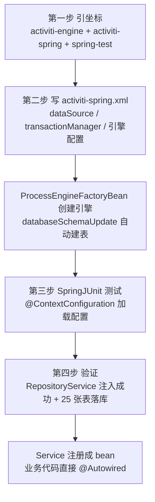

# 把引擎交给容器：Activiti 与 Spring 整合的四步路线

前五天的每个测试类开头都是同一行 `ProcessEngines.getDefaultProcessEngine()`，引擎自己 new、数据源自己读、事务没人管，这是单机玩法。真实业务系统里 Bean 由 Spring 创建、事务由 Spring 管，工作流引擎也该住进容器，跟业务代码共用一套数据源和事务。Activiti 7 为此提供了专门的整合包，路线只有四步。

## 先给结论

- 整合四步：引 Maven 坐标、写 `activiti-spring.xml` 配置文件、写 Spring 与 JUnit 整合的测试类、以 `RepositoryService` 能否注入作为成功标志。
- 核心变化是配置类：从 `StandaloneProcessEngineConfiguration` 换成 `org.activiti.spring.SpringProcessEngineConfiguration`，数据源与事务管理器由 Spring 注入。
- 引擎 bean 通过 `org.activiti.spring.ProcessEngineFactoryBean` 工厂方式创建，各 Service 再用实例工厂方法注册成 bean，业务代码直接 `@Autowired`。
- 配置里 `databaseSchemaUpdate` 设为 `drop-create`，Spring 容器拉起引擎时自动建表，不用再手动跑建表脚本。
- 配置文件名不固定，`activiti-spring.xml` 只是本课的取名习惯。

## 一、day06 全景：新特性部分讲什么

这一天的内容围绕 Activiti 7 的新特性展开，共五块：Activiti 与 Spring 整合开发、Activiti 7 现状分析、新特性介绍、Activiti 与 Spring Boot 整合开发，以及把引擎装进 Spring Boot 之后的综合案例（人力资源 SaaS 项目里的流程化管理）。Spring 整合是整条线的入口：公司里目前就两条主流路线，要么直接与 Spring 整合后用原生 API，要么与 Spring Boot 整合走自动配置，本节先把前者走通。

## 二、第一步：坐标就位

整合要的坐标分四组：Activiti 引擎本体、Activiti 与 Spring 的整合包、Spring 全家桶（事务、JDBC、测试）、MySQL 驱动与连接池。真实工程 `pom.xml` 里与整合直接相关的部分：

```xml
<properties>
    <slf4j.version>1.6.6</slf4j.version>
    <log4j.version>1.2.12</log4j.version>
</properties>

<dependencies>
    <!-- 流程引擎本体 -->
    <dependency>
        <groupId>org.activiti</groupId>
        <artifactId>activiti-engine</artifactId>
        <version>7.0.0.Beta1</version>
    </dependency>
    <!-- Activiti 与 Spring 整合包，SpringProcessEngineConfiguration 在这里 -->
    <dependency>
        <groupId>org.activiti</groupId>
        <artifactId>activiti-spring</artifactId>
        <version>7.0.0.Beta1</version>
    </dependency>
    <!-- bpmn 模型与转换相关坐标 -->
    <dependency>
        <groupId>org.activiti</groupId>
        <artifactId>activiti-bpmn-model</artifactId>
        <version>7.0.0.Beta1</version>
    </dependency>
    <!-- JUnit 与 Spring 整合测试所需 -->
    <dependency>
        <groupId>org.springframework</groupId>
        <artifactId>spring-test</artifactId>
        <version>5.0.7.RELEASE</version>
    </dependency>
    <dependency>
        <groupId>mysql</groupId>
        <artifactId>mysql-connector-java</artifactId>
        <version>5.1.40</version>
    </dependency>
    <dependency>
        <groupId>commons-dbcp</groupId>
        <artifactId>commons-dbcp</artifactId>
        <version>1.4</version>
    </dependency>
</dependencies>
```

`activiti-bpmn-converter`、`activiti-json-converter` 等坐标按需补齐，日志与 MyBatis 坐标照旧。坐标粘贴后记得刷新 Maven 工程，否则配置文件里的类全是红色。

## 三、第二步：activiti-spring.xml 把对象链条配齐

这是整合的主战场。一个配置文件要交代四件事：数据源、引擎配置、引擎工厂、Service 注册，外加事务切面：

```xml
<!-- 数据源 -->
<bean id="dataSource" class="org.apache.commons.dbcp.BasicDataSource">
    <property name="driverClassName" value="com.mysql.jdbc.Driver"/>
    <property name="url" value="jdbc:mysql://localhost:3306/activiti"/>
    <property name="username" value="root"/>
    <property name="password" value="root"/>
    <property name="maxActive" value="3"/>
    <property name="maxIdle" value="1"/>
</bean>

<!-- 工作流引擎配置 bean：整合的关键就是换成这个类 -->
<bean id="processEngineConfiguration" class="org.activiti.spring.SpringProcessEngineConfiguration">
    <property name="dataSource" ref="dataSource"/>
    <property name="transactionManager" ref="transactionManager"/>
    <property name="databaseSchemaUpdate" value="drop-create"/>
</bean>

<!-- 流程引擎：工厂方式创建 -->
<bean id="processEngine" class="org.activiti.spring.ProcessEngineFactoryBean">
    <property name="processEngineConfiguration" ref="processEngineConfiguration"/>
</bean>

<!-- 用引擎的实例工厂方法把 Service 注册成 bean -->
<bean id="repositoryService" factory-bean="processEngine" factory-method="getRepositoryService"/>
<bean id="runtimeService" factory-bean="processEngine" factory-method="getRuntimeService"/>
<bean id="taskService" factory-bean="processEngine" factory-method="getTaskService"/>
<bean id="historyService" factory-bean="processEngine" factory-method="getHistoryService"/>

<!-- 事务管理器，与引擎共用同一个数据源 -->
<bean id="transactionManager"
      class="org.springframework.jdbc.datasource.DataSourceTransactionManager">
    <property name="dataSource" ref="dataSource"/>
</bean>

<!-- 事务通知与切面，按业务工程的实际包路径修改切点 -->
<tx:advice id="txAdvice" transaction-manager="transactionManager">
    <tx:attributes>
        <tx:method name="save*" propagation="REQUIRED"/>
        <tx:method name="update*" propagation="REQUIRED"/>
        <tx:method name="find*" propagation="SUPPORTS" read-only="true"/>
    </tx:attributes>
</tx:advice>
<aop:config proxy-target-class="true">
    <aop:advisor advice-ref="txAdvice"
                 pointcut="execution(* com.example.service.impl.*.*(..))"/>
</aop:config>
```

三处要点：引擎配置 bean 注入了 `dataSource` 与 `transactionManager`，等于把数据库连接和事务控制一并托付给 Spring；`ProcessEngineFactoryBean` 是一个工厂 bean，容器真正要的是它产出的 `ProcessEngine`；各 Service 靠 `factory-bean` 加 `factory-method` 从引擎身上取出来，从此业务代码里不再出现 `getDefaultProcessEngine()`。

`databaseSchemaUpdate` 设成 `drop-create` 时，容器每次拉起引擎先删旧表再建新表，学习阶段最省心；生产环境必须换成 `false` 或 `true`，否则每次重启库都被清空。

## 四、第三步与第四步：测试类与成功标志

测试代码用 Spring 与 JUnit 整合的写法，两个注解决定一切：

```java
@RunWith(SpringJUnit4ClassRunner.class)
@ContextConfiguration(locations = "classpath:activiti-spring.xml")
public class ActivitiSpringIntegrationTest {

    @Autowired
    private RepositoryService repositoryService;

    @Test
    public void testDeploymentObj(){
        System.out.println("部署对象：" + repositoryService);
    }
}
```

`@RunWith` 把测试Runner换成 Spring 提供的，`@ContextConfiguration` 指定配置文件位置，容器随测试启动。成功的标志有两条：`repositoryService` 能正常注入并打印出对象；数据库里 25 张表被自动建出来。两件事同时成立，说明引擎已在容器里创建完成，后续的流程部署、实例启动直接从容器拿 Service 用。

整合后的依赖与动作链路如下：



## 五、换掉 Standalone 意味着什么

对比两个配置类，差的不是一行 class 名，而是管理权：

| 对比项 | StandaloneProcessEngineConfiguration | SpringProcessEngineConfiguration |
|---|---|---|
| 使用方式 | 代码里自己加载配置文件构建 | 作为 bean 交给容器创建 |
| 数据源 | 配置文件里给引擎私有 | 引用容器统一的 dataSource |
| 事务 | 引擎自行管理 | 引用 Spring 的 transactionManager |
| 生命周期 | 进程内手工维护 | 随容器启动与销毁 |

业务操作与流程操作由此能放进同一个事务：Service 方法上切面开事务，方法内既改业务表又调 `taskService.complete()`，两者共用一个数据源连接，要成功一起成功，要回滚一起回滚。这是单机版给不了的保障，也是公司选择整合的根本原因。

## 常见误区

- **只引 `activiti-engine` 不引 `activiti-spring`**：`SpringProcessEngineConfiguration` 与 `ProcessEngineFactoryBean` 都在整合包里，缺了它配置文件直接报类找不到。
- **把 `drop-create` 带上生产**：它的语义是先删表再建表，学习期方便，生产库一重启数据全没；生产用 `false`（不自动处理）加版本化脚本管理表结构。
- **引擎私配一套数据源**：图省事在引擎配置里另写连接信息，业务与流程两张皮，事务同生共死的保障就没了；数据源必须 `ref` 同一个 bean。
- **切点表达式照抄不查**：`aop:config` 的 pointcut 指向不存在的包时，容器启动报错；包名要按自己工程的 Service 实现类路径改。

## 面试可能被问到的问题

1. 面试官追问：「Activiti 与 Spring 整合后，引擎的创建方式有什么变化？」
   答：从代码里调 `ProcessEngines.getDefaultProcessEngine()` 手工获取，改为在 Spring 配置中声明 `SpringProcessEngineConfiguration`，再由 `ProcessEngineFactoryBean` 工厂 bean 产出引擎。引擎的生命周期交给容器管理，启动即创建，销毁即释放。

2. 面试官追问：「ProcessEngineFactoryBean 起什么作用？」
   答：它实现了 Spring 的 FactoryBean 接口，容器从它身上取出的是 getObject 方法返回的 `ProcessEngine` 对象。引擎的构建过程复杂（要装配配置、数据源、建表），用工厂 bean 把这套过程封装起来，配置文件里只需 ref 一个配置 bean。

3. 面试官追问：「各 Service 是怎么注册成 Spring bean 的？」
   答：用实例工厂方法的方式，`factory-bean` 指向引擎 bean，`factory-method` 指向 `getRepositoryService()`、`getRuntimeService()` 这类获取方法。引擎创建完成后，容器调用这些方法把返回值注册为对应 id 的 bean，业务代码直接注入。

4. 面试官追问：「databaseSchemaUpdate 常用取值有哪些？」
   答：`false` 表示不执行任何建表动作，表不存在就报错；`true` 表示启动时检查并补建缺失的表；`drop-create` 表示先删全部表再重建，适合学习与反复测试。生产环境应使用 `false` 并用脚本统一管理表结构版本。

5. 面试官追问：「整合之后流程操作能参与 Spring 事务吗？」
   答：能。`SpringProcessEngineConfiguration` 注入了 Spring 的 `transactionManager`，引擎内部的数据库操作走 Spring 事务体系；业务方法上由切面开启事务时，流程表与业务表的写操作共用同一连接，回滚时一起回滚。

## 配套资料

- 配置素材：`materials/code/02/Activiti7-day06-新特性/Activiti7-day06-新特性/资料/基本素材/01activiti与spring整合素材/activiti-spring.xml`（数据源、引擎配置、工厂 bean、Service 注册、事务切面的完整配置，文中切点包名已改为 `com.example`）
- 同目录 `pom.xml`（全套依赖坐标）；源码工程 `materials/code/02/Activiti7-day06-新特性/Activiti7-day06-新特性/源码/activiti06/`（`src/main/resources/activiti-spring.xml` 与测试类 `ActivitiSpringIntegrationTest.java`，包名已改为 `com.example`）
- 官方示例：`materials/code/02/Activiti7-day06-新特性/Activiti7-day06-新特性/资料/activiti-examples-master/activiti-api-spring-integration-example/`（Spring 整合的官方参考工程）
