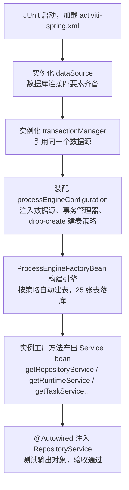

# 容器拉起引擎的那一刻：Spring 整合测试与加载过程分析

配置文件写完不代表整合成功，`SpringProcessEngineConfiguration` 有没有被容器正确装配、25 张表会不会自动建出来，得跑一次测试才知道。测试通过之后还有更值得问的一层：JUnit 一启动，容器是怎么一步步把引擎装出来塞给 `@Autowired` 的。这两件事合起来，才是 Spring 整合的完整闭环。

## 先给结论

- 测试类只需两个注解：`@RunWith(SpringJUnit4ClassRunner.class)` 与 `@ContextConfiguration(locations = "classpath:activiti-spring.xml")`，容器随测试启动。
- 整合成功的两个标志：`repositoryService` 注入成功并能打印出对象；`activiti` 库中 25 张表被自动创建。
- 加载主线是五环：JUnit 启动容器、配置里的 bean 依序实例化、`ProcessEngineFactoryBean` 构建引擎、实例工厂方法产出各 Service、`@Autowired` 完成注入。
- 引擎配置 bean 的三个属性分工明确：`dataSource` 管连接、`transactionManager` 管事务、`databaseSchemaUpdate=drop-create` 管建表。
- 事务通知的切点表达式指向的包必须真实存在，工程里没有这个包容器直接起不来，这是本课现场踩到的坑。

## 一、工程立起来：坐标、刷新与一个切点坑

新建工程 `activiti06`，把整合坐标整组粘进 `pom.xml`：引擎本体的 `activiti-engine`、承担整合职责的 `activiti-spring`、bpmn 模型与转换一组、`activiti-cloud-services-api`、`aspectjweaver`、MySQL 驱动、JUnit 与 `spring-test`、日志、MyBatis、`commons-dbcp` 与 `commons-io`。粘贴完成后必须刷新 Maven 工程，否则依赖没下载，配置文件里满屏红色，很容易误判成自己写错了。

真正的一个坑在事务切面：

```xml
<aop:config proxy-target-class="true">
    <aop:advisor advice-ref="txAdvice"
                 pointcut="execution(* com.example.service.impl.*.*(..))"/>
</aop:config>
```

切点指向的 `com.example.service.impl` 包在空工程里还不存在，容器启动解析到这一行就报错。新建出这个包，报错立即消失。切点表达式不是装饰，它声明的路径必须与工程实际结构对得上。

测试前照例清库，让建表效果一眼可见：

```sql
drop database activiti;
create database activiti;
```

此时库是干净的空壳，一张表都没有，接下来每一步引擎自动做了什么，表都会如实交代。

## 二、写测试类：两个注解一个注入

测试类放在工程的 test 目录下，写法就是 Spring 与 JUnit 整合的标准姿势：

```java
package com.example.test;

import org.activiti.engine.RepositoryService;
import org.junit.Test;
import org.junit.runner.RunWith;
import org.springframework.beans.factory.annotation.Autowired;
import org.springframework.test.context.ContextConfiguration;
import org.springframework.test.context.junit4.SpringJUnit4ClassRunner;

@RunWith(SpringJUnit4ClassRunner.class)
@ContextConfiguration(locations = "classpath:activiti-spring.xml")
public class ActivitiSpringIntegrationTest {

    @Autowired
    private RepositoryService repositoryService;

    @Test
    public void testDeploymentObj(){
        System.out.println("部署对象：" + repositoryService);
    }
}
```

`@RunWith` 把 JUnit 的执行器换成 Spring 提供的，测试运行即容器启动；`@ContextConfiguration` 指定配置文件在 classpath 下的位置。`@Autowired` 的字段能不能有值，取决于容器能否创建出 id 为 `repositoryService` 的 bean，因此这个输出等于在替整条装配链验收。别在 `main` 方法里写这套注解，`@Autowired` 只在容器管理的对象上生效，测试入口必须是 JUnit 的 `@Test`。

## 三、跑测试：两个成功标志一次验收

运行测试方法，控制台打出「部署对象：`org.activiti.engine.impl.RepositoryServiceImpl@...`」这类对象描述，第一个标志成立。再刷新数据库，`activiti` 库里 25 张表全部出现，第二个标志也成立，整合宣告成功。

建表动作不是谁额外执行的，它是引擎装配的一部分：`databaseSchemaUpdate` 设为 `drop-create`，容器拉起引擎时先删旧表再建新表，对反复测试极友好。这也反过来说明一件事：引擎创建发生在容器启动阶段，而不是第一次调用 Service 的时候。

## 四、加载过程分析：容器怎么把引擎装出来

对着配置文件把链条捋一遍，五个环节环环相扣：



这张图讲的是依赖的传导方向：测试的 `@ContextConfiguration` 触发配置文件加载，容器按依赖顺序实例化 bean。引擎工厂 bean 要创建引擎，引擎必须知道连哪个库、事务听谁的、表怎么处理，这三件事全部由 `processEngineConfiguration` 提供；配置 bean 又指向更上游的 `dataSource` 与 `transactionManager`。上游三件套就绪，`ProcessEngineFactoryBean` 才能构建出引擎；引擎就绪后，配置文件里那些 `factory-bean="processEngine"` 的声明开始干活，容器调用引擎的 `getRepositoryService()`、`getRuntimeService()` 等方法，把返回值注册成一个个 Service bean，最后由 `@Autowired` 送进测试类。

**第一，引擎是整个链条的装配枢纽。** 前五天代码里的 `processEngine.getRepositoryService()` 还在，只是调用者从业务代码变成了容器：实例工厂方法把这次调用提前到了容器启动时，调用结果存进 bean 定义，之后所有需要 Service 的地方都从容器拿现成的。

**第二，数据源与事务换主是整合的实质。** 引擎不再自建连接，用的是容器统一的数据源；事务管理器是 Spring 的 `DataSourceTransactionManager`，配合 `tx:advice` 与切面，业务方法上的事务同时罩住业务表与流程表的写操作。这就是第五天之前做不到、整合之后天然具备的能力。

## 常见误区

- **验收只看对象输出不看表**：`repositoryService` 打印出来只能证明 bean 装配链通了，建表策略是否生效、连的是不是预期的库，要靠刷表确认；两个标志缺一不可。
- **Maven 未刷新就排查配置**：坐标刚粘进去依赖还在下载，配置文件报红多半是索引未更新，先刷新工程再定位问题。
- **切点包不存在导致启动失败**：`aop:config` 的 pointcut 指向空工程里不存在的包，容器启动报错，容易被误读成 xml 语法错误；先建包或改表达式。
- **在 main 方法里测注入**：`@Autowired` 依赖容器环境，普通 `main` 起不来容器，字段永远是 null；测试入口必须是 JUnit 加 `@RunWith`。

## 面试可能被问到的问题

1. 面试官追问：「测试方法里没有一行创建引擎的代码，引擎是谁创建的？」
   答：JUnit 的 Spring 执行器在测试启动时加载 `activiti-spring.xml` 并刷新容器，配置里的 `ProcessEngineFactoryBean` 在初始化阶段依据 `SpringProcessEngineConfiguration` 构建引擎，建表也在此刻完成。测试类只是从容器里领取装配好的 Service。

2. 面试官追问：「`factory-bean` 和 `factory-method` 的组合是怎么工作的？」
   答：`factory-bean` 指定一个已存在的工厂 bean 实例，`factory-method` 指定要调用的方法。容器在创建 `repositoryService` 这类 bean 时，调用引擎实例的 `getRepositoryService()` 方法，把返回值作为 bean 注入需要的地方，这是实例工厂方法的注册方式。

3. 面试官追问：「整合后为什么流程操作能和业务操作共用一个事务？」
   答：`SpringProcessEngineConfiguration` 注入了 Spring 的 `DataSourceTransactionManager`，且引擎与业务使用同一个 `dataSource` bean。切面在业务方法上开事务时，流程表与业务表的 SQL 走同一连接同一事务边界，异常时一并回滚。

4. 面试官追问：「整合成功怎么判断？」
   答：两条标准同时满足：注入的 `RepositoryService` 能打印出真实对象，说明装配链完整；数据库里自动出现引擎的 25 张表，说明引擎按 `databaseSchemaUpdate` 策略完成了初始化。只有对象输出而表缺失，说明引擎配置或数据源有问题。

5. 面试官追问：「公司里 Activiti 的两种整合路线怎么选？」
   答：主流就两种：直接与 Spring 整合，配置显式、可控性强，之后用引擎原生 API 做流程控制；与 Spring Boot 整合，靠 starter 与自动配置省掉整套 xml，适合新工程。两条路线的 API 用法一致，差异在环境搭建方式，本课综合案例走的是 Spring Boot 路线。

## 配套资料

- 源码工程：`materials/code/02/Activiti7-day06-新特性/Activiti7-day06-新特性/源码/activiti06/`（`pom.xml`、`src/main/resources/activiti-spring.xml`、`src/test/java` 下的测试类 `ActivitiSpringIntegrationTest.java`，文中包名已统一改为 `com.example`）
- 配置素材：`materials/code/02/Activiti7-day06-新特性/Activiti7-day06-新特性/资料/基本素材/01activiti与spring整合素材/activiti-spring.xml` 与同目录 `pom.xml`
- 官方示例：`materials/code/02/Activiti7-day06-新特性/Activiti7-day06-新特性/资料/activiti-examples-master/activiti-api-spring-integration-example/`（Spring 整合的官方参考工程）
