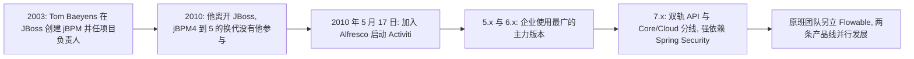

# 从 jBPM 到 Flowable：Activiti 的发展脉络与 7.x 要面对的挑战

学了五天 Activiti，部署、流程实例、组任务、网关都跑通了，进入第六天却发现风向变了：API 换了一套名字，文档里冒出 ProcessRuntime 和 TaskRuntime，社区里还流传着另一个叫 Flowable 的引擎。要判断这版新东西值不值得投入，得先把来龙去脉搞清楚：它从哪来，核心人物是谁，7.x 为什么长成这样，它的「竞品」为什么恰好是一批人做出来的另一个引擎。

## 先给结论

- Activiti 于 2010 年 5 月 17 日由 Alfresco 宣布启动，首席架构师 Tom Baeyens 正是 jBPM 的创建者与项目负责人。
- 企业里真正跑在生产环境、招聘需求最集中的，仍是 Activiti 5.x 与 6.x 两个版本。
- 7.x 不是 Tom Baeyens 团队的作品，他本人早已离开；原 Activiti 开发团队后来整体去做 Flowable。
- 7.x 拆成 Activiti Core 与 Activiti Cloud 两大块，课程聚焦 Core；新 API 是对老 Service 的封装，并且强依赖 Spring Security。
- 选型现状：Activiti 仍是主流方向，Flowable 有成长趋势，两者同源，值得对照学习。

## 一、jBPM 创始人的第二次出发

**第一，Activiti 的出生日期很明确。** 2010 年 5 月 17 日，Alfresco 软件公司宣布 BPM（业务流程管理）开源项目 Activiti 正式启动，首席架构师由流程管理领域的专家 Tom Baeyens 担任。作为一款工作流引擎，它的定位是把业务系统中复杂的业务流程抽取出来，使用专门的建模语言 BPMN 2.0 进行定义，业务系统按照预定义的流程执行，由引擎统一管理流程，减少业务系统因流程变更而升级改造的工作量，提高系统健壮性，降低开发维护成本，官方网站是 activiti.org。

**第二，Tom Baeyens 不是无名之辈。** 他的履历可以直接解释 Activiti 的出身：早年在西门子做软件开发，2003 年进入 JBoss，创建并负责 jBPM 项目，一直干到 2010 年 3 月；随后加入 Alfresco 出任 BPM 首席架构师，Activiti 就是他在这里的作品。换句话说，他先后主导了两款著名的工作流引擎，这个背景是理解 Activiti 一切设计风格的起点。

## 二、为什么 Activiti 常被看作 jBPM 的延续

jBPM 本身也是一款非常有名的工作流引擎，它在从 4 升级到 5 的换代时出现了关键变故：这次换代不是 Tom Baeyens 做的，他已经离开了 JBoss。jBPM 5 以及后续版本与他的设计理念相差很大，而 Activiti 与早期 jBPM 出自同一位首席架构师之手，思想一脉相承，很多人因此认为 jBPM 往后的延续其实就是 Activiti。

这也解释了 Activiti 一发布就能迅速走红的原因：一群学 jBPM 的开发者跟着人走，直接转投了 Activiti。社区不是从零积累的，而是整建制迁移过来的。

## 三、7.x 的组成部分：Core 与 Cloud 双线

**第一，5.x 和 6.x 才是市面上的主力。** 目前能在公司里接触到的版本，最常用的是 Activiti 5.x 和 6.x，实际项目与招聘要求都集中在这两代上。

**第二，7.x 是另一条产品线。** 7.x 不是 Tom Baeyens 带团队开发出来的。他后来从 Alfresco 离开，履历上是一段段新经历：做过 Effektif 的 CEO，在 Signavio 任杰出工程师，又创办过自己的项目。官方文档把现在的 Activiti 分成两个部分：

- **Activiti Core**：核心引擎部分，覆盖企业级开发对工作流管理的全部常规需求，本课程重点。
- **Activiti Cloud**：面向云原生的部分，借助云服务实现分布式业务流程开发，包含 Runtime Bundle、Query、Audit、Connectors 等基础构建块。

## 四、三道坎：API 变动、安全强依赖、团队分流

7.x 摆在使用者面前的是三道现实的坎。

**第一，API 大变动。** 熟悉 5 和 6 的开发人员上手 7，会发现 API 变了不少。老 API 的入口是一台 ProcessEngine，各模块 Service 从它那里领：

```java
// 老 API：从 ProcessEngine 领出各模块 Service（5.x/6.x 写法，示意）
ProcessEngine processEngine = ProcessEngines.getDefaultProcessEngine();
RepositoryService repositoryService = processEngine.getRepositoryService();
RuntimeService runtimeService = processEngine.getRuntimeService();
TaskService taskService = processEngine.getTaskService();
```

7.x 在这堆 Service 之上封装出两个新的门面接口，业务代码直接注入就能用：

```java
// 新 API：注入两个 Runtime 接口，背后仍然是老的 Service（7.x 写法，示意）
@Autowired
private ProcessRuntime processRuntime;
@Autowired
private TaskRuntime taskRuntime;
```

门面变了，底层没变，但写法、约定和前置条件都不一样，后两课逐个拆开。

**第二，强依赖 Spring Security。** 7.x 与 Spring Boot 整合后，默认的权限体系就是 Spring Security，调用新 API 之前必须先以具备特定角色的用户身份登录，否则连一次查询都通不过。这对不熟悉 Spring Security 的同学是一道前置技术门槛，也是 7.x 最受争议的设计。

**第三，原班人马分流做 Flowable。** Tom Baeyens 离开之后，Activiti 的原开发团队几乎整体转去做了 Flowable，两款引擎设计同源。就现状而言，不管是招聘还是公司的真实使用场景，Activiti 仍然是主流方向，Flowable 处在成长趋势中，有时间值得参考学习。

用一张图把这条时间线串起来：



这张图讲的是同一套流程引擎思想先后落进三个项目。关键看两头：jBPM 与 Activiti 出自同一人，所以理念相近；Activiti 5/6 与 7 之间隔着一次团队换血，所以 API 断代；7 与 Flowable 又是同一批人的两条产品线，所以彼此像。理解了人的流动，版本之间的差异就不再神秘。

## 常见误区

- **把 7.x 当成 6.x 的平滑升级**：版本号只进了一位，编程模型却换掉了，直接照搬 6.x 的 Service 用法会对不上号；7.x 的入口是 ProcessRuntime 与 TaskRuntime 两个接口。
- **以为 Flowable 是无关的竞品**：Flowable 出自 Activiti 原班团队，引擎设计同源，学过一个再看另一个成本很低，选型时应当作同一谱系来评估，而不是两套完全陌生的东西。
- **认为版本越新越好，上手就选 7**：企业现状是 5.x、6.x 占主流，存量系统大量停留在 5/6；先掌握主流版本的 API，再学 7.x 的新特性，才是稳妥路线。
- **忽略 BPMN 2.0 这个共同底座**：jBPM、Activiti、Flowable 的流程建模语言都是 BPMN 2.0，流程图本身可以迁移，差异集中在引擎实现与 API 层。

## 面试可能被问到的问题

1. 面试官追问：「Activiti 和 jBPM 是什么关系？」
   答：两者都是工作流引擎。jBPM 的创建者 Tom Baeyens 于 2010 年加入 Alfresco 后主导开发了 Activiti；jBPM 从 4 升级到 5 时他已离开，新版本与他的设计理念分歧较大，所以 Activiti 普遍被视为早期 jBPM 设计思想的延续。

2. 面试官追问：「你们公司为什么用 Activiti 5/6 而不是 7？」
   答：5.x 和 6.x 是目前企业使用最广的版本，文档、案例与招聘需求都集中在这两代；7.x 改变了编程模型并强依赖 Spring Security，存量系统迁移成本高。新项目若要用新特性可以直接从 7 起步，老系统则没有升级的紧迫性。

3. 面试官追问：「Activiti 7 分成哪两个部分？」
   答：分成 Activiti Core 与 Activiti Cloud。Core 是核心引擎，覆盖常规企业级工作流管理；Cloud 面向云原生，通过 Runtime Bundle、Query、Audit、Connectors 等构建块支持分布式业务流程开发。

4. 面试官追问：「Flowable 和 Activiti 什么关系？」
   答：Flowable 是 Activiti 原开发团队离开后另起的产品，引擎设计同源、API 风格接近。当前 Activiti 在招聘与实际项目中仍是主流，Flowable 处于成长趋势，两者可以对照学习。

5. 面试官追问：「Activiti 解决的核心问题是什么？」
   答：把业务系统中复杂的业务流程抽取出来，用 BPMN 2.0 建模语言定义，业务系统按预定义流程执行，流程由引擎统一管理。流程变更时不需要大范围改造业务系统，从而减少升级改造工作量，提高系统健壮性并降低维护成本。

## 配套资料

- 官方示例工程：`materials/code/02/Activiti7-day06-新特性/Activiti7-day06-新特性/资料/activiti-examples-master/`（7.x 新 API 的官方示例仓库，下一课拆解其结构）
- 7.x 新 API 落地示例：`materials/code/02/Activiti7-day06-新特性/Activiti7-day06-新特性/源码/demo2/activitispringboot06/`（Activiti 7 与 Spring Boot 整合的最小工程，文中新 API 用法即出自该工程，包名已统一改为 `com.example`）
- 历史脉络部分为课程讲义内容整理，无独立源码包
