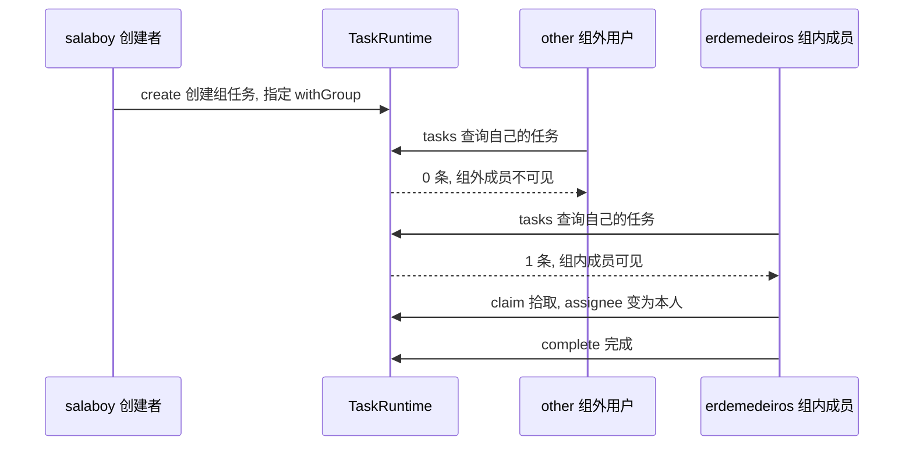

# TaskRuntime 拆解：任务的创建、拾取与完成，组任务可见性是隐藏主角

工作流系统里跟业务人员打交道最多的就是任务：创建任务、查自己的任务、拾取组任务、办结任务。7.x 把这一整块收进了 TaskRuntime 接口。上手时最容易困惑的现象是：同一个列表，两个人查出来的条数不一样，有人是 0 条，有人能看到任务。这不是 bug，是 TaskRuntime 默默替你做了数据权限过滤。这一课把接口、剧本和底层实现一起拆开。

## 先给结论

- TaskRuntime 是 7.x 对老 TaskService 的封装门面，唯一实现类 TaskRuntimeImpl，任务的创建、查询、拾取、完成、归还、删改全在一个接口里。
- 创建任务走 `create` 配合 `TaskPayloadBuilder`，`withGroup` 指定组就是组任务，`withAssignee` 直接指定办理人就是个人任务。
- `tasks(Pageable)` 查询自动按当前登录用户及其所属组过滤：组任务对组外成员天然不可见。
- 组任务的标准姿势是先 `claim` 拾取变个人任务，再 `complete` 完成；任务已被他人认领时，非办理人完成会被拒绝。
- 任务分配、完成等动作都有对应事件，注册 `TaskRuntimeEventListener` 监听器即可发通知。

## 一、接口一览：任务的全套动作

官方文档对 TaskRuntime 的定位一句话：业务应用里要为组织中的用户或组创建任务，这套 API 就是来帮你的。接口定义如下：

```java
public interface TaskRuntime {
    TaskRuntimeConfiguration configuration();
    // 按 id 查单个任务
    Task task(String taskId);
    // 分页查当前用户的任务, 两个重载
    Page<Task> tasks(Pageable pageable);
    Page<Task> tasks(Pageable pageable, GetTasksPayload payload);
    // 创建任务
    Task create(CreateTaskPayload payload);
    // 拾取组任务
    Task claim(ClaimTaskPayload payload);
    // 归还组任务
    Task release(ReleaseTaskPayload payload);
    // 完成任务
    Task complete(CompleteTaskPayload payload);
    Task update(UpdateTaskPayload payload);
    Task delete(DeleteTaskPayload payload);
    // 任务的流程变量
    List<VariableInstance> variables(GetTaskVariablesPayload payload);
    void setVariables(SetTaskVariablesPayload payload);
}
```

对比 ProcessRuntime 会发现风格完全一致：Payload 对象加 Builder 构造，方法名即语义。老 API 里 `claim`、`complete`、`setAssignee` 散落在 TaskService 的各种方法上，现在收拢成一组命名整齐的动作。

## 二、一个完整剧本：创建、不可见、可见、拾取、完成

官方示例 `activiti-api-basic-task-example` 的引导类把这套 API 串成了一个有情节的小剧本：

```java
@Override
public void run(String... args) {
    // 以 salaboy 身份创建组任务, 指定给 activitiTeam 组, 不指定办理人
    securityUtil.logInAs("salaboy");
    taskRuntime.create(TaskPayloadBuilder.create()
            .withName("First Team Task")
            .withDescription("This is something really important")
            .withGroup("activitiTeam")
            .withPriority(10)
            .build());

    // 切换到组外的 other 用户查任务, 一条也看不到
    securityUtil.logInAs("other");
    Page<Task> tasks = taskRuntime.tasks(Pageable.of(0, 10));
    logger.info("> Other cannot see the task: " + tasks.getTotalItems());

    // 切换到组内的 erdemedeiros, 能看到, 拾取后完成
    securityUtil.logInAs("erdemedeiros");
    tasks = taskRuntime.tasks(Pageable.of(0, 10));
    String taskId = tasks.getContent().get(0).getId();
    taskRuntime.claim(TaskPayloadBuilder.claim().withTaskId(taskId).build());
    taskRuntime.complete(TaskPayloadBuilder.complete().withTaskId(taskId).build());
}
```

同一个任务，other 查是 0 条，erdemedeiros 查得到，差别只在「他属不属于 activitiTeam 组」。这就是组任务的可见性规则：创建时不带办理人，任务挂在组上；查询时引擎按当前登录人的用户名与所属组拼过滤条件，组外成员直接被挡在结果之外。

任务动作还可以挂事件监听器，典型用途是任务被分配时给办理人发通知：

```java
@Bean
public TaskRuntimeEventListener<TaskAssignedEvent> taskAssignedListener() {
    return taskAssigned -> logger.info(">>> Task Assigned: '"
            + taskAssigned.getEntity().getName()
            + "' We can send a notification to the assignee: "
            + taskAssigned.getEntity().getAssignee());
}
```

声明成 `@Bean` 即生效，任务分配、完成时会回调对应监听器，`TaskCompletedEvent` 同理。

## 三、组任务生命周期一图看懂



这张图讲的是组任务从创建到办结的完整时序。关键节点在 `claim`：拾取之前任务属于组，人人可见无人负责；拾取之后 assignee 落到具体人身上，其他人不再可见，想反悔用 `release` 归还给组即可。

## 四、实现类里还是 TaskService

按住 Ctrl 点进 TaskRuntimeImpl，剧情和 ProcessRuntime 一样：实现类与 Spring Security 高度耦合，方法开头先取当前认证用户，没有认证用户直接抛异常；任务查询、拾取、完成最终全部委托给老的 TaskService。

- `task(taskId)`：先确认有认证用户，再拿用户角色与组，底层执行 `taskService.createTaskQuery().taskId(taskId).singleResult()`，查不到抛 NotFoundException，查到由转换器转成对外模型。
- `tasks(...)`：`createTaskQuery` 构造查询后，自动把当前用户与其所属组拼进过滤条件，所以「我的任务」天然带数据权限，业务代码不用手写候选人条件。
- `complete(...)`：先按 id 取任务并校验办理人，任务已被他人认领而当前用户不是办理人时，直接抛 IllegalStateException 拒绝完成；校验通过才交给 `taskService` 办结。

教学工程里的测试方法就是按这个姿势写的，查询、拾取、完成一条龙：

```java
// 查询任务, 并完成自己的任务
@Test
public void testTask() {
    securityUtil.logInAs("ryandawsonuk");
    Page<Task> taskPage = taskRuntime.tasks(Pageable.of(0, 10));
    if (taskPage.getTotalItems() > 0) {
        for (Task task : taskPage.getContent()) {
            taskRuntime.claim(TaskPayloadBuilder.claim().withTaskId(task.getId()).build());
            System.out.println("任务：" + task);
            taskRuntime.complete(TaskPayloadBuilder.complete().withTaskId(task.getId()).build());
        }
    }
}
```

新老 API 的动作对照关系如下：

| 动作 | 老 API（TaskService） | 新 API（TaskRuntime） |
|---|---|---|
| 创建任务 | `newTask()` 加 `saveTask()` | `taskRuntime.create(CreateTaskPayload)` |
| 拾取组任务 | `taskService.claim(taskId, userId)` | `taskRuntime.claim(ClaimTaskPayload)` |
| 查询我的任务 | `createTaskQuery().taskCandidateUser(...)` 等手拼条件 | `taskRuntime.tasks(Pageable)` 自动按登录人过滤 |
| 完成任务 | `taskService.complete(taskId)` | `taskRuntime.complete(CompleteTaskPayload)` |

本质上还是同一批数据库操作，新 API 换成了 Payload 参数风格，并把权限过滤内置进查询。依赖方面与 ProcessRuntime 共用同一个 starter，示例工程另配 H2 内存库即可跑，换 MySQL 只改数据源与驱动。

## 常见误区

- **跳过拾取直接完成他人已认领的任务**：实现类在 `complete` 里校验办理人，非 assignee 抛异常；组任务的标准流程是先 `claim` 再 `complete`。
- **查不到任务就以为创建失败**：多半是当前登录用户不在任务指定的组里，组任务对组外成员不可见；先用 `securityUtil.logInAs` 切到组内成员再查。
- **混淆 `withAssignee` 与 `withGroup`**：`withAssignee` 直接指定办理人，创建出来就是个人任务，不需要拾取；`withGroup` 才是组任务，要靠组员拾取。
- **每个动作前忘记登录**：TaskRuntimeImpl 与 ProcessRuntimeImpl 一样强依赖 Spring Security，没有认证用户第一步就被拦下，异常信息就是「需要认证用户」。

## 面试可能被问到的问题

1. 面试官追问：「TaskRuntime 和老的 TaskService 是什么关系？」
   答：封装关系。TaskRuntime 是 7.x 的新门面，唯一实现类 TaskRuntimeImpl 内部持有老 TaskService，查询走 `createTaskQuery`，拾取、完成最终都由 TaskService 执行。新 API 的增量在于 Payload 参数风格、内置的用户与组权限过滤，以及事件监听机制。

2. 面试官追问：「组任务的可见性是怎么实现的？」
   答：查询时实现类从安全上下文取当前用户，再通过用户组管理器拿到他所属的组，把这些条件自动拼进底层 TaskQuery。于是组任务只出现在组内成员的 `tasks` 结果里，组外成员查出来是 0 条，数据权限不需要业务代码关心。

3. 面试官追问：「claim 做了什么，对应老 API 哪个方法？」
   答：拾取就是把组任务的 assignee 设置为当前用户，组任务随之变成个人任务，其他组员不再可见。对应老 API 的 `taskService.claim(taskId, userId)`；反悔用 `release` 归还，等价于清空办理人还给组。

4. 面试官追问：「完成任务的权限校验是怎样的？」
   答：`complete` 先按任务 id 取任务并检查 assignee，若任务已被他人认领而当前用户不是该办理人，直接抛 IllegalStateException 拒绝完成。所以业务上必须保证「谁拾取谁完成」，避免代办冲突。

5. 面试官追问：「任务分配时想给办理人发通知，怎么实现？」
   答：注册 `TaskRuntimeEventListener` 监听器 bean，泛型指定 `TaskAssignedEvent`，任务被分配时回调，能拿到任务名与办理人，在里面接通知服务即可；任务完成对应 `TaskCompletedEvent`。

6. 面试官追问：「新 API 创建任务与老 API 有什么区别？」
   答：老 API 先 `newTask()` 再逐个 set 属性后 `saveTask()`；新 API 用 `TaskPayloadBuilder.create()` 链式构造 `CreateTaskPayload`，名称、描述、组、优先级一次声明清楚，语义更集中，也便于框架在创建瞬间挂校验与事件。

## 配套资料

- 官方任务示例：`materials/code/02/Activiti7-day06-新特性/Activiti7-day06-新特性/资料/activiti-examples-master/activiti-api-basic-task-example/`（`DemoApplication.java` 的创建、可见性、拾取、完成剧本与事件监听器均出自此处）
- 官方完整示例：`materials/code/02/Activiti7-day06-新特性/Activiti7-day06-新特性/资料/activiti-examples-master/activiti-api-basic-full-example/`（含任务变量 `variables` 读取与带变量完成的用法）
- 教学工程测试类：`materials/code/02/Activiti7-day06-新特性/Activiti7-day06-新特性/源码/demo2/activitispringboot06/src/test/java/`（查询、拾取、完成一条龙的测试写法，包名已统一改为 `com.example`）
