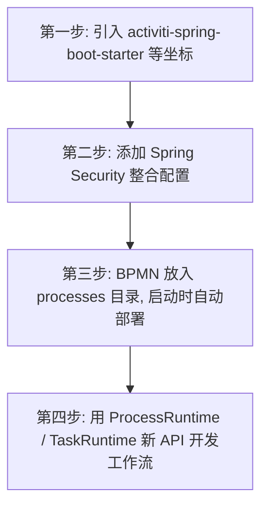

# Activiti7 与 Spring Boot 整合第一步：把坐标引对，把版本对齐

在老版 Activiti 里做 Spring 整合，要自己装配流程引擎、注册一堆 Bean、手写部署代码，配置文件能占半屏。Activiti7 出了正式版之后，官方给了与 Spring Boot 2.x 完全整合的 starter，引擎创建、数据表初始化、流程自动部署这些活儿全部交给自动配置。整条路看着省事了，第一道坎却卡在坐标上：版本引错、驱动不匹配，工程连启动都过不去。

这一课就把建工程和引坐标这件事做完整：一个真实的 Maven 工程从零建出来，每个依赖干什么、版本怎么对齐，逐个说清。

## 先给结论

- 核心坐标只有一个：`activiti-spring-boot-starter`，版本 `7.0.0.Beta2`。Activiti 的新旧 API、Spring 整合层、自动配置全靠它传递进来。
- 父工程锁定 `spring-boot-starter-parent` 的 `2.1.0.RELEASE`，JDK 用 1.8。Beta2 就是按这套 Boot 版本对齐的，随意抬升 Boot 版本容易踩自动配置不兼容的坑。
- 数据库三样不能少：`spring-boot-starter-jdbc`、MySQL 驱动（课程显式压到 5.1.27）、一个提前建好的 `activiti` 库。
- `spring-boot-starter-web` 与 `spring-boot-starter-test` 分别服务后续的接口开发和整合测试。
- starter 会连带引入 Spring Security。它不是可选项，而是 Activiti7 新 API 的前置条件，坐标加完就该准备 Security 的配置。

## 整合四步曲，坐标只是第一格

课件里把 Spring Boot 整合 Activiti7 的路线写成了固定四步，后面几课就是按这个顺序往下走的：



这张图是整个整合阶段的路线图。关键在第一格与第二格的因果关系：starter 引进来的不只是 Activiti 自己，还有 Spring Security，所以坐标落定之后马上要面对的就是安全框架配置，绕不过去。

## 建工程：普通 Maven 工程即可

新建一个 Maven 工程，`groupId` 取 `com.example`，`artifactId` 叫 `activiti-springboot-demo`，JDK 用 1.8。工程位置放在课程源码目录的 `demo2` 子目录下，与之前单独使用 Activiti 的练习工程并列，方便互相对照。

建完先别急着写代码，此时 `pom.xml` 里还没有任何 Activiti 相关坐标，直接跑什么都做不了。整合所需的全部依赖来自课程资料里提前准备好的清单，照着加进自己的 pom 就行。

## pom 全文：每个依赖都有明确分工

下面是整合工程 `activitispringboot06` 的完整 pom（包名已改写为 `com.example`）：

```xml
<?xml version="1.0" encoding="UTF-8"?>
<project xmlns="http://maven.apache.org/POM/4.0.0"
         xmlns:xsi="http://www.w3.org/2001/XMLSchema-instance"
         xsi:schemaLocation="http://maven.apache.org/POM/4.0.0 http://maven.apache.org/xsd/maven-4.0.0.xsd">
    <modelVersion>4.0.0</modelVersion>

    <groupId>com.example</groupId>
    <artifactId>activiti-springboot-demo</artifactId>
    <version>1.0-SNAPSHOT</version>

    <!-- Activiti7 与 Spring Boot 整合的相关依赖, 版本由父工程统一管理 -->
    <parent>
        <groupId>org.springframework.boot</groupId>
        <artifactId>spring-boot-starter-parent</artifactId>
        <version>2.1.0.RELEASE</version>
        <relativePath/> <!-- lookup parent from repository -->
    </parent>

    <properties>
        <project.build.sourceEncoding>UTF-8</project.build.sourceEncoding>
        <project.reporting.outputEncoding>UTF-8</project.reporting.outputEncoding>
        <java.version>1.8</java.version>
    </properties>

    <dependencies>
        <!-- 连接数据库需要 JDBC -->
        <dependency>
            <groupId>org.springframework.boot</groupId>
            <artifactId>spring-boot-starter-jdbc</artifactId>
        </dependency>
        <!-- MySQL 驱动, 显式压到 5.x -->
        <dependency>
            <groupId>mysql</groupId>
            <artifactId>mysql-connector-java</artifactId>
            <version>5.1.27</version>
        </dependency>
        <!-- Web 环境 -->
        <dependency>
            <groupId>org.springframework.boot</groupId>
            <artifactId>spring-boot-starter-web</artifactId>
        </dependency>
        <!-- 整合测试 -->
        <dependency>
            <groupId>org.springframework.boot</groupId>
            <artifactId>spring-boot-starter-test</artifactId>
            <scope>test</scope>
        </dependency>
        <!-- 整合的核心坐标 -->
        <dependency>
            <groupId>org.activiti</groupId>
            <artifactId>activiti-spring-boot-starter</artifactId>
            <version>7.0.0.Beta2</version>
        </dependency>
        <!-- MyBatis, 业务侧持久层使用 -->
        <dependency>
            <groupId>org.mybatis</groupId>
            <artifactId>mybatis</artifactId>
            <version>3.4.5</version>
        </dependency>
    </dependencies>

    <build>
        <plugins>
            <plugin>
                <groupId>org.springframework.boot</groupId>
                <artifactId>spring-boot-maven-plugin</artifactId>
            </plugin>
        </plugins>
    </build>
</project>
```

逐个拆开看每个依赖的存在理由：

**第一，`activiti-spring-boot-starter` 是整份 pom 的灵魂。** 引入它之后，依赖传递会把 Activiti7 的流程引擎、Spring 整合模块、`ProcessRuntime` 与 `TaskRuntime` 这套新 API，以及自动配置类一并带进来。后面课程里直接 `@Autowired` 就能注入 `ProcessRuntime`，靠的就是这个 starter 里的自动装配。

**第二，`spring-boot-starter-jdbc` 加 MySQL 驱动解决引擎的落地问题。** Activiti 运行时需要把自己的 25 张左右的表建进数据库，引擎初始化时要拿一个数据源去连库，没有 JDBC 和驱动，启动第一步就断。

**第三，`spring-boot-starter-web` 与 `spring-boot-starter-test` 是为后续铺垫。** 这一阶段最终要做成「审批中心」，流程操作会暴露成 HTTP 接口，测试则用 Spring Boot 整合 JUnit 的方式跑新 API，所以两个 starter 现在就位。

**第四，`spring-boot-maven-plugin` 保留。** 它负责打出可执行 jar，工程靠引导类启动，这个插件照常配置。

## 版本匹配：整合阶段最容易翻车的地方

**第一，Boot 版本与 Beta2 的绑定关系。** `7.0.0.Beta2` 发布时对标的就是 Spring Boot 2.1.x 一代的自动配置接口。父工程用 `2.1.0.RELEASE` 是经过验证的组合；如果把 Boot 升到差异较大的版本，starter 里的自动配置类可能找不到对应的扩展点，启动直接报错。学习阶段老老实实用课件验证过的组合，等吃透了再谈升级。

**第二，MySQL 驱动的版本要主动压下来。** 父工程 `2.1.0.RELEASE` 默认管理的 `mysql-connector-java` 版本偏高，连 MySQL 5.x 的服务端时容易出现时区、编码一类的问题。课程的做法是在依赖里显式声明 `5.1.27`，让这个版本盖过 parent 的默认值。工程里如果看到同一条依赖写了两遍（一遍走 parent 版本、一遍显式 5.1.x），保留显式那一条即可，重复声明清理掉更干净。

**第三，版本冲突的表象要认得。** 坐标打架时往往不是启动失败，而是运行到某一处抛 `NoSuchMethodError` 或者某个自动配置悄悄不生效。遇到这类诡异现象，先怀疑依赖版本，`mvn dependency:tree` 看一眼传递关系，比翻代码快得多。

## 引完坐标之后的环境清单

依赖就位只是准备动作，真正能跑起来还差两样环境：

```yaml
spring:
  datasource:
    url: jdbc:mysql://localhost:3306/activiti?useUnicode=true&characterEncoding=utf8&serverTimezone=GMT
    username: root
    password: root
    driver-class-name: com.mysql.jdbc.Driver
```

```bash
# MySQL 服务先起起来, 再确认 activiti 库存在, 否则引擎初始化连不上
mysql -uroot -proot -e "CREATE DATABASE IF NOT EXISTS activiti DEFAULT CHARSET utf8;"
```

数据源指向的 `activiti` 库必须提前存在，用户名密码按本机环境改。库、服务、驱动三样齐了，坐标这一步才算真正闭环。Security 的配置是下一个动作，属于第二步的内容。

## 常见误区

- **只引 starter 不引 JDBC 和驱动**：starter 不会替你决定用什么数据库，引擎初始化拿不到数据源或找不到驱动，启动报数据源相关异常。数据库三件套必须显式写进 pom。
- **父工程版本随意选**：随手用了最新版 Boot 父工程，Beta2 的自动配置对不上号，出现各种启动异常。与 `7.0.0.Beta2` 配套的是 2.1.0.RELEASE 这一代。
- **驱动版本照默认走**：parent 管理的高版本驱动连 MySQL 5.x 服务端容易出时区和编码问题，显式声明 5.1.x 更稳。
- **以为引了 starter 就万事俱备**：starter 连带引入了 Spring Security，Security 不配置，后面调新 API 第一个方法就会被安全框架拦住。

## 面试可能被问到的问题

1. 面试官追问：「Activiti7 与 Spring Boot 整合，核心要引哪些坐标？」
   答：核心是 `activiti-spring-boot-starter`（7.0.0.Beta2），它传递引入流程引擎、Spring 整合层、新 API 与自动配置；配套需要 `spring-boot-starter-jdbc`、MySQL 驱动，以及 Web 和 Test 两个 starter。父工程锁 `spring-boot-starter-parent` 2.1.0.RELEASE。

2. 面试官追问：「为什么 Boot 版本要和 starter 版本对齐？」
   答：starter 里的自动配置类是按特定一代 Boot 的扩展点写的，Beta2 对应 2.1.x。Boot 版本差异大时，自动配置可能找不到对应的接口或条件判断失效，出现启动异常或引擎装配不完整。

3. 面试官追问：「starter 引入后，Spring Security 是怎么来的？」
   答：`activiti-spring-boot-starter` 的依赖传递里带了 Spring Security 相关坐标，因为 Activiti7 的新 API 强依赖安全上下文，每个操作都要取当前认证用户。所以整合的第二步就是配置 Spring Security 的用户与角色。

4. 面试官追问：「MySQL 驱动为什么要显式指定 5.1.x 版本？」
   答：父工程默认管理的驱动版本偏高，对 MySQL 5.x 服务端常有时区与编码兼容问题。在 pom 里显式声明 5.1.27 覆盖默认版本，是低成本高收益的做法。

5. 面试官追问：「整合方式与老版 Activiti 的 Spring 整合相比，省掉了什么？」
   答：老方式要自己装配 ProcessEngineConfiguration、指定数据源与建表策略、手写部署代码；整合后引擎由 starter 自动配置，启动时自动建表，classpath 下约定目录里的 BPMN 文件自动部署，业务代码只需面向 ProcessRuntime、TaskRuntime 这套新 API。

## 配套资料

- 整合工程 pom：`materials/code/02/Activiti7-day06-新特性/Activiti7-day06-新特性/源码/demo2/activitispringboot06/pom.xml`（文中 pom 的蓝本，包名已统一改为 `com.example`）
- 项目深化版 pom：`materials/code/02/Activiti7-day07-审批中心模块开发/Activiti7-day07-审批中心模块开发/代码/activiti07/pom.xml`（在整合坐标基础上追加 MyBatis、Druid、PageHelper、Thymeleaf 等 HRM 项目的依赖）
- 数据源配置参考：`materials/code/02/Activiti7-day07-审批中心模块开发/Activiti7-day07-审批中心模块开发/代码/activiti07/src/main/resources/application.yml`
