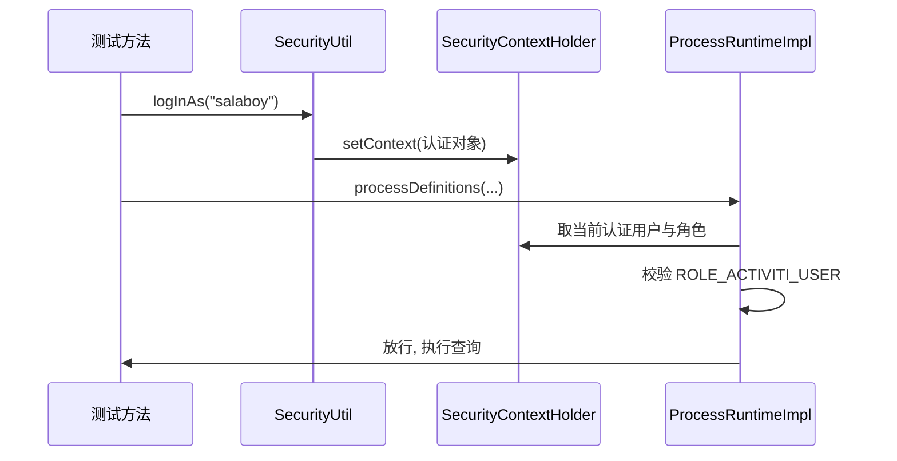
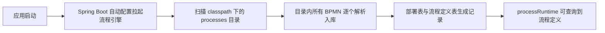
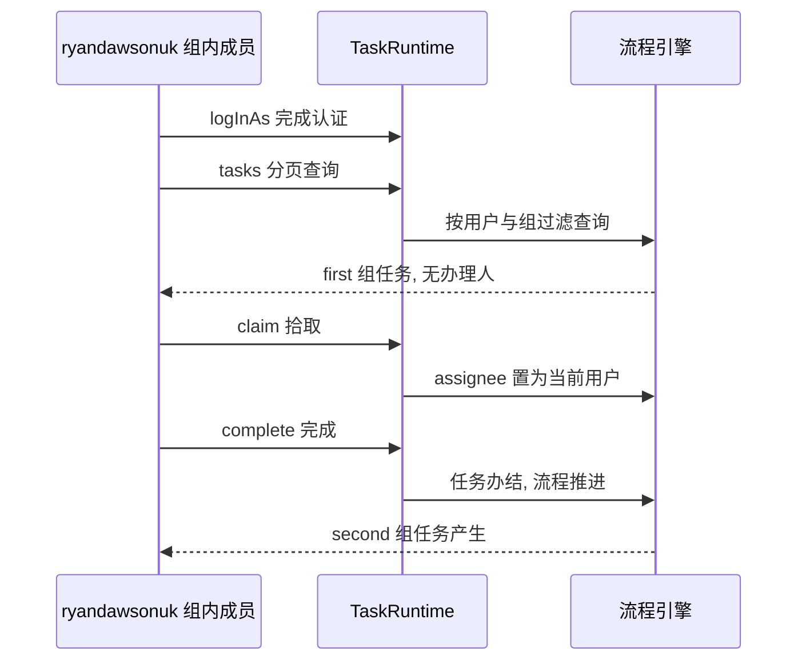

# Activiti7与SpringBoot整合三讲：Spring Security 前置配置、processes 自动部署与任务分页查询闭环

## 先给结论

Activiti7 与 Spring Boot 整合后，老版那套 RepositoryService 部署代码全部消失，换来的是一扇需要安全上下文才能推开的门：调用新 API 之前必须先有一个已认证的用户。全系列三讲把前置条件、自动部署、任务闭环一次打通。
第一讲解决被拦的问题：activiti-spring-boot-starter 引入时绑定了 Spring Security，SecurityUtil 模拟登录与 DemoApplicationConfiguration 内存用户组两个类从官方示例直接复用，用户必须带 ROLE_ACTIVITI_USER 角色，组权限以 GROUP_ 前缀书写并与 BPMN 里的候选组对上。
第二讲是流程定义侧：BPMN 放进 processes 目录应用启动即自动部署，省事但全量无差别，半成品别放进来；processRuntime 查定义、start 启动实例，key 就是 BPMN 里 process 元素的 id，新 API 是门面不是新引擎。第三讲是任务侧闭环：tasks 分页查询自动按当前登录人过滤，组任务先 claim 拾取再 complete 完成，流程自动推进到下一个节点，谁登录谁执行。
三讲依次是：
- Spring Security 配置信息：SecurityUtil、用户组内存配置与数据源落位。
- BPMN 流程定义：目录约定自动部署、查询定义与启动实例。
- 任务分页查询：tasks、claim、complete 三个方法跑通审批。

## 第1部分：Activiti7 新 API 为什么离不开 Spring Security：SecurityUtil 与用户组配置落位

坐标加完、依赖刷新，工程看起来万事俱备，可一旦调用 `ProcessRuntime` 的方法，控制台甩出一行 `authentication object was not found in the security context`，操作直接被拦。原因是 `activiti-spring-boot-starter` 引入时就绑定了 Spring Security，新 API 的每个方法都要求安全上下文里有一个已认证的用户，没有就抛异常。这一课解决的就是这个前置条件：把 Security 需要的配置类和工具类准备好。

好消息是这两个类不用自己写。Activiti7 官方示例工程里就带着现成的实现，拷进项目、按需改用户清单，整合的第二步就完成了。

### 为什么新 API 天然要过安全这一关

`ProcessRuntime` 和 `TaskRuntime` 这套 7.x 新 API 的设计前提是「所有操作都发生在某个用户的身份之下」。查流程定义是查「你可见的」流程定义，查任务是查「你或你所在组的」任务，启动实例、完成任务更要校验你有没有写权限。实现类 `ProcessRuntimeImpl`、`TaskRuntimeImpl` 在每个方法开头都从 Spring Security 的上下文里取认证对象，同时校验用户是否持有 `ROLE_ACTIVITI_USER` 角色。

这套安全策略的检查链路是这样的：



图里最关键的是第一次调用 `logInAs`：没有它，第二步直接在取用户那里断掉，异常信息就是开头那句 `authentication object was not found in the security context`。老 API 的 `RuntimeService`、`TaskService` 从不关心登录人是谁，新 API 把身份当成了操作的一部分，这是两代 API 使用习惯上最大的差异。

### SecurityUtil：一个模拟登录的工具类

官方示例里的 `SecurityUtil` 是个 `@Component`，核心就一个 `logInAs` 方法，作用是「假装这个用户已经登录了」：

```java
package com.example;

import org.springframework.beans.factory.annotation.Autowired;
import org.springframework.beans.factory.annotation.Qualifier;
import org.springframework.security.core.Authentication;
import org.springframework.security.core.GrantedAuthority;
import org.springframework.security.core.context.SecurityContextHolder;
import org.springframework.security.core.context.SecurityContextImpl;
import org.springframework.security.core.userdetails.UserDetails;
import org.springframework.security.core.userdetails.UserDetailsService;
import org.springframework.stereotype.Component;

import java.util.Collection;

@Component
public class SecurityUtil {

    @Autowired
    @Qualifier("myUserDetailsService")
    private UserDetailsService userDetailsService;

    public void logInAs(String username) {
        UserDetails user = userDetailsService.loadUserByUsername(username);
        if (user == null) {
            throw new IllegalStateException("User " + username + " doesn't exist, please provide a valid user");
        }
        // 构造一个已认证的 Authentication 对象, 塞进安全上下文
        SecurityContextHolder.setContext(new SecurityContextImpl(new Authentication() {
            @Override
            public Collection<? extends GrantedAuthority> getAuthorities() {
                return user.getAuthorities();
            }
            @Override
            public Object getCredentials() { return user.getPassword(); }
            @Override
            public Object getDetails() { return user; }
            @Override
            public Object getPrincipal() { return user; }
            @Override
            public boolean isAuthenticated() { return true; }
            @Override
            public void setAuthenticated(boolean isAuthenticated) { }
            @Override
            public String getName() { return user.getUsername(); }
        }));
        // 同步把身份写给 Activiti 老引擎, 保证新老两套 API 看到的用户一致
        org.activiti.engine.impl.identity.Authentication.setAuthenticatedUserId(username);
    }
}
```

三个要点值得咀嚼。第一，它注入的是 `UserDetailsService`，`logInAs` 拿用户名去查用户，查不到就抛 `IllegalStateException`，所以后面配置类里注册过的用户名才是合法的「登录名」。第二，方法体没有走真实的登录流程，而是手工 new 了一个匿名内部类实现 `Authentication` 接口，`isAuthenticated` 直接返回 `true`，把用户连同权限一起塞进 `SecurityContextHolder`。测试与教学场景要的就是这个效果：省掉登录页，一行代码完成身份切换。第三，最后一行 `Authentication.setAuthenticatedUserId(username)` 是 Activiti 老引擎的静态工具，把身份同步写给老引擎，新老两套 API 看到的登录人才不会打架。

### DemoApplicationConfiguration：用户与组的内存配置

第二个拷进来的类是 `DemoApplicationConfiguration`，`@Configuration` 配置类，用内存方式把一批用户连同角色、组注册进 Spring Security：

```java
package com.example;

import org.springframework.context.annotation.Bean;
import org.springframework.context.annotation.Configuration;
import org.springframework.security.core.authority.SimpleGrantedAuthority;
import org.springframework.security.core.userdetails.User;
import org.springframework.security.core.userdetails.UserDetailsService;
import org.springframework.security.crypto.bcrypt.BCryptPasswordEncoder;
import org.springframework.security.crypto.password.PasswordEncoder;
import org.springframework.security.provisioning.InMemoryUserDetailsManager;

import java.util.Arrays;
import java.util.List;
import java.util.stream.Collectors;

@Configuration
public class DemoApplicationConfiguration {

    @Bean
    public UserDetailsService myUserDetailsService() {
        InMemoryUserDetailsManager inMemoryUserDetailsManager = new InMemoryUserDetailsManager();

        // 每行格式: 用户名, 密码, 角色/组列表
        String[][] usersGroupsAndRoles = {
                {"salaboy", "password", "ROLE_ACTIVITI_USER", "GROUP_activitiTeam"},
                {"ryandawsonuk", "password", "ROLE_ACTIVITI_USER", "GROUP_activitiTeam"},
                {"erdemedeiros", "password", "ROLE_ACTIVITI_USER", "GROUP_activitiTeam"},
                {"zhangsan", "password", "ROLE_ACTIVITI_USER", "GROUP_activitiTeam"},
                {"lisi", "password", "ROLE_ACTIVITI_USER", "GROUP_activitiTeam"},
                {"wangwu", "password", "ROLE_ACTIVITI_USER", "GROUP_activitiTeam"},
                {"other", "password", "ROLE_ACTIVITI_USER", "GROUP_otherTeam"},
                {"system", "password", "ROLE_ACTIVITI_USER"},
                {"admin", "password", "ROLE_ACTIVITI_ADMIN"},
        };

        for (String[] user : usersGroupsAndRoles) {
            List<String> authoritiesStrings = Arrays.asList(Arrays.copyOfRange(user, 2, user.length));
            inMemoryUserDetailsManager.createUser(new User(user[0], passwordEncoder().encode(user[1]),
                    authoritiesStrings.stream().map(s -> new SimpleGrantedAuthority(s)).collect(Collectors.toList())));
        }
        return inMemoryUserDetailsManager;
    }

    @Bean
    public PasswordEncoder passwordEncoder() {
        return new BCryptPasswordEncoder();
    }
}
```

这份配置有几个刻意设计的地方。用户清单里 `salaboy`、`ryandawsonuk`、`erdemedeiros` 三个人同属 `GROUP_activitiTeam` 组，`other` 属于 `GROUP_otherTeam`，`admin` 只有管理员角色没有组。这种人员分布正好能演示组任务的可见性与拾取：同组的人查得到任务、组外的人查不到，后面任务那一课的测试就建立在这份名单上。

前缀规则是硬约定：`ROLE_` 开头的是角色，`GROUP_` 开头的是组。Activiti7 的用户组管理器读取权限串时按前缀拆分，`GROUP_activitiTeam` 去掉前缀后得到组名 `activitiTeam`，BPMN 流程文件里配置候选组时写的正是这个名字。两边名字对不上，任务在组员那里就不可见。

密码必须经过 `PasswordEncoder` 加密存储，这里用的是 `BCryptPasswordEncoder`。Spring Security 5 之后没有密码编码器会直接报错，这是一个固定搭配。

### 数据源落位：application.yml

Security 备好之后，数据库连接信息写进 `src/main/resources/application.yml`：

```yaml
spring:
  datasource:
    url: jdbc:mysql://localhost:3306/activiti?useUnicode=true&characterEncoding=utf8&serverTimezone=GMT
    username: root
    password: root
    driver-class-name: com.mysql.jdbc.Driver
```

连接的库叫 `activiti`，MySQL 服务要先启动、库要提前建好，用户名密码按本机实际改。这套配置与 `spring-boot-starter-jdbc` 配合，自动配置会用它创建数据源交给流程引擎。

后续 HRM 项目里业务库与流程库要分开时，工程里另有一个双数据源的配置类，通过继承 Activiti 的自动配置基类来指定引擎专用数据源：

```java
@Configuration
public class ActivitiDatasourceConfig extends AbstractProcessEngineAutoConfiguration {

    @Bean
    @Primary
    @ConfigurationProperties(prefix = "spring.datasource.act")
    @Qualifier("activitiDataSource")
    public DataSource activitiDataSource() {
        return DataSourceBuilder.create().build();
    }

    @Bean
    @ConfigurationProperties(prefix = "spring.datasource.ihrm")
    @Qualifier("ihrmDataSource")
    public DataSource ihrmDataSource() {
        return DataSourceBuilder.create().build();
    }
}
```

单库学习阶段用不上它，知道有这条路即可：引擎吃 `@Primary` 的那个数据源，业务侧走另一个。

## 第2部分：BPMN 放进 processes 目录就自动部署：流程定义查询与实例启动实战

老版 Activiti 里部署一个流程，要写 `repositoryService.createDeployment().addClasspathResource(...).deploy()` 这样的代码，还要操心引擎初始化。Spring Boot 整合后这套动作消失了：BPMN 文件放进约定目录，应用一启动就自动部署入库。省事的同时也带来新的困惑，为什么流程还没部署就能查到定义？为什么一查就报安全异常？启动实例时 key 到底填什么？这一课把「画流程、查定义、启实例」三件事一次讲透。

### 一、画 BPMN：目录约定与三种任务分配方式

流程本身很简单：开始事件、两个用户任务 first 和 second、结束事件，顺序连线串起来。画完保存成 `myProcess_1.bpmn`，关键在于存放位置。

官方开发文档在 ProcessRuntime 的说明里有一句 `Process defaults need to be placed inside`，意思就是流程定义默认要放在 classpath 的 `processes` 目录下。在 `src/main/resources` 下新建 `processes` 文件夹，BPMN 文件放进去，对应的结构是：

```bash
src/main/resources/
└── processes/
    └── myProcess_1.bpmn
```

对应的 BPMN XML 如下（按课件流程图补全的完整示例，用户任务用候选组分配）：

```xml
<?xml version="1.0" encoding="UTF-8"?>
<definitions xmlns="http://www.omg.org/spec/BPMN/20100524/MODEL"
             xmlns:activiti="http://activiti.org/bpmn"
             targetNamespace="http://www.example.org/processdef">
  <process id="myProcess_1" name="myProcess_1" isExecutable="true">
    <startEvent id="startEvent1" name="Start"/>
    <userTask id="first" name="first" activiti:candidateGroups="activitiTeam"/>
    <userTask id="second" name="second" activiti:candidateGroups="activitiTeam"/>
    <endEvent id="endEvent1" name="End"/>
    <sequenceFlow id="flow1" sourceRef="startEvent1" targetRef="first"/>
    <sequenceFlow id="flow2" sourceRef="first" targetRef="second"/>
    <sequenceFlow id="flow3" sourceRef="second" targetRef="endEvent1"/>
  </process>
</definitions>
```

用户任务的分配属性是这课的知识重心，三种写法要分清：

**第一，`activiti:assignee`，直接指定办理人。** 流程图上直接给节点写一个具体用户，比如 `wangwu`，任务产生后就属于这个人，别人看不到也办不了。适合「这个节点固定由某人审批」的场景。

**第二，`activiti:candidateUsers`，候选用户。** 值可以写多个，逗号隔开，比如 `zhangsan,lisi,wangwu`，这三个人都是候选人，谁先拾取任务归谁。它的局限是必须把具体用户名提前写死在流程文件里。

**第三，`activiti:candidateGroups`，候选组。** 写组名而不是用户名，比如 `activitiTeam`。大多数场景下画流程时只清楚「这个节点由行政部门处理」，至于行政部是谁根本不知道，也不想知道。这时组方式的优势就体现出来：流程定义只认组，人由 Security 配置动态供给。

组名有一条硬性对应关系：`DemoApplicationConfiguration` 里注册的组权限是 `GROUP_activitiTeam`，去掉 `GROUP_` 前缀得到的 `activitiTeam` 才是 BPMN 里要写的组名。两边必须能对上，组任务才能被组内成员查到。组名不是随便起的，写 `team01` 就得在 Security 配置里有对应的 `GROUP_team01`。

### 二、自动部署：省事的代价

放对目录之后，部署这件事就完全交给框架了：



这张图讲的是自动部署的完整链路。关键路径在第三步：扫描发生在应用启动阶段，部署动作是引擎初始化的一部分，所以程序一起动，数据库里就已经有部署记录和流程定义了。

**好处是省心。** 不用写部署代码，新增一个流程文件，重启应用就生效，`ACT_RE_DEPLOYMENT` 与 `ACT_RE_PROCDEF` 两张表自动出现记录。

**代价是粗暴。** 引擎不检查流程是否开发完毕，`processes` 目录里有 10 个 BPMN 就一口气全部入库。五套流程里有一套没画完？照样被部署进去。而且 BPMN 一旦部署入库，流程定义就持久存在，误部署的残留还要手动清理。所以目录要当成「发布区」来管理，只放确认可用的流程文件，草稿放在别的目录里，反正引擎只认 `processes` 这一个位置。

### 三、测试类骨架与流程定义查询

验证这一切要用 Spring Boot 整合 JUnit 的测试类。把测试类建在 `src/test/java` 下，骨架如下：

```java
package com.example;

import org.activiti.api.process.model.ProcessDefinition;
import org.activiti.api.process.model.ProcessInstance;
import org.activiti.api.process.model.builders.ProcessPayloadBuilder;
import org.activiti.api.process.runtime.ProcessRuntime;
import org.activiti.api.runtime.shared.query.Page;
import org.activiti.api.runtime.shared.query.Pageable;
import org.activiti.api.task.runtime.TaskRuntime;
import org.junit.Test;
import org.junit.runner.RunWith;
import org.springframework.beans.factory.annotation.Autowired;
import org.springframework.boot.test.context.SpringBootTest;
import org.springframework.test.context.junit4.SpringRunner;

@RunWith(SpringRunner.class)
@SpringBootTest
public class ActivitiTest {

    @Autowired
    private ProcessRuntime processRuntime;

    @Autowired
    private TaskRuntime taskRuntime;

    @Autowired
    private SecurityUtil securityUtil;
}
```

三个注入对象各司其职：`ProcessRuntime` 负责流程定义查询与实例启动，`TaskRuntime` 负责任务操作，`SecurityUtil` 负责模拟登录。`@RunWith(SpringRunner.class)` 与 `@SpringBootTest` 是 Spring Boot 整合 JUnit 的固定组合，前者把测试跑在 Spring 的测试环境里，后者自动装配整个应用上下文。

查流程定义的测试方法：

```java
/**
 * 查看流程定义
 */
@Test
public void testDefinition() {
    securityUtil.logInAs("salaboy"); // Spring Security 的认证工作
    Page<ProcessDefinition> processDefinitionPage = processRuntime
            .processDefinitions(Pageable.of(0, 10));
    System.out.println("可用的流程定义数量：" + processDefinitionPage.getTotalItems());
    for (ProcessDefinition pd : processDefinitionPage.getContent()) {
        System.out.println("流程定义：" + pd);
    }
}
```

这段代码不长，信息量却不少：

**第一，`logInAs` 是第一步。** 漏掉它，测试立刻失败，控制台报 `authentication object was not found in the security context`，这就是上一课说的安全前置条件。当前流程的候选组是 `activitiTeam`，用组内成员 `salaboy` 登录正合适。

**第二，分页是显式的。** `Pageable.of(0, 10)` 表示从第 0 条开始取 10 条，这是 7.x 新 API 的固定风格，没有「不带分页查全部」的用法。返回的 `Page<ProcessDefinition>` 用 `getTotalItems` 拿总数，用 `getContent` 拿当前页内容集合，两个方法配合就能完成列表展示。

**第三，BPMN 还没手动部署，为什么能查到？** 因为自动部署发生在应用启动阶段，`@SpringBootTest` 拉起上下文的那一刻，`processes` 目录里的 `myProcess_1.bpmn` 已经进了数据库。每条定义都带 id、key、version 等字段，key 就是 XML 里 process 的 id `myProcess_1`，version 是版本号，同名流程重复部署时版本自动递增。

顺带交代一个环境现象：整合后建出来的表比单独使用 Activiti 时少了历史相关的那几张。Beta2 版本的整合包没有生成 history 系列表，手动建出来引擎也不会往里写数据，属于这个早期版本的已知缺陷。查询与实例运行不受影响，但基于历史表的功能在这个版本下没有支撑，做技术选型时要知道这一点。

### 四、启动流程实例：start 一个方法的事

流程定义就绪后，启动实例只要一个方法：

```java
/**
 * 启动流程实例
 */
@Test
public void testStartInstance() {
    securityUtil.logInAs("salaboy"); // Spring Security 的认证工作
    ProcessInstance processInstance = processRuntime
            .start(ProcessPayloadBuilder
                    .start()
                    .withProcessDefinitionKey("myProcess_1")
                    .build());
    System.out.println("流程实例ID：" + processInstance.getId());
}
```

写法延续了新 API 的 Builder 风格：`ProcessPayloadBuilder.start()` 起一个载荷构造器，`withProcessDefinitionKey` 指定按哪个流程定义启动，`build` 收尾，最后交给 `processRuntime.start` 执行。构造器上还有 `withName` 设置实例名称、`withVariable` 设置流程变量等系列方法，用到时按同样套路追加。启动成功后打印实例 id，去数据库 `ACT_RU_EXECUTION` 表能查到对应记录，id 尾部几位与控制台输出一致。

**key 写错是最常见的启动失败原因。** `withProcessDefinitionKey` 的值必须与 BPMN 里 process 的 id 完全一致，写成 `myProcess` 而库里部署的是 `myProcess_1`，启动时直接抛找不到流程定义的异常。拿不准就去 `ACT_RE_PROCDEF` 表里看 KEY_ 字段。

### 五、源码走读：start 底下还是 RuntimeService

按住 Ctrl 跟进 `ProcessRuntimeImpl` 的 `start` 方法，能看到三段关键逻辑：

```java
// ProcessRuntimeImpl, 原理讲解用节选
public ProcessInstance start(StartProcessPayload startProcessPayload) {
    ProcessDefinition processDefinition = null;
    // 优先按 id 找流程定义
    if (startProcessPayload.getProcessDefinitionId() != null) {
        processDefinition = this.processDefinition(startProcessPayload.getProcessDefinitionId());
    }
    // id 没给再按 key 找
    if (processDefinition == null && startProcessPayload.getProcessDefinitionKey() != null) {
        processDefinition = this.processDefinition(startProcessPayload.getProcessDefinitionKey());
    }
    // 安全策略校验: 当前用户对该流程有无写权限
    securityPolicyManager.canWrite(processDefinition.getKey());
    // 最终委托老引擎的 RuntimeService 启动实例
    return processInstanceConverter.from(this.runtimeService.createProcessInstanceBuilder()
            .processDefinitionId(...)
            .build());
}
```

这段源码确认了两件事。其一，新 API 的每个入口都先过安全策略，`securityPolicyManager` 校验当前用户对目标流程的读写权限，不通过就抛 `ActivitiForbiddenException`，这也是用户必须带 `ROLE_ACTIVITI_USER` 角色的原因。其二，校验通过后真正干活的是 `runtimeService.createProcessInstanceBuilder()`，也就是老版 Activiti 的 `RuntimeService`。`ProcessRuntime`、`TaskRuntime` 这批新接口本质上是给老 Service 套了权限、事件与载荷模型的门面，老的 `RepositoryService`、`RuntimeService`、`TaskService` 依然是引擎的核心。理解了这层关系，新 API 的任何行为都可以到老实现里找答案。

## 第3部分：TaskRuntime 分页查任务与拾取执行：tasks、claim、complete 三个方法跑通审批

流程实例启动之后，去数据库看 `ACT_RU_EXECUTION` 表，里面已经躺着两条执行记录：一条是开始节点，一条是停在那里等待办理的 first 任务。任务已经产生了，可它挂在候选组 `activitiTeam` 名下，没有具体办理人。这一课要做的就是新 API 里任务侧的完整闭环：分页查任务、拾取任务、执行任务，三个方法跑完一个节点，流程自动走到下一个节点。

### 一、任务从哪来，又该怎么查

流程实例启动后，引擎按 BPMN 定义走到第一个用户任务节点，在运行时表里生成任务。因为节点配置的是候选组 `activitiTeam` 而不是具体办理人，任务是组任务：组内人人可见，无人负责。

查任务的动作收在 `TaskRuntime` 接口里，核心方法签名如下：

```java
public interface TaskRuntime {
    // 分页查询当前用户的任务
    Page<Task> tasks(Pageable pageable);
    // 拾取组任务
    Task claim(ClaimTaskPayload payload);
    // 完成任务
    Task complete(CompleteTaskPayload payload);
    // 其余省略: create / release / delete / variables 等
}
```

查询不带任何用户参数，却能做到「各人查各人的任务」，原因在实现类 `TaskRuntimeImpl` 里：它从安全上下文取出当前登录人，把用户名与其所属组自动拼进底层 `TaskQuery` 的过滤条件。上一课用 `salaboy` 启动了实例，任务属于 `activitiTeam` 组，那么 `salaboy`、`ryandawsonuk`、`erdemedeiros` 这些组内成员都能查到它，`GROUP_otherTeam` 的 `other` 查出来永远是空的。

老 API 想达到同样效果，要手写 `taskService.createTaskQuery().taskCandidateOrAssigned(userId).list()`，自己拼候选人与办理人条件；新 API 把这层过滤内置了，业务代码只管要分页。

### 二、查询任务的测试：Page 对象怎么用

测试方法的第一半是查询与遍历：

```java
@Test
public void testTask() {
    securityUtil.logInAs("ryandawsonuk"); // 指定用户认证信息
    // 分页查询任务列表
    Page<Task> taskPage = taskRuntime.tasks(Pageable.of(0, 10));
    if (taskPage.getTotalItems() > 0) {
        for (Task task : taskPage.getContent()) {
            System.out.println("任务：" + task);
        }
    }
}
```

几个细节对应着新 API 的使用习惯：

**第一，登录人选的是组内成员。** `ryandawsonuk` 在 Security 配置里属于 `GROUP_activitiTeam`，与 BPMN 里候选组 `activitiTeam` 对得上，所以查得到任务。换成 `other` 这条测试就查不出东西，这不是代码错了，是可见性规则在起作用。

**第二，分页参数与流程定义查询完全一致。** `Pageable.of(0, 10)` 从第 0 条取 10 条，`getTotalItems` 判断有没有任务，`getContent` 拿当前页的 `Task` 集合。真实项目里前端传页码，这里换算成 `Pageable` 的两个参数即可。

**第三，先判空再遍历。** `getTotalItems() > 0` 的判断让流程更清晰：没有任务就不进循环，避免拿空列表做无意义的操作。运行这段代码，控制台输出 first 任务的完整信息，任务名、id、候选组一目了然，此时任务的 `assignee` 还是空。

### 三、拾取与执行：claim 之后再 complete

**为什么必须拾取？** 流程图上写的是候选组，任务生成时只有「哪些组可以办」的信息，没有「谁在办」。组里七八个人都看着这个任务，如果每个人都能直接点完成，任务就乱了。拾取（claim）就是组内成员认领动作：把任务的办理人设置成自己，组任务变成个人任务，其他组员从此看不到它，竞争关系就此收敛到一个人身上。

完整的查询、拾取、执行、再查询代码如下：

```java
/**
 * 查询并完成自己的任务
 */
@Test
public void testTask() {
    securityUtil.logInAs("ryandawsonuk"); // 指定用户认证信息

    Page<Task> taskPage = taskRuntime.tasks(Pageable.of(0, 10));
    if (taskPage.getTotalItems() > 0) {
        for (Task task : taskPage.getContent()) {
            // 拾取任务: 办理人变成当前登录用户
            taskRuntime.claim(TaskPayloadBuilder.claim()
                    .withTaskId(task.getId())
                    .build());
            System.out.println("任务：" + task);
            // 完成任务: 流程推进到下一个节点
            taskRuntime.complete(TaskPayloadBuilder.complete()
                    .withTaskId(task.getId())
                    .build());
        }
    }

    // 再次查询新任务
    Page<Task> taskPage2 = taskRuntime.tasks(Pageable.of(0, 10));
    if (taskPage2.getTotalItems() > 0) {
        for (Task task : taskPage2.getContent()) {
            System.out.println("任务：" + task);
        }
    }
}
```

对照输出能看清任务的完整一生：第一次查询打出 first 任务，拾取并完成后，第二次查询打出的已经是 second 任务。first 任务完成了，引擎按顺序流自动把流程推进到下一个用户任务节点，产生新的组任务，`ACT_RU_TASK` 表里的记录也换了内容。

拾取与完成的调用结构一模一样，都是「PayloadBuilder 点方法名、`withTaskId` 带上任务 id、`build` 构造载荷、交给 `TaskRuntime` 执行」，差别只在方法语义。这种统一风格是 7.x 新 API 的设计意图：动作即方法名，参数即 with 开头的链式声明，读代码像读句子。

任务侧三个动作与老 API 的对应关系如下：

| 动作 | 老 API（TaskService） | 新 API（TaskRuntime） |
|---|---|---|
| 查询任务 | `createTaskQuery().taskCandidateOrAssigned(...)` 手拼条件 | `tasks(Pageable)` 自动按登录人过滤 |
| 拾取任务 | `taskService.claim(taskId, userId)` | `claim(ClaimTaskPayload)` |
| 完成任务 | `taskService.complete(taskId)` | `complete(CompleteTaskPayload)` |

老 API 的 `claim` 要显式传 userId，新 API 从安全上下文里拿当前登录人，所以「谁登录谁执行」不是一句口号，而是权限模型的一部分。

### 四、拾取到完成的完整链路



这张图讲的是组任务从产生到办结的时序。关键节点在 claim：拾取前任务是组资产，人人可见无人负责；拾取后 assignee 落到具体人身上，complete 之后引擎推进流程，下一个节点的任务随之产生。反悔也有后路，`release` 方法能把任务归还给组，恢复成无人认领的状态。

实际业务里，查询到的任务 id 通常回传给前端做「认领」「办理」两个按钮，后端分别对应 `claim` 与 `complete` 两个接口，中间可以插入表单校验、业务落库等逻辑，工作流的部分就这三个方法。

## 常见误区

- **漏拷 SecurityUtil，直接调新 API**：`ProcessRuntime` 的方法从安全上下文取不到认证对象，抛 `authentication object was not found in the security context`。每次调用前先 `securityUtil.logInAs("用户名")`。
- **组名乱起或漏写前缀**：Security 配置里组权限必须写成 `GROUP_组名`，BPMN 里候选组写去掉前缀的组名。两边对不上，组任务的可见性就乱了。
- **用户没有 `ROLE_ACTIVITI_USER` 角色**：角色缺失时新 API 会以安全策略拒绝操作，抛权限相关异常。给每个要操作流程的用户都补上这个角色。
- **密码不加密直接注册**：Spring Security 5 要求密码必须经过 `PasswordEncoder` 处理，明文注册在创建用户或认证环节报错。配置里保留 `BCryptPasswordEncoder` 这个 Bean。
- **库没建就连**：`application.yml` 指向的 `activiti` 库不存在，引擎初始化第一步就连不上库。先建库再启动应用。
- **BPMN 放在 resources 根目录**：引擎只扫描 classpath 的 `processes` 目录，放在别处不会被部署，查流程定义永远是 0 条。目录名必须是 `processes`。
- **半成品流程也丢进 processes**：自动部署全量入库，没画完的流程同样被部署，残留定义还会占用 key 与版本号。草稿放其他目录，确认后再移入。
- **不登录就查询**：`processDefinitions`、`start` 都要先 `securityUtil.logInAs`，否则报 `authentication object was not found in the security context`。
- **启动实例的 key 与 BPMN id 不一致**：`withProcessDefinitionKey` 写的值必须等于 process 元素的 id，差一个下划线都启动不了，报找不到流程定义。
- **BPMN 里候选组写成 GROUP_activitiTeam**：`GROUP_` 前缀属于 Security 权限串的写法，BPMN 里写去掉前缀的组名 `activitiTeam`，两边靠名字对应。
- **组任务不拾取直接完成**：任务已有办理人时，非办理人调 `complete` 会被实现类校验拒绝。正确姿势是先 `claim` 再 `complete`，或者干脆由办理人本人操作。
- **用组外用户查任务**：`other` 不在 `activitiTeam` 里，`tasks` 查出 0 条，误以为任务没生成。先核对登录人与 BPMN 候选组的对应关系。
- **漏掉方法开头的 logInAs**：每个测试方法都要自己完成认证，上一个方法登录过不代表下一个方法还有效，直接调用会报找不到认证对象。
- **把分页参数当页码**：`Pageable.of(0, 10)` 的第一个参数是起始下标而不是页码，第 3 页每页 10 条应该写 `Pageable.of(20, 10)`。

## 面试可能被问到的问题

1. 面试官追问：「为什么 Activiti7 整合后调 API 会报 authentication object was not found？」
   答：新 API 的实现类与 Spring Security 绑定，每个方法开头都从 `SecurityContextHolder` 取当前认证用户并校验 `ROLE_ACTIVITI_USER` 角色，上下文里没有认证对象就直接抛这个异常。调用前用 `SecurityUtil.logInAs` 模拟登录即可解决。

2. 面试官追问：「SecurityUtil 的 logInAs 做了什么？」
   答：它拿用户名调 `UserDetailsService.loadUserByUsername` 加载用户，然后手工构造一个已认证的 `Authentication` 对象放进 `SecurityContextHolder`，最后再调 Activiti 老引擎的 `Authentication.setAuthenticatedUserId` 同步身份，保证新老 API 看到同一个登录人。

3. 面试官追问：「用户、组、角色在配置里是怎么组织的？」
   答：用 `InMemoryUserDetailsManager` 内存注册，每条记录是用户名加密码加一串权限，角色以 `ROLE_` 前缀、组以 `GROUP_` 前缀写入权限串，转成 `SimpleGrantedAuthority` 集合创建用户。密码经 `BCryptPasswordEncoder` 加密。

4. 面试官追问：「GROUP_ 前缀的作用是什么？」
   答：Activiti7 的用户组管理器按前缀区分权限类型，`GROUP_xxx` 会被识别为组 `xxx`。BPMN 里给用户任务配置候选组时写的是去掉前缀的组名，引擎查询任务可见性时把当前用户所属的组拼进过滤条件，组名不一致任务就对不上。

5. 面试官追问：「正式项目里用户数据在数据库，还能用 InMemoryUserDetailsManager 吗？」
   答：不能，内存方式只适合教学与测试。生产实现自定义 `UserDetailsService`，从用户表加载用户、从角色表组装权限，`SecurityUtil` 的登录逻辑不变，只是数据来源换成数据库。

6. 面试官追问：「流程库和业务库要分开，怎么配？」
   答：定义双数据源，给引擎的数据源标记 `@Primary`，并通过继承 `AbstractProcessEngineAutoConfiguration` 的配置类明确指定引擎使用哪个数据源，业务侧用另一个数据源对应的 JdbcTemplate 或 MyBatis 配置，两边互不干扰。

7. 面试官追问：「Spring Boot 整合 Activiti7 后，流程是怎么部署的？」
   答：约定优于配置。BPMN 文件放在 classpath 的 `processes` 目录下，应用启动时自动配置扫描该目录并全部部署入库，无需手写部署代码。代价是全量部署，半成品流程也会入库，目录要按发布区管理。

8. 面试官追问：「assignee、candidateUsers、candidateGroups 三者怎么选？」
   答：`assignee` 直接指定唯一办理人，适合节点负责人固定；`candidateUsers` 指定一组候选用户，逗号分隔，需要把用户名写死在流程里；`candidateGroups` 只写组名，人员关系由安全配置动态决定。人员不确定时用候选组最合适。

9. 面试官追问：「processRuntime.processDefinitions 返回什么，怎么分页？」
   答：返回 `Page<ProcessDefinition>` 对象。分页参数用 `Pageable.of(起始下标, 每页条数)` 显式传入，结果通过 `getTotalItems` 取总数、`getContent` 取当前页集合，没有不分页的全量查询用法。

10. 面试官追问：「启动流程实例时 withProcessDefinitionKey 的值从哪来？」
   答：来自 BPMN 文件里 process 元素的 id，部署入库后对应 `ACT_RE_PROCDEF` 表的 KEY_ 字段。可以按 key 也可以按流程定义 id 启动，key 不存在时抛找不到流程定义的异常。

11. 面试官追问：「ProcessRuntime.start 的源码里做了什么？」
   答：先按 id 或 key 解析出流程定义，再通过 securityPolicyManager 校验当前用户对该流程的写权限，不通过抛 ActivitiForbiddenException，通过后委托老引擎 RuntimeService 的 createProcessInstanceBuilder 完成实例创建。新 API 是门面，老 Service 仍是核心。

12. 面试官追问：「整合后历史表少了是怎么回事？」
   答：Beta2 版本的整合包在建表阶段没有生成 history 系列表，手动建表引擎也不会写入数据，属于该版本的已知问题。流程运行与任务操作不受影响，但依赖历史数据的功能在此版本下不可用，生产使用需换更稳定的版本或单独处理历史记录。

13. 面试官追问：「taskRuntime.tasks 不传用户参数，怎么做到只查自己的任务？」
   答：实现类从 Spring Security 上下文取当前登录人，把用户名与所属组自动拼进底层 TaskQuery 的过滤条件，个人任务与所在组的候选任务一起返回，组外成员查不到组任务。数据权限内置于查询，业务代码不用手写候选人条件。

14. 面试官追问：「组任务为什么要先 claim？」
   答：claim 把任务的办理人设置为当前用户，组任务变成个人任务，其他组员不再可见。没有这一步，组内所有人都能操作同一个任务，会产生并发办理冲突；拾取机制把竞争收敛为单一负责人，反悔时用 release 归还给组。

15. 面试官追问：「claim 与老 API 的 claim 有什么区别？」
   答：老 API 的 `taskService.claim(taskId, userId)` 需要显式传用户 id；新 API 的 `claim(ClaimTaskPayload)` 从安全上下文取当前登录人，载荷里只带任务 id。本质动作相同，都是设置 assignee，新 API 的用户来源固定为登录人。

16. 面试官追问：「complete 之后发生了什么？」
   答：引擎把当前任务标记完成写入历史，流程沿顺序流推进到下一个节点，下一个用户任务随之生成并写入运行时任务表。业务上表现为旧任务从待办列表消失、新任务出现，整个过程在一个事务里完成。

17. 面试官追问：「Pageable.of(0, 10) 两个参数分别是什么？」
   答：第一个是起始下标，从 0 开始；第二个是每页最大条数。新 API 的列表查询都要求显式分页，返回 Page 对象，用 getTotalItems 取总数、getContent 取当前页数据，翻页就是换算起始下标。

18. 面试官追问：「怎么设计一个审批中心的待办接口？」
   答：登录态由 Spring Security 提供，接口内部调 `taskRuntime.tasks(Pageable)` 拿当前人的待办分页，前端「认领」按钮对应 claim、「办理」按钮对应 complete，办理时先完成业务表单落库再调 complete，保证业务与流程状态一致。

## 配套资料

- SecurityUtil 与配置类：`materials/code/02/Activiti7-day07-审批中心模块开发/Activiti7-day07-审批中心模块开发/代码/activiti07/src/main/java/`（根包下的 `SecurityUtil.java` 与 `DemoApplicationConfiguration.java`，包名已统一改为 `com.example`）
- 数据源配置：`materials/code/02/Activiti7-day07-审批中心模块开发/Activiti7-day07-审批中心模块开发/代码/activiti07/src/main/resources/application.yml`（单库版本）；双数据源配置类 `ActivitiDatasourceConfig.java` 在同工程 `src/main/java` 的 `config` 包下
- 前一课整合工程对照：`materials/code/02/Activiti7-day06-新特性/Activiti7-day06-新特性/源码/demo2/activitispringboot06/src/main/java/`（同名两个类，写法一致，用户名单略有差异）
- 整合工程测试类：`materials/code/02/Activiti7-day06-新特性/Activiti7-day06-新特性/源码/demo2/activitispringboot06/src/test/java/`（`Actviti7DemoApplicationTests.java`，流程定义查询与实例启动的真实测试代码，方法名与本课视频一致，包名已改为 `com.example`）
- 审批中心工程：`materials/code/02/Activiti7-day07-审批中心模块开发/Activiti7-day07-审批中心模块开发/代码/activiti07/`（pom 与配置齐全，流程操作收在 `service/ActivitiService.java` 的老 API 实现里，可与新 API 对照）
- 官方示例工程：`materials/code/02/Activiti7-day06-新特性/Activiti7-day06-新特性/资料/activiti-examples-master/activiti-api-basic-process-example/`（`DemoApplication.java` 演示 ProcessRuntime 的 start 与事件监听）
- 整合工程测试类：`materials/code/02/Activiti7-day06-新特性/Activiti7-day06-新特性/源码/demo2/activitispringboot06/src/test/java/`（`Actviti7DemoApplicationTests.java`，testTask 方法即查询、拾取、完成、再查询的完整真实代码，包名已改为 `com.example`）
- 审批中心工程任务侧实现：`materials/code/02/Activiti7-day07-审批中心模块开发/Activiti7-day07-审批中心模块开发/代码/activiti07/src/main/java/`（`service/ActivitiService.java`，老 API 的任务查询 `taskCandidateOrAssigned` 与拾取执行写法，可对照理解）
- Security 用户组配置：`materials/code/02/Activiti7-day07-审批中心模块开发/Activiti7-day07-审批中心模块开发/代码/activiti07/src/main/java/`（`DemoApplicationConfiguration.java`，组内成员与组外用户的名单来源）
