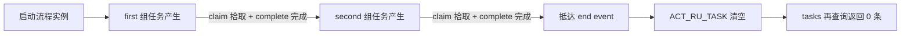

# 从 second 任务到 end event：把一条 BPMN 流程从头跑到尾的收官测试

上一课的测试停在流程中段：first 任务办结之后，流程推进到 second 节点，`ACT_RU_TASK` 表里躺着一条 NAME 为 second 的任务记录。这一课把这条任务也办结，让流程实例从开始节点一路走到 end event，并验证一个关键现象：流程结束之后再查任务，`getTotalItems()` 变成 0，`if` 条件不再成立，控制台不再有任何输出。整条流程从头到尾跑通一遍，Activiti7 新 API 任务侧的知识点就闭环了。

## 先给结论

- 任务侧的全部动作就是三个方法：`tasks` 查询、`claim` 拾取、`complete` 完成，每个节点重复同一套动作，没有额外 API。
- 组任务的办理人不固定，`activitiTeam` 组内任何成员登录都能办理；把 `logInAs` 的用户名换成组内另一个人，查询、拾取、完成照常工作。
- 每办结一个任务，引擎沿顺序流自动推进，second 节点完成后流程抵达 end event，整个流程实例结束。
- 流程结束的标志是运行时任务表清空：第二次查询的 `if` 判断不成立，循环体不执行，这就是「任务二没有输出」的真正原因。
- 想再测一遍任务处理，必须先重新启动一个流程实例，否则任务表里没有任何可办的任务。

## 一、测试前的现场：second 任务还挂在表里

流程实例 `myProcess_1` 启动后，first 任务已经在早前完成，此刻数据库里的现场是这样：

```sql
-- ACT_RU_TASK 节选：first 任务办结后，表里只剩 second 一条任务
PROC_INST_ID_                         PROC_DEF_ID_                                        NAME_    TASK_DEF_KEY_
46c01182-fa00-11c8-8005-9070b02444e4  myProcess_1:762DB915-C095-11c8-81a4-5070b02444e4    second   _4
```

对应的 BPMN 流程是四段式结构：开始事件、first 用户任务、second 用户任务、结束事件。两个用户任务都把候选组配置成 `activitiTeam`，所以任务生成时只挂组、不挂人，谁在组内谁就有权查询并办理。

这张现场图说明了引擎的推进逻辑：



图上每个任务节点都要经过「拾取、办结」两步，办结之后流程自动流向下一个节点，不需要代码里指定「下一个是谁」。关键路径在最后一格：second 完成后流程到达结束事件，运行时表随之清空，这就是本课测试要观察到的终态。

## 二、换一个登录人，把 second 任务办结

组任务的一个实用性质：办理人不是写死的，组内成员人人可办。测试时把 `logInAs` 的用户从上一课的 `ryandawsonuk` 换成组内另一名成员 `erdemedeiros`，其余代码原样保留：

```java
/**
 * 查询任务并完成自己的任务
 */
@Test
public void testTask() {
    securityUtil.logInAs("erdemedeiros"); // 组内换一个人登录, 同样能办
    // 分页查询任务列表
    Page<Task> taskPage = taskRuntime.tasks(Pageable.of(0, 10));
    if (taskPage.getTotalItems() > 0) {
        for (Task task : taskPage.getContent()) {
            System.out.println("任务1:" + task);
            // 领取任务: 办理人设置为当前登录用户
            taskRuntime.claim(TaskPayloadBuilder.claim().withTaskId(task.getId()).build());
            // 执行任务: 办结并推进流程
            taskRuntime.complete(TaskPayloadBuilder.complete().withTaskId(task.getId()).build());
        }
    }
    // 再次查询, 验证流程是否产生新任务
    Page<Task> taskPage2 = taskRuntime.tasks(Pageable.of(0, 10));
    if (taskPage2.getTotalItems() > 0) {
        for (Task task : taskPage2.getContent()) {
            System.out.println("任务2:" + task);
        }
    }
}
```

这段代码与上一步测试相比结构没变，变化只有三处，恰好对应本课要验证的三件事：

**第一，登录人换了。** `erdemedeiros` 在安全配置里同样属于 `GROUP_activitiTeam`，与 BPMN 候选组对应，所以 `tasks` 能查到 second 任务。换成组外的 `other` 则查不到任何东西，可见性过滤内置在 `TaskRuntime` 实现里，依据的就是登录人所属的组。

**第二，动作还是那三个。** 查询拿到任务后先 `claim` 再 `complete`，与办结 first 任务时完全一样。工作流引擎的常态就是如此：不同节点的业务含义不同，但引擎层面的动作始终是查、领、办三步。

**第三，结尾多了一次再查询。** second 任务办结后流程已经走到 end event，运行时任务表被清空，`taskPage2` 查出来的 `getTotalItems()` 是 0，`if` 条件不成立，循环体一次都不进，所以控制台不会有「任务2」的输出。这个「没有输出」不是代码出了问题，而是流程已经跑完的直接证据。

## 三、任务表清空的时刻：运行时表与历史表

second 任务办结、流程抵达 end event 之后，数据库发生了一次「清场」：`ACT_RU_TASK` 里 second 的记录被删除，`ACT_RU_EXECUTION` 里对应的执行流也随之结束。运行时表的职责是描述「现在正在发生什么」，流程一结束，这些现在时的记录就没有存在意义了。

历史数据不会被删掉。办结的任务与流程实例的完整轨迹写进了 `ACT_HI_TASKINST` 与 `ACT_HI_PROCINST`，需要审计或者统计时从这里查。也就是说：

| 表 | 流程运行中 | 流程结束后 |
|---|---|---|
| `ACT_RU_TASK` | 存放待办任务 | 清空 |
| `ACT_RU_EXECUTION` | 存放执行流 | 清空 |
| `ACT_HI_TASKINST` | 持续追加已办任务 | 保留 |
| `ACT_HI_PROCINST` | 持续追加实例信息 | 保留 |

想再跑一遍任务处理的测试，直接执行 `testTask` 是没有意义的，因为任务表已经空了。正确做法是先执行启动流程实例的方法，让引擎按 BPMN 定义重新生成 first 任务，任务侧的三个方法才有用武之地。下一课把这套动作搬进 Controller，浏览器发一次请求就能触发同样的流程，届时也会遇到同样的问题：流程跑完了要先重启实例，接口才有任务可办。

## 常见误区

- **把「没有输出」当成程序出错**：第二次查询不打印任务，是因为流程已结束、任务表已清空，`getTotalItems()` 为 0 属于正常终态。判断依据看数据库而不是看控制台。
- **以为换登录人要改 BPMN**：组任务的办理资格由候选组决定，换组内成员登录即可，流程定义文件一个字都不用动。
- **流程结束后直接重跑任务测试**：任务表为空，查询、拾取、完成都不会发生。先调用 `processRuntime.start` 启动新实例，再测任务。
- **混淆运行时表与历史表**：流程结束只清 `ACT_RU_` 系列表，`ACT_HI_` 系列表保留全部轨迹，排查「任务去哪了」要去历史表。

## 面试可能被问到的问题

1. 面试官追问：「怎么判断一个流程实例已经执行结束？」
   答：运行时表清空是直接标志，`ACT_RU_TASK` 与 `ACT_RU_EXECUTION` 里不再有该实例的记录，`taskRuntime.tasks` 也查不到它的任务；同时历史表 `ACT_HI_PROCINST` 里该实例的结束时间被写入。代码层面表现为查询返回 0 条。

2. 面试官追问：「组任务换个人办理，流程定义需要改吗？」
   答：不需要。候选组配置的是组而不是具体人，只要新登录用户在 Spring Security 配置里属于同一个组，查询、拾取、完成都能正常执行。办理人是在 claim 时动态设置的，与流程定义解耦。

3. 面试官追问：「complete 之后流程怎么知道下一个节点是谁？」
   答：BPMN 文件里的顺序流已经描述了节点之间的连线，任务办结后引擎沿顺序流自动推进到下一个节点并生成新任务，业务代码不需要指定去向。这正是流程驱动开发的优势，节点编排变化时代码不用改。

4. 面试官追问：「运行时表和历史表为什么要分开设计？」
   答：运行时表服务于正在进行的流程，数据频繁增删改，保持精简能让待办查询和流转操作高效；历史表服务于审计、统计与回溯，只增不改。分开之后各自可以采用不同的存储与索引策略，互不拖累。

5. 面试官追问：「同一个组任务两个人同时 claim 会怎样？」
   答：claim 的本质是把任务办理人设置为当前用户，任务一旦被某个人拾取，组内其他人就不再可见，重复拾取会因任务已存在办理人而被拒绝。这种机制把组任务的并发竞争收敛到单一个人身上，保证一个任务只被一个人办理。

## 配套资料

- 整合工程测试类：`materials/code/02/Activiti7-day06-新特性/Activiti7-day06-新特性/源码/demo2/activitispringboot06/src/test/java/`（`Actviti7DemoApplicationTests.java` 的 `testTask` 方法，即查询、拾取、完成、再查询的完整真实代码，包名已改为 `com.example`）
- Security 用户组配置：`materials/code/02/Activiti7-day07-审批中心模块开发/Activiti7-day07-审批中心模块开发/代码/activiti07/src/main/java/`（`DemoApplicationConfiguration.java`，`erdemedeiros`、`ryandawsonuk` 等组内成员与组外用户 `other` 的名单来源）
- 审批中心工程任务侧实现：`materials/code/02/Activiti7-day07-审批中心模块开发/Activiti7-day07-审批中心模块开发/代码/activiti07/src/main/java/`（`service/ActivitiService.java`，老 API 的任务查询与拾取执行写法，可对照理解新旧两套 API）
