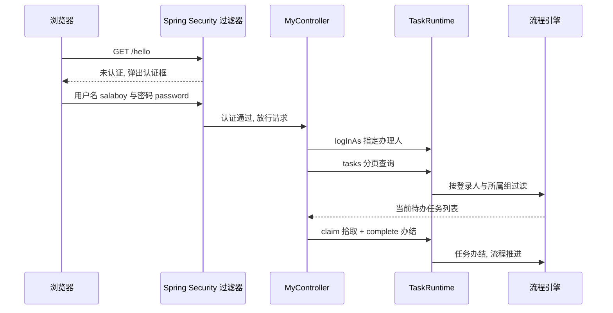

# 把流程操作做成 HTTP 接口：Activiti7 整合 Spring MVC 开发 Controller

测试类里已经能查询、拾取、完成任务，但 `@Test` 方法只能开发自己点着跑，真实系统需要浏览器或前端发请求来触发。这一课把 `ProcessRuntime`、`TaskRuntime` 注入 Controller，用 `@RestController` 加 `@RequestMapping` 把任务操作暴露成 HTTP 接口，Activiti7、Spring Boot、Spring MVC 三者正式合体。写法上没有任何新知识：Controller 就是普通 Spring MVC 的 Controller，任务操作就是测试类里那三行代码。

## 先给结论

- Controller 的写法与普通 Spring MVC 完全一致：类上 `@RestController`，方法上 `@RequestMapping` 指定访问路径。
- 需要注入三个对象：`ProcessRuntime`（流程实例侧）、`TaskRuntime`（任务侧）、`SecurityUtil`（认证工具类）。
- 引导类要用 `@SpringBootApplication(exclude = SecurityAutoConfiguration.class)` 排除 Boot 默认安全配置，用户名单由自己的 `UserDetailsService` Bean 提供。
- 浏览器访问接口会先弹出认证框，这是 Spring Security 在拦截，输入名单里的用户名与密码才能进入方法体。
- 方法返回 `void` 时页面空白是正常的，任务信息看控制台输出；流程已跑完时接口无任务可办，要先重启一个流程实例。

## 一、Controller 骨架：三个依赖注入进来

在工程里新建 `controller` 包，创建 `MyController` 类。它的核心工作是承接任务操作，所以先把三类依赖注入进来：

```java
package com.example.activiti.controller;

import org.activiti.api.process.runtime.ProcessRuntime;
import org.activiti.api.task.runtime.TaskRuntime;
import org.springframework.beans.factory.annotation.Autowired;
import org.springframework.web.bind.annotation.RequestMapping;
import org.springframework.web.bind.annotation.RestController;

@RestController
public class MyController {

    @Autowired
    private ProcessRuntime processRuntime; // 流程实例与流程定义操作
    @Autowired
    private TaskRuntime taskRuntime;       // 任务查询、拾取、完成
    @Autowired
    private SecurityUtil securityUtil;     // 指定办理人身份

    @RequestMapping("/hello")
    public void testHello() {
        // 方法体见下一节
    }
}
```

三个依赖各司其职。`ProcessRuntime` 负责启动流程实例、查询流程定义；`TaskRuntime` 负责任务的查询、拾取与完成；`SecurityUtil` 是工程里自带的工具类，内部通过 `UserDetailsService` 加载用户并写入安全上下文。`@RestController` 等价于 `@Controller` 加 `@ResponseBody`，方法返回值直接写进响应体，这正是与前端交互时最常用的形态。

方法上标注 `@RequestMapping("/hello")`，路径随意，重点是它把一段流程操作绑定到了一个可访问的 URL 上。真实项目里的「认领任务」「办理任务」接口，就是把 `claim`、`complete` 分别绑到不同路径上，套路完全相同。

## 二、方法体：查询、拾取、完成搬到接口里

方法体直接从测试类里迁移过来，逻辑一字不改：

```java
@RequestMapping("/hello")
public void testHello() {
    // 指定办理人身份, activitiTeam 组内成员即可
    securityUtil.logInAs("erdemedeiros");
    // 分页查询任务列表
    Page<Task> taskPage = taskRuntime.tasks(Pageable.of(0, 10));
    if (taskPage.getTotalItems() > 0) {
        for (Task task : taskPage.getContent()) {
            System.out.println("任务1:" + task);
            // 领取任务
            taskRuntime.claim(TaskPayloadBuilder.claim().withTaskId(task.getId()).build());
            // 执行任务
            taskRuntime.complete(TaskPayloadBuilder.complete().withTaskId(task.getId()).build());
        }
    }
    // 重新查询: 当前任务办结后流程推进到下一个节点
    Page<Task> taskPage2 = taskRuntime.tasks(Pageable.of(0, 10));
    if (taskPage2.getTotalItems() > 0) {
        for (Task task : taskPage2.getContent()) {
            System.out.println("任务2:" + task);
        }
    }
}
```

`logInAs` 这一行在接口里依然要保留。Activiti7 的新 API 从安全上下文里取当前登录人做权限过滤，`tasks` 查的是「这个人或这个人所在组的任务」，上下文里没有认证对象时直接调用会失败。测试类里是 `logInAs` 给的认证，接口里同样由它给出，保证不管浏览器用哪个账号通过认证，接口内部都以指定的办理人身份执行任务。

`testStartInstance` 的启动实例代码也可以放进 Controller，方法体里先 `processRuntime.start` 再查任务，一次请求完成「发起流程、办理任务」两步，这正是审批业务的雏形。

## 三、引导类与安全配置：exclude 与用户名单

引导类从 day06 的整合素材工程复制过来，改动只有注解上的一个属性：

```java
@SpringBootApplication(exclude = SecurityAutoConfiguration.class)
public class ActivitiDemoApplication {

    public static void main(String[] args) {
        SpringApplication.run(ActivitiDemoApplication.class, args);
    }
}
```

`exclude = SecurityAutoConfiguration.class` 的作用是关掉 Spring Boot 默认的安全自动配置。默认配置会凭空造一个用户、生成一个随机密码、挂一套默认登录页，而本工程的安全数据完全由自己的配置类提供：

```java
@Configuration
public class DemoApplicationConfiguration {

    @Bean
    public UserDetailsService myUserDetailsService() {
        InMemoryUserDetailsManager manager = new InMemoryUserDetailsManager();
        // 用户名, 密码, 角色, 所属组
        String[][] usersGroupsAndRoles = {
                {"salaboy", "password", "ROLE_ACTIVITI_USER", "GROUP_activitiTeam"},
                {"ryandawsonuk", "password", "ROLE_ACTIVITI_USER", "GROUP_activitiTeam"},
                {"erdemedeiros", "password", "ROLE_ACTIVITI_USER", "GROUP_activitiTeam"},
                {"other", "password", "ROLE_ACTIVITI_USER", "GROUP_otherTeam"},
                {"admin", "password", "ROLE_ACTIVITI_ADMIN"},
        };
        for (String[] user : usersGroupsAndRoles) {
            List<String> authorities = Arrays.asList(Arrays.copyOfRange(user, 2, user.length));
            manager.createUser(new User(user[0], passwordEncoder().encode(user[1]),
                    authorities.stream().map(SimpleGrantedAuthority::new).collect(Collectors.toList())));
        }
        return manager;
    }

    @Bean
    public PasswordEncoder passwordEncoder() {
        return new BCryptPasswordEncoder();
    }
}
```

名单里的组名与 BPMN 候选组一一对应，`activitiTeam` 的成员能查到组任务，`otherTeam` 的成员查不到。这份名单同时服务于两个入口：浏览器弹出的认证框从这里校验账号密码，`SecurityUtil.logInAs` 也从这里加载用户并构造认证对象。

一次完整的调用链路是这样的：



关键环节在过滤器那两步：请求先被 Spring Security 拦截，认证通过后才进入 Controller，之后才轮到 Activiti 的 API 干活。控制台里先打出「任务1」是 first 节点的任务，办结后再打出的「任务2」就是 second 节点的任务，与测试类的输出完全一致。

## 四、测试前的准备：任务表里得先有任务

启动引导类之后直接访问 `localhost:8080/hello`，很可能什么都查不到。原因是上一课已经把流程全部跑完，任务表里空空如也，接口执行时 `getTotalItems()` 为 0，循环体不执行。解决办法是先把测试类里启动流程实例的方法再执行一遍：

```java
@Test
public void testStartProcess() {
    securityUtil.logInAs("system");
    ProcessInstance pi = processRuntime.start(
            ProcessPayloadBuilder.start().withProcessDefinitionKey("myProcess").build());
    System.out.println("流程实例ID：" + pi.getId());
}
```

新实例启动后 first 任务重新生成，此时浏览器访问 `/hello`，认证、查询、办结一气呵成，控制台输出两批任务信息，Spring MVC 引路进来的整合就算跑通了。从此工作流操作有了 HTTP 入口，前端页面接进来只是时间问题。

## 常见误区

- **漏掉 `logInAs` 直接调 `TaskRuntime`**：新 API 依赖安全上下文里的认证对象做权限过滤，上下文为空时任务查询拿不到结果甚至抛异常。接口方法开头先固定办理人身份，或从请求的登录态里解析。
- **不排除 `SecurityAutoConfiguration` 又自己配用户**：Boot 的默认用户与自定义名单并存，行为难以预测，认证框里输入哪个都拿不准。要么全交给自动配置，要么 exclude 之后全用自己的名单。
- **流程跑完了还去调任务接口**：任务表为空，接口执行等于空转。测试前先重启一个流程实例，这是最容易浪费排查时间的一处。
- **以为页面空白是接口没生效**：方法返回 `void`，页面当然空白。任务是否办理看控制台输出或数据库，而不是看浏览器页面。

## 面试可能被问到的问题

1. 面试官追问：「Activiti7 整合 Spring Boot 后，Controller 里操作流程和普通业务接口有什么区别？」
   答：Controller 本身的写法没有任何区别，`@RestController` 与 `@RequestMapping` 照常使用。区别在于注入的是 `ProcessRuntime` 与 `TaskRuntime` 这类工作流 API，且每个操作都依赖安全上下文中的认证对象，接口里需要先确定办理人身份再执行任务操作。

2. 面试官追问：「为什么要 `exclude = SecurityAutoConfiguration.class`？」
   答：排除 Spring Boot 默认的安全自动配置，避免它注册的默认用户、随机密码和默认登录页与工程自己的安全配置叠加。用户、角色、组全部由自定义的 `UserDetailsService` Bean 提供，Activiti7 的权限过滤也以这份名单为准。

3. 面试官追问：「浏览器访问接口时弹出的用户名密码框是谁给的？」
   答：是 Spring Security 的认证过滤器给出的。请求未携带认证信息时被拦截返回 401，浏览器据此弹出认证框，输入的账号在自定义的 `InMemoryUserDetailsManager` 名单里校验，通过后请求才到达 Controller。

4. 面试官追问：「接口里已经有了登录态，为什么还要调 `logInAs`？」
   答：新 API 的权限过滤依赖安全上下文中带有 `ROLE_ACTIVITI_USER` 权限的认证对象。教学工程里浏览器认证与流程办理人是两个概念，`logInAs` 显式指定办理人，保证接口以组内成员身份执行任务；生产上通常从请求的登录态解析出用户再设置到上下文。

5. 面试官追问：「同一个接口既想启动流程又想办理任务，怎么设计？」
   答：拆成两个职责清晰的接口，一个调 `processRuntime.start` 负责发起审批，一个调 `taskRuntime.tasks` 加 `claim`、`complete` 负责办理待办，前端按页面动作分别调用。混在一个方法里耦合度高，也不利于权限控制与事务边界划分。

## 配套资料

- 引导类与安全配置：`materials/code/02/Activiti7-day06-新特性/Activiti7-day06-新特性/源码/demo2/activitispringboot06/src/main/java/`（`Actviti7DemoApplication.java` 的 `exclude = SecurityAutoConfiguration.class` 写法、`DemoApplicationConfiguration.java` 的内存用户名单，包名已改为 `com.example`）
- 认证工具类：`materials/code/02/Activiti7-day07-审批中心模块开发/Activiti7-day07-审批中心模块开发/代码/activiti07/src/main/java/`（`SecurityUtil.java`，`logInAs` 内部加载用户并写入安全上下文的完整实现）
- 真实 Controller 参考：`materials/code/02/Activiti7-day07-审批中心模块开发/Activiti7-day07-审批中心模块开发/代码/activiti07/src/main/java/controller/`（`ProcessController.java`，注入 `ProcessRuntime`、`TaskRuntime` 并提供流程部署、查询接口的完整工程版 Controller；本课的 `MyController` 为课堂实录代码，按画面整理）
