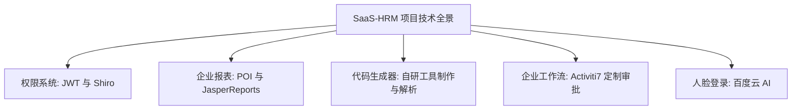
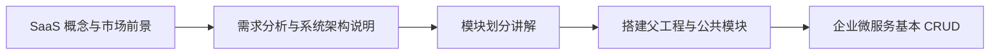

# SaaS 模式的人力资源系统长什么样：项目全景与课程路线

新项目开篇。接下来要做的是一套基于 SaaS 平台的人力资源管理系统（HRM），它解决的是传统行业的信息化问题：一套系统部署一次，同时服务多家企业，每家公司在里面管自己的人、做自己的审批。开课先不写代码，把三件事讲透：SaaS 到底是什么、这套系统要做什么、整个课程按什么路线推进。搞清楚这些，后面每一天的代码才知道自己处在全局的哪个位置。

## 先给结论

- SaaS 的本质是「租软件」：软件部署在云端，企业按订阅使用，不用自己买服务器、装系统、做运维，多租户是它的核心特征。
- 云服务分三层：IaaS 卖基础设施、PaaS 卖平台环境、SaaS 直接卖软件服务，层次越高，企业要操心的事越少。
- 项目的技术亮点有五块：权限系统（JWT 与 Shiro、菜单按钮 API 三级权限）、企业报表（POI 出 Excel、JasperReports 出 PDF）、自研代码生成器、企业工作流定制（Activiti7）、人脸登录（百度云 AI）。
- 第一天的任务链：SaaS 概念与市场 → 需求分析与架构说明 → 模块划分 → 搭建父工程与公共模块 → 企业微服务的基本 CRUD。
- 工程从第一天起就是微服务形态，统一响应结果、分布式 ID 生成器这类公共代码先备好，后续所有微服务复用。

## 一、从买软件到租软件：IaaS、PaaS、SaaS 三层服务

企业要用一套信息系统，传统做法是买服务器、装数据库、部署软件、养运维团队，每一层都要自己出钱出人。云服务把这件事按层拆开卖，卖到哪一层，企业就省掉哪一层的负担：

| 模式 | 卖什么 | 类比 | 企业管什么 |
|---|---|---|---|
| IaaS 基础设施即服务 | 虚拟机、存储、网络 | 租毛坯房 | 操作系统以上的所有东西 |
| PaaS 平台即服务 | 中间件、数据库、运行环境 | 租精装房 | 应用与数据 |
| SaaS 软件即服务 | 开箱即用的软件 | 住酒店 | 只管用，软件与数据都由服务商维护 |

**层次越高，交付的东西越完整。** IaaS 只解决「机器从哪来」，PaaS 解决「环境从哪来」，SaaS 直接回答「软件从哪来」。邮箱服务、在线文档、客户关系管理这类产品，企业打开浏览器注册账号就能用，背后就是 SaaS 模式。

SaaS 的市场前景建立在两个账本上。企业侧：不需要一次性投入大笔软硬件费用，按年按人订阅，成本变成可预测的运营开支，用得多买得多，用不起随时停。服务商侧：一套系统服务成千上万家企业，研发与运维成本被海量租户摊薄，规模越大边际成本越低。这套商业逻辑成立的前提，是技术上的多租户能力。

## 二、多租户：一套系统凭什么服务多家企业

多租户（multi-tenancy）指软件实例只有一套，却同时服务多个客户（租户），租户之间的数据严格隔离、互不可见。放到人力资源场景里：A 公司的 HR 登录后只看到 A 公司的员工、部门与审批单，B 公司的一切对它完全不可见，尽管两边连的是同一个系统、同一套数据库服务。

数据隔离是 SaaS 系统的第一设计问题，常见三种粒度：

- **独立数据库**：每个租户一个库，隔离最彻底，成本最高，适合对安全要求苛刻的大客户。
- **共享数据库、独立 Schema**：一个库里每个租户一套表，隔离与成本居中。
- **共享表、租户字段隔离**：所有租户的数据放同一批表，靠租户标识字段区分，成本最低，是互联网 SaaS 产品的主流选择。

项目里的企业实体把这些 SaaS 特征写在了字段上：

```java
// 企业实体: 租户维度的载体（节选, 包名已改写）
public class Company implements Serializable {
    private String id;
    private String name;         // 公司名称
    private String managerId;    // 企业登录账号ID, 租户管理员
    private String version;      // 当前版本
    private Date renewalDate;    // 续期时间
    private Date expirationDate; // 到期时间
    private String auditState;   // 审核状态
    private Integer state;       // 状态
    private Double balance;      // 当前余额
    // 公司地区、地址、法人代表、电话、邮箱、所属行业等字段省略
}
```

`version`、`renewalDate`、`expirationDate`、`balance` 这几个字段组合起来就是一份订阅合同：企业开通时审核、按版本付费、到期续费、余额扣减。多租户不只是技术概念，它直接长在数据模型上。后续权限系统的开发会围绕这个租户维度展开，企业内再分角色、分用户，形成「平台管企业、企业管员工」的两层结构。

## 三、课程技术全景：五大模块各自解决什么问题

整个项目的含金量集中在五个技术模块上，每个模块对应一类真实的企业级需求：



**第一块，权限系统。** 前后端分离架构下的 token 认证用 JWT 实现，认证框架引入传统的 Shiro，权限控制做到三个粒度：菜单权限决定用户能看到哪些页面，按钮权限决定页面上哪些按钮可点，API 权限在后端接口层再做一次兜底校验。这是企业级系统的标配能力，也是本项目开发顺序上的第一站。

**第二块，企业报表。** 企业躲不开报表：员工花名册导出 Excel 用 POI 实现，正式的证明文件与档案输出 PDF 用 JasperReports 实现。两套框架各管一种文件格式，覆盖了 Java 报表开发的主流场景。

**第三块，代码生成器。** 做到第二个、第三个微服务时就会发现，各模块的代码大同小异：实体、数据访问、业务、控制器一层层重复。手工复制粘贴是巨大的劳动力浪费，方案是自己动手做一个代码生成工具。这一块不仅教使用，更教制作与解析，理解了原理，换任何模板引擎都能自己写。

**第四块，企业工作流定制。** 请假审批层层上报：直属领导批完到部门主管，再到人事经理，直到总经理签字生效。这种多级流转就是企业工作流，借助 Activiti7 实现定制。前面一系列控制台演练的查询、拾取、完成任务，都会在这里变成真实业务。

**第五块，人脸登录。** 借助百度云 AI 的人脸识别能力实现刷脸登录，是人工智能在企业系统里的一个落地切片。



这张图是第一天的推进路线，从概念一路走到能跑的代码。

## 四、第一天的落脚点：工程骨架与第一个微服务

概念讲完，动手部分从搭建工程开始：创建父工程统一依赖版本，公共模块存放所有微服务共享的代码。其中统一响应结果是微服务间与前后端间的通用契约：

```java
@Data
@NoArgsConstructor
public class Result {
    private boolean success; // 是否成功
    private Integer code;    // 返回码
    private String message;  // 返回信息
    private Object data;     // 返回数据

    public Result(ResultCode code) {
        this.success = code.success;
        this.code = code.code;
        this.message = code.message;
    }
    // 静态工厂 SUCCESS / ERROR / FAIL 等方法省略
}
```

每个接口都返回这个结构，前端拿到统一的 `success`、`code`、`message`、`data` 四件套，处理逻辑可以完全通用化。配套的分布式 ID 生成器负责在微服务环境下生成全局唯一的主键，企业微服务的第一批 CRUD 接口就建立在这些公共组件之上。

需求分析阶段用 Power Designer 画用例图，把系统的参与者与功能边界先画清楚；模块划分把整个系统拆成企业、用户、权限等若干微服务，每个微服务职责单一、独立部署。骨架立起来之后，第二天起的数据表设计与前端框架、之后的权限与报表，都是往这副骨架上加内容。

## 常见误区

- **把 SaaS 理解成「部署在云上的软件」**：把单体应用扔到云主机上跑只是换了机房，SaaS 的核心是多租户架构与订阅式运营，一套实例服务多家企业、数据按租户隔离，这两点缺一不可。
- **认为多租户就必须一个租户一个数据库**：隔离方案有独立数据库、独立 Schema、共享表加租户字段三档，按成本与安全要求选型，互联网 SaaS 产品多用共享表方案，靠租户标识区分数据。
- **以为人力资源系统就是增删改查**：员工管理的 CRUD 只是底座，权限的三级控制、报表的两种格式、自研代码生成器、工作流的定制审批才是项目的难度与含金量所在。
- **低估公共模块的作用**：统一响应结果、分布式 ID 这类公共代码看着不起眼，微服务数量一多，没有它们的统一约定，各模块的接口风格会迅速失控。

## 面试可能被问到的问题

1. 面试官追问：「SaaS 和传统软件交付模式的本质区别是什么？」
   答：传统模式卖拷贝，企业自建环境部署维护，一次性买断；SaaS 模式软件由服务商统一部署运营，企业按订阅使用，核心支撑技术是多租户，一套实例服务多家企业且数据相互隔离。商业模式从资产支出变成运营支出，技术上考验数据隔离与水平扩展能力。

2. 面试官追问：「IaaS、PaaS、SaaS 的边界怎么划分？」
   答：按交付层次划分。IaaS 提供虚拟机、存储、网络等基础设施，用户自管操作系统与上层软件；PaaS 提供数据库、消息队列、运行环境等平台能力，用户只管应用与数据；SaaS 直接交付可用的软件，用户不做任何运维。层次越高，服务商承担越多，用户负担越少。

3. 面试官追问：「多租户的数据隔离有哪些方案，怎么选？」
   答：三种主流方案。独立数据库隔离最彻底，适合安全要求高的大客户；共享数据库独立 Schema 居中；共享表加租户字段成本最低，是互联网 SaaS 的主流。选型看客户规模、合规要求与成本预算，方案落点在数据模型设计上，例如企业实体中的租户管理字段。

4. 面试官追问：「为什么菜单权限、按钮权限、API 权限要分开控制？」
   答：三层各挡一类问题。菜单权限控制页面可见性，按钮权限控制页面内操作粒度，API 权限在后端接口层兜底。只做前端两层的话，绕过页面直接调接口就能越权，后端 API 校验是安全闭环的最后一道闸，三者配合才能覆盖从展示到数据的完整链路。

5. 面试官追问：「模块间代码高度相似，除了代码生成器还有什么办法？」
   答：按相似程度选手段。配置相似的抽公共依赖与公共模块；逻辑相似的封装成可复用的业务组件或继承体系；连工程结构都雷同、只是字段不同的，代码生成器收益最大，以模板加元数据的方式批量产出。生成器的价值在于模板可维护、可迭代，理解其制作原理后才能根据团队规范定制。

## 配套资料

- 企业实体与租户字段：`materials/code/02/day01 SAAS-HRM系统概述与搭建环境/SAAS-HRM系统概述与搭建环境/资源/Company.java`（含 `managerId`、`renewalDate`、`expirationDate`、`balance` 等完整字段，包名已改写为 `com.example`）
- 公共响应组件：`materials/code/02/day01 SAAS-HRM系统概述与搭建环境/SAAS-HRM系统概述与搭建环境/资源/通用代码/common/`（`Result.java`、`ResultCode.java`、`PageResult.java`，微服务统一响应结构的真实实现）
- 分布式 ID 生成器：`materials/code/02/day01 SAAS-HRM系统概述与搭建环境/SAAS-HRM系统概述与搭建环境/资源/通用代码/IdWorker.java`（基于雪花算法的全局唯一 ID 实现，公共模块的组成部分）
