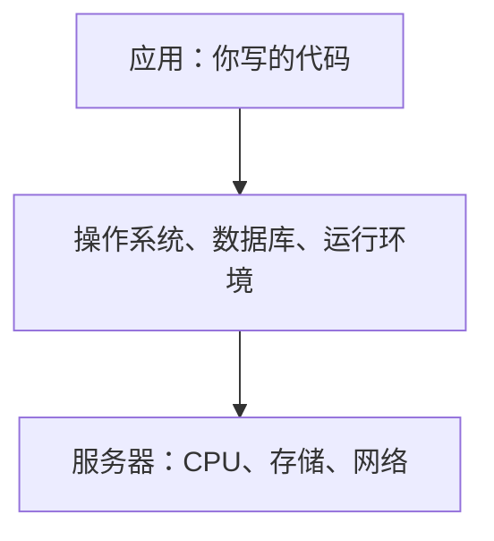
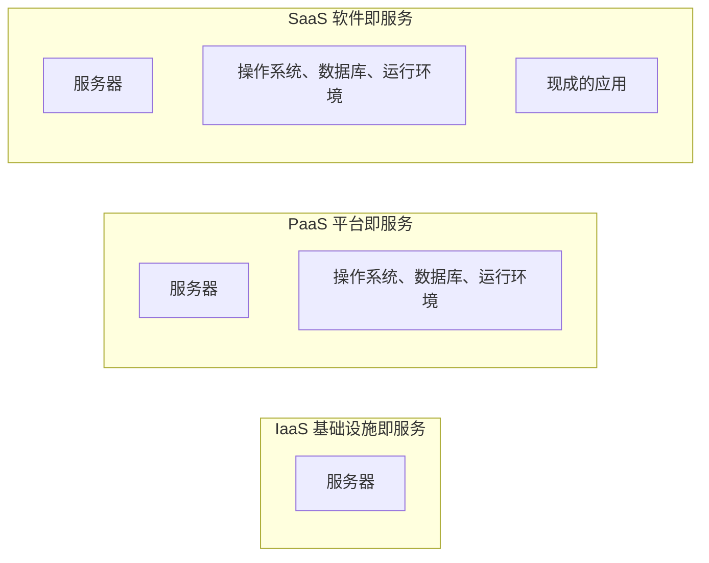

# 云服务的三种模式：IaaS、PaaS、SaaS 各自包到哪一层

公司要「上云」，你打开云厂商的官网，看到的是云服务器、云数据库、现成的人力资源系统三类完全不同的商品，价格模式也不一样，到底该按哪个思路调研？又或者面试官随口一句「说说 IaaS、PaaS、SaaS 的区别」，你只记得三个名字，说不清三者的边界在哪。

这一节就把这件事一次讲透：企业开发从代码到上线，中间要自己张罗的所有东西，云服务把它们拆成了三层，按层出租。三种模式名只差一个字母，差别就在「服务商替你包到哪一层」。

## 先给结论

- 云服务把企业开发要自建的东西按层出租：IaaS 租硬件，PaaS 租平台，SaaS 直接租软件。
- IaaS（基础设施即服务）只交付一台可选配的服务器：CPU、存储、带宽自己挑，操作系统、数据库、运行环境仍要自己装。
- PaaS（平台即服务）在 IaaS 之上把操作系统、数据库、运行环境一并备好，你只管把自己的代码部署上去。
- SaaS（软件即服务）连应用本身都替你做好，按需租赁付费、即租即用，能上网的设备就能访问。
- 一套房子类比记住全部：自建机房是买地盖房，IaaS 是租毛坯，PaaS 是租精装公寓，SaaS 是拎包入住。

## 从「部署一套系统」要干多少活说起

代码写完只是开始，要让系统真正跑起来，清单远比想象的长。

**第一，得有一台自己的服务器。** CPU 选什么型号、存储给多大、网络架构和带宽怎么定，每一项都要自己选型、自己采购。

**第二，要在服务器上装软件。** 先装操作系统，Windows 还是 Linux 要做选择；然后装数据库；如果开发用的是 Java，还得把对应语言的运行环境装好。

**第三，才是把应用部署进去。** 前两步全部就绪，你写的代码才有地方落地。

这三层的依赖关系，用一张图看最直观：



从上往下，每一层都压在下一层之上：应用离不开运行环境，运行环境离不开操作系统，操作系统离不开那台真实的服务器。传统企业从零开始把三层全部自建，采购、安装、维护全在自己手上，成本高、周期长。云服务这个概念，正是把这三层拆开、按层出租的产物。

## IaaS：租毛坯房，装修自己来

IaaS（Infrastructure as a Service，基础设施即服务）交付的是最底下那层：服务器本身。向服务商交纳一定费用，立刻得到一台虚拟服务器，CPU 几核、存储多大、带宽几兆都可以按需选择，不用再走硬件采购流程。对企业来说省事，费用通常也更低。

不过 IaaS 的边界也很清楚：**它只提供技术设备，剩下的不管。** 操作系统装什么、数据库装哪个、运行环境要不要，全是用户自己的事。

拿租房子打比方，IaaS 就是租毛坯房：房子给你了、水电通了，装修、家具、家电全部自理。落到操作上，拿到一台 IaaS 裸机之后至少要做这些事（示例为按主流 Linux 写法补全）：

```bash
# 拿到一台 IaaS 裸机后，要让一个 Java 应用能跑起来，环境全靠自己装
yum install -y java-1.8.0-openjdk        # 装 JDK 运行环境
yum install -y mysql-server              # 装数据库
systemctl start mysqld                   # 启动数据库服务
# 操作系统的选择与安装，则发生在拿到这台机器之前
```

## PaaS：租精装公寓，行李住进来就行

PaaS（Platform as a Service，平台即服务）比 IaaS 再往上包一层：服务器、操作系统、数据库、运行环境（比如 JDK）全部由服务商准备好。你什么都不用采购，也不用配维护人员，交费之后只剩下一段自己的代码要部署。

类比继续升级：PaaS 是租精装公寓，装修、家具、家电都齐了，拎着行李住进去就能生活。

很多 PaaS 平台把「部署」也简化成提交一份应用描述，平台照单自动拉起环境（示例为按主流写法补全）：

```yaml
# 一份典型的 PaaS 应用清单：平台读它来准备运行环境
name: saas-hrm-web
runtime: java8            # 运行环境平台帮你装
database: mysql57         # 数据库平台帮你开
instances: 2              # 实例数量平台帮你调度
```

对照这份清单能看得很清楚：里面没有任何一行是「装 JDK」「装 MySQL」之类的命令，这些全被平台接管了。PaaS 里包含服务器、操作系统等一整套内容，你写好的代码部署上去就能运行。

## SaaS：拎包入住，连软件都是租的

SaaS（Software as a Service，软件即服务）是最彻底的一层：连应用本身都由服务商做好，部署在互联网上。企业什么都不用开发，按自己的需求向服务商租赁或购买，交钱就能直接用；只要手上有能上网的设备，浏览器也好手机也好，随时访问这套系统。

三种模式各交付到哪一层，放进同一张图里对比：



这张图在讲一件事：三种模式的差别只在「服务商替你包到哪一层」。IaaS 包到服务器为止，PaaS 包到运行环境为止，SaaS 直接包到应用。SaaS 的底层同样跑在服务器和平台之上，三者不是互斥选项，而是同一条技术栈的三个交付切面。房子始终是那栋楼：租毛坯、租精装、拎包入住，区别只在你自己还要做多少。

## 常见误区

- **以为 IaaS 自带数据库。** IaaS 只交付服务器，操作系统、数据库、运行环境仍然自己装；帮你装好的那是 PaaS。
- **把「传统软件装到云服务器上」当成 SaaS。** 那只是部署位置变了，软件仍要买断、自己维护；SaaS 的标志是按需租赁、服务商托管升级。
- **认为三种模式三选一。** 它们是分层的互补关系，你每天用的 SaaS 产品，底层可能正跑在某个 IaaS 平台上。
- **以为选了 PaaS 就不用写代码。** PaaS 免掉的是环境搭建，应用代码仍要自己开发部署；连代码都不用写的才是 SaaS。

## 面试可能被问到的问题

1. 面试官追问：「IaaS、PaaS、SaaS 的核心区别是什么？」
   答：区别在服务商交付的层次。IaaS 交付服务器等基础设施，用户自装系统与运行环境；PaaS 在此之上把操作系统、数据库、运行环境备好，用户只部署代码；SaaS 把应用本身也做好，用户交钱即用。按「包到哪一层」记忆即可。

2. 面试官追问：「用房子类比这三种模式，你会怎么讲？」
   答：自建机房相当于买地盖房，一切自己来；IaaS 是租毛坯，房子有了、装修自理；PaaS 是租精装公寓，家具家电齐备、行李入住；SaaS 是拎包入住，连住什么都被安排好了。

3. 面试官追问：「企业什么场景该选 IaaS 而不是 SaaS？」
   答：当业务需要深度定制、或已有成熟系统要迁移时，选 IaaS 自己掌控整条技术栈；要的是标准化能力且不想背运维负担时，直接订阅对应的 SaaS 产品更划算。

4. 面试官追问：「为什么说用 SaaS 对企业成本更低？」
   答：SaaS 把采购服务器、搭建环境、雇人维护这些成本摊到所有租户头上，企业只为所用功能按期付费，免去一次性硬件投入和专职运维，总体成本显著下降。

## 配套资料

- 本课为概念讲解（PPT 与白板），无配套源码；文中 bash、yaml 均为按主流写法补全的示例。
- 本项目后续会用到的课程通用代码位于：`materials/code/02/day01 SAAS-HRM系统概述与搭建环境/SAAS-HRM系统概述与搭建环境/资源/通用代码/`（含 `IdWorker.java`、`common/Result.java`、`common/ResultCode.java`、`common/PageResult.java`，后面几篇会逐个讲到）。
