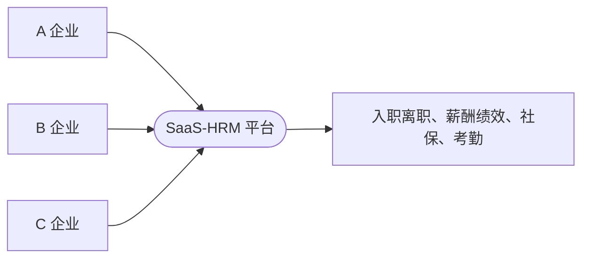

# 什么是 SaaS-HRM：一套平台服务 N 家企业，还要互相不可感知

写过公司内部管理系统的人，第一次听到「SaaS-HRM」多半会犯嘀咕：人力资源管理系统我写过，员工、薪酬、社保那套东西并不陌生，前面多挂一个 SaaS，系统的设计到底哪里不一样了？

差别不在功能列表，而在「谁在用」。这一节先说清 HRM 本身管什么，再看挂上 SaaS 之后架构上多出来的那个关键角色：租户。本项目整个阶段要做的系统，就是围绕这个角色展开的。

## 先给结论

- SaaS-HRM 是基于 SaaS 模式的人力资源管理系统，入职离职、薪酬绩效、社保、考勤等 HR 功能一样不少。
- 核心变化在服务对象：不是服务一家公司的内部，而是 A、B、C 众多企业共用同一套平台。
- 租户隔离是命门：A 企业感知不到 B，B 也感知不到 C，每家企业都觉得系统是为自己单独定制的。
- 落到数据上：每家入驻企业对应一条企业档案记录，订阅版本、续期到期、审核状态都记在这条记录上。
- 平台的通用设施在第一天就绪：统一返回码预留了认证授权语义，雪花算法 ID 生成器为多租户共库提供全局唯一主键。

## HRM 本身：人力资源管理系统管什么

先把 SaaS 放一边，单独看 HRM（Human Resource Management，人力资源管理）。一套人力资源管理系统必然包含这些功能：员工的入职与离职办理、薪酬绩效体系与工资计算、社保是否缴纳的管理，再加上考勤这类日常工作。这些功能对应的是企业人事行政的真实流程，与传统 HR 软件没有区别。

真正的分水岭在下一个问题：这套系统服务谁。

## 挂上 SaaS：三个箭头指向同一个平台

传统 HR 软件是一对一的：一家企业买一套，装在自己机房里。SaaS-HRM 把方向拧了过来：服务商提供一套公共平台，众多企业都通过它来完成自己内部的人力资源管理。



图里最要紧的一处是：三个箭头都指向同一个平台，但 A、B、C 三家企业之间没有任何连线。平台对每一家企业提供完整的 HR 功能，而这些企业彼此不发生关系。

## 租户隔离：每家企业都以为系统是单独给它做的

这种「多家共用一套、彼此互不知情」的模式，在架构上叫多租户（multi-tenant），每一家接入的企业就是一个租户。

**第一，租户之间不可感知。** A 企业使用平台时，感知不到 B 和 C 的存在；同理，B 不知道 A，B 也不知道 C。数据按企业维度隔离，查询、报表、权限都带着企业这个边界。

**第二，每家企业都有「单独定制」的体验。** 虽然底层是同一套代码，但每家租户看到的组织架构、员工数据、订阅的功能模块都只属于自己的，用起来就像系统是专门为它开发的。这正是 SaaS-HRM 名字的由来：基于 SaaS 平台的 HRM 管理系统。

**第三，隔离贯穿全链路，不只是查询过滤。** 从企业入驻的资质审核，到账号权限的分配，再到每条业务数据归属哪家企业，所有环节都按租户维度设计。这一步想清楚，后面的权限体系、数据模型才不会返工。

## 本项目的通用设施：第一天就备好的三件东西

课程资料包在第一天就给出了三块通用代码，它们分别解决多租户平台的三个基础问题。

**企业档案是租户名册，也是订阅账本。** 每家入驻企业在库里对应一条 `Company` 记录：公司名称、企业登录账号 ID、当前订阅版本、续期时间、到期时间、审核状态、当前余额全在这条记录上。租户是谁、订的什么、还能不能用，看这一条就够了。

**统一返回码提前铺好了权限的路。** 平台所有接口的响应都用同一个返回码枚举约定（包名已改为 `com.example`）：

```java
package com.example.common.entity;

public enum ResultCode {

    SUCCESS(true, 10000, "操作成功！"),
    //---系统错误返回码-----
    FAIL(false, 10001, "操作失败"),
    UNAUTHENTICATED(false, 10002, "您还未登录"),
    UNAUTHORISE(false, 10003, "权限不足"),
    SERVER_ERROR(false, 99999, "抱歉，系统繁忙，请稍后重试！");

    //操作是否成功
    boolean success;
    //操作代码
    int code;
    //提示信息
    String message;

    ResultCode(boolean success, int code, String message) {
        this.success = success;
        this.code = code;
        this.message = message;
    }
}
```

多租户平台最先要回答的两个安全问题就是「你登录了吗」「你有权限吗」，所以返回码里早早定义了 `UNAUTHENTICATED` 与 `UNAUTHORISE`。后续用 JWT、Shiro 做认证授权时，所有拦截器返回给前端的就是这套约定。

**主键必须全局唯一，雪花算法顶上。** 多租户的数据最终汇在同一套存储里，如果每张表还用数据库自增主键，跨表跨库汇总时必然冲突，也容易从 ID 推测业务量级。资料里的 `IdWorker` 用雪花算法解决这个问题：时间戳、数据中心、机器、序列拼成一个全局唯一的长整数（节选核心部分）：

```java
package com.example.common.utils;

import java.lang.management.ManagementFactory;
import java.net.InetAddress;
import java.net.NetworkInterface;

// 雪花算法代码实现
public class IdWorker {
    // 时间起始标记点，作为基准，一旦确定不能变动
    private final static long twepoch = 1288834974657L;
    // 机器标识位数、数据中心标识位数、毫秒内自增位数
    private final static long workerIdBits = 5L;
    private final static long datacenterIdBits = 5L;
    private final static long sequenceBits = 12L;
    // 机器 ID 左移 12 位，数据中心 ID 左移 17 位，时间毫秒左移 22 位
    private final static long workerIdShift = sequenceBits;
    private final static long datacenterIdShift = sequenceBits + workerIdBits;
    private final static long timestampLeftShift = sequenceBits + workerIdBits + datacenterIdBits;

    /* 上次生产 id 的时间戳 */
    private static long lastTimestamp = -1L;
    // 0，并发控制
    private long sequence = 0L;

    private final long workerId;
    // 数据标识 id 部分
    private final long datacenterId;

    /**
     * 获取下一个 ID
     */
    public synchronized long nextId() {
        long timestamp = timeGen();
        if (timestamp < lastTimestamp) {
            // 时钟回拨直接拒绝，保证 ID 不重复
            throw new RuntimeException(String.format(
                    "Clock moved backwards.  Refusing to generate id for %d milliseconds",
                    lastTimestamp - timestamp));
        }
        if (lastTimestamp == timestamp) {
            // 当前毫秒内，则 +1
            sequence = (sequence + 1) & 4095;
        } else {
            sequence = 0L;
        }
        lastTimestamp = timestamp;
        // 各部分按位组合生成最终的 ID
        return ((timestamp - twepoch) << timestampLeftShift)
                | (datacenterId << datacenterIdShift)
                | (workerId << workerIdShift) | sequence;
    }

    private long timeGen() {
        return System.currentTimeMillis();
    }
}
```

`nextId()` 加了 `synchronized`，并发调用也不会撕出重号；时钟一旦回拨直接抛异常，宁可失败也不生成重复 ID。每家企业的档案、每个租户下的员工记录，主键都由它分配，租户再多也不会撞。

整个项目后续的技术版图，也在这套通用设施上展开：权限开发（JWT、Shiro）、企业报表方案（POI、Jasper）、代码生成工具的制作与解析、企业工作流定制（Activiti 7）、人脸登录这类人工智能应用。每一步都会回到同一个主题：如何在一套平台上安全地服务众多企业。

## 常见误区

- **把多租户理解成每家企业单独部署一套。** 那是传统软件的私有化部署；SaaS-HRM 是共用一套平台，靠逻辑隔离划清边界。
- **以为隔离只是查询时多带一个企业 ID 条件。** 数据、权限、附件、缓存、ID 生成都要带租户维度，漏掉任何一环都会串数据。
- **把企业账号当成租户。** 一个租户是一家入驻企业，`Company` 上的 `managerId` 只是这家企业的登录账号，租户与账号是一对多的关系。
- **以为共用平台就能看到别家数据。** 设计目标恰恰相反：A 感知不到 B，B 感知不到 C，「看不见」本身就是产品承诺。

## 面试可能被问到的问题

1. 面试官追问：「什么是 SaaS-HRM？」
   答：基于 SaaS 模式的人力资源管理系统。功能上覆盖入职离职、薪酬绩效、社保、考勤等 HR 业务；模式上由服务商提供一套公共平台，众多企业接入使用，每家企业只管理自己的人力资源，且感知不到其他租户的存在。

2. 面试官追问：「多租户是什么？租户隔离怎么做？」
   答：多租户指一套系统同时服务多家客户企业，每家企业是一个租户。隔离要在数据、权限、体验三个层面同时做：数据按租户维度隔离，权限校验带租户边界，界面与功能按租户订阅的版本呈现，目标是租户之间完全不可感知。

3. 面试官追问：「SaaS-HRM 和传统 HR 软件的区别？」
   答：传统 HR 软件一对一安装在企业内网，买断加自维护；SaaS-HRM 部署在服务商的互联网环境，多家企业共用平台、按订阅付费，升级维护由服务商统一负责。

4. 面试官追问：「多租户系统为什么主键不用数据库自增？」
   答：所有租户的数据汇在同一套存储里，自增主键跨表跨库会冲突，还会泄露业务量级。本项目用雪花算法 `IdWorker` 生成全局唯一的长整数 ID，时间戳加机器标识加序列，`nextId()` 加锁保证并发安全，时钟回拨时直接拒绝生成。

5. 面试官追问：「平台接口的返回格式怎么统一？」
   答：定义统一的 `Result` 结构与 `ResultCode` 枚举，每个响应携带是否成功、返回码、提示信息、数据四部分；返回码里预先定义了未登录、权限不足等语义，为后续 JWT、Shiro 的认证授权留好约定。

## 配套资料

- 统一返回码：`materials/code/02/day01 SAAS-HRM系统概述与搭建环境/SAAS-HRM系统概述与搭建环境/资源/通用代码/common/ResultCode.java`（配套的 `Result.java`、`PageResult.java` 在同一目录）。
- 雪花算法 ID 生成器：`materials/code/02/day01 SAAS-HRM系统概述与搭建环境/SAAS-HRM系统概述与搭建环境/资源/通用代码/IdWorker.java`（文中为节选，包名已改为 `com.example`）。
- 企业档案：`materials/code/02/day01 SAAS-HRM系统概述与搭建环境/SAAS-HRM系统概述与搭建环境/资源/Company.java`。
