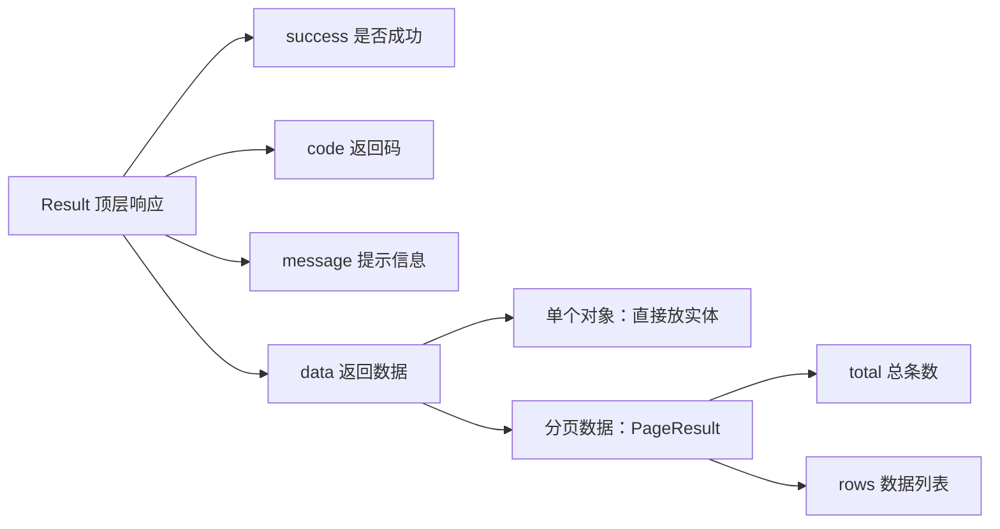
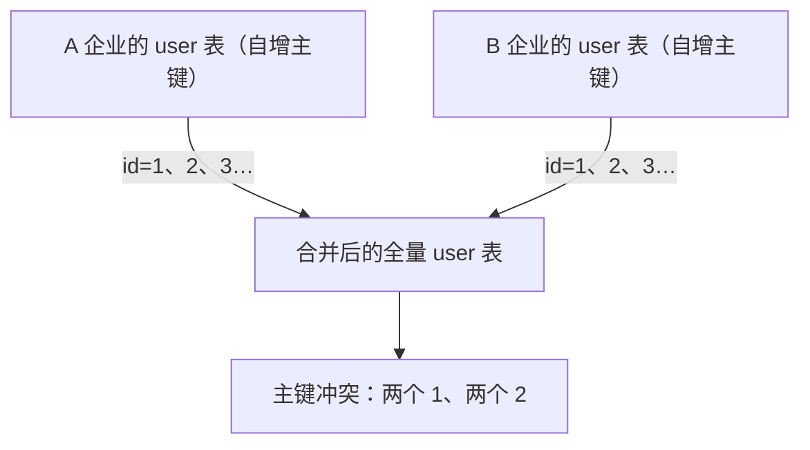
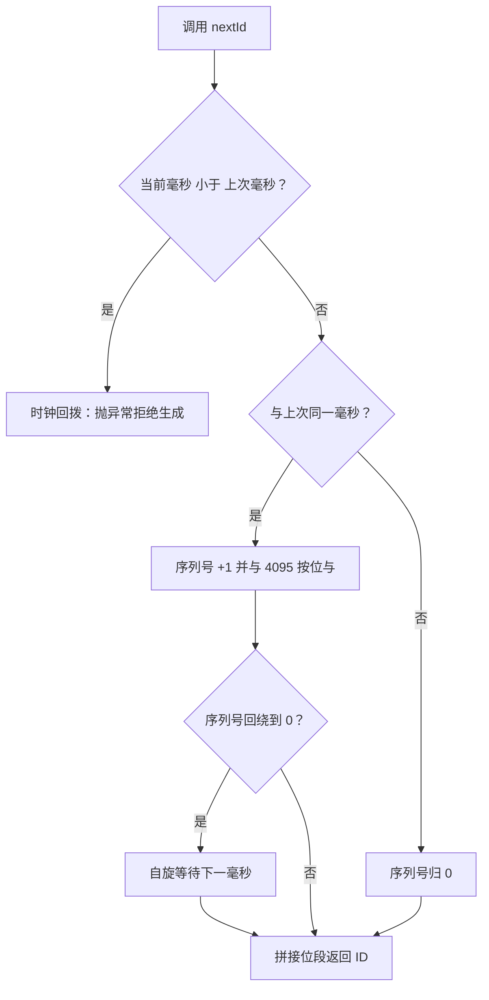
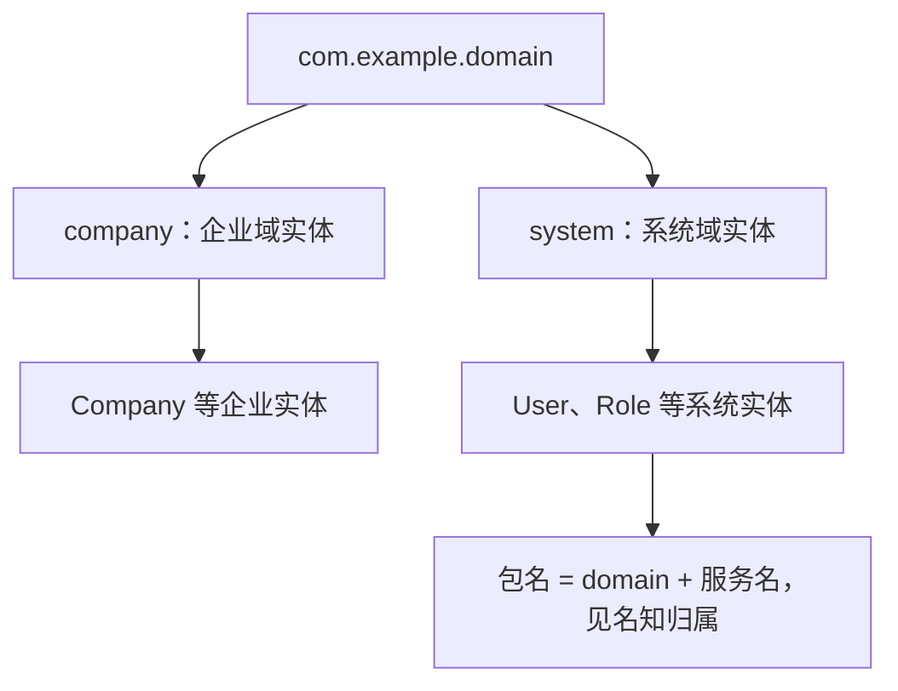

# 工程搭建之搭建子工程：公共返回实体、分布式 ID 与实体模块三步走

## 先给结论

- 公共子模块 `hrm-common` 先行：`ResultCode` 枚举收敛返回码（10000 成功、10001 失败、10002 未登录、10003 权限不足、99999 系统繁忙），`Result` 四字段统一外壳，分页把 `PageResult` 的 total 加 rows 放进 `data`。
- 返回码用枚举而不是常量类：构造器私有、实例固定，从语言层面杜绝拼出不存在的返回码；分页接口绝不裸返回 `List`，前端要拿总条数算页码。
- 分布式 ID 用雪花算法：64 位长整型，1 位符号、41 位毫秒时间戳、10 位机器标识（拆成 5 位数据中心加 5 位机器）、12 位序列号，单机单毫秒上限 4096 个，超出自旋等下一毫秒。
- 时钟回拨直接抛异常拒绝发号，宁可短时不可用也不冒重复 ID 的风险；机器 ID 的分配必须有登记机制，两台机器拿到同一组值，同一毫秒必出重复。
- 实体模块 `hrm-domain` 按服务分包，依赖 JPA starter 与 `hrm-common`；Lombok 两步走：父工程引坐标、类上贴注解，`@Data` 一网打尽但不含全参构造。
- JPA 底线：实体必须有 public 或 protected 的无参构造，只加 `@AllArgsConstructor` 会顶掉默认构造，编译不报错、一到查询就抛实例化异常。
- 模块纪律：公共坐标只在父工程声明一次，模块间依赖在 pom 里显式写清，新建模块的源码目录记得标记 Sources Root。

## 第1部分：工程搭建_搭建子工程之搭建环境构造返回实体类

接口写起来之后，马上会撞上一个朴素的问题：返回值长什么样？返回实体、返回布尔、返回字符串，每个开发者一套习惯，前端就得为每个接口写一套解析。所以公共子模块搭好后的第一件事，不是写工具类，而是把「接口返回什么」这件事用三个类定死：返回码枚举 `ResultCode`、响应对象 `Result`、分页容器 `PageResult`。这三个类来自课程资料的真实代码，后面每个微服务的每个接口都在用它们。

### 一、搭出公共子模块
在 IDEA 里对父工程右键 New Module，选 Maven，artifactId 取 `hrm-common`。生成出来的 pom 极短，这正是父子结构的红利：

```xml
<?xml version="1.0" encoding="UTF-8"?>
<project xmlns="http://maven.apache.org/POM/4.0.0"
         xmlns:xsi="http://www.w3.org/2001/XMLSchema-instance"
         xsi:schemaLocation="http://maven.apache.org/POM/4.0.0 http://maven.apache.org/xsd/maven-4.0.0.xsd">
    <modelVersion>4.0.0</modelVersion>

    <!-- groupId 与 version 直接继承父工程，不必重复声明 -->
    <parent>
        <artifactId>hrm-parent</artifactId>
        <groupId>com.example</groupId>
        <version>1.0-SNAPSHOT</version>
    </parent>

    <artifactId>hrm-common</artifactId>
</project>
```

父工程里已经声明了 web、日志、测试、Lombok 这些公共依赖，`hrm-common` 一行没写就全都有了。接下来在 `src/main/java` 下建包 `com.example.common.entity`，三个返回值类都放这里；分布式 ID 生成器则放到 `com.example.common.utils`，那是下一小节的内容。

### 二、ResultCode：把返回码收敛成枚举
返回码散落在各接口里写魔法数字，是维护噩梦的开端：10000 在一个接口里代表成功，在另一个接口里可能被当成别的含义。课程的做法是定义一个枚举，每个枚举项携带三个信息：

```java
package com.example.common.entity;

public enum ResultCode {

    SUCCESS(true, 10000, "操作成功！"),
    //---系统错误返回码-----
    FAIL(false, 10001, "操作失败"),
    UNAUTHENTICATED(false, 10002, "您还未登录"),
    UNAUTHORISE(false, 10003, "权限不足"),
    SERVER_ERROR(false, 99999, "抱歉，系统繁忙，请稍后重试！");

    //---用户操作返回码----
    //---企业操作返回码----
    //---权限操作返回码----
    //---其他操作返回码----

    // 操作是否成功
    boolean success;
    // 操作代码
    int code;
    // 提示信息
    String message;

    ResultCode(boolean success, int code, String message) {
        this.success = success;
        this.code = code;
        this.message = message;
    }

    public boolean success() {
        return success;
    }

    public int code() {
        return code;
    }

    public String message() {
        return message;
    }
}
```

三个枚举字段的含义一目了然：`success` 表示操作是否成功，`code` 是返回码，`message` 是给前端直接展示的提示语。枚举的构造器默认私有，外部只能使用这五个预定义实例，无法随手 new 出一个来路不明的返回码，这就是枚举比常量类可靠的地方。

返回码的分段规则也值得记下来。通用段是 10000 起步的这一组：

| 返回码 | 枚举项 | 含义 |
|---|---|---|
| 10000 | SUCCESS | 操作成功 |
| 10001 | FAIL | 统一操作失败 |
| 10002 | UNAUTHENTICATED | 未登录 |
| 10003 | UNAUTHORISE | 权限不足 |
| 99999 | SERVER_ERROR | 系统繁忙等异常兜底 |

注释里预留的分组则是业务扩展位：用户操作相关的失败码从 2 万段开始取值，企业操作从 3 万段开始，权限操作、其他操作依此类推。不同业务的失败码各占一个号段，看到 30005 就知道是企业模块出了问题，定位时不用全文搜索。

### 三、Result：所有接口的统一外壳
请求进来了、业务跑完了，响应出去的对象就是 `Result`：

```java
package com.example.common.entity;

import lombok.Data;
import lombok.NoArgsConstructor;

@Data
@NoArgsConstructor
public class Result {

    private boolean success;// 是否成功
    private Integer code;// 返回码
    private String message;// 返回信息
    private Object data;// 返回数据

    public Result(ResultCode code) {
        this.success = code.success;
        this.code = code.code;
        this.message = code.message;
    }

    public Result(ResultCode code, Object data) {
        this.success = code.success;
        this.code = code.code;
        this.message = code.message;
        this.data = data;
    }

    public Result(Integer code, String message, boolean success) {
        this.code = code;
        this.message = message;
        this.success = success;
    }

    public static Result SUCCESS() {
        return new Result(ResultCode.SUCCESS);
    }

    public static Result ERROR() {
        return new Result(ResultCode.SERVER_ERROR);
    }

    public static Result FAIL() {
        return new Result(ResultCode.FAIL);
    }
}
```

类上的 `@Data` 与 `@NoArgsConstructor` 是 Lombok 注解，负责生成 getter、setter 与无参构造，省掉几十行模板代码，原理在实体模块那一节细讲。

**有了 `ResultCode` 为什么还要 `Result`？** 因为两者的角色不同：枚举是「答案的模板」，响应对象是「装答案的信封」。以 `ResultCode` 为参的构造器把枚举里的三个值一次拷进信封，业务代码只需要 `new Result(ResultCode.UNAUTHENTICATED)` 一句话；如果只保留 `Result`，每个接口都要自己 `setSuccess`、`setCode`、`setMessage` 三连，写错了返回码还不报错。把三个构造器加三个静态方法合起来看，实际使用时惯用的写法是 `Result.SUCCESS()` 带数据放行，异常场景由全局异常处理器返回 `Result.ERROR()`，业务校验失败则用 `FAIL()` 携带自定义提示。

`data` 声明成 `Object` 是刻意的：它可以是单个企业对象、一个集合，也可以是下一节的分页容器。类型放宽换来的是外壳永远不变，变化的部分全在 `data` 里。

### 四、PageResult：分页数据的固定容器
列表查询几乎都带分页，分页响应比单对象多两样东西：总条数和当前页数据。`PageResult` 只用两个字段就把它说清楚了：

```java
package com.example.common.entity;

import lombok.AllArgsConstructor;
import lombok.Data;
import lombok.NoArgsConstructor;

import java.util.List;

@Data
@AllArgsConstructor
@NoArgsConstructor
public class PageResult<T> {
    private Long total;
    private List<T> rows;
}
```

泛型 `T` 让它可以装任何类型的列表，企业列表装 `Company`，员工列表装 `User`。使用时把 `PageResult` 塞进 `Result` 的 `data`，最终序列化出的 JSON 长这样：

```json
{
    "success": true,
    "code": 10000,
    "message": "操作成功！",
    "data": {
        "total": 15,
        "rows": [
            {"id": "1", "name": "某某科技有限公司"}
        ]
    }
}
```

整个嵌套结构可以画成一张图：



前端拿到的永远是同一层结构：判断 `success`、读 `code`、展示 `message`、渲染 `data`。单对象与分页的区别只发生在 `data` 内部，解析逻辑只需要写一次。

### 五、放进 JPA 工程里怎么用
公共子模块就位后，实体模块会引入 `spring-boot-starter-data-jpa`，业务实体交给 JPA 管理（实体模块的搭建与 Lombok 在下一节展开）。到了 Controller 层，这套返回值体系的用法非常固定：

```java
// 示例：企业微服务 Controller，业务代码按本课写法补全
@RequestMapping(value = "/company/{id}", method = RequestMethod.GET)
public Result findById(@PathVariable String id) {
    Company company = companyService.findById(id);    // JPA 查出的实体
    return new Result(ResultCode.SUCCESS, company);   // 实体放进 data
}
```

查列表时把 JPA 分页查询的结果转成 `PageResult(total, rows)` 再包进 `Result`，与上面同一套路。三个类加起来不到一百行，却是后面十几个微服务接口的地基。
## 第2部分：工程搭建_搭建子工程之分布式id生成器

SaaS 模式下多租户共用一套系统，每个企业各自的数据互相隔离。听起来不相干，但统计和分析会把它们拉回同一张表：A 企业的 `user` 表、B 企业的 `user` 表，最终要合并成一张全量 `user` 表做报表。这时候主键问题就暴露了，两张表各自从 1 开始自增，合并瞬间就是一片重复。这一节把四种主键方案摆开比较，然后拆开雪花算法的 64 个比特，看清它凭什么成为微服务时代的主键默认答案。

### 一、自增主键为什么在微服务下失效
单库单表时代，数据库自增是默认选项：省心、有序、数字短。画出合并的场景就能看到它的天花板：



数据一旦需要在多库之间汇总、迁移、分库分表，本地自增的「局部唯一」就不再够用，全局唯一成了硬需求。这时候候选方案有三个，各有硬伤：

| 方案 | 优点 | 硬伤 |
|---|---|---|
| 数据库自增 | 简单、有序、省事 | 多库合并必冲突，分库分表直接不可用 |
| UUID | 全局唯一，生成零成本 | 字符串长（36 位），占空间、索引大，且完全无序，插入 B+ 树页分裂频繁 |
| 全局 Redis 计数器 | 全局唯一且递增 | 每次取号多一次网络往返，高并发下 Redis 成为瓶颈与单点 |

雪花算法（Snowflake）出自 Twitter 的开源实践，目标很明确：在应用进程内就地生成 ID，既全局唯一，又保持趋势递增，还不依赖任何外部服务。

### 二、64 个比特的布局
雪花算法把一个 `long`（64 位）切成四段。计算机内部本就是二进制存储，把不同含义的信息按位拼在一起，读出来还是唯一的数字：


| 位段 | 位数 | 取值范围 | 作用 |
|---|---|---|---|
| 符号位 | 1 | 恒 0 | 保证生成的 long 是正数 |
| 时间戳 | 41 | 约 69 年 | 当前毫秒减去起始纪元的差值，毫秒变化 ID 必然变化 |
| 数据中心 ID | 5 | 0～31 | 区分机房或应用分组 |
| 机器 ID | 5 | 0～31 | 区分机房内的不同实例 |
| 序列号 | 12 | 0～4095 | 同一毫秒内自增计数 |

几个数字要能脱口而出：10 位机器标识共 1024 个组合，即最多支持 1024 个实例；12 位序列号意味着单机单毫秒上限 4096 个 ID，折算单机每秒约 409 万，对绝大多数业务绰绰有余；41 位时间戳从起始纪元算起可用约 69 年，按现在的系统生命周期，够用到任何人退休。

三段信息各管一层冲突：毫秒变了 ID 必然不同；毫秒相同，落在不同机器 ID 也不同；同一毫秒同一机器，靠序列号逐次加一区分。三层全撞上时序列号归零自旋，等待进入下一毫秒。

### 三、代码逐段读
完整实现在课程资料里，类名 `IdWorker`，核心是位运算常量与一个 `nextId()` 方法。先看常量区（包名已改为 `com.example`）：

```java
package com.example.common.utils;

// 雪花算法代码实现
public class IdWorker {
    // 时间起始标记点，作为基准，一般取系统的最近时间（一旦确定不能变动）
    private final static long twepoch = 1288834974657L;
    // 机器标识位数
    private final static long workerIdBits = 5L;
    // 数据中心标识位数
    private final static long datacenterIdBits = 5L;
    // 机器 ID 最大值
    private final static long maxWorkerId = -1L ^ (-1L << workerIdBits);
    // 数据中心 ID 最大值
    private final static long maxDatacenterId = -1L ^ (-1L << datacenterIdBits);
    // 毫秒内自增位
    private final static long sequenceBits = 12L;
    // 机器 ID 左移 12 位
    private final static long workerIdShift = sequenceBits;
    // 数据中心 ID 左移 17 位
    private final static long datacenterIdShift = sequenceBits + workerIdBits;
    // 时间毫秒左移 22 位
    private final static long timestampLeftShift = sequenceBits + workerIdBits + datacenterIdBits;
    // 毫秒内序列号掩码
    private final static long sequenceMask = -1L ^ (-1L << sequenceBits);
    ...
}
```

两处位运算值得停下来算一遍。`-1L` 的二进制是 64 个 1，左移 5 位后低位补零，再与全 1 异或，得到低 5 位为 1、其余为 0 的数，正好是 31，也就是 5 位能表达的最大值。`sequenceMask` 同理等于 4095，后面用它做按位与，让序列号在 0 到 4095 之间回绕。

`nextId()` 是唯一对外的取号入口，`synchronized` 保证多线程串行取号，序列号才不会错乱：

```java
public synchronized long nextId() {
    long timestamp = timeGen();
    if (timestamp < lastTimestamp) {
        // 时钟回拨：直接拒绝生成
        throw new RuntimeException(String.format(
            "Clock moved backwards.  Refusing to generate id for %d milliseconds",
            lastTimestamp - timestamp));
    }

    if (lastTimestamp == timestamp) {
        // 当前毫秒内，则 +1
        sequence = (sequence + 1) & sequenceMask;
        if (sequence == 0) {
            // 当前毫秒内计数满了，则等待下一毫秒
            timestamp = tilNextMillis(lastTimestamp);
        }
    } else {
        sequence = 0L;
    }
    lastTimestamp = timestamp;
    // 按位拼接：时间戳、数据中心、机器、序列号合成 64 位 ID
    long nextId = ((timestamp - twepoch) << timestampLeftShift)
            | (datacenterId << datacenterIdShift)
            | (workerId << workerIdShift) | sequence;

    return nextId;
}
```

拼接一行就是第二节的位布局图落到代码上的样子：时间戳减去起始纪元后左移 22 位站到高位，数据中心左移 17 位、机器左移 12 位依次落位，序列号占据最低 12 位，按位或合体。`tilNextMillis` 是个自旋：当前毫秒的序列号用满了，就不断取系统时间，直到时钟走进下一个毫秒。

两台机器 ID 怎么分配？这个实现默认不靠人工配置：无参构造器里，`getDatacenterId()` 取本机 MAC 地址末两个字节右移后对 32 取模得到数据中心 ID，`getMaxWorkerId()` 用数据中心 ID 加 JVM 进程号做 hash 再取模得到机器 ID。多实例部署在同一机房时，进程号不同，机器 ID 大概率错开。

### 四、时钟回拨：唯一需要警惕的故障
雪花算法的唯一时间依赖是 `System.currentTimeMillis()`，它来自操作系统时钟。NTP 校时、运维手工改时间都可能让时钟往回走，这就是时钟回拨。



回拨为什么危险？ID 里没有「哪个实例生成的第几个」以外的防重信息，同一毫秒的时间戳回去之后，序列号又从 0 开始，前后生成的两批 ID 就会完全重复。对主键来说，重复是不可接受的，所以代码的选择是抛异常拒绝服务，等时钟追平或超过上次记录再恢复。

生产系统的常见增强做法有三类：回拨幅度小（几十毫秒内）就自旋等待追平；回拨大就告警并切换备用机器位或直接停机；更彻底的方案是把「上次时间戳」持久化，重启后校验。课程实现取最朴素也最安全的一种：拒绝。

### 五、在业务里怎么用
对业务代码来说，`IdWorker` 只是一个取号器。典型用法是在服务里持有一个实例，建实体时取号（示例为按本课写法补全）：

```java
IdWorker idWorker = new IdWorker();          // 无参构造：自动按 MAC 与进程号分配机器标识
long id = idWorker.nextId();                 // 例如 368752527915311104
company.setId(String.valueOf(id));           // 实体主键用字符串承接
```

主键字段用 `String` 承接 long 值是这套工程的习惯，好处是规避 JavaScript 对超过 2 的 53 次方整数的精度丢失问题。
## 第3部分：工程搭建_搭建子工程之搭建实体类模块和lombok插件

公共工具模块里有了统一返回值和 ID 生成器，还差一类东西没有归宿：实体类。企业、员工这些实体几乎每个微服务都要用，如果在每个服务里各写一份，改一个字段就要同步 N 处。做法是再抽一个公共实体模块，全部实体只定义一次。模块搭好后立刻会遇到体感最强的问题：实体字段多，getter、setter 写起来又长又烦，于是 Lombok 出场，一个注解把整套模板方法收进编译期。

### 一、搭出实体模块
还是老流程：IDEA 里对父工程右键 New Module，选 Maven，artifactId 取 `hrm-domain`。它的 pom 比工具模块多两个依赖（模块名与包名已按中性命名整理）：

```xml
<?xml version="1.0" encoding="UTF-8"?>
<project xmlns="http://maven.apache.org/POM/4.0.0"
         xmlns:xsi="http://www.w3.org/2001/XMLSchema-instance"
         xsi:schemaLocation="http://maven.apache.org/POM/4.0.0 http://maven.apache.org/xsd/maven-4.0.0.xsd">
    <modelVersion>4.0.0</modelVersion>

    <parent>
        <groupId>com.example</groupId>
        <artifactId>hrm-parent</artifactId>
        <version>1.0-SNAPSHOT</version>
    </parent>

    <artifactId>hrm-domain</artifactId>

    <dependencies>
        <!-- 实体要打 JPA 注解，引入 Spring Data JPA 环境 -->
        <dependency>
            <groupId>org.springframework.boot</groupId>
            <artifactId>spring-boot-starter-data-jpa</artifactId>
        </dependency>
        <!-- 公共工具模块：Result、IdWorker 等 -->
        <dependency>
            <groupId>com.example</groupId>
            <artifactId>hrm-common</artifactId>
            <version>1.0-SNAPSHOT</version>
        </dependency>
    </dependencies>
</project>
```

实体模块引入 `spring-boot-starter-data-jpa`，是因为接下来实体上要写 `@Entity`、`@Id` 这些 JPA 注解，坐标没进来编译都过不了；依赖 `hrm-common` 则让实体模块也能用公共工具类。

新模块有个高频小坑：创建出来后 `src/main/java` 与 `src/main/resources` 的目录图标不对，类写进去不被当源码编译。右键目录选 Mark Directory as，分别标记为 Sources Root 与 Resources Root，图标变成蓝色源码目录才算就位。

### 二、实体分包：一个服务一个子包
实体模块将来会装下整个系统的实体，混在一个包里必然失控。课程的约定是以包区分业务：顶层 `com.example.domain`，下面按服务名建子包，企业服务的实体进 `com.example.domain.company`，系统服务的实体进对应包：



看到实体类的完整包名，就知道它属于哪个服务的业务域，反过来找实体也不用全文搜索。这套约定在几十个模块的工程里比任何注释都管用。

### 三、没有 Lombok 的世界：一个实体的样板代码账单
在 `company` 包下建一个最简的 `Company`，只有两个字段。按传统写法补全 getter、setter 后是这样：

```java
package com.example.domain.company;

public class Company {
    private String id;
    private String name;

    public String getId() {
        return id;
    }

    public void setId(String id) {
        this.id = id;
    }

    public String getName() {
        return name;
    }

    public void setName(String name) {
        this.name = name;
    }
}
```

两个字段就有四个方法。用一下试试：

```java
Company company = new Company();
company.setName("某某科技有限公司");
company.setId("368752527915311104");
```

这时候把 getter、setter 删掉，上面两行立刻飘红。真实的企业实体远不止两个字段：资料里的 `Company` 有近 20 个字段，涵盖名称、登录账号 ID、版本、续期与到期时间、地区地址、营业执照、法人代表、电话邮箱、规模行业、审核状态、余额、创建时间。照两个字段四个方法的账单，这一个类手写下来就是两百多行，全是与业务无关的模板。

IDEA 的 Alt+Insert 能自动生成这些方法，但生成出来还是摆在源码里，类的有效信息被模板淹没，改字段名时一堆生成物跟着要重新生成。治本的办法是让这些方法根本不出现在源码里。

### 四、五个注解接管模板方法
Lombok 的用法分两步。装坐标这一步父工程已经做好了：`org.projectlombok:lombok` 就写在 `hrm-parent` 的 `<dependencies>` 里，所有子模块自动继承，不需要每个模块再引。剩下第二步，把注解贴到实体类上：

```java
package com.example.domain.company;

import lombok.AllArgsConstructor;
import lombok.Data;
import lombok.NoArgsConstructor;

@Data
@NoArgsConstructor
@AllArgsConstructor
public class Company {
    private String id;
    private String name;
}
```

一个注解干一件事：

| 注解 | 生成内容 |
|---|---|
| `@Setter` | 全部字段的 setter |
| `@Getter` | 全部字段的 getter |
| `@NoArgsConstructor` | 无参构造器 |
| `@AllArgsConstructor` | 全参构造器 |
| `@Data` | getter、setter、toString、equals、hashCode，外加 RequiredArgsConstructor |

`@Data` 是组合拳，等价于 `@Getter` 加 `@Setter` 加 `@ToString` 加 `@EqualsAndHashCode`，再附一个 `@RequiredArgsConstructor`（以 final 与 `@NonNull` 字段为参的构造器，一个都没有时就是无参构造）。所以类上只写 `@Data` 时，getter、setter 已齐全；但全参构造不在其覆盖范围，需要时必须显式加 `@AllArgsConstructor`。课程实体类的习惯配方是三件套齐上：`@Data` 加两个构造注解，意图一目了然，不依赖 `@Data` 的隐含规则。

### 五、与 JPA 的兼容性注意
这套实体接下来会交给 JPA 管理，补上 `@Entity` 与 `@Id` 注解后长这样（表映射细节在数据库接入时展开）：

```java
package com.example.domain.company;

import lombok.AllArgsConstructor;
import lombok.Data;
import lombok.NoArgsConstructor;

import javax.persistence.Entity;
import javax.persistence.Id;
import java.io.Serializable;

@Data
@NoArgsConstructor
@AllArgsConstructor
@Entity          // JPA 实体：由 JPA 管理映射与生命周期
public class Company implements Serializable {
    @Id          // 主键，值为 IdWorker 生成的分布式 ID
    private String id;
    private String name;
}
```

Lombok 与 JPA 同处一个类，有三处边界要清楚。

**第一，无参构造是 JPA 的硬性要求。** JPA 规范规定实体必须有 public 或 protected 的无参构造器，框架靠它反射实例化对象、创建懒加载代理。Java 的规则是：手写了任何构造器，编译器就不再送默认无参构造。于是「只加 `@AllArgsConstructor`」的实体在查询时直接抛实例化异常。显式写上 `@NoArgsConstructor`，这一坑永不复发。

**第二，`@Data` 的 equals 与 hashCode 基于全部字段。** 实体常被放进 `Set` 去重，而持久化过程中字段会变（新分配主键、更新时间戳），哈希值跟着变，集合行为就可能出乎意料。学习阶段无碍，生产上常见做法是改为 `@EqualsAndHashCode(of = "id")` 只按主键比较。

**第三，版本要配套。** 课程用的是 Lombok 1.16.16 这类老版本，配 JDK 8 没有问题；新版 IDEA 已内置插件支持，老版本 IDE 则必须装 Lombok 插件，否则编辑器满屏「找不到方法」，虽然命令行构建照样通过。
## 常见误区

- **返回码写成魔法数字。** 接口里直接 `return new Result(10000, "成功", true)`，返回码失去唯一出口，调整分段时全工程搜索替换。统一从 `ResultCode` 取值，码表只有一个来源。
- **用常量类代替枚举。** 常量类挡不住 `new`，任何人都能拼一个不存在的返回码出来；枚举实例固定，构造器私有，从语言层面杜绝乱码。
- **分页接口直接返回 `List`。** 前端拿不到总条数，分页组件没法显示总页数。总条数与数据必须一起返回，也就是 `PageResult` 的 `total` 与 `rows`。
- **`success` 字段类型与 `code` 混用。** 有人想用 `code == 10000` 判断成功而把 `success` 删掉。两个字段并存是给不同消费者用的：`success` 给人快速判断，`code` 给程序细分处理，删任何一个都会让前端逻辑变脆。
- **把雪花 ID 当成严格递增。** 它只在单实例上趋势递增，两台机器时钟或取号顺序不同，全局看可能后生成的 ID 更小。排序、分页依据可以用它，但不能拿它做严格时序证明。
- **手动配置机器 ID 时配重了。** 无参构造自动分配尚有小概率撞号，手工指定 `new IdWorker(1, 1)` 时如果两个实例拿到同一组值，同一毫秒内就会生成重复 ID。机器 ID 的分配规则必须有登记机制。
- **以为 41 位存的是绝对时间。** 存的是相对 `twepoch` 的毫秒差值。想从 ID 反推时间，要用 `(id >> 22) + twepoch` 还原，直接当毫秒时间戳解释会差出四十多年。
- **无视时钟回拨异常继续重试。** 回拨期间抛异常是保护，用死循环硬重试只会刷屏，正确处理是捕获后等待时钟追平，或走降级取号方案。
- **只加 `@AllArgsConstructor` 不加 `@NoArgsConstructor`。** 编译不报错，一到 JPA 查询就抛实例化异常，属于典型的「上线才炸」。无参构造是实体类的底线配置。
- **源码目录没标记 Sources Root。** 新建模块后照常写类，IDE 不把它当源码，编译产物里没有对应的 class，运行期报 `ClassNotFoundException`。右键 Mark Directory as 先处理目录属性。
- **实体模块漏依赖 `hrm-common`。** 实体模块想用 `IdWorker` 或公共常量时编译不过，回头补上 `hrm-common` 依赖即可，模块间依赖关系在 pom 里是显式契约。
- **每个子模块重复引 Lombok 坐标。** 父工程已经声明，子模块再引一份还带不同版本号，等于亲手制造版本分裂。公共坐标的归宿只有一个地方：父工程。

## 面试可能被问到的问题

1. 面试官追问：「为什么用枚举管理返回码，而不是一个常量类？」
   答：枚举的构造器私有、实例有限，编译期就锁死了合法取值集合，还能在枚举项上挂 success、message 等属性，取值与语义天然绑定。常量类本质是一堆 int，挡不住调用方随手拼一个不存在的值，语义分散也容易重复定义。

2. 面试官追问：「统一响应体里的 `data` 声明成 `Object` 会不会有问题？」
   答：这是刻意的取舍。外壳结构必须稳定，`data` 的类型由业务决定，声明成 `Object` 配合泛型的 `PageResult`，能同时容纳单对象、集合与分页三种形态。代价是失去编译期类型检查，所以更精细的做法是 `Result<T>` 泛型化，业务侧按类型声明，本课选择的是更简单的 `Object` 方案。

3. 面试官追问：「分页数据的响应结构应该怎么设计？」
   答：在统一外壳的 `data` 里放一个分页容器，至少包含总条数与当前页数据两个字段，如 `total` 与 `rows`。总条数供前端计算页码，`rows` 是列表本体。需要页码、每页大小时也可以扩展字段，关键是结构固定、所有列表接口一致。

4. 面试官追问：「接口返回了业务 code，HTTP 状态码还有意义吗？」
   答：两者描述不同层面。HTTP 状态码描述传输与路由层面的事件，请求是否到达、资源是否存在、服务器是否出错；业务 code 描述业务规则的结果，如未登录、权限不足。实践上 HTTP 层正常返回 200，由 `success` 与 `code` 表达业务结果，网关与监控则依赖 HTTP 状态码做熔断与告警，两者并存且各司其职。

5. 面试官追问：「枚举的构造器能声明成 public 吗？」
   答：不能。Java 规定枚举构造器只能是 private 或包级私有，编译器会直接报错。这个限制正是枚举的价值所在：实例集合在定义处封闭，外部无法制造新的返回码，从语言层面保证了码表的权威性。

6. 面试官追问：「雪花算法的 64 位是怎么划分的？」
   答：1 位符号位恒为 0，41 位毫秒时间戳（相对起始纪元的差值，可用约 69 年），10 位机器标识，12 位毫秒内序列号。课程实现把 10 位机器标识拆成 5 位数据中心加 5 位机器，便于按机房管理。单机单毫秒上限 4096 个，全局唯一且趋势递增。

7. 面试官追问：「为什么不用 UUID？不是也全局唯一吗？」
   答：UUID 是 36 位字符串，占存储、索引体积大，且完全无序，作为 InnoDB 主键插入时频繁页分裂，写入性能差。雪花 ID 是 8 字节 long，短、有序、便于按时间范围查询，缺点是需要处理机器标识分配与时钟回拨。

8. 面试官追问：「遇到时钟回拨怎么办？」
   答：课程实现直接抛异常拒绝生成，防止同毫秒重复。生产上常见增强：小幅回拨自旋等待追平；大幅回拨告警、切备用位或停机；把上次时间戳持久化，重启时校验避免回拨后重复。核心原则是宁可不发号，绝不发重号。

9. 面试官追问：「单机每毫秒 4096 个的上限是怎么来的？超了怎么办？」
   答：序列号占 12 位，最大值 4095，与上一位的序列号做按位与实现 0 到 4095 回绕。当第 4096 个请求到来时序列号回绕到 0，算法检测到后调用自旋逻辑等待时钟进入下一毫秒，用时间换空间，ID 依然不重。

10. 面试官追问：「两台机器的机器 ID 重复会发生什么？」
   答：同一毫秒内两台机器都会从序列号 0 开始发号，时间戳相同、机器位相同、序列号相同，必然产生重复 ID。所以机器标识要么靠 MAC 加进程号这类环境差异自动区分，要么引入注册中心或配置表分配并登记，不能随手乱配。

11. 面试官追问：「`nextId()` 为什么要加 `synchronized`？」
   答：`sequence` 和 `lastTimestamp` 是共享可变状态，多线程并发取号时会出现两个线程拿到同一序列号、或时间戳判断错乱，导致重复 ID。单实例内串行化是最简单的正确性保证；由于取号只是几次位运算，纳秒级开销，锁不会成为瓶颈。

12. 面试官追问：「Lombok 的实现原理是什么？」
   答：它是编译期注解处理器。编译器处理源码时，Lombok 拦截注解节点，直接把 getter、setter、构造器等方法写进 AST 再生成字节码，源文件本身不变。运行期没有任何反射开销，风险在于 IDE 与构建工具必须认识它，否则出现编辑器报错但能编译的错位。

13. 面试官追问：「`@Data` 等价于哪些注解？不包括什么？」
   答：等价于 `@Getter`、`@Setter`、`@ToString`、`@EqualsAndHashCode` 和 `@RequiredArgsConstructor`。不包括 `@NoArgsConstructor` 与 `@AllArgsConstructor`，需要这两种构造器时要显式声明，依赖 `@Data` 隐含出无参构造不可靠。

14. 面试官追问：「JPA 实体为什么必须有无参构造器？」
   答：JPA 框架在查询结果映射、懒加载代理、实体合并等场景靠反射创建实体实例，规范要求提供 public 或 protected 的无参构造器。一旦类里只有全参构造，反射实例化直接失败，抛实例化异常，查询流程中断。

15. 面试官追问：「实体类为什么要单独抽成公共模块？」
   答：实体是跨服务的数据契约，多个微服务的接口出入参都引用同一批类。抽成独立模块后实体只定义一次，改字段所有依赖方重新编译即可同步；实体定义散在各服务里则会复制出多份版本，序列化字段对不上号，联调时出现莫名的数据丢失。

16. 面试官追问：「`@Data` 用在 JPA 实体上有什么隐患？」
   答：`@EqualsAndHashCode` 默认比较全部字段，实体在持久化过程中字段会变化，放进 `Set` 或做去重时哈希不稳定。常见修正是指定按主键比较，如 `@EqualsAndHashCode(of = "id")`；另外 `@ToString` 若关联了懒加载属性，在会话外调用会触发懒加载异常，输出时要留意。

## 配套资料

- 统一返回码枚举：`materials/code/02/day01 SAAS-HRM系统概述与搭建环境/SAAS-HRM系统概述与搭建环境/资源/通用代码/common/ResultCode.java`
- 统一响应对象：`materials/code/02/day01 SAAS-HRM系统概述与搭建环境/SAAS-HRM系统概述与搭建环境/资源/通用代码/common/Result.java`
- 分页数据容器：`materials/code/02/day01 SAAS-HRM系统概述与搭建环境/SAAS-HRM系统概述与搭建环境/资源/通用代码/common/PageResult.java`
- 公共子模块的 pom 在课程资料中未单独收录，文中按课程画面内容整理；Controller 用法示例为按本课写法补全，包名已统一改为 `com.example`。
- 雪花算法完整实现：`materials/code/02/day01 SAAS-HRM系统概述与搭建环境/SAAS-HRM系统概述与搭建环境/资源/通用代码/IdWorker.java`
  （含无参构造器按 MAC 与进程号自动分配机器标识的 `getDatacenterId`、`getMaxWorkerId` 方法，包名已改为 `com.example`）
- 业务调用示例为按本课写法补全，非课程源码；配套的企业实体见
  `materials/code/02/day01 SAAS-HRM系统概述与搭建环境/SAAS-HRM系统概述与搭建环境/资源/Company.java`。
- 企业实体（含近 20 个字段定义与 JPA 注解导入）：`materials/code/02/day01 SAAS-HRM系统概述与搭建环境/SAAS-HRM系统概述与搭建环境/资源/Company.java`
  （资料文件以字段定义为主，类上的 Lombok 与 JPA 注解为课程演示逐个添加，文中按演示结果整理，包名已改为 `com.example`）
- 实体模块 pom 与两字段的演示类为课程画面内容整理，包名与模块名已改为中性命名；Lombok 坐标见
  `materials/code/02/day01 SAAS-HRM系统概述与搭建环境/SAAS-HRM系统概述与搭建环境/资源/通用代码/common/Result.java`
  中相同的 `lombok` 依赖用法（坐标统一声明于父工程）。
