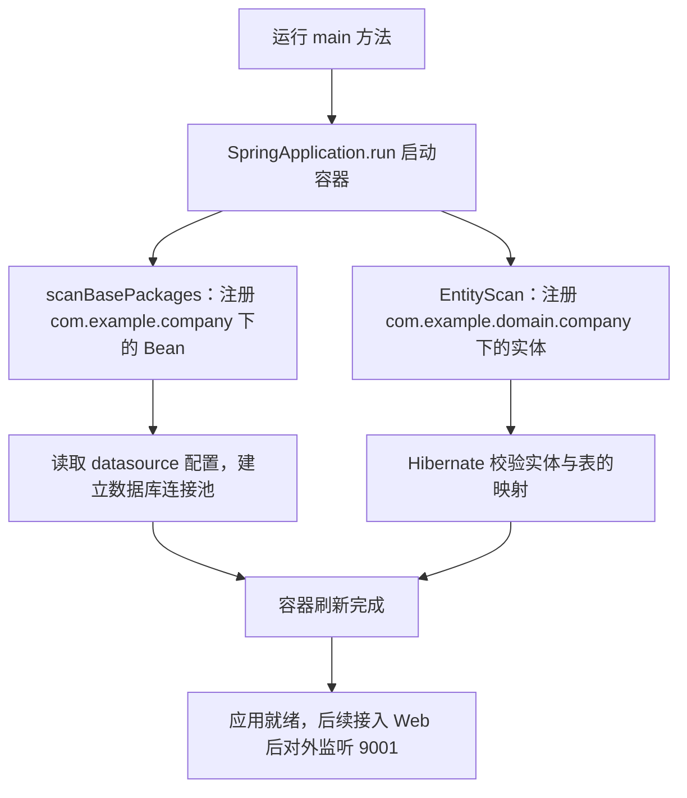

# 第一个能跑的微服务：企业服务的模块、配置文件与启动类

父工程、公共工具模块、公共实体模块都就位之后，手里攒下的东西其实都是「库」：能被别的模块依赖，自己却跑不起来。真正意义上第一个微服务是企业服务（company），业务很朴素：企业的增删改查。把它从空目录做到端口能通，需要的东西出奇地少，一共三样：一个 Maven 模块、一份 `application.yml`、一个带 `main` 方法的启动类。

很多教程会把「搭一个服务」讲得很重，实际拆开看，三样东西各回答一个问题：坐标回答「我需要哪些能力」，配置文件回答「我在哪、叫什么、连谁」，启动类回答「谁把我拉起来」。

## 先给结论

- 企业服务模块依赖三组坐标：`spring-boot-starter-data-jpa` 提供 JPA 环境，`mysql-connector-java` 提供驱动，`hrm-common` 提供公共工具。
- 配置文件四段式：`server.port` 定端口 9001，`spring.application.name` 定服务名，`spring.datasource` 定数据库连接，`spring.jpa` 定 JPA 行为。
- 启动类两个注解各管一摊：`@SpringBootApplication(scanBasePackages)` 管 Bean 扫描，`@EntityScan` 管 JPA 实体扫描；实体放在另一个模块里，后者漏了服务直接起不来。
- `main` 方法一行 `SpringApplication.run(CompanyApplication.class, args)`，运行即启动。
- 表结构由建表脚本手动执行；开发期也可以交给 Hibernate 的 `ddl-auto=update` 按实体自动建表，两者适用场景不同。

## 一、微服务模块和公共模块差在哪

前面搭的 `hrm-common` 与 `hrm-domain` 是被依赖方，打包后躺在别人的 classpath 里。企业服务模块 `hrm-company` 是依赖方，它有自己的端口、自己的配置、自己的启动入口，是一个能独立运行的进程。区别在 pom 里一眼就能看出来：公共模块的 pom 只有依赖声明，服务模块的 pom 还要支撑一个完整 Spring Boot 应用的运行。

按同样的套路来建：父工程右键 New Module，选 Maven，模块名 `hrm-company`。建完之后做三件事：引坐标、写配置文件、写启动类。

## 二、建模块与三组坐标

坐标不需要背，理解每个是干嘛的即可：

```xml
<dependencies>
    <!-- JPA 起步依赖：带进 Spring Data JPA、Hibernate 与事务支撑 -->
    <dependency>
        <groupId>org.springframework.boot</groupId>
        <artifactId>spring-boot-starter-data-jpa</artifactId>
    </dependency>
    <!-- MySQL 驱动 -->
    <dependency>
        <groupId>mysql</groupId>
        <artifactId>mysql-connector-java</artifactId>
    </dependency>
    <!-- 公共模块：IdWorker、统一返回结构都在里面 -->
    <dependency>
        <groupId>com.example</groupId>
        <artifactId>hrm-common</artifactId>
        <version>1.0-SNAPSHOT</version>
    </dependency>
</dependencies>
```

三组坐标没有一个写版本号：前两个由 Spring Boot 父工程的依赖仲裁管理，第三个是本地 SNAPSHOT 模块，版本随父工程走。这里没有引 `spring-boot-starter-web`，本阶段先把重心放在数据访问层，Web 相关坐标到实现接口的章节再补；`server.port` 属于 Web 场景的配置，先写上不碍事。

## 三、application.yml：服务递给全场的名片

配置文件放在 `src/main/resources` 下，Spring Boot 约定名字为 `application.yml`。服务要向社会自我介绍的全部信息都在这几十行里：

```yaml
# 服务配置
server:
  port: 9001                        # 服务端口
spring:
  # 应用配置
  application:
    name: hrm-company               # 服务名
  # 数据源配置
  datasource:
    driver-class-name: com.mysql.jdbc.Driver
    url: jdbc:mysql://localhost:3306/hrm_db?useUnicode=true&characterEncoding=utf8
    username: root
    password: 111111
  # JPA 配置
  jpa:
    database: MySQL                 # 指定数据库类型
    show-sql: true                  # 控制台打印 SQL
    open-in-view: true              # 视图渲染期间保持会话开启
```

**第一段是服务定位。** `port` 决定这个进程在操作系统的哪扇门后听请求；`application.name` 是它在微服务集群里的身份证，将来注册中心、服务间调用、日志排查都按这个名字认人，必须与模块名对得上。

**第二段是数据库连接。** 四件套缺一不可：驱动类名、URL、账号、密码。URL 里的 `hrm_db` 是本服务连的库名，`useUnicode` 与 `characterEncoding` 两个参数保证中文不乱码。

**第三段是 JPA 行为开关。** `database: MySQL` 告诉 Hibernate 生成哪种方言的 SQL；`show-sql: true` 让每条语句打在控制台上，学习阶段强烈建议开着；`open-in-view` 与懒加载有关，暂时保持默认即可。

## 四、启动类：两个注解，一个 main

```java
package com.example.company;

import org.springframework.boot.SpringApplication;
import org.springframework.boot.autoconfigure.SpringBootApplication;
import org.springframework.boot.autoconfigure.domain.EntityScan;

// 1. 设置 Spring Boot 的包扫描
@SpringBootApplication(scanBasePackages = "com.example.company")
// 2. 设置 JPA 实体的包扫描
@EntityScan(value = "com.example.domain.company")
public class CompanyApplication {

    public static void main(String[] args) {
        SpringApplication.run(CompanyApplication.class, args);
    }
}
```

两个注解值得分开说透。

**`scanBasePackages` 管 Bean 扫描。** 默认范围是启动类所在包及其子包，本服务的代码就放在 `com.example.company` 下，默认已经覆盖；显式写出来是把范围钉死，多模块工程里少了「为什么这个 Bean 没被扫到」的悬案。

**`@EntityScan` 管 JPA 实体扫描，是这个工程结构里最容易漏的一环。** 实体类不在本模块，而在公共实体模块 `hrm-domain` 的 `com.example.domain.company` 包下，超出了启动类的默认扫描范围。Spring Boot 默认只把启动类包下的 `@Entity` 注册为受管实体，跨模块的实体一概视而不见，结果就是 DAO 创建代理时找不到持久化类型，启动直接报错。`@EntityScan` 把实体扫描范围扩到实体真实所在的包，问题消失。现场还有个细节：扫描值一开始顺手写成了服务自己的包名，跑起来才发现实体没注册，改成 `com.example.domain.company` 才对，包名要写到实体真正的家。

启动到就绪的完整链路如下：



图里两条扫描线互不重叠：Bean 扫描找的是 `@Service`、`@Component` 这类容器管理的对象，实体扫描找的是 `@Entity` 标注的持久化类，两套机制各走各的配置项，混为一谈是新手最常见的卡点。

## 五、表从哪来：脚本建表与自动建表

配置里没有出现「建表」相关的内容，表本身要事先准备。两种做法：

| 方式 | 做法 | 适用场景 |
|---|---|---|
| 建表脚本 | 手动在 MySQL 里执行 SQL 脚本建库建表 | 字段类型、索引、默认值需要精确控制，团队共享同一份表结构 |
| 自动建表 | 配置 `spring.jpa.hibernate.ddl-auto=update`，Hibernate 按实体注解生成表 | 学习与原型阶段省事，实体改完一启动表跟着变 |

`ddl-auto` 常用取值：`create` 每次启动删表重建（数据不留）、`create-drop` 会话结束即删、`update` 缺表建表缺列加列（不删数据）、`validate` 只校验不改动、`none` 什么都不做。生产环境的答案几乎总是 `none` 加脚本，因为自动建表管不了索引优化与历史数据迁移。本课选择脚本方式，资料包里带完整的建库脚本，逐张表执行即可。

## 常见误区

- **漏配 `@EntityScan` 或包名写错。** 实体在跨模块包里而不被扫描，启动报找不到受管实体或 DAO 无法创建，报错信息往往绕得很远，根源只是实体扫描范围没覆盖到。
- **驱动类名新旧混用。** `com.mysql.jdbc.Driver` 是 MySQL 5.x 的驱动类，连 MySQL 8 要换成 `com.mysql.cj.jdbc.Driver`，URL 还得补时区参数，类名与数据库版本不匹配直接连接失败。
- **YAML 缩进错位。** YAML 靠缩进表达层级，子项缩进两空格、冒号后留一个空格；`port` 一旦缩进到 `spring` 之下，配置静默失效，服务在另一个端口上起来的怪事多半是它。
- **服务名随手起。** `application.name` 写成任意字符串，后续微服务互相调用按名字找不到人；名字应与模块、业务语义保持一致。

## 面试可能被问到的问题

1. 面试官追问：「`@SpringBootApplication` 的默认组件扫描范围是什么，什么时候需要显式配置？」
   答：默认扫描启动类所在包及其子包。当部分 Bean 不在这个范围（比如公共模块里、平行包里），或想把范围显式钉死避免隐式规则时，用 `scanBasePackages` 属性指定扫描根包。

2. 面试官追问：「`@EntityScan` 解决什么问题？」
   答：Spring Boot 默认只把启动类包下的 JPA 实体注册为受管实体。实体类抽在独立公共模块、包路径超出默认范围时，必须用它扩大实体扫描范围，否则实体不被识别，依赖它的 Repository 在启动时创建失败。

3. 面试官追问：「`spring.application.name` 在微服务架构里有什么用？」
   答：它是服务在集群中的唯一标识，注册中心按它登记服务实例，服务间调用按名字做负载均衡，日志与链路追踪也按它归类。名字一旦约定就不要轻易改，它属于服务契约的一部分。

4. 面试官追问：「`open-in-view` 是做什么的，为什么有争议？」
   答：它让数据库会话从请求进入到视图渲染完成一直保持开启，好处是视图层访问懒加载属性不会报会话已关闭；争议在于会话被拉长，数据库连接被占住，高并发下容易耗尽连接池，严格分层的团队倾向于关掉它。

5. 面试官追问：「Hibernate 的 `ddl-auto` 有哪些取值，生产环境该用哪个？」
   答：`create` 启动删表重建、`create-drop` 结束即删、`update` 差异化补表补列、`validate` 只校验、`none` 不作为。生产用 `none` 加版本化的建表脚本，因为自动建表无法处理索引优化、数据迁移与回滚。

6. 面试官追问：「一个 Spring Boot 微服务最小需要哪些部分？」
   答：一组业务依赖坐标、一份 `application.yml`（至少端口与数据源）、一个带 `@SpringBootApplication` 的启动类。引入 Web 起步依赖后，内嵌容器与自动配置也由框架补齐，这就是约定优于配置带来的最小可运行单元。

## 配套资料

- 企业实体与公共工具（服务模块直接依赖）：`materials/code/02/day01 SAAS-HRM系统概述与搭建环境/SAAS-HRM系统概述与搭建环境/资源/Company.java`、
  `materials/code/02/day01 SAAS-HRM系统概述与搭建环境/SAAS-HRM系统概述与搭建环境/资源/通用代码/IdWorker.java`
- 统一返回结构：`materials/code/02/day01 SAAS-HRM系统概述与搭建环境/SAAS-HRM系统概述与搭建环境/资源/通用代码/common/Result.java`
- day01 资料包未含完整服务工程，文中 pom 依赖、`application.yml` 与启动类按课程演示画面整理，模块名、包名、数据库名已改为中性命名；`ddl-auto` 小节为按本课环境补充的通用写法说明。
