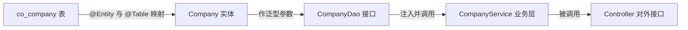
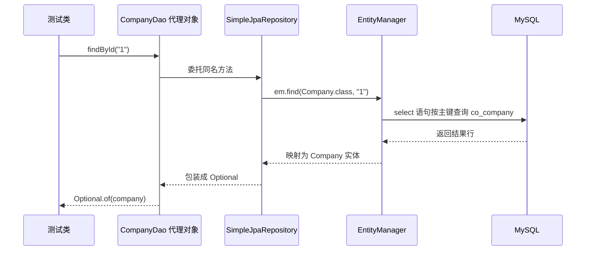
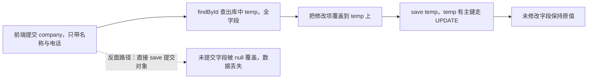
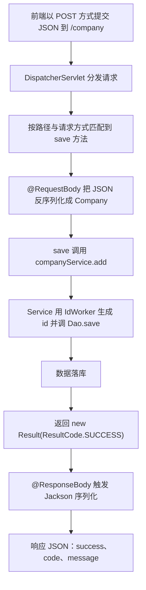

# 企业微服务_实现crud操作之四讲：JPA 实体类、空接口 DAO、Service 业务规则与 REST 控制器

## 先给结论

企业微服务的增删改查是标准四层动线：实体类、DAO 接口、Service 业务层、Controller 控制器。全系列四讲沿着这条动线把 co_company 一张表的 CRUD 做完，每一层都讲出这一层的道理，后面部门微服务、用户微服务全是同一套动作的重复。
第一层把 SaaS 企业表翻译成 JPA 实体：类对表、属性对列两层映射，二十个字段只有主键必须显式标注，text 大字段配 @Lob。第二层是两行继承换来一整套 CRUD：CompanyDao 空接口 extends 两个泛型接口，实现在运行期由 Spring Data JPA 动态代理生成，现场测试还踩出实体缺无参构造器的经典报错。
第三层 Service 给 CRUD 立规矩：主键不问前端要也不靠自增，IdWorker 生成；新增补审核与激活默认值；更新永远先查再改，请求体缺字段不会抹掉库里的值。第四层 Controller 对齐 API 文档收口：五个 RESTful 接口、@RequestBody 与 @PathVariable 两件套收参、Result 统一返回，更新接口里把地址参数补进对象是最隐蔽的一个动作。
四讲依次是：
- 创建实体类：读懂 co_company 表、两类映射五个注解与驼峰规则。
- dao 接口：空接口两个泛型、动态代理原理与 Optional 取值。
- service：主键生成、先查再改与事务边界。
- 保存企业：API 文档约束、五个 REST 接口与一次请求的完整路径。

## 第1部分：从 co_company 建表语句到 Company 实体类：JPA 映射注解逐个拆

企业微服务的环境已经就绪，开始写业务。SaaS 模式下第一个要摸清的不是代码，而是一张企业表：它比普通字典表复杂得多，里面装着审核状态、账户余额、续期到期时间。这些字段每一种都对应 SaaS 平台的一条商业规则，读懂了表，实体类和后面的增删改查才有依据。

企业增删改查的标准路线是四步：实体类、DAO 接口、Service 业务层、Controller 控制器。这一节走第一步，把 `co_company` 表翻译成一个 JPA 实体类。

### 一、先读懂表：字段里藏着租户的一生

建表语句来自课程资料的数据库脚本，这张表十九个字段：

```sql
CREATE TABLE `co_company` (
  `id` varchar(40) NOT NULL COMMENT 'ID',
  `name` varchar(255) NOT NULL COMMENT '公司名称',
  `manager_id` varchar(255) NOT NULL COMMENT '企业登录账号ID',
  `version` varchar(255) DEFAULT NULL COMMENT '当前版本',
  `renewal_date` datetime DEFAULT NULL COMMENT '续期时间',
  `expiration_date` datetime DEFAULT NULL COMMENT '到期时间',
  `company_area` varchar(255) DEFAULT NULL COMMENT '公司地区',
  `company_address` text COMMENT '公司地址',
  `legal_representative` varchar(255) DEFAULT NULL COMMENT '法人代表',
  `company_phone` varchar(255) DEFAULT NULL COMMENT '公司电话',
  `mailbox` varchar(255) DEFAULT NULL COMMENT '邮箱',
  `company_size` varchar(255) DEFAULT NULL COMMENT '公司规模',
  `industry` varchar(255) DEFAULT NULL COMMENT '所属行业',
  `remarks` text COMMENT '备注',
  `audit_state` varchar(255) DEFAULT NULL COMMENT '审核状态',
  `state` tinyint(2) DEFAULT '1' COMMENT '状态',
  `balance` double DEFAULT NULL COMMENT '当前余额',
  `create_time` datetime NOT NULL COMMENT '创建时间'
) ENGINE=InnoDB DEFAULT CHARSET=utf8mb4;
```

（营业执照图片 ID 等个别字段从略，完整脚本见文末资料。）把十九个字段按业务含义分成三组，SaaS 平台的运作方式就浮出来了。

**基本信息组**：名称、地区、地址、法人、电话、邮箱、规模、行业、备注，注册时填写的企业画像。

**租约信息组**：`version` 当前版本、`renewal_date` 续期时间、`expiration_date` 到期时间、`balance` 余额。企业是租用平台的租户，什么时候续费、什么时候到期、账户里还剩多少钱，全部落在这四个字段里，到期扣费直接从余额走。

**准入与状态组**：`audit_state` 审核状态与 `state` 状态是两个容易混淆的字段。审核状态管「准入」：企业想用平台，先提交资质，平台审核通过前不能使用，0 未审核、1 审核通过；状态管「启停」：审核通过的企业也可以被停用，0 未激活、1 已激活。一个是平台对企业设的门槛，一个是开关。

主键是 `varchar(40)` 而不是自增数字，预留给分布式 ID 生成器产出的字符串，多租户数据合并汇总时不会冲突，这正是前面公共工具模块里准备雪花算法的原因。

### 二、实体类放在哪、怎么长

位置有讲究：实体是跨服务的数据契约，企业、员工这些实体几乎每个微服务都要引用，所以放进公共实体模块 `hrm-domain`，按业务域分包到 `com.example.domain.company`。资料里已经备好带注释的字段清单，照字段写属性，再补上映射注解：

```java
package com.example.domain.company;

import lombok.AllArgsConstructor;
import lombok.Data;
import lombok.NoArgsConstructor;

import javax.persistence.Entity;
import javax.persistence.Id;
import javax.persistence.Table;
import java.io.Serializable;
import java.util.Date;

@Data
@NoArgsConstructor
@AllArgsConstructor
@Entity                          // 声明为 JPA 实体
@Table(name = "co_company")      // 与哪张表建立映射
public class Company implements Serializable {

    private static final long serialVersionUID = 594829320797158219L;

    //ID
    @Id                          // 主键映射
    private String id;

    /** 公司名称 */
    private String name;

    /** 企业登录账号ID */
    private String managerId;

    /** 当前版本 */
    private String version;

    /** 续期时间 */
    private Date renewalDate;

    /** 到期时间 */
    private Date expirationDate;

    /** 公司地区 */
    private String companyArea;

    /** 公司地址 */
    private String companyAddress;

    // ……营业执照图片ID、法人代表、电话、邮箱、规模、行业、备注等字段同构，省略

    /** 审核状态 */
    private String auditState;

    /** 状态 */
    private Integer state;

    /** 当前余额 */
    private Double balance;

    /** 创建时间 */
    private Date createTime;
}
```

Lombok 三件套负责模板方法，`Serializable` 与 `serialVersionUID` 为跨服务传输做准备，中间十来个普通字段写法完全一致，照注释抄即可。真正需要理解的是注解，一共五个。

### 三、两类映射，五个注解

实体与表打交道，映射关系分两层，注解各就各位：

| 注解 | 标注位置 | 作用 |
|---|---|---|
| `@Entity` | 类上 | 声明这是 JPA 实体，交给持久化框架管理 |
| `@Table(name = "co_company")` | 类上 | 指定实体映射哪张表，省略时按类名找同名表 |
| `@Id` | 主键属性上 | 标记主键，本表主键由 IdWorker 生成，无需 `@GeneratedValue` |
| `@Column` | 普通属性上 | 指定属性对应的列名，满足驼峰对应时可省略 |
| `@Lob` | 大文本属性上 | 声明长文本大对象，对应 MySQL 的 `text` 类型 |

**`@Entity` 要选对包。** IDE 补全时列表里会出现两个 Entity：`javax.persistence.Entity` 是 JPA 规范注解，`org.hibernate.annotations` 里也有一个旧的 Entity 注解，选错包行为不一致，认准 `javax.persistence`。

**`@Id` 只有主键需要。** 这张表的主键不靠数据库生成，而是 Service 层用 IdWorker 算好再存入，所以不需要 `@GeneratedValue`，主键属性直接是 `String`。

**`@Column` 是可选项。** 比如 `name` 属性对应 `name` 列，写与不写一样；省略的判断标准在下一节展开。

**`@Lob` 是本课实体代码里没写、但值得补的规范项。** 表里 `company_address` 与 `remarks` 两列是 `text` 类型，直接用 `String` 承接可以运行，但显式加上 `@Lob` 能让 Hibernate 按长文本语义处理（对应 SQL 的 `CLOB/TEXT`），字段语义也更清楚：

```java
import javax.persistence.Lob;

/** 公司地址 */
@Lob
private String companyAddress;
```

类型对应关系一张表说清：

| MySQL 类型 | Java 类型 | 备注 |
|---|---|---|
| `varchar` | `String` | 主键、名称、电话等绝大多数字段 |
| `datetime` | `java.util.Date` | 续期、到期、创建时间 |
| `text` | `String` 加 `@Lob` | 地址、备注 |
| `tinyint` | `Integer` | 状态 |
| `double` | `Double` | 余额 |

写时间属性时 IDE 会同时弹出 `java.util.Date` 与 `java.sql.Date` 两个候选，选 `java.util`。`java.sql.Date` 是为 JDBC 结果集设计的子类，只保留日期部分且带时区行为，业务实体统一用 `java.util.Date`，由 JPA 负责与 `datetime` 列互转。

### 四、属性到列名：驼峰规则为什么成立

`renewalDate` 与 `renewal_date` 长得不一样，为什么不用写 `@Column`？因为 Hibernate 的默认命名策略在中间做了翻译：遇到驼峰式属性名，自动转成下划线式列名再去找列，`managerId` 译成 `manager_id`，`companyArea` 译成 `company_area`。这条规则覆盖了十九个字段里的绝大多数，省略注解是安全的。

需要显式写 `@Column` 的场景只有两类：属性名与列名完全对不上（比如属性叫 `phone` 而列叫 `company_phone`），或者想自定义一个与默认翻译不同的列名。命名策略本身也可配置，`spring.jpa.hibernate.naming.physical-strategy` 指定策略类，默认值就是那条「驼峰转下划线」的规则，改成别的策略后，省略注解的写法就得重新过一遍。

四步路线里实体类的位置如下：



实体处于链条最上游：它一旦定型，DAO 的泛型、Service 的出入参全部跟着确定，字段映射错了，后面每一层都会跟着报错。

## 第2部分：两行继承换来一整套 CRUD：CompanyDao 接口与 Spring Data JPA 的实现原理

按传统写法做一层 DAO：先写接口定方法签名，再写实现类，实现类里拼 SQL 或者调模板类，一个实体的增删改查下来一两百行。这一节的 CompanyDao 只有两行继承，方法体一个都没有，`save`、`deleteById`、`findById`、`findAll` 却全都在。第一次见到的人普遍怀疑它能不能真查到数据，本课现场写了个测试类验证，还顺手踩出一个实体类的经典报错，正好一起讲透。

### 一、DAO 只剩一个接口

在 `hrm-company` 模块的 `com.example.company.dao` 包下新建接口，注意是 interface 不是 class：

```java
package com.example.company.dao;

import com.example.domain.company.Company;
import org.springframework.data.jpa.repository.JpaRepository;
import org.springframework.data.jpa.repository.JpaSpecificationExecutor;

public interface CompanyDao extends JpaRepository<Company, String>,
        JpaSpecificationExecutor<Company> {
}
```

与传统三件套（接口、实现类、SQL）相比，实现类和 SQL 全部消失了。`JpaRepository` 里内置了增删改查、排序、分页等十几个方法；`JpaSpecificationExecutor` 是另一条查询线，接收动态拼接的条件对象 `Specification`，适合前端任意组合筛选条件的复杂查询场景，本课先把它挂上备用，权限查询等章节会实际用到。

### 二、两个泛型怎么填

泛型不是装饰，它把整套方法签名定型：

| 接口 | 泛型位 | 填什么 | 决定什么 |
|---|---|---|---|
| `JpaRepository` | 第一个 | `Company` | `save`、`findAll` 等方法的出入参类型 |
| `JpaRepository` | 第二个 | `String` | `findById(String)`、`deleteById(String)` 的参数类型 |
| `JpaSpecificationExecutor` | 唯一 | `Company` | 条件查询的返回实体类型 |

第二个泛型必须与实体主键属性的类型一致：`Company` 的主键是 `String id`，DAO 就写 `String`。填成 `Long`，调用 `findById("1")` 直接编译不过，泛型在这一层替你把类型错误挡在编译期。

### 三、测试验证：空接口真的能用吗

在 test 目录建一个测试类，让 Spring 容器先跑起来再注入 DAO：

```java
package com.example.company;

import com.example.company.dao.CompanyDao;
import com.example.domain.company.Company;
import org.junit.Test;
import org.junit.runner.RunWith;
import org.springframework.beans.factory.annotation.Autowired;
import org.springframework.boot.test.context.SpringBootTest;
import org.springframework.test.context.junit4.SpringJUnit4ClassRunner;

@RunWith(SpringJUnit4ClassRunner.class)   // JUnit 走 Spring 的测试运行器
@SpringBootTest                           // 先把整个容器拉起来
public class CompanyDaoTest {

    @Autowired
    private CompanyDao companyDao;

    @Test
    public void test() {
        Company company = companyDao.findById("1").get();
        System.out.println(company);
    }
}
```

两个注解的组合是 Spring Boot 测试的固定写法：`@RunWith` 换掉 JUnit 的默认运行器，让测试过程由 Spring 接管；`@SpringBootTest` 负责在测试前启动完整容器，这样 `@Autowired` 才有 Bean 可注入。`findById("1")` 返回的是 `Optional<Company>` 包装，`.get()` 取出里面的对象。

运行之前记得打开 `show-sql: true`，控制台会打出 Hibernate 生成的 SQL，查询结果封装成 Company 对象打印出来，空接口能用这件事眼见为实。

现场第一次运行就翻车了，报错信息值得记住：

```bash
java.lang.IllegalArgumentException: No default constructor for entity:
: com.example.domain.company.Company
```

**原因与修复一句话说清。** JPA 要求实体必须有 public 或 protected 的无参构造器，框架靠反射实例化对象；而实体类上此前只配了 `@AllArgsConstructor`，全参构造一出现，编译器送默认无参构造的福利就没了。补上 `@NoArgsConstructor` 再跑，查询通过。

### 四、方法是谁提供的：运行期动态代理

接口里一行实现都没有，容器里注入的到底是什么？答案是 Spring Data JPA 在启动期为每个 DAO 接口生成一个代理对象，方法调用被转发到框架自带的实现类 `SimpleJpaRepository`，它再通过 JPA 规范的 `EntityManager` 操作数据库。整条链路：



图里最值得看的一环是代理：DAO 接口没有实现类，`@Autowired` 注入的 Bean 却真实存在，因为它是启动期生成的代理。这也是为什么 DAO 必须声明为 interface，框架要按接口生成代理，写成 class 直接编译失败。

最常用的几个方法与行为：

| 方法 | 参数 | 行为 |
|---|---|---|
| `save` | 实体对象 | 按主键判断：库里有则 UPDATE，没有则 INSERT |
| `deleteById` | 主键 | 按主键删除 |
| `findById` | 主键 | 按主键查询，结果包在 `Optional` 里 |
| `findAll` | 无 | 查询全部，返回 `List<Company>` |

`save` 的判定值得多看一眼：它先拿对象的主键去查库，查到走更新，查不到走保存。同一个方法承担两种写行为，Service 层的 `add` 与 `update` 因此共用一行 `save`，差别全在调用前的准备动作上。

## 第3部分：Service 层给 CRUD 立规矩：主键生成、先查再改与事务边界

DAO 提供的是技术能力，Service 层装的是业务规则。看两个细节就能体会：新增和更新在 DAO 里调用的是同一个 `save`，但 Service 里的 `add` 与 `update` 写法完全不同，一个要凭空造主键，一个要先查库再动手。把企业服务的五个业务方法写完，Service 层在分层架构里「承上启下」的角色就清楚了：Controller 传来的原始请求在这里加工成合法的持久化操作。

### 一、Service 的骨架：一个注解一个注入

类上 `@Service` 声明为容器管理的业务对象，字段上 `@Autowired` 把 DAO 与 ID 生成器注入进来：

```java
package com.example.company.service;

import com.example.company.dao.CompanyDao;
import com.example.common.utils.IdWorker;
import com.example.domain.company.Company;
import org.springframework.beans.factory.annotation.Autowired;
import org.springframework.stereotype.Service;

@Service                                // 声明为容器管理的业务对象
public class CompanyService {

    @Autowired
    private CompanyDao companyDao;      // 数据访问能力

    @Autowired
    private IdWorker idWorker;          // 分布式 ID 生成器
}
```

注入方式是标准套路，值得留意的是第二个依赖：`IdWorker` 是公共模块里的普通工具类，Spring 默认并不认识它，得先把它注册成 Bean，这就是下一个问题。

### 二、保存企业：主键与默认值都不问前端要

**先注册 IdWorker。** 在启动类里以 `@Bean` 方式声明，容器启动时构造好这个对象，之后任何 Service 都能注入：

```java
@Bean
public IdWorker idWorker() {
    return new IdWorker();
}
```

`IdWorker` 的构造过程会自动探测机器标识与数据中心标识，注册成单例后全局复用一个发号器，比在各处随手 `new` 可靠得多。

**再看保存方法本体**，课程把它拆成四步写在注释里：

```java
/**
 * 保存企业
 * 1. 配置 IdWorker 到工程（启动类 @Bean）
 * 2. 在 Service 中注入 IdWorker
 * 3. 通过 IdWorker 生成 ID
 * 4. 调用 dao 保存企业
 */
public void add(Company company) {
    String id = idWorker.nextId() + "";      // long 拼接空串转 String
    company.setId(id);
    company.setAuditState("0");              // 0 未审核，1 已审核
    company.setState(1);                     // 0 未激活，1 已激活
    companyDao.save(company);
}
```

三个动作各有讲究。

**主键生成。** 前端提交的企业只有名称、行业这类画像字段，ID 由服务端算出来。`nextId()` 返回 `long`，而实体主键和表列 `id varchar(40)` 都是字符串，`+ ""` 是最直白的类型转换。雪花 ID 本质是个 64 位长整型，数值最大到 19 位，前端 JavaScript 的 Number 只有 53 位安全整数精度，传成数字会丢精度，存成字符串顺便规避了这个坑。

**默认值兜底。** `auditState` 必须置 0：新企业刚提交资质，必然未审核，审核权在平台手里；`state` 默认置 1 表示账号可用。这两个字段都涉及平台准入策略，绝不能信任客户端传什么就是什么，服务端覆盖是安全底线。

**落库。** 此时的对象主键在库中不存在，`save` 走 INSERT 分支，一条新企业记录诞生。

### 三、更新企业：永远先查再改

```java
/**
 * 更新企业
 * 1. 参数：前端提交的 Company 对象（必带 ID）
 * 2. 根据 ID 查询数据库中的企业对象
 * 3. 在查询结果上设置要修改的属性
 * 4. 调用 dao 完成更新
 */
public void update(Company company) {
    Company temp = companyDao.findById(company.getId()).get();
    temp.setName(company.getName());
    temp.setCompanyPhone(company.getCompanyPhone());
    companyDao.save(temp);
}
```

两条路径放在一起看，差别一目了然：



**为什么不直接 save 前端传来的对象？** 请求体通常只带修改项，直接入库时，没传的字段以 null 覆盖库中现值，一次更新能把地址、法人、余额全部清空。先查再改等于先把「全量对象」从库里捞出来，只动该动的属性，其余字段原样保留。这里 `save` 之所以走更新分支，是因为 `temp` 的主键在库中真实存在，判定逻辑在上一节的 DAO 原理里已经拆过。

### 四、删除与查询：一行一个

剩下三个方法都薄到一行：

```java
/**
 * 删除企业：参数 id
 */
public void deleteById(String id) {
    companyDao.deleteById(id);
}

/**
 * 根据 id 查询企业
 */
public Company findById(String id) {
    return companyDao.findById(id).get();    // Optional 的固定取值写法
}

/**
 * 查询企业列表
 */
public List<Company> findAll() {
    return companyDao.findAll();
}
```

`findById` 里的 `.get()` 是 `Optional` 的固定取值法，适合「主键查不到就算异常」的场景。`findAll` 把整张表搬回来，数据量一大就必须换分页方案，公共模块里的 `PageResult` 统一返回结构正是为那时准备的。

### 五、事务注解：演示从简，生产必配

课程代码为了聚焦主流程没有贴 `@Transactional`。单条 `save`、`deleteById` 框架内部自带事务兜底，问题不大；但业务方法一旦组合多次写操作，没有事务边界就会出现一半成功一半失败。按本课写法补全的生产版本长这样：

```java
@Transactional(rollbackFor = Exception.class)
public void add(Company company) {
    // 与上文相同：生成主键、补默认值、保存企业
}
```

事务注解放 Service 层而非更下层，是因为事务边界要与业务动作对齐：一个业务动作可能跨多次 DAO 调用，放 DAO 层事务过细，放 Controller 层又把无关的读操作卷进事务。查询方法可以标 `@Transactional(readOnly = true)`，给框架一个只读优化的提示。

## 第4部分：Web 层收口：用 CompanyController 把企业微服务的五个 REST 接口写完整

实体类、Dao、Service 都已就位，剩下 Web 层对着 API 文档落码。这时真正的约束才浮出水面：接口路径、请求方式、参数结构、返回结构全部由文档约定，前端要按它发请求，后端必须按它接，不能像写 Service 那样自由发挥。企业微服务一共五个接口，把这一个类的写法吃透，后面部门微服务、用户微服务都是同一套动作的重复。

### 一、接口不是瞎写的：先看 API 文档的约定

文档把五个接口的路径和请求方式定死了，整理成表：

| 操作 | 请求方式 | 路径 | 说明 |
|---|---|---|---|
| 保存企业 | POST | `/company` | 请求体是企业实体的 JSON |
| 查询企业列表 | GET | `/company` | 响应 data 是数组 |
| 根据 id 查询 | GET | `/company/{companyId}` | id 是地址参数 |
| 根据 id 更新 | PUT | `/company/{companyId}` | 地址参数加 JSON 请求体 |
| 根据 id 删除 | DELETE | `/company/{companyId}` | id 是地址参数 |

每个方法落地前都重复同一套动作，可以归纳成三步。**第一步，配置方法**：根据文档确定路径和请求方式，映射到 Controller 的方法上。**第二步，看请求参数**：是 JSON 请求体还是地址参数，决定用 `@RequestBody` 还是 `@PathVariable`。**第三步，构造响应**：文档规定的响应结构是 code、flag（对应 `success` 字段）、message，外加可选的 data，全部装进 `Result`。三步走完，一个接口就算写完了。

### 二、Controller 的公共骨架

五个接口的父路径都是 `/company`，这个规律值得在代码里做一次抽取。类骨架如下（包名统一改为 `com.example`）：

```java
package com.example.company.controller;

import com.example.common.entity.Result;
import com.example.company.service.CompanyService;
import com.example.domain.company.Company;
import org.springframework.beans.factory.annotation.Autowired;
import org.springframework.web.bind.annotation.*;

@RestController
@RequestMapping(value = "/company")
public class CompanyController {

    @Autowired
    private CompanyService companyService;
}
```

**第一，`@RestController` 一个注解抵两个。** 它组合了 `@Controller` 和 `@ResponseBody`，类里所有方法的返回值都会自动写进响应体，不再走视图解析。有人会先标上 `@ResponseBody` 再犹豫要不要留，答案是删掉即可：`@RestController` 已经包含它，重复标注没有必要。

**第二，类级 `@RequestMapping(value = "/company")` 是公共前缀。** 方法级路径会拼接在它后面，五个接口的映射路径分别写成 `""`、`/{id}`，不用每个都重复写 `/company`。

**第三，注入的是 Service 不是 Dao。** Web 层只依赖业务层，`@Autowired` 注入 `CompanyService`，增删改查全部通过它转发。

### 三、保存企业：POST 请求与 @RequestBody

保存接口的方法体最短，但涉及两个关键注解：

```java
//保存企业
@RequestMapping(value = "", method = RequestMethod.POST)
public Result save(@RequestBody Company company) {
    //业务操作
    companyService.add(company);
    return new Result(ResultCode.SUCCESS);
}
```

**第一，请求参数用 `@RequestBody` 接。** 前后端分离项目里，前端必然以 JSON 串的形式提交数据。`@RequestBody` 的作用是把请求体里的 JSON 自动反序列化成 `Company` 对象，前提条件是 JSON 的属性名要和实体属性名对应上。对照文档的参数列表看，`id`、`name`、`companyPhone` 等字段与企业实体完全一致，所以直接收一个 `Company` 就够了。

**第二，返回值从 `void` 换成 `Result`。** 文档规定响应有 code、flag、message 三个字段，恰好就是 `Result` 类的三个属性：

```java
@Data
@NoArgsConstructor
public class Result {
    private boolean success;//是否成功
    private Integer code;// 返回码
    private String message;//返回信息
    private Object data;// 返回数据

    public Result(ResultCode code) {
        this.success = code.success;
        this.code = code.code;
        this.message = code.message;
    }

    public Result(ResultCode code, Object data) {
        this.success = code.success;
        this.code = code.code;
        this.message = code.message;
        this.data = data;
    }

    public Result(Integer code, String message, boolean success) {
        this.code = code;
        this.message = message;
        this.success = success;
    }
}
```

`Result` 不能直接 `new Result()` 了事，三个字段必须有值。所以它提供了接收 `ResultCode` 的构造方法，把枚举里的信息一次性拷进来。`ResultCode` 是个枚举，集中管理全部返回码：

```java
public enum ResultCode {

    SUCCESS(true,10000,"操作成功！"),
    FAIL(false,10001,"操作失败"),
    UNAUTHENTICATED(false,10002,"您还未登录"),
    UNAUTHORISE(false,10003,"权限不足"),
    SERVER_ERROR(false,99999,"抱歉，系统繁忙，请稍后重试！");

    boolean success;   //操作是否成功
    int code;          //操作代码
    String message;    //提示信息

    ResultCode(boolean success, int code, String message) {
        this.success = success;
        this.code = code;
        this.message = message;
    }
}
```

`new Result(ResultCode.SUCCESS)` 一行，success、code、message 就都填好了，保存接口没有数据要带，`data` 留空即可。

### 四、删改查：三个带地址参数的接口

剩下四个接口全按第二节的套路走，直接看完整实现：

```java
//根据id更新企业
@RequestMapping(value = "/{id}", method = RequestMethod.PUT)
public Result update(@PathVariable(value = "id") String id, @RequestBody Company company) {
    company.setId(id);
    companyService.update(company);
    return new Result(ResultCode.SUCCESS);
}

//根据id删除企业
@RequestMapping(value = "/{id}", method = RequestMethod.DELETE)
public Result delete(@PathVariable(value = "id") String id) {
    companyService.deleteById(id);
    return new Result(ResultCode.SUCCESS);
}

//根据id查询企业
@RequestMapping(value = "/{id}", method = RequestMethod.GET)
public Result findById(@PathVariable(value = "id") String id) {
    Company company = companyService.findById(id);
    Result result = new Result(ResultCode.SUCCESS);
    result.setData(company);
    return result;
}

//查询企业列表
@RequestMapping(value = "", method = RequestMethod.GET)
public Result findAll() {
    List<Company> list = companyService.findAll();
    Result result = new Result(ResultCode.SUCCESS);
    result.setData(list);
    return result;
}
```

四个方法各有一个值得留意的点。更新接口里，路径是 `/{id}`，花括号包住的 `{id}` 既是 URL 的一部分，又是参数的占位符，`@PathVariable(value = "id")` 负责把地址里的值取出来交给形参；请求体里那份 JSON 同样用 `@RequestBody` 转成 `Company`，但这个对象里没有 id 字段的值，所以要 `company.setId(id)` 手动补上。删除接口最简单，拿到 id 直接往下传。按 id 查询时，Service 返回的 `Company` 就是要给前端的数据，构造 `Result` 之后 `setData(company)` 塞进 data 字段。查询列表同理，data 里放的是 `List<Company>`，序列化后就是文档要求的数组。

更新走的是 `companyService.update(company)`，Service 内部依然是 `companyDao.save(company)`。JPA 的 save 有 id 就按主键更新、没 id 就新增，所以上一段那个 `setId` 一旦漏掉，更新就会变成插入一条新记录。

### 五、一次请求在框架里的完整路径

这张图梳理 POST 保存请求从进入到返回的全过程：



关键路径在两头：请求头上，`@RequestMapping` 同时匹配路径和 `method`，同一个 `""` 路径靠 POST 与 GET 区分成两个方法；响应头上，`@ResponseBody`（由 `@RestController` 提供）把 `Result` 交给 Jackson 转成 JSON。中间的 Service 只是转手，它用雪花算法工具 `IdWorker` 生成主键再落库：

```java
@Service
public class CompanyService {

    @Autowired
    private CompanyDao companyDao;
    @Autowired
    private IdWorker idWorker;

    public void add(Company company) {
        String id = idWorker.nextId() + "";
        company.setId(id);
        companyDao.save(company);
    }

    public Company findById(String id) {
        return companyDao.findById(id).get();
    }
}
```

`CompanyDao` 则是一个空接口，继承 `JpaRepository<Company, String>` 后，`save`、`deleteById`、`findById`、`findAll` 全部现成可用。到这里 Web 层的五个方法就全部写完了，下一件事是把它们真正测起来。

## 常见误区

- **`@Entity` 导错包。** 选成 `org.hibernate.annotations.Entity` 这个旧注解，规范行为不生效；认准 `javax.persistence.Entity`。
- **时间属性误选 `java.sql.Date`。** 它是 JDBC 专用的日期子类，含时区陷阱，业务实体统一 `java.util.Date`。
- **属性名乱起又不写 `@Column`。** 既不同名也不满足驼峰规则时，Hibernate 找不到对应列，启动或查询时报 Unknown column；对不上号的字段要么改名要么补注解。
- **漏掉 `Serializable` 与 `serialVersionUID`。** 实体要在服务间传输、进缓存时才暴露问题，反序列化因版本号缺失而失败，写实体时一次到位。
- **DAO 写成 class。** `JpaRepository` 是接口，只能被接口 extends 继承，写成类编译不过；框架也只对接口做代理。
- **泛型主键类型与实体主键不一致。** 实体是 `String id`，DAO 泛型却填 `Long`，编译期就报类型不匹配，改齐即可。
- **实体只配全参构造。** `@AllArgsConstructor` 顶掉默认无参构造，查询时抛 `No default constructor for entity`，补 `@NoArgsConstructor` 是唯一正解。
- **`Optional` 无脑 `.get()`。** 主键不存在时 `get()` 抛 `NoSuchElementException`；不确定数据是否存在时，先用 `isPresent()` 判断或改用 `orElseThrow` 给出明确异常。
- **直接 `save` 前端对象做更新。** 请求体缺的字段被 null 覆盖，库中数据悄悄丢失；先查再改，或者严格约束前端提交全量字段并逐一校验。
- **在 Service 里随手 `new IdWorker()`。** 手工 new 的对象不在容器管理内，别人无法注入复用，发号器也可能出现多个实例；统一在启动类 `@Bean` 注册。
- **`nextId()` 不转类型直接 `setId`。** `long` 塞不进 `String` 主键，编译期直接报错；`+ ""` 或 `String.valueOf` 转换后再赋值。
- **写操作漏事务注解。** 组合型业务（先写企业再写关联表）没有事务边界，异常中断时数据残缺；写方法统一补 `@Transactional`。
- **更新时漏写 `company.setId(id)`**：请求体的 JSON 里通常没有 id，实体对象的 id 为 null，`save` 按「无主键即新增」处理，本想更新却多插了一条数据。
- **两个方法映射同一路径却不区分请求方式**：`""` 路径上同时挂保存与列表，必须分别指定 `method = POST` 与 `method = GET`，否则容器启动时报 Ambiguous mapping。
- **参数前忘写 `@RequestBody`**：Spring 会尝试按表单或查询参数取值，JSON 请求体进不来，实体对象里全是 null。
- **类上用 `@Controller` 却不加 `@ResponseBody`**：返回 `Result` 对象被当成视图名去解析，请求直接 404。要么补注解，要么直接用 `@RestController`。

## 面试可能被问到的问题

1. 面试官追问：「`@Entity` 和 `@Table` 各自的作用是什么？」
   答：`@Entity` 把类声明为 JPA 实体，纳入持久化上下文管理；`@Table` 指定实体映射的表名与表级属性，不写时按类名寻找同名表。两者配合完成「类到表」这一层映射。

2. 面试官追问：「实体主键为什么用 String 而不是数据库自增？」
   答：主键由雪花算法在应用层生成，存成字符串。自增主键在分库分表、多租户数据合并时会冲突；分布式 ID 全局唯一且趋势递增，先算好再插入也不依赖数据库回填。

3. 面试官追问：「JPA 怎么把驼峰属性映射到下划线列名？可以自定义吗？」
   答：靠 Hibernate 的物理命名策略，默认实现把驼峰式属性名转成下划线式列名。可通过 `spring.jpa.hibernate.naming.physical-strategy` 换策略类，也可用 `@Column` 对个别字段显式指定。

4. 面试官追问：「`@Lob` 什么时候用？对应数据库什么类型？」
   答：属性对应大文本或二进制大对象时使用，字符串加 `@Lob` 对应 MySQL 的 `text` 系列类型，字节数组加 `@Lob` 对应 `blob`。普通 `varchar` 长度有限，长文本应显式声明，避免默认映射截断。

5. 面试官追问：「实体类为什么要实现 `Serializable`？」
   答：实体经常要跨网络传输（远程调用、缓存序列化），实现该接口才允许被序列化。`serialVersionUID` 固定版本号，避免类结构微调后新旧数据反序列化失败，显式声明一个固定值是习惯做法。

6. 面试官追问：「只写接口为什么就有实现？Spring Data JPA 的原理是什么？」
   答：启动期框架扫描 DAO 接口，按方法名与泛型信息生成动态代理对象注册进容器；代理把方法调用转发到 `SimpleJpaRepository`，后者基于 `EntityManager` 完成实际持久化。派生查询还会按方法名规则翻译成 SQL 条件。

7. 面试官追问：「`JpaRepository` 的两个泛型分别是什么？」
   答：第一个是实体类型，决定方法的出入参；第二个是主键类型，决定 `findById`、`deleteById` 等方法的参数类型。它必须与实体 `@Id` 属性的类型一致，否则编译期就暴露错误。

8. 面试官追问：「`save` 方法怎么区分保存和更新？」
   答：它先按对象的主键查询数据库，存在记录则执行 merge 走 UPDATE，不存在则 persist 走 INSERT。所以携带已有主键的对象调 `save` 是更新，主键为空或库中不存在的是新增。

9. 面试官追问：「`findById` 为什么返回 `Optional`？」
   答：按主键查询可能查不到，返回 null 会把空指针风险转嫁给调用方。`Optional` 把「可能为空」写进方法签名，强迫调用方面对空值场景，用 `isPresent`、`orElse`、`orElseThrow` 显式处理。

10. 面试官追问：「`JpaSpecificationExecutor` 适合什么场景？」
   答：动态条件查询。前端多条件自由组合时，用 `Specification` 按需拼接 `Predicate`，配合 `Pageable` 还能分页排序，避免为一个组合写一个 SQL 的方法爆炸问题。

11. 面试官追问：「注入的 DAO 是什么对象？」
   答：是运行期生成的代理对象，不是手写的实现类。容器里注册的 Bean 类型实现了 DAO 接口，调用被转发到框架默认实现，这正是「接口无实现也能注入」的原因。

12. 面试官追问：「Service 层的 `add` 和 `update` 都调 `save`，JPA 怎么知道该 insert 还是 update？」
   答：`save` 内部按主键查库，存在记录走 merge 执行 UPDATE，不存在走 persist 执行 INSERT。所以 `add` 前要造一个库中不存在的新主键，`update` 前查出的对象必然带着库中已有主键。

13. 面试官追问：「更新为什么先查再改？直接 save 提交的对象不行吗？」
   答：直接 save 时，请求体未携带的字段会以 null 覆盖库中现值，造成数据丢失。先查再改把全量对象捞出后只覆盖修改项，代价是一次主键查询，换来更新的安全与可控。

14. 面试官追问：「雪花算法为什么最后要转成 String 存储？」
   答：雪花 ID 是 64 位长整型，超出 JavaScript Number 的 53 位安全整数范围，接口返回数字时前端会丢精度。数据库列与传输层都用字符串承载，算法本身仍在长整型位运算上完成。

15. 面试官追问：「`@Transactional` 为什么放 Service 层？什么情况下会失效？」
   答：事务边界应与业务动作对齐，Service 是业务动作的完整单元，DAO 层过细、Controller 层过粗。常见失效场景：同类内部自调用绕过代理、方法非 public、异常被 catch 吞掉、数据库引擎不支持事务。

16. 面试官追问：「`Optional` 的正确用法是什么？」
   答：把「可能为空」显式写进签名。主键查询确定应存在时用 `get()`；不确定时用 `isPresent` 判断、`orElse` 给默认值或 `orElseThrow` 抛业务异常，避免把 `Optional` 再存成字段或传参。

17. 面试官追问：「`@RestController` 和 `@Controller` 有什么区别？」
   答：`@RestController` 是 `@Controller` 与 `@ResponseBody` 的组合注解。`@Controller` 只声明这是个处理器，方法返回值默认按视图名解析；加上 `@ResponseBody` 后返回值直接写进响应体。前后端分离项目所有接口都返回 JSON，统一用 `@RestController` 最省事。

18. 面试官追问：「`@RequestBody` 的使用前提是什么？」
   答：请求体必须是 JSON 这类可反序列化的内容，且 JSON 属性名与目标实体属性名一致，框架底层靠 Jackson 完成转换。如果是表单提交或查询参数，就不该用 `@RequestBody`，Spring 会走另一套参数绑定。

19. 面试官追问：「`@PathVariable` 是怎么工作的？」
   答：`@RequestMapping` 路径里用 `{id}` 声明占位符，请求到达时框架把 URL 中对应位置的值解析出来，按参数名注入到标注了 `@PathVariable` 的形参里。参数名与占位符名一致时，value 还可以省略。

20. 面试官追问：「为什么要用 Result 统一包装返回值，而不是直接返回实体？」
   答：统一包装后前端拿到的结构固定为 success、code、message、data，成功失败判断只看 code，不用按接口逐个约定；业务数据统一放 data。这也是统一异常处理能落地的前提，异常时返回的也是同一个结构的 Result。

21. 面试官追问：「同一个路径怎么映射到不同方法？」
   答：`@RequestMapping` 除了路径还匹配请求方式，`/company` 上 POST 交给保存、GET 交给列表，互不冲突。这正是 RESTful 的设计方式：资源路径相同，用 HTTP 动词表达操作语义。

## 配套资料

- 企业实体类（字段定义与注释清单）：`materials/code/02/day01 SAAS-HRM系统概述与搭建环境/SAAS-HRM系统概述与搭建环境/资源/Company.java`
  （资料文件以字段定义为主，类上的 Lombok 与 JPA 注解为课程演示逐个添加，文中按演示结果整理；`@Lob` 为按本课表结构补充的规范写法，包名已改为 `com.example`）
- 完整建库建表脚本（含 `co_company` 建表语句）：`materials/code/02/day02 SAAS-HRM数据库设计与前端框架/3-3 SAAS-HRM数据库设计与前端框架/资源/ihrm.sql`
- 公共工具类：`materials/code/02/day01 SAAS-HRM系统概述与搭建环境/SAAS-HRM系统概述与搭建环境/资源/通用代码/IdWorker.java`
- 实体类（DAO 泛型依赖）：`materials/code/02/day01 SAAS-HRM系统概述与搭建环境/SAAS-HRM系统概述与搭建环境/资源/Company.java`
- 同款 DAO 的真实成例（代码生成器章节生成工程中的企业 DAO，可对照泛型写法）：
  `materials/code/02/day13-代码生成器实现/day13-代码生成器实现/资源/测试/生成代码路径/ihrm_company/src/main/java/com/ihrm/system/dao/CompanyDao.java`
- day01 资料包未含 CompanyDao 与测试类的源码文件，文中代码按课程演示画面整理，包名已改为中性命名；报错信息与修复过程为课程现场实录。
- 雪花算法 ID 生成器（`nextId()` 即文中调用）：`materials/code/02/day01 SAAS-HRM系统概述与搭建环境/SAAS-HRM系统概述与搭建环境/资源/通用代码/IdWorker.java`
- 企业实体类：`materials/code/02/day01 SAAS-HRM系统概述与搭建环境/SAAS-HRM系统概述与搭建环境/资源/Company.java`
- 统一返回与分页结构（后续 Controller 接口将用到）：`materials/code/02/day01 SAAS-HRM系统概述与搭建环境/SAAS-HRM系统概述与搭建环境/资源/通用代码/common/Result.java`、
  `materials/code/02/day01 SAAS-HRM系统概述与搭建环境/SAAS-HRM系统概述与搭建环境/资源/通用代码/common/PageResult.java`
- day01 资料包未含 Service 层源码文件，`CompanyService` 与 `@Bean` 注册按课程演示画面整理，包名已改为中性命名；事务小节的 `@Transactional` 示例为按本课写法补全的生产版写法。
- 通用返回结构：`materials/code/02/day01 SAAS-HRM系统概述与搭建环境/SAAS-HRM系统概述与搭建环境/资源/通用代码/common/Result.java`、同目录 `ResultCode.java`
- 企业微服务完整成例（含 Controller、Service、Dao，包名已由 `com.ihrm` 改写为 `com.example`）：
  `materials/code/02/day13-代码生成器实现/day13-代码生成器实现/资源/测试/生成代码路径/ihrm_company/src/main/java/com/ihrm/system/controller/CompanyController.java`
  与同工程 `service/CompanyService.java`、`dao/CompanyDao.java`
