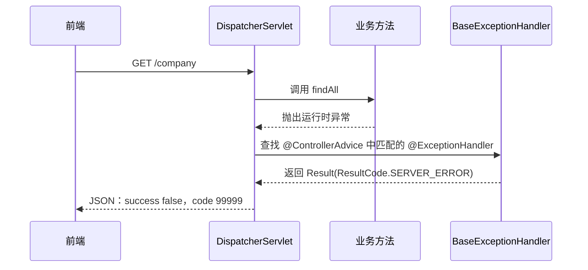

# 统一异常处理：把所有异常变成前端能读的 Result JSON

企业微服务的增删改查跑通之后，还有一类问题没有着落：异常。`findById(id).get()` 在查不到数据时会抛 `NoSuchElementException`，数据库连不上会抛连接异常，业务规则不满足还要主动抛异常。这些异常一旦发生，Spring Boot 默认把 500 状态码和错误页抛给前端，与「响应永远是 success、code、message、data」的约定直接冲突。处理异常靠每个方法里 try catch 是下策，重复代码铺天盖地还容易漏。Spring 提供的组合方案是 `@ControllerAdvice` 加 `@ExceptionHandler`，在项目公共模块里写一次，全工程生效。

## 先给结论

- `@ControllerAdvice` 标在类上，声明这是一个对全部 Controller 生效的增强类；`@ExceptionHandler(value = Exception.class)` 标在方法上，声明该方法接住哪类异常。
- 处理方法的返回值统一是 `Result`，再加 `@ResponseBody`，前端在任何异常下拿到的都是约定的 JSON 结构。
- 处理器类放在公共模块 `common` 里，各微服务都能复用；前提是启动类的扫描范围能覆盖到它。
- 自定义业务异常继承 `RuntimeException`，内部携带一个 `ResultCode`；处理器里按异常类型分门别类，业务异常用异常自带的 code，其余异常兜底返回 `SERVER_ERROR`。

## 一、先看没有处理时异常的样子

按 id 查询的底层实现是 `companyDao.findById(id).get()`，`get()` 直接从 `Optional` 里拆值，id 不存在就抛出 `NoSuchElementException`。这时前端收到的响应是 Spring Boot 默认错误页，HTTP 状态码 500，报文里没有 code 也没有 message，前端约定的判断逻辑全部失效。异常在数据层与业务层抛出是常态，不需要也不应该在每层都捕获，正确做法是让它一路抛到框架层，由统一入口翻译成约定的 `Result` 结构再返回。

## 二、两步搭出全局异常处理器

公共异常处理类放在 `common` 模块的 `handler` 包下，类名沿用讲义的 `BaseExceptionHandler`：

```java
package com.example.common.handler;

import com.example.common.entity.Result;
import com.example.common.entity.ResultCode;
import org.springframework.web.bind.annotation.*;

import javax.servlet.http.HttpServletRequest;
import javax.servlet.http.HttpServletResponse;

@ControllerAdvice
public class BaseExceptionHandler {

    @ExceptionHandler(value = Exception.class)
    @ResponseBody
    public Result error(HttpServletRequest request, HttpServletResponse response, Exception e) {
        Result result = new Result(ResultCode.SERVER_ERROR);
        return result;
    }
}
```

这个类只做两件事。**第一件，声明它是异常处理器。** `@ControllerAdvice` 的含义是「对所有 Controller 的增强」，Spring MVC 在任何一个 Controller 方法抛出异常后，都会到标了该注解的类里找匹配的处理方法。方法参数里可以拿 `HttpServletRequest`、`HttpServletResponse`，最后一个参数是被抛出的异常本身，名字随意。

**第二件，声明对什么异常做处理。** `@ExceptionHandler(value = Exception.class)` 指定接住 `Exception` 及其所有子类，等于全局兜底；写成具体异常类型则只接那一种。方法返回 `Result`，但异常处理入口不在普通 Controller 流程里，所以 `@ResponseBody` 必须显式标注，才能让 `Result` 被 Jackson 序列化成 JSON 写回响应体。

`SERVER_ERROR` 是返回码枚举里约定的兜底项：

```java
public enum ResultCode {

    SUCCESS(true,10000,"操作成功！"),
    FAIL(false,10001,"操作失败"),
    UNAUTHENTICATED(false,10002,"您还未登录"),
    UNAUTHORISE(false,10003,"权限不足"),
    SERVER_ERROR(false,99999,"抱歉，系统繁忙，请稍后重试！");

    boolean success;   //操作是否成功
    int code;          //操作代码
    String message;    //提示信息

    ResultCode(boolean success, int code, String message) {
        this.success = success;
        this.code = code;
        this.message = message;
    }
}
```

## 三、让处理器被扫描到：改启动类的扫描范围

处理器在 `common` 模块，而企业微服务的启动类原来只扫 `com.example.company` 这个包，`common` 根本不在扫描范围内，处理器写了也等于没写。把扫描范围扩大到两个模块的公共父包：

```java
@SpringBootApplication(scanBasePackages = "com.example")
@EntityScan(value = "com.example.domain")
public class CompanyApplication {

    //启动方法
    public static void main(String[] args) {
        SpringApplication.run(CompanyApplication.class, args);
    }

    @Bean
    public IdWorker idWorker() {
        return new IdWorker();
    }
}
```

`scanBasePackages` 改成 `com.example` 之后，`company` 模块的业务组件与 `common` 模块里的异常处理器都会被注册进容器。这是跨模块公共类能否生效的分界线，配置类、工具类 Bean 同理。

## 四、验证：人为制造一个异常

在查询列表方法里塞一行必炸的代码：

```java
//查询企业列表
@RequestMapping(value = "", method = RequestMethod.GET)
public Result findAll() {
    int i = 1 / 0;   //人为制造 ArithmeticException
    List<Company> list = companyService.findAll();
    Result result = new Result(ResultCode.SUCCESS);
    result.setData(list);
    return result;
}
```

重启服务，用 Postman 以 GET 方式请求 `http://localhost:9001/company`，返回：

```json
{
  "success": false,
  "code": 99999,
  "message": "抱歉,系统繁忙,请稍后重试",
  "data": null
}
```

后台控制台照常打印 `ArithmeticException` 的堆栈，方便开发排查；前端拿到的却是一个结构完整的 JSON，判断 `success` 为 false、提示 message 即可，页面不会白屏。异常被翻译，而不是被吞掉，两层各取所需。

## 五、自定义异常：让处理器分门别类

兜底返回「系统繁忙」对系统异常够用，但业务错误（权限不足、未登录）需要各自的 code 与提示。做法分两步：先定义异常类，再在处理器里区分对待。

自定义异常放在 `common` 的 `exception` 包下：

```java
package com.example.common.exception;

import com.example.common.entity.ResultCode;
import lombok.Getter;

@Getter
public class CommonException extends RuntimeException {
    private static final long serialVersionUID = 1L;

    private ResultCode code = ResultCode.SERVER_ERROR;

    public CommonException() {
    }

    public CommonException(ResultCode resultCode) {
        super(resultCode.message());
        this.code = resultCode;
    }
}
```

继承 `RuntimeException` 意味着这是非受检异常，方法签名不用层层声明 throws，抛出方一行 `throw new CommonException(ResultCode.UNAUTHORISE)` 即可。异常对象里带着 `ResultCode`，构造时用 `resultCode.message()` 把提示语传给父类，异常的 `getMessage()` 自然就是这段话。

处理器里按类型分流：

```java
@ExceptionHandler(value = Exception.class)
@ResponseBody
public Result error(HttpServletRequest request, HttpServletResponse response, Exception e) {
    if (e.getClass() == CommonException.class) {
        //业务异常：用异常自带的返回码构造响应
        CommonException ce = (CommonException) e;
        return new Result(ce.getCode());
    }
    //其他异常：统一兜底为系统错误
    return new Result(ResultCode.SERVER_ERROR);
}
```

业务侧抛异常也只多一行。把按 id 查询改成权限校验失败就抛：

```java
//根据id查询企业
@RequestMapping(value = "/{id}", method = RequestMethod.GET)
public Result findById(@PathVariable(value = "id") String id) {
    throw new CommonException(ResultCode.UNAUTHORISE);
}
```

重启后对照测试：GET `/company` 走进 if 之外的分支，返回 99999 系统繁忙；GET `/company/1` 抛出的是 `CommonException`，命中 if 分支，返回 10003 权限不足。同一台服务、同一个处理器，两种异常各自返回了约定的语义。

异常在框架里的流转路径如下：



关键一环在倒数第二跳：`DispatcherServlet` 捕获异常后不是直接回 500 页，而是先找 `@ControllerAdvice` 类里参数类型匹配的处理方法，找到就交给它翻译，这也是为什么处理方法的参数能声明成 `Exception` 却接得住 `ArithmeticException`。

## 常见误区

- **类上只标 `@ControllerAdvice`，方法上忘写 `@ExceptionHandler`**：容器里这个类只是个普通 Bean，异常依旧走默认流程，一个都接不住。两个注解缺一不可。
- **处理方法忘加 `@ResponseBody`**：返回的 `Result` 对象被当成视图名解析，前端收到的是页面解析错误或 500。更省事的替代是类上直接用 `@RestControllerAdvice`，它自带 `@ResponseBody`。
- **处理器类不在扫描范围内**：`common` 模块里的类，启动类只扫自己模块的包时不会注册，配置形同虚设。检查 `scanBasePackages` 是否覆盖公共模块的父包。
- **if 分流之后没有兜底分支**：判断了自定义异常却不写 else，其他异常的处理方法返回 null，前端拿到空响应。分类逻辑必须以一个无条件的兜底结尾。
- **返回码与提示语在处理器里硬编码**：code 与 message 应该由 `ResultCode` 枚举统一供给，散落的字面量迟早会和枚举对不上。

## 面试可能被问到的问题

1. 面试官追问：「`@ControllerAdvice` 的原理和作用范围是什么？」
   答：它是 Spring MVC 的控制器增强机制，容器启动时会把标了该注解的 Bean 收集起来，拦截到 Controller 异常时从中查找匹配的 `@ExceptionHandler` 方法。默认对全局所有 Controller 生效，也可以用 `basePackages`、`annotations` 属性限定作用范围。

2. 面试官追问：「一个类里有多个 `@ExceptionHandler`，怎么决定用哪个？」
   答：按异常类型的继承距离匹配，谁更具体优先谁。方法 A 处理 `CommonException`、方法 B 处理 `Exception`，抛出 `CommonException` 时走 A，其他异常走 B。所以更清晰的写法是拆成多个方法，代替方法体里的 if 判断。

3. 面试官追问：「自定义异常为什么继承 `RuntimeException` 而不是 `Exception`？」
   答：`RuntimeException` 是非受检异常，抛出与传递不受编译器强制，业务代码不用层层声明 throws，方法签名保持干净。业务异常本质上是预期内的错误信号，属于实现细节，不该污染方法签名。

4. 面试官追问：「统一异常处理和统一返回结构是怎么配合的？」
   答：正常响应返回 `Result`，异常响应经过全局处理器也返回 `Result`，两边的结构完全一致，只是 code 不同。前端因此只需要一套判断逻辑，先看 success 或 code，再从 data 取数据，这层一致性是统一异常处理最大的价值。

5. 面试官追问：「处理器接住了异常，但排查问题需要堆栈怎么办？」
   答：兜底给前端的 JSON 只暴露 code 和友好提示，服务端该记录日志一处都不能少。在处理方法里按异常级别打印 error 日志并带上堆栈，必要时报监控，做到对用户友好、对开发可查两条线并行。

## 配套资料

- 返回码枚举与返回结构：`materials/code/02/day01 SAAS-HRM系统概述与搭建环境/SAAS-HRM系统概述与搭建环境/资源/通用代码/common/ResultCode.java`、同目录 `Result.java`
- 工程通用包里 `CommonException` 的引用成例：`materials/code/02/day13-代码生成器实现/day13-代码生成器实现/资源/SpringBoot模板/${path2}_${project}/src/main/java/${path1}/${path2}/${path3}/controller/${ClassName}Controller(1).java`
- `BaseExceptionHandler` 完整源码不在资料包中，文中代码按课堂画面与本课写法补全
