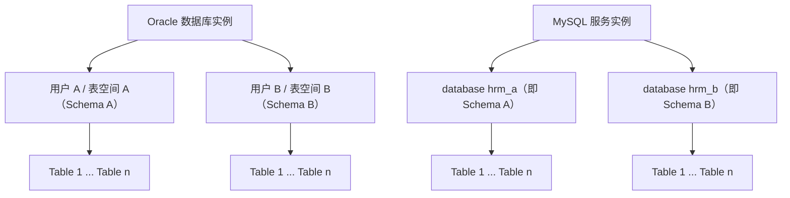
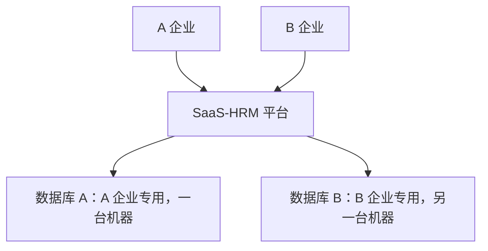
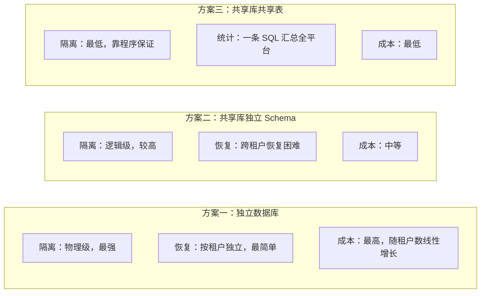

# 多租户数据库设计方法_独立数据库篇：独立数据库、独立 Schema 与共享表的称重与取舍

## 先给结论

- 本系列聚焦多租户数据库设计中的隔离方案，共两篇：先深入共享数据库独立 Schema 这个折中方案，再拉通独立数据库、独立 Schema、共享表三种方案做整体称重，落到本项目的选型。
- 共享数据库独立 Schema 的要点：所有租户共用一个数据库实例，每个租户分配一个独立 Schema，表建在各自空间里；逻辑隔离程度较高，成本明显低于独立数据库。
- Schema 的语义因库而异：Oracle 里一个用户对应一个 Schema，MySQL 里 Schema 与 Database 同级，实施前先确认自己用的是哪种语义。
- 它的代价要提前认账：所有租户压在同一台物理实例上，实例宕机即全租户不可用；隔离是逻辑隔离，安全边界在账号授权与 SQL 审计。
- 三种方案的对比维度是三个：成本、隔离安全性、数据备份恢复；独立数据库隔离最好但成本随租户数线性增长，共享表成本最低但隔离最弱且代码量最大。
- 共享表方案的收口纪律：每张表加租户字段、每条查询带过滤、每次写入注入归属，必须用统一的持久层拦截实现，不能依赖开发者自觉。
- 应用层落地独立 Schema 的典型手法是维护多个数据源，用 AbstractRoutingDataSource 的子类按租户标识路由到对应 Schema。
- 本项目的取舍：试用版采用共享数据库共享表，正式版采用 MySQL 共享库独立 Schema；按租户价值分级混用是 SaaS 产品的常态。
- 隔离级别的事后升级成本极高：从共享表迁到独立 Schema 要动数据、动代码、动运维，设计期就该明确各档租户的方案归属。
- 两篇连读的心法：隔离方案没有高级低级之分，只有成本、隔离与维护之间的称重，选型跟着租户分级与预算走。

## 第1部分：共享数据库、独立 Schema：把 N 个租户装进同一个数据库实例

独立数据库方案给每家租户单独配一台机器加一套数据库，隔离做到了极致，成本也跟着租户数线性上涨：租户破百时，光数据库服务器就是一笔不小的开支，运维还要同时照看上百个实例。介于「一租户一库」和「所有租户一张表」之间，还有一种折中姿态：数据库实例只有一个，实例内部按 Schema 划出租户的私有空间。本节把这种方案讲透，关键在于先弄明白 Schema 到底是什么，它在 Oracle 和 MySQL 里还不是同一个东西。

### 一、先把 Schema 这个词讲清楚

「Schema」在很多资料里被含糊地翻译成「模式」，不结合具体数据库根本无法落地。方案能否实施，取决于你用的数据库里 Schema 是什么。

**在 Oracle 里，Schema 就是用户。** Oracle 支持在一个数据库实例里建多个用户，一个用户一般对应一个 Schema，表都建立在 Schema 之中，可以简单理解为「一个用户一套数据库表」。用户还会被分配表空间，多个用户对应多个表空间，表空间之间的数据相互独立。所以 Oracle 做多租户，就是给每家租户建一个用户，租户的表全部放进自己的表空间。

**在 MySQL 里，Schema 与 Database 平级。** MySQL 的 Schema 概念不如 Oracle 那么显眼，它实际上就对应一个一个的 database，可以把 Schema 理解成一个一个独立的小数据库。所以 MySQL 做多租户，就是给每家租户建一个 database，同一套表名在各个库里各存一份。

两种数据库在这张图里可以对照着看：



看图的关键在顶层：不管底下怎么划分，Oracle 与 MySQL 的实例都只有一个。这正是方案名里「共享数据库」四个字的含义，划分动作发生在实例内部。

### 二、方案长什么样：一个实例，N 个租户空间

回到那张反复出现的架构图：A 企业、B 企业访问同一个 SaaS-HRM 平台，平台背后不再是两台机器两套库，而是一个共享数据库。请求进来后，应用识别出当前用户属于哪家租户，进而路由到该租户的 Schema：A 企业的请求落到 A 的表空间（Oracle）或 A 的 database（MySQL），B 企业同理。所有东西都安装在一台机器上，与独立数据库方案一台租户一台机器截然不同。

以 MySQL 为例，落库动作就是一租户建一个库（示例为按本课写法补全，课程视频只讲到方案层面）：

```sql
-- 一租户一个 schema：MySQL 中 schema 与 database 同义
CREATE DATABASE `hrm_tenant_a` DEFAULT CHARACTER SET utf8mb4;
CREATE DATABASE `hrm_tenant_b` DEFAULT CHARACTER SET utf8mb4;

-- 每个租户库里放同一套表结构，表名完全相同，各自存各自的数据
-- 以企业档案表为例，hrm_tenant_a 里建一份，hrm_tenant_b 里再建一份同名表
CREATE TABLE `hrm_tenant_a`.`co_company` (
  `id` varchar(40) NOT NULL COMMENT 'ID',
  `name` varchar(255) DEFAULT NULL COMMENT '公司名称',
  `version` varchar(255) DEFAULT NULL COMMENT '当前版本',
  `expiration_date` datetime DEFAULT NULL COMMENT '到期时间',
  PRIMARY KEY (`id`)
) ENGINE=InnoDB DEFAULT CHARSET=utf8mb4;
```

结构层面定了，应用层还差一个动作：请求进来时先知道「这是哪家租户」，再把这条请求引到对应的库。主流实现是维护多个数据源，按租户标识动态路由：

```java
// 示例：按租户路由数据源（主流写法补全，本课视频未给出实现代码）
public class TenantContext {
    private static final ThreadLocal<String> TENANT = new ThreadLocal<>();
    public static void set(String tenant) { TENANT.set(tenant); }
    public static String get()  { return TENANT.get(); }
}

public class TenantRoutingDataSource extends AbstractRoutingDataSource {
    // 返回值对应配置中某个数据源的 key，例如 hrm_tenant_a / hrm_tenant_b
    @Override
    protected Object determineCurrentLookupKey() {
        return TenantContext.get();
    }
}
```

登录成功后把租户标识放进 `ThreadLocal`，本次请求里的每一条 SQL 都会被路由到该租户的库。业务代码写表名时完全不用关心租户是谁，隔离逻辑收敛在数据源这一层，这是该方案对开发侧最大的友好。

### 三、优点：隔离与成本之间的第一次平衡

**第一，安全性较高，有了真实的隔离边界。** 不同租户用不同的表空间或不同的 database，数据在存储层面就分了家，不再像共享表那样全靠每条 SQL 自觉带条件。租户各自建表，还顺带获得了按租户定制表结构的自由，A 租户要的扩展字段不影响 B 租户。

**第二，成本比独立数据库低得多，一个实例能撑更多租户。** 数据库安装数量从「随租户数增长」变成「一台」，购置成本和维护成本一起降下来。对中等规模租户量的 SaaS 产品，这是最常被选中的平衡点。

### 四、缺点：共享实例的代价要提前认账

**第一，物理上是单点。** 所有租户的数据都放在同一台物理数据库上，这台机器出问题，A 的数据没了，B 的数据也没了。对比独立数据库方案，A 那台机器坏了只是 A 受损，B 完全不受影响。可用性风险从「按租户分摊」变成了「全员共担」。

**第二，数据恢复困难。** 备份和回滚的最小单位是整个实例，某一家租户误删了数据想单独恢复，要么整实例回滚让所有租户陪跑，要么从备份里把该租户的数据手工摘出来，操作成本很高。

**第三，跨租户统计困难。** 平台方想统计全平台的企业数、用户数，得跨多个 Schema 汇总，共享表方案一条 SQL 的事，在这里要遍历所有租户库。

**第四，隔离不是完全隔离。** 同一个实例内，只要账号有权限，跨 Schema 查询是成立的，比如 `SELECT * FROM hrm_tenant_b.co_company` 在有授权时照样能执行。所以「隔离」必须由权限体系兜底：应用连接各租户库的账号只授予本库权限，租户之间互相不可见靠授权收敛来保证，而不是靠 Schema 天然筑墙。

**适用场景也随之清晰：** 租户量中等、有付费能力差异、对数据隔离有较高要求但出不起独立数据库的钱、能接受平台级统一容灾的 SaaS 产品。本项目课程后段演示正式版时，走的正是 MySQL 共享数据库、独立 Schema 这条路线。

## 第2部分：多租户的三种数据库设计：独立数据库、独立 Schema、共享表

需求已经明确：数据库要能支持多个租户访问共享资源，也能访问各自私有的资源，租户之间互相隔离。但这句话落不到建表语句上，中间还差一个决策：隔离做到什么粒度，拿什么换成本。业界把答案收敛成了三种：独立数据库、共享数据库独立 Schema、共享数据库共享表。上一节拆完了中间那个，本节把剩下两种补齐，三种摆在一起对比，最后回到本项目：SaaS-HRM 平台自己是怎么选的，以及为什么后续课程写的代码全部基于其中一种。

### 一、独立数据库：一租户一套库，隔离拉满

独立数据库最好理解：A 企业访问平台，识别出它是 A，就让它访问属于自己的数据库 A；B 企业访问，识别出是 B，就让它访问数据库 B。每个租户一个数据库，互不相干。



图里两个数据库框分别长在不同的机器上，这正是隔离性的来源：A 和 B 的数据连物理位置都不在一起，怎么互相访问？想串都串不了。

**第一，隔离性与恢复能力都是三种方案里最强的。** 一套库只服务一家租户，数据模型可以按租户的独特需求随意扩展，不必顾虑别家；出现故障时恢复数据也很简单，坏的是 A 就只修 A，B 完全不受牵连。

**第二，成本同样是三种方案里最高的。** 一台数据库往往就要部署到一台机器上，A 一台、B 一台，租户越多机器越多，数据库的安装数量跟着涨，购置成本和维护成本一起涨。

**第三，换个角度看，它其实是传统模式的云上翻版。** A 企业一套独立部署、B 企业一套独立部署，与过去卖给一家企业就到客户现场装一套的传统方式大同小异，只是把机器从客户机房搬到了云端。想做真正的 SaaS，这一步省不掉成本，但也没占到 SaaS 的便宜。

数据源层面的形态是每个租户一条独立连接配置（示例为按主流写法补全，课程视频只讲到方案层面）：

```yaml
# 独立数据库方案：一租户一库（本例中两台不同机器），示例为按主流写法补全
spring:
  datasource:
    tenant-a:
      jdbc-url: jdbc:mysql://10.0.0.11:3306/hrm_tenant_a
      username: tenant_a
      password: "***"
    tenant-b:
      jdbc-url: jdbc:mysql://10.0.0.12:3306/hrm_tenant_b
      username: tenant_b
      password: "***"
```

每多一家租户就多一段配置、多一套机器，成本曲线一目了然。

### 二、共享数据库共享表：一套表住下所有租户

第三种方案走到另一个极端：数据库完全共享，表也完全共享，所有租户的数据都存放在同一个数据库的同一套表里。独立 Schema 方案好歹在实例里划了几块地皮，这里连地皮都不划了。

**问题的暴露来得非常直接。** 假设用户表里有一行：ID 是 1，用户名是张三。请问这个张三是 A 企业的还是 B 企业的？表结构里没有任何信息能回答。唯一的办法是在表上再加一个标志字段，比如企业 ID，值为 A 就是 A 企业的，值为 B 就是 B 企业的。也就是说，**共享表方案的全部隔离希望，都压在租户 ID 字段上。**

本项目课程脚本的表结构正是这样设计的。部门表 `co_department` 把 `company_id` 定义成了非空字段：

```sql
CREATE TABLE `co_department` (
  `id` varchar(40) NOT NULL,
  `company_id` varchar(255) NOT NULL COMMENT '企业ID',
  `pid` varchar(255) DEFAULT NULL COMMENT '父级部门ID',
  `name` varchar(255) DEFAULT NULL COMMENT '部门名称',
  `code` varchar(255) DEFAULT NULL COMMENT '部门编码',
  `manager` varchar(40) DEFAULT NULL COMMENT '部门负责人',
  `create_time` datetime DEFAULT NULL COMMENT '创建时间',
  PRIMARY KEY (`id`)
) ENGINE=InnoDB DEFAULT CHARSET=utf8mb4;
```

同一张表里同时住着两家租户的数据（表结构来自课程脚本，数据行为示例）：

```sql
INSERT INTO `co_department` (`id`, `company_id`, `pid`, `name`, `code`, `manager`) VALUES
('1063676045212913664', '1', '0', '研发部', 'DEV-TECHNOLOG', '技术部总监'),
('9903676045212913664', '2', '0', '研发部', 'DEV-TECHNOLOG', '研发负责人');

-- 查询必须携带租户条件，否则两家公司的部门会混在同一个结果里
SELECT `id`, `name`, `code` FROM `co_department` WHERE `company_id` = '1';
```

**第一，它是最便宜的方案。** 所有租户用同一套数据库，服务器只有一套，成本低廉，几乎适用于预算极度受限的场景。

**第二，它把隔离的全部责任转嫁给了程序。** 数据在存储层完全混放，谈不上任何存储级隔离，程序员操作不当，A 企业就能看到 B 企业的数据。于是设计和写代码时必须加大开发量：平台里无数个功能对应无数张表，每张表都要加租户 ID，每条查询都要根据租户 ID 过滤，每条写入都要注入当前租户，代码写起来相对麻烦，这部分多出来的开发量，就是用人力成本换服务器成本。

**第三，隔离靠工程手段收口，不能靠自觉。** 实践中通常统一在持久层做拦截：从登录态解析当前租户，强制拼进每条 SQL 的条件里，禁止业务代码手写过滤。把「忘记带条件」这类人为疏漏从源头堵住，共享表方案才敢上生产。

### 三、三种方案摆在一起称重



三块内容对应 PPT 上那张三维对比图的三个轴：成本、隔离安全性、数据备份恢复。选型口诀也随之而来：不差钱，选独立数据库；预算极限、能接受用代码补隔离，选共享表；既追求隔离性又想保留一定的数据共享与成本空间，选共享库独立 Schema。没有绝对正确的答案，只有与租户规模、付费能力、安全要求匹配的答案。

### 四、本项目的选择：试用版共享表，正式版独立 Schema

SaaS-HRM 平台把两种方案用在了两档产品上，这个设计本身就很能说明问题：

- **试用版**：系统放在外网上让多个企业免费试用，目的是获客，单租户价值低、量大，采用共享数据库共享表的方式设计，把每一分服务器成本都省下来。
- **正式版**：企业付费购买、定价较高，出于数据安全的角度，给付费租户迁移到独立的空间，采用基于 MySQL 的共享数据库独立 Schema 设计，这部分在课程后段展开。

**试用与正式对应不同方案的组合，说明三种方案不是单选题。** 同一个产品可以按租户分级混用：试用期用低成本方案，付费后升级到高隔离方案，迁移动作本身就是一条清晰的产品阶梯。

对本课程而言还有一条实用信息：后续几天的编码全部基于第三种方案（共享数据库共享表），每张表都会带着 `company_id` 出现，每段业务代码都要处理租户过滤；方案一与方案二到此讲解完毕，方案二会在课程最后与实现一起回看。理解了这一天为什么这样选，后面看到每条 SQL 都拖着 `company_id` 时，就知道那不是啰嗦，而是共享表方案全部隔离希望所在。

## 常见误区

- **把 Schema 当成数据库的通用概念直接套用。** Oracle 里 Schema 挂在用户上，MySQL 里 Schema 等于 database，两者建租户空间的操作完全不同，实施前先确认自己用的是哪种语义。

- **以为 Schema 隔离等于安全隔离。** 同实例跨 Schema 只要有权限就能互相访问，隔离的最后一道防线是账号授权与 SQL 审计，Schema 只是划出了边界。

- **只看到成本低，忽略单点风险。** 一个实例承载所有租户，容量规划、高可用（主从、备份策略）必须在上线前做足，否则一次故障就是全租户级事故。

- **以为每个租户的表可以长得不一样。** 独立 Schema 允许按租户定制表结构，但定制越多，升级脚本越难统一维护；通常约定主体表结构一致，差异收敛在少数扩展表。

- **以为独立数据库是「最高级」的方案。** 它隔离最好但本质是传统私有化部署的云端翻版，租户一多成本失控，多数 SaaS 产品撑不起，选它只有「预算充足加强隔离诉求」同时成立才合理。

- **以为共享表方案加一个租户 ID 字段就完事。** 字段只是起点，所有表都要加、所有查询都要过滤、所有写入都要注入，遗漏任何一张表、任何一条 SQL 都会串数据；必须用统一的持久层拦截收口，不能依赖开发者自觉。

- **以为三种方案只能全站二选一。** 按租户分级混用是常态，本项目试用版与正式版就是两套方案并存，付费升级伴随存储迁移。

- **以为隔离级别可以事后升级。** 从共享表迁到独立 Schema 要动数据、动代码、动运维，设计期就该明确各档租户的方案归属，别等出了安全事件再补救。

## 面试可能被问到的问题

1. 面试官追问：「共享数据库、独立 Schema 是什么方案？」
   答：所有租户共用一个数据库实例，每个租户分配一个独立 Schema，表建在各自 Schema 中，数据在实例内部按租户划界。应用根据请求中的租户标识路由到对应 Schema，是隔离性与成本之间的折中方案。

2. 面试官追问：「Oracle 和 MySQL 里 Schema 有什么区别？」
   答：Oracle 中一个用户对应一个 Schema，表建在 Schema（表空间）里，可以理解为一个用户一套表；MySQL 中 Schema 与 Database 同级，一个 Schema 就是一个 database。所以该方案在 Oracle 里表现为一租户一个用户，在 MySQL 里表现为一租户一个库。

3. 面试官追问：「这个方案比独立数据库省在哪里，又亏在哪里？」
   答：省的是服务器数量和维护成本，一个实例支撑更多租户；亏的是隔离从物理级降到逻辑级，实例单点故障影响全部租户，数据恢复和跨租户统计都更困难。

4. 面试官追问：「应用层怎么做到按租户路由到不同 Schema？」
   答：典型做法是维护多个数据源，用 `AbstractRoutingDataSource` 的子类重写 `determineCurrentLookupKey`，从 `ThreadLocal` 中取出登录时设置的租户标识作为路由键，把本次请求的所有 SQL 定向到该租户的库，业务代码不感知路由细节。

5. 面试官追问：「Schema 隔离能完全防止租户之间互相访问数据吗？」
   答：不能。同一实例内跨 Schema 访问在技术上始终成立，只要账号被授权。真正的安全边界是权限体系：每个租户使用的数据库账号只授予本 Schema 的权限，配合 SQL 审计，才能把逻辑隔离落实成实际的安全隔离。

6. 面试官追问：「多租户数据库设计有哪几种方案？」
   答：业界常见的有三种：独立数据库，一租户一套库一台机器，隔离最好成本最高；共享数据库独立 Schema，一个实例内按 Schema 划租户，逻辑隔离成本居中；共享数据库共享表，所有租户共用一套表，靠租户 ID 字段区分归属，成本最低但隔离最弱。

7. 面试官追问：「独立数据库方案有什么优缺点？」
   答：优点是为不同租户提供独立的数据库，有助于简化数据模型的扩展设计，满足不同租户的独特需求，出现故障时恢复数据比较简单；缺点是数据库安装数量增多，带来维护成本和购置成本的增加，本质接近传统私有化部署搬到云端。

8. 面试官追问：「共享表方案怎么区分数据的归属？」
   答：在业务表里增加租户标志字段，本项目用 `company_id` 关联企业表，并定义为非空。所有查询携带该字段过滤，所有写入注入当前租户；可靠的做法是在持久层统一拦截，从登录态解析租户后强制拼进 SQL，避免依赖每段业务代码自觉携带。

9. 面试官追问：「共享表方案隔离性最弱，为什么还有大量产品在用？」
   答：因为它成本最低，所有租户共用一套库一套表，服务器投入与租户数量基本无关，对试用用户、免费用户量大的 SaaS 产品特别合适；隔离弱的问题用工程手段弥补，统一拦截加权限校验可以把风险压到可接受范围，用人力换服务器是笔划算的账。

10. 面试官追问：「一个 SaaS 产品可以混用多种隔离方案吗？」
   答：可以，而且很常见。按租户价值分级：试用期租户用共享表控制成本，付费租户升级到独立 Schema 或独立数据库保障安全。本项目就是试用版走共享表、正式版走 MySQL 独立 Schema 的组合，方案选型服务产品定价策略，而不是一刀切。

11. 面试官追问：「选型时主要权衡哪些维度？」
   答：主要权衡隔离性、开发难度和成本三个维度，对应数据备份恢复、每条 SQL 是否要带租户条件、服务器购置与维护投入。共享表开发量最大隔离最弱成本最低，独立数据库相反，独立 Schema 居中，按租户规模与安全要求称重即可。

## 配套资料

- 建表脚本：`materials/code/02/day02 SAAS-HRM数据库设计与前端框架/3-3 SAAS-HRM数据库设计与前端框架/资源/ihrm.sql`（文中的 `co_company` 表结构节选自该脚本；脚本本身是共享库方案，多租户分 Schema 的建库语句为按本课写法补全的示例）

- 建表脚本：`materials/code/02/day02 SAAS-HRM数据库设计与前端框架/3-3 SAAS-HRM数据库设计与前端框架/资源/ihrm.sql`（`co_department`、`bs_user` 等业务表均带 `company_id` 租户字段，文中 DDL 为节选，INSERT 数据行为示例）

- 企业档案实体类：`materials/code/02/day01 SAAS-HRM系统概述与搭建环境/SAAS-HRM系统概述与搭建环境/资源/Company.java`（`version`、`expirationDate` 等字段对应试用与正式的版本区分）
