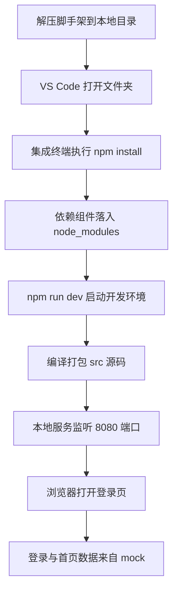

# 拿到前端脚手架第一件事：装好依赖把它跑起来

后端工程有 Maven 管依赖，敲个命令就能启动；HRM 项目的前端呢？它不是从零敲出来的，是一个基于 Vue 的脚手架工程：别人搭好的后台管理模板，改过样式直接用。拿到手的第一个动作不是读代码，而是弄明白它是什么、装什么环境、怎么跑起来。跑不起来，后面看目录、看流程都是空中楼阁。

## 先给结论

- 脚手架工程是基于 Vue 2.5 的后台管理前端模板，课程在其上调整了 CSS 样式来适配 HRM 的界面；不习惯也可以去 Element UI 官网自选同类脚手架。
- 技术栈五件套：Vue 做视图，vue-router 管路由，vuex 管状态，axios 发请求，Element UI 提供组件库，另配 vue-i18n 做多语言。
- 环境只需要装 Node 8 以上版本，npm 5 随 Node 一起装好，不用单独处理。
- `package.json` 是前端世界的 pom.xml：既声明依赖清单，也定义可执行脚本；`npm install` 对应拉依赖，`npm run dev` 对应启动工程。
- 工程不连后端也能登录、能看页面，因为数据由前端 mock 提供，联调前看到的都是模拟数据。

## 一、脚手架工程是什么

前后端分离之后，前端这一侧同样有自己的工程化体系。这个脚手架工程不是课程从无到有写出来的，而是在一套成熟的 Vue 后台管理模板基础上，调整了 CSS 样式让它更贴合 HRM 的界面需求，重点改动都在样式层。官网上同类脚手架很多，Element UI 自己就提供多套，不想用课程提供的版本，自己找一套换上也没有本质区别。

工程的构成先交代清楚。`package.json` 是整个工程的户口本，里面最重要的两块：`dependencies` 声明依赖的 JS 组件及版本，`scripts` 定义可以直接执行的脚本命令。工程依赖的核心组件如下（`package.json` 节选）：

```json
{
  "name": "project-saas-hrm-vue-master",
  "version": "1.0.0",
  "dependencies": {
    "element-ui": "2.2.2",
    "vue": "2.5.2",
    "vue-router": "3.0.1",
    "vuex": "3.0.1",
    "vue-i18n": "7.6.0",
    "mockjs": "1.0.1-beta3",
    "js-cookie": "2.2.0",
    "nprogress": "0.2.0",
    "font-awesome": "4.7.0",
    "normalize.css": "6.0.0"
  }
}
```

对照技术栈就能对上号：`vue` 是框架本体，`vue-router` 做路由管理，`vuex` 做状态管理，`element-ui` 是组件库，请求发送由 axios 承担（讲义的技术栈清单里单列了它），`mockjs` 用来造模拟数据。`devDependencies` 里还有一长串 babel 等编译工具，属于构建期依赖，按需自动装即可。

## 二、环境准备：Node、npm 与 VS Code

**环境只有一条硬要求：Node 8 以上。** npm 5 已经集成在 Node 8 里，装完 Node 就都有了，不用分开安装。

**编辑器用 VS Code。** 它以文件夹的形式组织工程：安装后选择「打开文件夹」，选中解压好的脚手架目录，整个工程就引入进来了。资料包的软件目录里带了安装包，双击装完即可；之前课程已经装过的可以直接跳过。

工程拿到手的形态是一个压缩包，把它复制到统一的代码目录（比如集中放代码的盘符下建个目录）再解压，路径里尽量不要带空格和中文，后面敲命令会省事。

## 三、装依赖并启动

VS Code 左下角打开集成终端。它等价于在工程根目录按住 Shift 右键、在此处打开命令行窗口，只是把窗口集成进了编辑器，省得来回切换。所有命令都在 `package.json` 所在的目录下执行：

```bash
# 安装依赖，从镜像源下载 package.json 里声明的全部组件
npm install

# 国际源速度慢时，可改用国内淘宝镜像工具
cnpm install

# 以开发环境启动工程
npm run dev
```

这套动作和 Maven 高度相似，对照着记最快：`package.json` 相当于 pom.xml，`npm install` 相当于拉取依赖，下载的组件全部落进 `node_modules` 目录，相当于本地仓库；npm 默认找的是国外镜像源，速度慢，`cnpm` 走国内淘宝镜像，装不装都不影响结果，只影响等待时间。安装完成前，工程目录下没有 `node_modules` 文件夹，安装完成后它自动出现。

`dev` 是 `scripts` 里定义的启动命令，指以开发环境运行。执行后工程开始编译，日志打出运行成功和访问地址，默认在 8080 端口，浏览器访问：

```bash
http://localhost:8080
```

整个启动链路如下：



图里最容易被忽略的是最后一环：随手输一个手机号也能登录成功，首页上的用户名、公司名都不是后端返回的，而是 mock 文件里写死的模拟数据。这正是脚手架的设计意图，接口还没开发时，前端照样能把页面和流程全部走通。

## 常见误区

- **跳过安装直接启动**：没有执行 `npm install` 就敲 `npm run dev`，报找不到模块。依赖必须先落进 `node_modules`，工程才有得编译。
- **在错误的目录执行命令**：命令必须在 `package.json` 所在的工程根目录执行，在外层目录敲命令会提示找不到脚本。
- **把 npm 安装慢当成坏了**：默认国外源下载几十上百个组件，等待时间很长。换 `cnpm` 或国内镜像源是常规操作，不是工程出了问题。
- **端口写死在记忆里**：访问地址以启动日志打印的为准，端口在 config 配置里可以改，日志报哪个就用哪个。

## 面试可能被问到的问题

1. 面试官追问：「package.json 在前端工程里起什么作用？」
   答：它相当于 Maven 的 pom.xml，声明工程名、版本、依赖清单和可执行脚本。依赖分 dependencies（运行期）和 devDependencies（构建期）两组，scripts 里定义的命令通过 npm run 触发，比如 dev 对应以开发环境启动。

2. 面试官追问：「npm install 和 npm run dev 分别做了什么？」
   答：npm install 按 package.json 的依赖声明，从镜像源下载组件并放入 node_modules；npm run dev 执行 scripts 里定义的 dev 命令，把 src 源码编译打包，起一个本地开发服务器对外提供页面访问。

3. 面试官追问：「node_modules 是什么？为什么要提交代码时忽略它？」
   答：它是依赖组件的安装目录，内容由 npm 依据 package.json 完全重建，体积大且与操作系统相关，因此不进版本库，任何人拿到 package.json 执行 npm install 都能还原出同样的目录。

4. 面试官追问：「为什么要用脚手架工程，而不是从零搭一个前端项目？」
   答：后台管理系统有大量通用能力：登录鉴权、路由菜单、状态管理、多语言、组件库集成。脚手架把这些基础设施搭好了，团队只写业务模块，起步成本低，风格也统一。课程工程只是在一套开源模板上改了样式。

5. 面试官追问：「Node 和 npm 是什么关系？」
   答：Node 是 JS 的运行时，让 JS 能脱离浏览器执行，前端工程化工具链跑在它上面；npm 是随 Node 附带的包管理器，负责依赖的下载与版本管理，两者版本绑定，装 Node 8 即自带 npm 5。

6. 面试官追问：「接口还没开发完，前端页面为什么能登录能出数据？」
   答：工程里内置了 mock 机制，用模拟数据拦截请求并返回预置的 JSON，比如固定的手机号和用户名。这让前端在接口就绪前独立开发与自测，联调阶段再切换到真实后端。

## 配套资料

- 企业模块模拟数据：`materials/code/02/day02 SAAS-HRM数据库设计与前端框架/3-3 SAAS-HRM数据库设计与前端框架/资源/通用代码/company.js`（脚手架 mock 机制的真实样例，页面不连后端也能出列表数据的原因）
- 脚手架完整工程未随资料包提供，文中 `package.json` 为工程文件节选；安装与启动命令按本课实际操作整理
