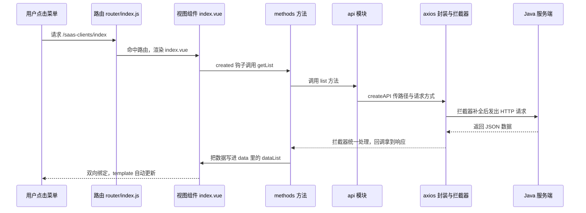

# 从地址栏到表格出数据：一条前端请求的完整执行链路

在 Vue 后台工程里，打开一个列表页，数据就出现在表格里了。可真要回答「数据是哪一行代码取回来的」，很多人就卡住了：改了页面没反应，数据死活不出来，或者把请求代码写得到处都是。问题都出在同一个地方，这条链路在心里没有完整的图。

把地址 `/saas-clients/index` 敲进地址栏，到表格填满数据，中间经过路由、视图、生命周期钩子、api 模块、axios 封装、服务端一共八九个环节。把这条链路拆开看一遍，之后每加一个页面都知道该动哪几个文件、出错了该从哪一环查起。

## 先给结论

- 请求地址先由路由定位到视图：`/saas-clients/index` 命中模块目录下 `router/index.js` 的配置，映射到模块里的 `pages/index.vue`。
- 一个 `.vue` 文件分三段：`template` 放页面标签，`script` 放 JS 逻辑，`style` 放样式，取数的代码全部写在 `script` 里。
- `script` 里三个关键角色：`data` 是数据模型，`methods` 是页面方法，`created` 是页面一加载就自动执行的钩子函数。
- 标准链路是：`created` 调用 `methods`，`methods` 调用 api 模块，api 模块经 axios 封装和拦截器把请求发给服务端；数据回来后修改 `data`，双向绑定让页面自动更新。
- 前端不改 DOM，改的是数据模型：模型一变，页面跟着变，这是整条链路的落脚点。

## 一、路由：把地址变成一个 .vue 文件

访问 `http://localhost:8080/#/saas-clients/index`，hash 之后的部分就是路由要处理的地址。业务页面的路由不在公共配置里，而在**模块目录自己的 `router/index.js`** 中，`saas-clients` 是父路径，`index` 是子路径，父子拼接定位到模块下的 `demo/pages/index.vue` 这类视图文件。路由只负责一件事：地址命中后，把对应的 `.vue` 文件渲染出来。

数据从哪来，路由不管，管的是视图组件自己。所以接下来要拆的就是这个 `.vue` 文件。

## 二、.vue 文件的三段结构与 script 的三个角色

打开视图文件，内容天然分成三块：

- `template`：全部是 HTML 页面标签，负责页面长什么样。
- `script`：页面需要的全部 JS 逻辑，负责数据和行为。
- `style`：样式表，负责好不好看。

重点在 `script`，它里面有三个必须分清的角色。

**第一是 `data`，页面级的数据模型。** 它是双向绑定的锚点：JS 侧的数据变了，HTML 里的内容跟着变；反过来页面上把值改了，数据模型也同步变。给 `data` 里放一个 `abc: 1`，模板里写 `{{ abc }}` 就显示 1，把模型改成 2 页面立刻显示 2；在页面上把 `abc` 改成 123，模型里同样变成 123。这就是双向绑定最直白的演示。

**第二是 `methods`，页面自己的方法集合。** 发请求、处理点击、组装数据，都写在里面。列表页要展示的数据，就是 `methods` 里的方法取回来放进 `data` 的。

**第三是 `created`，Vue 的生命周期钩子。** 钩子函数指的就是 Vue 在页面初始化阶段自动帮你调用的方法，不用手动触发。验证很简单：

```javascript
created() {
  console.log('created方法执行')
}
```

打开浏览器 F12 刷新页面，控制台立刻打出这句话。页面一加载它就执行，所以「进页面就要取数据」这类动作天然挂在 `created` 里。

## 三、链路串起来：created 到 methods 到 api 到服务端

三个角色各就各位之后，整条链路就能拼出来了。列表页的核心代码长这样：

```javascript
export default {
  name: 'saas-clients-index',
  data() {
    return {
      dataList: []                    // 数据模型，驱动表格渲染
    }
  },
  methods: {
    // 获取列表数据
    getList() {
      tableAPI.list().then(res => {
        this.dataList = res.data.items // 响应数据写进数据模型
        console.log(this.dataList)
      })
    }
  },
  created() {
    this.getList()                    // 页面一加载就取数
  }
}
```

`methods` 里的 `getList` 并没有自己发请求，而是调用了 `tableAPI.list`。这个方法从 api 模块 import 进来，api 目录按工程约定存放全部与后端交互的方法，里面一个典型的封装长这样：

```javascript
import { createAPI } from '@/utils/request'

// 以 get 方式请求 /table/list
export const list = data => createAPI('/table/list', 'get', data)
```

`createAPI` 是框架封装好的工具方法，接收请求路径、请求方式、参数三个信息，底层由统一的 axios 实例真正发出 HTTP 请求，请求和响应两头都挂着拦截器：发出前统一补 token、统一错误处理，响应回来后做统一的状态判断，再交还给 `then` 回调。

用一张时序图把整条链路固定下来：



图上最值得记住的是最后一环：服务端的数据回到 `methods`，`methods` 只做一件事，把值写进 `data` 的数据模型。页面之所以会变，不是有人去改了标签，而是模型变了，`template` 里的绑定自动刷新。想动态改页面内容，途径永远是「在 methods 里修改数据模型」，直接上手改 DOM 在这套体系里是反模式。

## 四、为什么要分层：组件不直接碰 axios

把请求拆成 api 模块加封装层，而不是在组件里直接写 `axios.get`，收益在工程变大之后才显现：

- 请求路径集中在一个目录里管理，后端改了接口，只动 api 文件，组件一行不改。
- token 注入、错误码处理、Loading 开关这类横切逻辑在拦截器里写一次全局生效，不用每个请求重复。
- 组件保持「只关心数据模型」的纯粹形态，取数细节全部下沉，单元测试和替换 mock 都更容易。

这套分层正是后面 mock 模拟数据（api 层写法不变，只在更底层把请求拦下来）和企业模块开发（照着 api 目录约定新增文件）的基础。

## 常见误区

- **把取数代码写在 `template` 或直接操作 DOM**：链路的正确位置是 `created` 触发 `methods`，数据落地到 `data`。绕过数据模型直接改标签，双向绑定会把它覆盖回去。
- **分不清 `created` 和 `methods`**：`created` 是钩子，页面初始化时自动执行；`methods` 里的方法必须被显式调用。只在 `methods` 里写了取数方法却忘了在 `created` 里调用，页面会一直空白。
- **取响应数据的层级写错**：工程统一的响应结构是 `code`、`success`、`message`、`data` 四个字段，业务数据在 `res.data` 里，写成 `res.items` 取回来永远是 undefined。
- **把请求 URL 散落在组件里**：路径字符串写死在页面中，脱离 api 目录，路径改动和 mock 切换都找不到统一的开关。

## 面试可能被问到的问题

1. 面试官追问：「Vue 单文件组件的三段结构各自负责什么？」
   答：`template` 放页面标签，描述视图结构；`script` 放组件逻辑，包括数据模型、方法和生命周期钩子；`style` 放样式。三段共同描述一个组件，取数与状态逻辑全部收敛在 `script` 段。

2. 面试官追问：「created 钩子是什么时候执行的，适合做什么？」
   答：在实例创建完成、页面初始化阶段自动执行，此时数据模型已就绪但尚未依赖用户交互。适合放「进页面就要做」的动作，比如发起查询请求、初始化数据，本课的列表取数就挂在 created 里。

3. 面试官追问：「什么是双向数据绑定？」
   答：数据模型与视图双向同步。模型变化自动更新到页面标签，页面上触发的修改也同步回模型。开发者的职责是维护数据模型，视图由绑定机制驱动刷新，不需要手动操作 DOM。

4. 面试官追问：「为什么请求要封装成 api 模块，而不是在组件里直接写 axios？」
   答：集中管理请求路径与后端契约，后端变更只需改 api 文件；token 注入、统一错误处理等横切逻辑在 axios 拦截器里实现一次全局生效；组件只依赖 api 方法返回的数据，与传输细节解耦，也方便整体替换成 mock。

5. 面试官追问：「axios 拦截器一般用来做什么？」
   答：请求拦截器在发出前统一补 token、加公共请求头、统一开启加载动画；响应拦截器在回调前统一判断状态码、处理登录失效、剥掉外层结构。业务代码因此不用每个请求都重复这些模板逻辑。

6. 面试官追问：「从点击菜单到列表渲染，中间有哪些环节？」
   答：地址先经路由匹配到模块下的视图组件，组件初始化时 created 钩子调用 methods 里的取数方法，方法调用 api 模块经 axios 封装与拦截器发出请求，服务端返回后把数据写入 data 数据模型，双向绑定驱动 template 更新，表格随之渲染。

## 配套资料

- 企业模块模拟数据：`materials/code/02/day02 SAAS-HRM数据库设计与前端框架/3-3 SAAS-HRM数据库设计与前端框架/资源/通用代码/company.js`（api 返回结构的真实样例，`code`、`success`、`message`、`data` 四段结构）
- 前端工程源码未随资料包提供，文中组件与 api 封装片段为按本课工程写法整理
