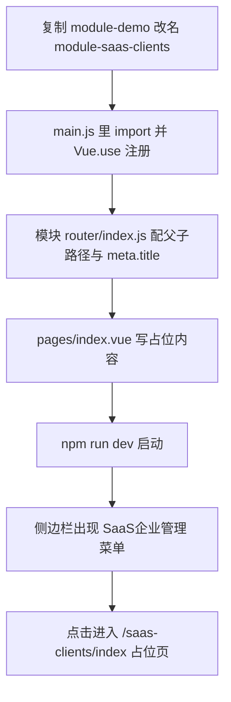

# 在脚手架上长出新模块：企业管理的环境搭建四步

需求已经摆在界面原型上了：侧边栏多一个「SaaS企业管理」菜单，点进去是一个企业列表页，每行带查看按钮，点击后地址变化、跳到详情页。功能代码还八字没一撇，但前端的地基必须先打起来：工程里还没有这个模块，菜单、路由、页面全是空中楼阁。

脚手架工程按「模块」组织代码，新增一个业务领域有一套固定的最小动作。这套动作做过一遍之后，后面再加用户管理、部门管理，流程完全复用，值得一步不漏地走清楚。

## 先给结论

- 新增业务模块固定四步：复制模块目录、在 `main.js` 注册、配置模块路由、编写占位页面。
- 模块即目录：`module-saas-clients` 下带 `pages`、`router`、`store`，结构照着 `module-demo` 复制再改名即可。
- 注册发生在 `src/main.js`：import 模块后调用 `Vue.use(saasClients, store)`，工程才认得这个模块。
- 路由配置在模块自己的 `router/index.js`：父路径 `saas-clients` 加子路径 `index` 拼出访问地址 `/saas-clients/index`，`meta.title` 决定侧边栏菜单文字。
- 页面先放占位内容跑通跳转，`npm run dev` 启动后菜单自动出现，业务代码后续再填。

## 一、界面原型拆成工程动作

原型上的两个画面对应两类工程资产：列表页是一个页面组件加一条路由；查看按钮点击后地址变化，说明详情页是另一条路由加另一个组件。再加上侧边栏的「SaaS企业管理」入口来自路由的 `meta` 配置，可以数出新模块要动的文件清单：

- 模块目录：`module-saas-clients`，装下这个业务的全部页面、路由、状态。
- 注册代码：`src/main.js` 里多两行。
- 模块路由：`module-saas-clients/router/index.js`，配置父子路径与菜单标题。
- 页面组件：`module-saas-clients/pages/index.vue`，先写占位。

先看清脚手架的目录约定，知道每个文件该放哪：

```text
src/
├── api/                    # 与后端交互的 API 方法
├── components/             # 公共组件
├── mock/                   # 模拟数据
├── router/                 # 公共路由配置与 _import
├── utils/                  # 工具库（含 axios 封装）
├── module-dashboard/       # 面板模块
├── module-demo/            # demo 模块，复制母本
├── module-saas-clients/    # 新增：企业管理模块
│   ├── pages/              # 业务页面
│   ├── router/             # 模块路由
│   └── store/              # 模块状态
├── App.vue
└── main.js                 # 入口，模块在此注册
```

业务代码全部收进 `module-` 前缀的目录，公共设施留在 `src` 根下，模块之间互不侵扰。

## 二、第一步：复制模块，改名

新建模块最省事的做法不是从零搭目录，而是把 `module-demo` 整个复制一份，改名为 `module-saas-clients`。复制来的目录里 `pages`、`router`、`store` 一应俱全，结构天然符合约定，之后只需替换内容。

这里有个动手前的小细节：**先停掉正在运行的开发服务再复制。** dev 服务占着模块目录下的文件句柄，服务不停就改名，操作系统直接弹「文件夹正在使用，请关闭正在使用的文件或文件夹」。`Ctrl+C` 停掉工程，复制改名后再启动，这条报错根本不会出现。

## 三、第二步：在 main.js 里注册模块

复制出来的目录工程并不认识，要在入口文件里声明一次：

```javascript
// 注册 - 业务模块
import dashboard from '@/module-dashboard'      // 面板
import demo from '@/module-demo'                // demo
import saasClients from '@/module-saas-clients' // 新添加的 企业管理

Vue.use(dashboard, store)
Vue.use(demo, store)
Vue.use(saasClients, store)   // 照已有模块的写法补一行
```

import 负责把模块引进来，`Vue.use` 负责真正注册，参数里的 `store` 把全局状态管理实例也交给模块，模块内部的 `store` 子目录由此接入全局。注册完成后，Vue 工程知道多了个叫 `saasClients` 的模块，会按规定去找它下面的 `router` 和 `pages`。

## 四、第三步：配置路由与菜单

模块的路由写在 `module-saas-clients/router/index.js`，打开复制来的文件，改掉与 demo 相关的名字：

```javascript
import Layout from '@/module-dashboard/pages/layout'
const _import = require('@/router/import_') + process.env.NODE_ENV

export default {
  root: true,
  path: 'saas-clients',            // 父路径
  component: Layout,               // 挂载在整体布局框架下
  name: 'saas-clients',            // 不能与 demo 模块重名
  meta: {
    title: 'SaaS企业管理',
    icon: 'component'
  },
  children: [
    {
      path: 'index',               // 子路径，完整地址 /saas-clients/index
      component: _import('saas-clients/pages/index'),
      name: 'saas-clients-index',
      meta: { title: 'SaaS企业管理', icon: 'component', noCache: true }
    }
  ]
}
```

几个字段的分工值得逐个确认：

- `path` 父子拼接：父路径 `saas-clients` 加子路径 `index`，得到访问地址 `/saas-clients/index`。
- `component: Layout`：外层套的是全局布局组件，侧边栏和头部由它提供，业务页面渲染在布局的内容区里。
- `_import('saas-clients/pages/index')`：按需加载函数，自动拼上 `module-` 前缀，指向模块下的页面文件，路径错一个字母页面就是白屏。
- `meta.title`：侧边栏菜单的文字来源，改成「SaaS企业管理」，刷新后菜单名立刻跟着变。
- `name` 全局唯一：复制自 demo 的 `name` 若不改，两个模块的路由名冲突，跳转会出现匪夷所思的结果。

复制改名最容易漏的就是这些藏在对象里的旧名字：文件头 import 的模块名、路由里的 `name`、`meta.title`、`_import` 的路径参数，逐一检查才不会留雷。

## 五、第四步：占位页面与启动验证

路由指向的页面先写个占位，把跳转链路跑通：

```vue
<template>
  <div class="dashboard-container">
    saas企业管理
  </div>
</template>

<script>
export default {
  name: 'saasClientList',
  components: {},
  data() {
    return {}
  },
  computed: {},
  created() {}
}
</script>
```

复制来的 demo 内容清掉，`template` 里只留一句提示文字，`data`、`methods` 里临时的东西全部删除，保留标准骨架。业务代码等接口和路由都验证过了再往里填，占位页的意义就在于此：先证明「地址能进、页面能出」，把链路问题与业务问题隔离开。

启动验证：

```bash
npm run dev
```

编译通过后刷新浏览器，侧边栏多出「SaaS企业管理」菜单，点击进入 `/saas-clients/index`，占位文字正常显示。四个步骤全部落地：



图中每一步的输出都是下一步的输入：没有复制出来的目录，注册无从谈起；没有注册，路由配置不生效；没有路由，页面没有入口。顺序错一步，现象就各不相同，这也是排查时倒推的依据。

## 常见误区

- **服务运行中复制改名模块**：dev 服务占用文件句柄，报「文件夹正在使用」。先停服务再操作，改完再启动。
- **只 import 不 `Vue.use`**：模块进了打包产物却没注册，路由不挂载、菜单不出现，页面 404。两行代码缺一不可。
- **name 与 demo 模块重名**：路由名全局唯一，重名后路由匹配错乱、菜单高亮异常。复制改名时把所有旧名字清干净。
- **`_import` 路径写错**：参数是相对模块的路径，漏写 `pages` 或拼错模块名，懒加载找不到 `.vue` 文件，页面白屏且控制台报组件加载失败。

## 面试可能被问到的问题

1. 面试官追问：「前端工程按模块组织代码有什么好处？」
   答：每个业务领域独立成目录，页面、路由、状态自包含，模块间边界清晰。新增或下线一个业务只动自己的目录加一行注册，不影响其他模块，团队并行开发也不容易产生文件冲突。

2. 面试官追问：「Vue.use 注册模块时做了什么？」
   答：Vue.use 会执行模块暴露的 install 方法，把路由、状态等能力挂到 Vue 实例与传入的 store 上。本工程的模块以 Vue.use(mod, store) 方式注册，模块内部的子路由由此并入全局路由表，子 store 也并入全局状态。

3. 面试官追问：「新增一个页面最少要改哪几个文件？」
   答：在所属模块的 pages 下新建 `.vue` 页面，并在该模块 router/index.js 的 children 里加一条路由配置，共两处。若页面要出现在侧边栏，路由的 meta.title 照约定填写即可，菜单组件无需改动。

4. 面试官追问：「路由嵌套（父子路由）解决什么问题？」
   答：父路由承载公共布局（如侧边栏加头部的 Layout），子路由负责内容区切换。后台系统里大量页面共享同一套框架，嵌套路由让布局只渲染一次，业务页面作为子视图替换，结构与复用都更合理。

5. 面试官追问：「为什么模块路由的 component 写 Layout，业务组件却放在 children 里？」
   答：父级的 Layout 是全局布局骨架，负责侧边栏与头部；children 里的组件是具体业务页，渲染进布局预留的内容出口。这样菜单点击只替换内容区，布局不重建，页面状态与滚动位置也更可控。

6. 面试官追问：「复制模块改名，最容易遗漏的环节是什么？」
   答：对象内部的旧标识：模块 import 名、路由的 name、meta.title、_import 的路径参数。目录改名只是表面，这些字符串不改会导致路由名冲突、菜单文字错乱或组件加载失败，逐项全局搜索旧名是最稳的做法。

## 配套资料

- 企业模块 mock 数据真实文件：`materials/code/02/day02 SAAS-HRM数据库设计与前端框架/3-3 SAAS-HRM数据库设计与前端框架/资源/通用代码/company.js`（占位页面后续取数的数据来源）
- 前端脚手架源码未随资料包提供，文中注册、路由、占位页面代码为按本课操作步骤整理
