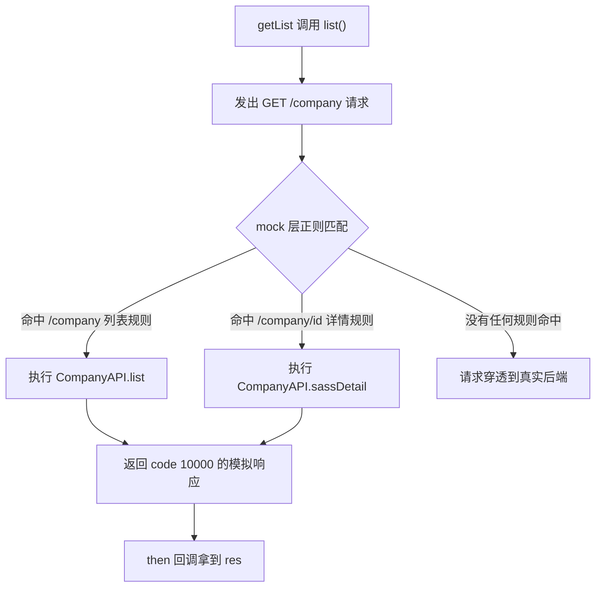

# 企业列表的第一批数据：created 接上 api，用 mock 顶住没有后端的空窗

api 文件已经封装好了，真正动手做企业列表时会立刻撞上一个尴尬：后端一行代码还没写。页面刷新，控制台毫无动静，列表区空白。前端这条取数链路走到这里断了，断点就在「api 调出去之后，请求发向哪里」。

接断点的思路分两步：页面 `created` 钩子调用 `methods` 里的方法，方法再调用 api 的 `list` 发起请求；后端没就位，就靠 mock 层把请求拦下来，返回一份严格按接口文档构造的模拟数据。前端整条链路先跑通，等后端就绪再把 mock 摘掉，前端代码一个字都不用改。

## 先给结论

- 取数链路固定三段：`created` 调 `methods` 里的 `getList`，`getList` 调 api 的 `list`，`list` 发出 `GET /company` 请求。
- `list()` 返回的是 Promise，响应用 `.then(res => ...)` 的回调函数接，这个写法来自 JavaScript 原生语法。
- 后端空窗期在 mock 目录新建 `company.js`，导出 `list` 与 `sassDetail` 两个函数，返回值结构完全对齐接口文档的统一响应外壳：`code`、`success`、`message`、`data`。
- mock 按 URL 正则拦截请求：`GET /company` 命中列表函数，`GET /company/{id}` 命中详情函数，两条规则的正则必须能区分开，否则互相抢请求。
- 刷新后控制台里 `res` 自带 `config`、`headers`、`request` 一大堆字段，业务上只关心 `res.data`。

## 一、先把方法的调用链搭出来

页面组件 `src/module-saas-clients` 下的 `index.vue`，此前只有一个空壳。api 方法要先进到组件里，从 api 目录把 `list` 引进来，然后在 `created` 钩子与 `methods` 之间把调用关系写全：

```vue
<script>
import { list } from '@/api/base/saasClient'

export default {
  name: 'saas-clients-index',
  data () {
    return {}
  },
  created () {
    // 页面实例化之前执行：从这里发起取数
    this.getList()
  },
  methods: {
    getList () {
      // 调用 api 发起请求，响应在 then 的回调里接
      list().then(res => {
        console.log(res)
      })
    }
  }
}
</script>
```

这条链路有两处容易卡壳的地方。**第一，为什么放在 `created` 里调。** Vue 组件有生命周期钩子，`created` 在实例创建完成、页面还没渲染时执行，取数动作放这里，数据到得最早。`created` 里不能直接写业务，按工程习惯转手调用 `methods` 里的 `getList`，钩子只负责「什么时候」，方法负责「做什么」。

**第二，`.then(res => ...)` 是什么写法。** api 里的 `list` 底层是 axios 请求，返回 Promise，`then` 方法接收一个回调函数，请求有响应时才执行；箭头函数 `res =>` 右边的 `res` 就是响应对象。先用 `console.log(res)` 把它打出来，是取数第一步的标准验证动作。

## 二、mock 数据文件：照着接口文档造

调用链有了，请求却不知道发到哪，后端也不存在。脚手架工程内置了 Mock.js，支持自己构造模拟数据。做法是在 mock 目录新建 `company.js`，内容不用手敲，课程资料里的通用代码直接整份拷入。这份代码的关键是返回值结构与接口文档逐字段对齐：

```javascript
import Mock from 'mockjs'
import { param2Obj } from '@/utils'

const List = []
const count = 100

// 循环构造三条企业数据
for (let i = 0; i < 3; i++) {
  let data = {
    id: "1" + i,
    name: "企业" + i,
    managerId: "string",
    version: "试用版v1.0",
    renewalDate: "2018-01-01",
    expirationDate: "2019-01-01",
    companyArea: "string",
    companyAddress: "string",
    businessLicenseId: "string",
    legalRepresentative: "string",
    companyPhone: "13800138000",
    mailbox: "string",
    companySize: "string",
    industry: "string",
    remarks: "string",
    auditState: "string",
    state: "1",
    balance: "string",
    createTime: "string"
  }
  List.push(data)
}

export default {
  // 全部列表：GET /company 的模拟响应
  list: () => {
    return {
      code: 10000,
      success: true,
      message: "查询成功",
      data: List
    }
  },
  // 根据 ID 查询：GET /company/{id} 的模拟响应
  sassDetail: () => {
    return {
      code: 10000,
      success: true,
      message: "查询成功",
      data: {
        id: "10001",
        name: "测试企业",
        version: "试用版v1.0",
        expirationDate: "2019-01-01",
        state: "1"
      }
    }
  }
}
```

两个函数对应接口文档里的两个查询接口。「全部列表」的响应外壳是 `code`（10000 代表成功）、`success`、`message`、`data` 四件套，`data` 是数组，里面循环塞了三条企业信息；「根据 ID 查询」外壳相同，`data` 换成单个对象。字段清单不是拍脑袋定的，接口文档里企业实体的每个属性都造到了，数据库 `co_company` 表的列名与之一一对应，将来连真实后端时数据结构无缝切换。

## 三、注册拦截规则：正则匹配请求地址

模拟函数写好了，还要告诉 Mock.js 什么样的请求交给哪个函数。mock 目录的入口文件里引入企业模块的模拟 api，再用 `Mock.mock` 注册拦截规则：

```javascript
import Mock from 'mockjs'
import LoginAPI from '@/login'
import CompanyAPI from '@/company'

Mock.setup({
  // timeout: 1000
})

// 既有规则：登录接口的模拟
Mock.mock(/\/frame\/login/, 'post', LoginAPI.login)

// 企业列表：拦截 GET /company
Mock.mock(/\/company$/, 'get', CompanyAPI.list)
// 企业详情：拦截 GET /company/{id}，正则吃掉 id 段
Mock.mock(/\/company\/.+$/, 'get', CompanyAPI.sassDetail)
```

`Mock.mock` 的三个参数分别是匹配请求地址的正则、请求方式、命中后执行的函数。列表请求的路径是 `/company`，详情请求是 `/company` 后面再拼一个 id，id 是个会变的字符串，所以详情规则的正则要多吃一段。请求从发出到拿到数据，走的是这样的分支：



分支图里最值得看的是「穿透」这一条：mock 规则没命中的请求会正常发往后端。这意味着同一份前端代码，mock 配了走模拟数据，后端上线把 mock 规则删掉就走真实接口，切换成本为零。

## 四、刷新验证：一坨响应里只取 res.data

打开浏览器控制台刷新页面，`console.log` 已经打出内容，但打出来的是一大坨：`config`、`headers`、`request`、`data` 等。难道要 `config` 要 `header` 吗？不要，业务上只关心 `data` 这一个属性，`res.data` 才是接口真正返回的统一响应外壳：

```javascript
list().then(res => {
  // res 是 axios 的完整响应，业务数据在 res.data
  console.log(res.data)
})
```

再刷新，控制台输出干净了：`10000` 代表成功，`查询成功` 是提示语，`data` 里三条企业数据整整齐齐。到这里，「页面创建、方法调用、api 发请求、mock 拦截、响应落地」整条链路全部走通，后面就是把 `res.data.data` 里的数组绑到模型上渲染出来，那是下一节的事。

## 常见误区

- **`.then` 里以为 `res` 就是业务数据**：`res` 是 axios 包装过的完整响应，业务外壳在 `res.data`，数组还要再往里一层。直接把 `res` 当数组去遍历会报错。
- **两条 mock 规则写成一模一样**：列表与详情都写成 `/\/company/`，路径重叠，详情请求会被列表规则抢先截住。用 `$` 锚定结尾，把 `/company` 与 `/company/{id}` 的匹配范围分开。
- **模拟数据随手乱造字段**：字段名与接口文档对不上，前端页面调通了，联调时全要返工。模拟数据按接口文档逐字段构造，才是「先前端后后端」的正确姿势。
- **忘了引入 api 方法就调用**：`list is not defined`，`import { list } from '@/api/base/saasClient'` 这一行漏不得。

## 面试可能被问到的问题

1. 面试官追问：「前端开发为什么要用 mock？和直接等后端比好在哪？」
   答：mock 让前端不等后端就能跑通整条取数链路，接口文档一出，前端照着构造模拟数据先把页面调通。前后端并行开发缩短总工期；同时 mock 数据结构严格对齐接口文档，相当于提前验证了契约，联调时问题更少。

2. 面试官追问：「mock 是怎么把请求拦下来的？」
   答：Mock.js 重写了 XMLHttpRequest 对象，页面发出的 ajax 请求会先经过它的拦截层，按注册的 URL 正则与请求方式匹配，命中就直接返回注册函数的返回值，请求不再真正发往服务器；没命中则穿透为真实请求。

3. 面试官追问：「`created` 和 `mounted` 里发请求有什么区别？」
   答：`created` 在实例创建后、DOM 挂载前触发，`mounted` 在 DOM 挂载后触发。纯取数两者都能用，`created` 更早；如果取数后要依赖 DOM 做图表渲染之类的操作，才必须等 `mounted`。本课的取数放在 `created`。

4. 面试官追问：「统一响应外壳 code、success、message、data 的意义是什么？」
   答：让所有接口的返回结构一致，前端可以写统一的拦截处理：code 判断业务成败、message 直接弹提示、data 才是业务数据。外壳约定清楚后，mock 构造数据、异常处理、响应拦截器都围着同一套结构写，全工程一处逻辑多处复用。

5. 面试官追问：「后端就绪后，前端怎么从 mock 切到真实接口？」
   答：删除或关闭 mock 拦截规则即可。api 层的路径、请求方式、字段都没变，组件层零改动。这也是把 api 独立成目录、把 mock 做成可插拔层带来的收益：切换只发生在最底层。

## 配套资料

- 企业模块 mock 数据真实文件：`materials/code/02/day02 SAAS-HRM数据库设计与前端框架/3-3 SAAS-HRM数据库设计与前端框架/资源/通用代码/company.js`（文中引用的 `list` 与 `sassDetail` 模拟数据即出自此文件）
- 企业表结构：`materials/code/02/day02 SAAS-HRM数据库设计与前端框架/3-3 SAAS-HRM数据库设计与前端框架/资源/ihrm.sql`（`co_company` 表，模拟数据的字段与其列一一对应）
- mock 入口注册代码在课程工程内未随资料包提供，文中 `Mock.setup` 与 `Mock.mock` 注册段为按本课工程写法补全的示例
