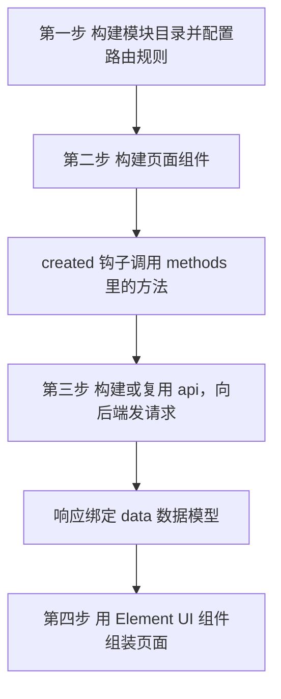

# 企业详情页：动态路由「detail/:id」与列表页的跳转传参

企业列表能看、能拨开关了，但操作列里的「查看」还是个死按钮：点下去什么也不发生。真实需求是点击后进入详情页，地址栏变成类似 `/saas-clients/detail/10` 的样子，页面展示这家企业的完整资料。实现它要动三个地方：注册一条带参数的子路由、新建一个详情页组件、把列表页的按钮改成跳转链接。

## 先给结论

- 后台系统开发一个新页面，固定四步：构建模块并配置路由规则、构建页面（`created` 调 `methods`）、构建 api、用 Element UI 组装页面。
- 详情路由注册在企业模块 `children` 数组里，`path` 写 `detail/:id`，冒号后面的 `id` 是给地址参数起的名字，属于动态路由。
- 跳转链接优先用 `router-link`，`:to` 动态拼接地址，把当前行的 `scope.row.id` 拼在路径末尾。
- 跳转地址必须与路由规则逐字符一致，一个下划线与连字符、单复数的差异都是 404。
- 详情页里用 `this.$route.params.id` 取出地址参数，下一节就靠它去调按 ID 查询的接口。

## 一、模块开发四步走：把套路固化下来

企业模块做到这里，流程已经可以总结成一套固定打法，后面每个业务模块都按它复制：



路由决定「地址变成页面」的映射，页面负责发起取数，api 负责请求的封装与对齐，Element UI 负责观感。列表页是按这四步建出来的，详情页照方抓药，只是第三步的 api 上一节已经写好，第一步的路由要新增一条带参数的规则。

## 二、注册动态路由：detail/:id 是什么

企业模块的路由文件在 `src/module-saas-clients/router/index.js`，列表页的子路由就注册在这里，详情页的规则加在同一个 `children` 数组里：

```javascript
// src/module-saas-clients/router/index.js（企业模块部分）
{
  path: '/saas-clients',
  redirect: 'noredirect',
  name: 'saas-clients',
  meta: {
    title: '企业模块管理',
    icon: 'component'
  },
  children: [
    {
      path: 'index',
      component: () => import('@/views/saas-clients/pages/index'),
      name: 'saas-clients-index',
      meta: { title: 'SAAS企业列表', icon: 'component', noCache: true }
    },
    {
      // :id 是动态参数占位，参数名自定
      path: 'detail/:id',
      component: () => import('@/views/saas-clients/pages/detail'),
      name: 'saas-clients-detail',
      meta: { title: 'SAAS企业详情', icon: 'component', noCache: true }
    }
  ]
}
```

`detail/:id` 里的冒号是 Vue Router 的动态路由语法。详情页的地址不是写死的，每家企业都有自己的 id，地址随着点击的行变化，`/saas-clients/detail/10`、`/saas-clients/detail/11` 都要命中同一条规则。冒号后面的 `id` 是给这个会变的参数起的名字，地址里 `detail/` 后面那一截就叫 `id`，将来在组件里按这个名字取值。`component` 仍然用 `() => import(...)` 的写法，路由懒加载，进入详情页时才下载它的代码。

## 三、建详情页骨架，把查看按钮改成跳转链接

路由指向的 `detail.vue` 还不存在。在 `views/saas-clients/pages` 下新建 `detail.vue`，结构从 `index.vue` 复制过来再瘦身，省得从零搭骨架：

```vue
<template>
  <div class="dashboard-container">
    <div class="app-container">
      <el-card shadow="never">
        <!-- 企业详情内容，下一节填充 -->
      </el-card>
    </div>
  </div>
</template>

<script>
export default {
  name: 'saas-clients-detail',
  data () {
    return {}
  }
}
</script>
```

接着回到列表页 `index.vue`，把操作列里的按钮换成跳转链接。`a` 标签可以跳，但它是原生整页刷新；工程里更合适的是 Vue Router 提供的 `router-link`，它走路由切换，只更新视图区域，不重新加载整个应用：

```vue
<el-table-column fixed="right" label="操作" width="150">
  <template slot-scope="scope">
    <router-link :to="'/saas-clients/detail/' + scope.row.id">查看</router-link>
  </template>
</el-table-column>
```

`to` 属性指明跳转目标，前面加了冒号变成动态绑定，值是一个 JavaScript 拼接表达式：固定前缀 `/saas-clients/detail/` 加上当前行的 `scope.row.id`。上一节的作用域插槽在这里正好派上用场，没有 `scope.row`，链接根本拼不出目标地址。刷新列表页，鼠标悬到「查看」上，左下角已经能看到拼好的链接地址。

## 四、404 排查：跳转地址与路由规则要逐字符一致

点击「查看」，页面跳出 404，这是本节现场真实发生的坑。链接明明拼好了，路由也注册了，问题出在两边字符串对不上：路由表里注册的父路径，与链接里手写的前缀，只要有一处字符不同就匹配不上，单复数之差（`detail` 与 `details`）、下划线与连字符之差（`saas_clients` 与 `saas-clients`）都是 404，而且报错信息不会告诉你差在哪。

排查方法是把两边代码并排打开逐字符比对：路由文件里的 `path`，与 `router-link` 拼出来的地址，父路径、子路径、参数占位三段必须完全一致。统一之后刷新，点击查看，地址栏变成 `/saas-clients/detail/10`，详情页组件成功渲染出来，坑才算填完。

页面有了，参数怎么用？详情页组件里用 `this.$route.params.id` 就能拿到地址里的 10，按本课的写法补一个最简单的验证：

```javascript
// detail.vue 的 script 部分（示例，按本课写法补全）
export default {
  name: 'saas-clients-detail',
  data () {
    return {}
  },
  created () {
    // 取出地址参数，下一节用它调用按 ID 查询的接口
    console.log(this.$route.params.id)
  }
}
```

控制台打出点击那一行的 id，动态路由的传参链路就闭合了：列表页拼参数、路由规则接参数、详情页取参数。下一节把这个 id 喂给 api 的按 ID 查询方法，详情数据就有了。

## 常见误区

- **忘了冒号或忘了加参数**：`path` 写成 `detail/id`，路由把 `id` 当成字面字符，访问 `/saas-clients/detail/10` 直接 404。动态参数的冒号不能少。
- **跳转地址手写硬编码**：`to="/saas-clients/detail/10"` 写死 10，每行都跳到同一家企业。要用 `:to` 动态拼接 `scope.row.id`。
- **`router-link` 与路由大小写或拼写不一致**：404 的头号来源。两边逐字符比对，别靠记忆。
- **详情页忘了 `noCache` 或复用了列表页组件名**：两个页面 `name` 相同会让缓存与调试都混乱，复制骨架后记得把组件 `name` 改成 `saas-clients-detail`。

## 面试可能被问到的问题

1. 面试官追问：「Vue Router 的动态路由是什么，参数怎么取？」
   答：用冒号占位声明路径参数，如 `detail/:id`，同一条规则匹配所有带不同 id 的地址。组件内通过 `this.$route.params` 取参数值，本课取 `params.id`。地址变化进入同一组件时组件会复用，需要用 `watch` 监听 `$route` 或在路由守卫里重新取数。

2. 面试官追问：「router-link 和 a 标签的区别？」
   答：a 标签触发浏览器原生跳转，整页重新加载，应用状态全部丢失；router-link 拦截点击事件，走 Vue Router 的 history 切换，只更新路由视图，应用实例不销毁，配合路由懒加载体验与性能都更好。单页应用内部的跳转一律用 router-link 或编程式导航。

3. 面试官追问：「路由懒加载是怎么实现的，有什么好处？」
   答：`component: () => import('@/views/.../detail')` 把组件定义成异步函数，构建工具据此把组件单独切成一个 chunk，访问到该路由时才下载执行。首屏不必加载全部页面代码，体积大的后台系统首屏速度明显提升。

4. 面试官追问：「路由跳转传参除了路径参数还有什么方式？」
   答：还有 query 参数，地址形如 `?id=10`，组件里用 `$route.query.id` 取；以及编程式导航的 `params` 传参。路径参数把资源定位写进 URL，刷新不丢、可分享可收藏，详情页这类按 id 定位的场景首选；query 适合可选的筛选条件，不宜承担资源定位。

5. 面试官追问：「点进详情页 404，你的排查思路是什么？」
   答：先看地址栏实际地址，再打开路由配置逐段比对：父路径、子路径、参数占位是否逐字符一致，路由是否注册在正确的模块数组里，路由文件是否被主入口加载。本课的现场案例就是跳转前缀与注册父路径差了一个字符，两边并排比对是最快的定位手段。

## 配套资料

- 企业模块 mock 数据真实文件：`materials/code/02/day02 SAAS-HRM数据库设计与前端框架/3-3 SAAS-HRM数据库设计与前端框架/资源/通用代码/company.js`（`sassDetail` 即按 ID 查询的模拟响应，详情数据下一节接入）
- 企业表结构：`materials/code/02/day02 SAAS-HRM数据库设计与前端框架/3-3 SAAS-HRM数据库设计与前端框架/资源/ihrm.sql`（`co_company` 表，详情页展示字段的来源）
- 脚手架工程路由源码未随资料包提供，文中路由配置与 `detail.vue` 骨架为按本课工程写法补全的示例
