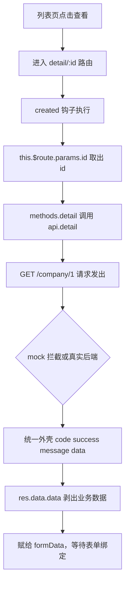

# 企业详情数据层：从地址参数取 id，把详情数据装进表单对象

详情路由已经通了：列表点「查看」，地址栏变成 `/saas-clients/detail/1`，`detail.vue` 成功渲染。但页面只有三个空标签，一个字段都没有。把数据接进来要过三关：页签骨架用 Element UI 的 Tabs 组件搭出来；请求按 ID 查询的接口，把路由参数 id 传过去；响应剥掉两层壳，把业务数据装进表单绑定的数据模型。过程中还埋着一个 mock 拦截顺序的暗坑，控制台打出来的不是详情对象，而是整个列表。

## 先给结论

- 页签用 `el-tabs` 加三个 `el-tab-pane` 构造，`v-model` 绑定的值等于哪个 pane 的 `name`，哪个页签就默认选中。
- 取数固定三步：`created` 里取 `this.$route.params.id`，调 `methods` 里的方法，方法里调 api 的 `detail` 并传 id。
- 响应要剥两层：`res.data` 是 axios 包的响应体，`res.data.data` 才是统一响应外壳里的业务数据，直接赋给 `formData`。
- 最大的坑在 mock：列表的拦截正则 `/company/` 同样命中 `/company/1`，详情请求被列表规则截走返回数组，详情规则必须注册在列表之前。
- `created` 里调用 `methods` 的方法必须写 `this.detail(...)`，漏掉 `this` 不报错，只是沉默地什么都不执行。

## 一、Tabs 页签骨架：v-model 与 name 的对位

详情页原型分成企业信息、账户信息、交易记录三个页签，这种结构不用自己写，Element UI 的 Tabs 组件直接给。组件文档的示例里有一组关键对应关系：`el-tabs` 的 `v-model` 绑着一个数据模型值，每个 `el-tab-pane` 各有一个 `name`，模型值等于哪个 `name`，哪个页签就处于选中态。

从列表页把 `detail.vue` 复制过来时，`import` 的还是 `list`，这里要换成按 ID 查询的 `detail`。搭好的骨架如下：

```vue
<template>
  <div class="dashboard-container">
    <div class="app-container">
      <el-tabs v-model="activeName">
        <el-tab-pane label="企业信息" name="first"></el-tab-pane>
        <el-tab-pane label="账户信息" name="second"></el-tab-pane>
        <el-tab-pane label="交易记录" name="third"></el-tab-pane>
      </el-tabs>
    </div>
  </div>
</template>

<script>
import { detail } from '@/api/base/saasClient'
export default {
  name: 'saas-clients-detail',
  data () {
    return {
      activeName: 'first',
      formData: {}
    }
  },
  methods: {},
  created () {}
}
</script>
```

`activeName` 初始值写 `first`，刷新页面默认停在企业信息这个页签上。想把默认页签换成第二个，把初始值改成 `second` 就行，不用动任何模板。`formData` 在 `data` 里先声明为空对象，它是下一步承接详情数据的容器，先声明再赋值才能保持响应式。

## 二、取数三步：created 取 id，methods 调接口

数据层照旧走那条固定链路，`created` 钩子发起，`methods` 承接，api 模块收尾。上一节已经从动态路由知道参数藏在 `this.$route.params.id` 里，现在把它真正用起来：

```javascript
methods: {
  detail (id) {
    detail({ id }).then(res => {
      // 第一层 data 是 axios 的响应包裹，第二层 data 才是业务数据
      this.formData = res.data.data
      console.log(res.data.data)
    })
  }
},
created () {
  // 动态路由 detail/:id 的参数从这里取
  this.detail(this.$route.params.id)
}
```

`res.data.data` 这串写法值得单独说清。axios 拿到响应后统一包一层 `data`，这是第一层；工程规定所有接口的响应体都是 `code`、`success`、`message`、`data` 这个外壳，业务数据放在外壳的 `data` 字段里，这是第二层。所以真正装进 `formData` 的，是外壳里那个代表企业详情的对象。接口文档里按 ID 查询要求传 id，`detail({ id })` 把路由参数包装成 `data` 传给 api，api 层拼出 `/company/1` 这样的路径。

整个数据流可以用一张图收拢：



链路的终点是 `formData`，页签骨架暂时显示不了它，下一节把表单绑上去就能看见。

## 三、控制台沉默与 mock 正则顺序

第一个现场问题：刷新页面，控制台什么都没打出来。检查代码发现 `created` 里调用方法时少写了 `this`，方法没被找到，也没有任何报错。补上 `this.detail(...)` 再刷新，`console.log` 出东西了，但打出来的不是对象，是一个数组，类型明显不对。

排这个错要把请求的路径和 mock 的匹配规则摆在一起看。api 层发的详情请求是 `/company/1`，而 mock 注册里列表规则的匹配正则是 `company`，它内部按正则表达式做匹配，`/company/1` 恰好落在 `/company` 加一截数字这个形态上，列表正则认为它也是查列表，于是把整个数组塞给了这次请求。修复办法是调整注册顺序，把详情的匹配规则放到列表上面：

```javascript
// src/mock/index.js 中企业相关的注册（示例，按本课工程写法补全）
import companyAPI from '@/api/base/saasClient'

// 详情规则在上：company 后面还跟着一段 id 才算详情
Mock.mock(/company\/\w+/, 'get', companyAPI.sassDetail)
// 列表规则在下：company 结尾的请求才是查列表
Mock.mock(/company$/, 'get', companyAPI.list)
```

`Mock.mock` 的规则按注册顺序匹配，先命中先拦截。两条规则的分工由此拉开：上面这条代表查询详情，下面这条代表查询列表。调整之后再刷新，控制台打出了对象，资料包 mock 文件里 `sassDetail` 处理函数返回的那条「测试企业」详情，已经稳稳落在 `formData` 里。

## 常见误区

- **`created` 里调方法漏写 `this`**：写成 `detail(id)`，组件找不到这个调用点，控制台连报错都没有，只会让你怀疑接口。方法一律 `this.detail(...)` 调用。
- **mock 拦截正则太宽且不分先后**：`/company/` 这样的正则既匹配列表也匹配详情，注册顺序一乱，详情请求被列表规则截走返回数组。详情规则在前、列表规则在后。
- **取错响应层级**：把 `res.data` 整个赋给 `formData`，表单绑定的是外壳而不是业务数据，页面上全是空白。记住剥两层，取 `res.data.data`。
- **`formData` 不在 `data` 里先声明**：事后才挂上去的属性在 Vue 2 里不是响应式的，接口数据到了页面也不刷新。空对象也要先在 `data` 里占位。

## 面试可能被问到的问题

1. 面试官追问：「`res.data.data` 两层 data 分别是什么？」
   答：第一层是 axios 对 HTTP 响应体的包裹，`res.data` 才是后端返回的原始内容；第二层是工程统一的响应外壳，外壳里 `code` 表状态、`message` 表提示、`data` 装真正的业务数据。前端取业务数据时要把两层都剥开。

2. 面试官追问：「为什么在 created 里就能拿到路由参数？」
   答：`created` 执行时组件实例已建立，`$route` 挂在实例上且当前路由已完成匹配，`detail/:id` 声明的参数会填进 `$route.params`。地址变化但组件复用时 created 不会再执行，需要 watch `$route` 重新取数。

3. 面试官追问：「mock 的两条规则都匹配同一个路径前缀，谁先生效？」
   答：按注册顺序匹配，先注册的先拦截。同一资源既要拦截列表又要拦截详情时，把更具体的详情规则放在前面，列表规则收紧到路径结尾，否则宽正则会吞掉后续所有请求。

4. 面试官追问：「详情数据为什么要放进 data 里的 formData，而不是存成普通变量？」
   答：Vue 2 的响应式系统在实例化时递归劫持 data 里的属性，只有声明在 data 中的属性才有 getter 和 setter，赋值才会触发视图更新。挂在实例其他位置的数据变了页面不动，调试还很难发现。

5. 面试官追问：「页签组件的 v-model 和 tab-pane 的 name 是什么关系？」
   答：v-model 绑定的值等于哪个 pane 的 name，哪个页签就选中，两者是受控对位关系。初始化给 `first` 就默认停在第一个页签，点击页签时组件会把对应的 name 写回 v-model 绑定的变量。

## 配套资料

- 企业模块 mock 数据真实文件：`materials/code/02/day02 SAAS-HRM数据库设计与前端框架/3-3 SAAS-HRM数据库设计与前端框架/资源/通用代码/company.js`（`sassDetail` 即按 ID 查询的本地响应，返回 id 为 10001 的「测试企业」详情）
- 企业表结构：`materials/code/02/day02 SAAS-HRM数据库设计与前端框架/3-3 SAAS-HRM数据库设计与前端框架/资源/ihrm.sql`（`co_company` 表，详情字段与 mock 字段一一对应）
- mock 注册规则与 `detail.vue` 数据层代码为按本课工程写法补全的示例，脚手架源码未随资料包提供
