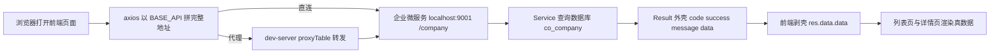

# 前后端联调：关掉 mock，把企业列表指向真实微服务

前端两个页面都齐了，后端企业微服务也开发完了，但两边一直是各跑各的：页面吃 mock，后端被 Postman 验收。联调就是把这层假数据摘掉，让浏览器发出的请求真正穿过网络落到微服务上，再从数据库把数据拉回来。这一步的现场剧情非常固定：注释掉 mock，页面全线 404；配一行环境变量，重启前端服务，数据库里的企业出现在列表页。404 到真数据之间差的，就是前端工程的请求地址配置。

## 先给结论

- 联调第一步是把 `src/mock/index.js` 里企业相关的拦截注册注释掉，Network 面板立刻出现真实请求。
- 404 的根因是请求默认打在前端 dev-server 自己身上：`BASE_API` 没指向后端，`/company` 落在了 `localhost:8080`。
- 把 `config/dev.env.js` 的 `BASE_API` 指向企业微服务 `http://localhost:9001`，请求才真正出网。
- 改 config 必须重启 `npm run dev`，webpack 的环境配置只在启动时读取，热更新对它无效。
- 直连方案要求后端放行跨域（`@CrossOrigin`）；用 `proxyTable` 代理转发则同源天然无跨域，二选一。
- 验收标志：列表页出现数据库 `co_company` 预置的企业，点「查看」详情表单回显真数据。

## 一、关 mock 与 404 现象

mock 拦截的注册点在 `src/mock/index.js`，把企业相关的两条规则整体注释掉：

```javascript
// src/mock/index.js：联调时停用企业模块的拦截
// Mock.mock(/company\/\w+/, 'get', companyAPI.sassDetail)
// Mock.mock(/company$/, 'get', companyAPI.list)
```

刷新页面，列表空白，F12 打开 Network 面板，这次能看到请求了，但每一条都是红色的 404。请求的地址暴露了问题：全部发到了前端工程自己的地址下面，形如 `localhost:8080/api/company`，包括按 ID 查详情的 `company/1` 也一样。后端明明在跑，请求却压根没往那边去。

原因在请求前缀上。api 层写的都是部分路径 `/company`，发出前要拼上环境配置里的前缀变量 `BASE_API`。开发模式下这个前缀没有指向后端微服务，拼出来的地址就落在 dev-server 自己身上，前端工程里当然没有 `/company` 这个接口，404 是必然结果。

## 二、BASE_API：把请求地址指向微服务

环境配置集中在 `config` 目录，`dev.env.js` 管开发联调，`prod.env.js` 管打包发布。联调时把 `BASE_API` 写成完整请求地址，直指企业微服务的端口：

```javascript
// config/dev.env.js：开发联调环境
module.exports = {
  NODE_ENV: '"development"',
  BASE_API: '"http://localhost:9001"'
}
```

企业微服务在本课工程里跑在 9001 端口，`/company` 拼上前缀后变成 `http://localhost:9001/company`，与后端 Controller 声明的路径完全对上。生产环境则在 `prod.env.js` 里换成线上网关地址，api 层代码一行不动。

直连之外还有一条代理路线。`config/index.js` 的 `proxyTable` 能让 dev-server 把指定前缀的请求转发到后端，浏览器始终只跟 dev-server 通信：

```javascript
// config/index.js：代理方案（与直连二选一，示例按主流写法补全）
proxyTable: {
  '/api': {
    target: 'http://localhost:9001',
    changeOrigin: true,
    pathRewrite: { '^/api': '' }
  }
}
```

两条路线的本质区别在跨域上。直连时浏览器从 `localhost:8080` 的页面直接请求 `localhost:9001`，端口不同构成跨域，后端必须放行；工程在搭建阶段已经用 `@CrossOrigin` 解决了这件事：

```java
// 后端企业微服务的 Controller（示例，按本课写法补全）
@CrossOrigin
@RestController
@RequestMapping("/company")
public class CompanyController {

    @GetMapping
    public Result list() {
        // 返回统一外壳 Result，业务数据在 data 字段
        return new Result(ResultCode.SUCCESS, companyService.findAll());
    }
}
```

代理方案里请求从浏览器到 dev-server 是同源，dev-server 再由服务端转发到 9001，服务端之间的请求不受浏览器同源策略约束，天然没有跨域问题。微服务一多，代理配置可以按前缀给每个服务各配一条，统一测试时反而省心。

整条联调链路如下图：



## 三、重启才生效与真数据验收

改完 `dev.env.js` 直接刷新页面，请求还是 404，这不是配置写错，而是 `BASE_API` 这类环境变量在 webpack 启动时注入，运行期间的热更新不会重新读取。停掉当前进程，重新 `npm run dev`，再刷新页面，列表页出现了数据库里的企业。

数据来自资料包提供的 `ihrm.sql`，企业表 `co_company` 预置了若干条记录，其中一条就是列表页上那家「测试企业」：

```sql
-- ihrm.sql 预置的企业数据（企业名按中性示例改写）
-- 列顺序对应 id、name、manager_id、version、renewal_date、expiration_date、
-- company_area、company_address、business_license_id、legal_representative、
-- company_phone、mailbox、company_size、industry、remarks、audit_state、
-- state、balance、create_time
INSERT INTO `co_company` VALUES
('1', '测试企业', 'abc', '12', null, null, null, null, null,
 '张三', null, null, null, null, null, '0', '1', '0', '2018-11-07 13:30:05');
```

随便点一行的「查看」，详情页表单里回显的也是数据库的真实字段，前后端至此完全接通。验收时有一个细节值得看：mock 阶段列表只有 3 条固定的假数据，联调后条数、名称、状态全部跟着数据库走，数据库改一条，页面刷新就变，这才叫真数据。

## 四、联调常见问题清单

前后端第一次接通，问题几乎都出在下面这几处，按这张单子逐项排查能省掉大半时间：

| 现象 | 原因 | 处理 |
|---|---|---|
| Network 面板里没有请求，页面却有数据 | mock 拦截没停用 | 注释 `src/mock/index.js` 里的企业注册规则 |
| 请求 404，地址落在前端工程自身 | `BASE_API` 未指向后端微服务 | `dev.env.js` 写完整地址并确认端口 |
| 改了 config 页面没变化 | 环境配置只在启动时读取 | 停掉进程重新 `npm run dev` |
| 控制台报跨域错误 | 直连方案后端未放行 | 后端加 `@CrossOrigin`，或改用 `proxyTable` 代理 |
| 请求通了但页面字段空白 | 前后端字段命名不一致 | 对照接口文档与数据库列名统一驼峰或下划线 |
| 数据取到但页面 undefined | 响应外壳层级取错 | 剥两层壳，取 `res.data.data` |

## 常见误区

- **联调只关部分 mock**：详情规则注释了、列表规则还在，列表假详情真，页面自相矛盾。切换前把对应模块的拦截全部停用，以 Network 面板有真实请求为准。
- **`BASE_API` 拼错协议或端口**：少写 `http://`、把 9001 写成 9002，请求发到不存在的服务上，报错却长得和后端宕机一模一样。配置改完先在浏览器地址栏敲一遍完整地址验证。
- **以为配置会热更新**：`config` 目录下的环境文件只在构建启动时读取，改完不重启等于没改。
- **联调前不核对字段**：后端按数据库输出下划线风格，前端按 mock 的驼峰风格取值，页面空白还互相怀疑。接口文档是唯一契约，联调第一天就核对。

## 面试可能被问到的问题

1. 面试官追问：「前端项目里 BASE_API 的作用是什么？」
   答：它是按运行环境注入的请求前缀，api 层只写部分路径，运行时拼成完整 URL。开发联调指向本地微服务，打包发布换成线上网关，一套代码完成环境切换，路径集中可审计。

2. 面试官追问：「proxyTable 代理是怎么解决跨域的？」
   答：浏览器与 dev-server 同源，请求先发到 dev-server；dev-server 在服务端把请求转发到真实的后端地址。跨域是浏览器的同源策略限制，服务端之间的转发不受它约束，所以代理方案前端零跨域问题。

3. 面试官追问：「跨域是什么，后端如何放行？」
   答：协议、域名、端口任一不同即构成跨域，浏览器默认拦截非同源响应。后端通过 CORS 响应头放行，Spring 里在 Controller 或全局配置加 `@CrossOrigin`，声明允许的来源、方法与头，浏览器预检通过后放行请求。

4. 面试官追问：「为什么改了环境配置必须重启开发服务？」
   答：`dev.env.js` 这类配置在 webpack 构建启动时以常量形式注入到打包产物里，运行期的热更新只监听业务源码，不重新执行构建配置。配置属于构建期输入，天然需要重启才能生效。

5. 面试官追问：「从 mock 切换到联调，理想情况下要改几处代码？」
   答：两处固定动作：停用 mock 注册，改 `BASE_API` 指向真实服务，业务代码零改动。能做到这一点的前提是 mock 阶段严格按接口契约写路径与字段，否则切换当天就要全量返工。

6. 面试官追问：「联调时页面空白，你的排查顺序是什么？」
   答：先看 Network 面板：没有请求查 mock 是否停用、请求是否发出；有请求看状态码，404 查地址与端口、500 查后端日志；请求 200 再看响应结构，核对字段名与外壳层级。由网络层向数据层逐层收窄，不靠猜。

## 配套资料

- 企业表结构与预置数据：`materials/code/02/day02 SAAS-HRM数据库设计与前端框架/3-3 SAAS-HRM数据库设计与前端框架/资源/ihrm.sql`（`co_company` 表建表语句与预置企业数据，联调验收的数据来源）
- 后端响应外壳与实体：`materials/code/02/day01 SAAS-HRM系统概述与搭建环境/SAAS-HRM系统概述与搭建环境/资源/通用代码/common/Result.java`、`materials/code/02/day01 SAAS-HRM系统概述与搭建环境/SAAS-HRM系统概述与搭建环境/资源/Company.java`（文中包名已改为 `com.example` 视角描述）
- mock 拦截注册、Controller 与 `proxyTable` 配置为按本课工程写法补全的示例，脚手架与微服务源码未随资料包提供
