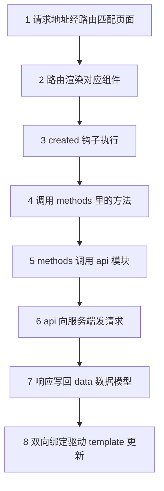
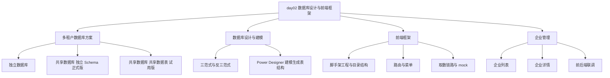

# SaaS-HRM 数据库设计与前端框架全章收束：多租户选型、三范式与前端取数链路的复习地图

这一章的内容分成气质完全不同的两半：前半段是数据库设计，多租户、三范式、建模工具，全是方案与取舍；后半段是前端框架，脚手架、路由、取数链路、mock，一路都在跟组件和配置打交道。前端部分讲得细、节奏枯燥，但整套课程里它是唯一一次把前端掰开揉碎的一章，之后的重心就回到后端与 SaaS 平台的云建设上。复习时与其逐节回看，不如把两条主线各收成一张图、一份对照表，理解了骨架，细节随时能查。

## 先给结论

- 多租户是一种多层租赁的架构思想，一套系统服务多家企业，核心考量是每家企业的数据必须隔离。
- 隔离方案共三种：独立数据库、共享数据库独立 Schema、共享数据库共享数据表。HRM 项目试用版用第三种全共享，正式版升级到第二种。
- 三范式约束设计：列原子、一表一事、消除传递依赖；反三范式允许适度冗余，`bs_user` 表冗余 `company_name`、`department_name` 就是真实案例。
- 前端部分最值钱的资产是那条取数链路与模块开发四步，企业列表和企业详情是它的两次完整演练。
- 全章的验收动作是前后端联调：关 mock、配 `BASE_API`、重启服务，数据库里的企业在页面上跑起来。

## 一、多租户与三种隔离方案

多租户这个词听起来抽象，拆开就是「一栋楼里住了多少户人家」的问题。传统软件一套系统卖一家企业，部署一次服务一个客户；SaaS 模式下一套系统同时服务成百上千家企业，系统是共用的，数据却不能混。谁的数据归谁、别的企业一眼都不许看见，这就是多租户设计要解决的全部问题。

隔离方案按隔离程度从高到低有三种，各自的价格标签完全不同：

| 方案 | 隔离程度 | 成本 | 适用场景 |
|---|---|---|---|
| 独立数据库 | 每家企业一个库 | 最贵，服务器与运维成本线性增长 | 金融、医疗等强隔离需求的大客户 |
| 共享数据库、独立 Schema | 一库里每家企业一个 Schema | 中等，隔离与成本折中 | 正式付费客户，数据要分级隔离 |
| 共享数据库、共享数据表 | 所有企业共表，靠企业 ID 区分 | 最便宜，一个库服务所有租户 | 免费试用版、海量小微企业 |

共享数据表方案的实现特征很鲜明：每张业务表都带一个企业 ID 字段，查询时永远带着这个条件过滤。资料包的 `ihrm.sql` 里随手可验：

```sql
-- 共享数据表方案的隔离字段：业务表全部带企业 ID（节选自 ihrm.sql）
CREATE TABLE `co_department` (
  `id` varchar(40) NOT NULL,
  `company_id` varchar(255) NOT NULL COMMENT '企业ID',
  `pid` varchar(255) DEFAULT NULL COMMENT '父级部门ID',
  `name` varchar(255) DEFAULT NULL COMMENT '部门名称',
  `code` varchar(255) DEFAULT NULL COMMENT '部门编码',
  `create_time` datetime DEFAULT NULL COMMENT '创建时间',
  PRIMARY KEY (`id`)
) ENGINE=InnoDB DEFAULT CHARSET=utf8mb4;
```

`co_department`、`bs_user` 这些表全都带 `company_id`，这就是试用版方案在表结构上的直接体现。三种方案不是互相取代的关系，而是随客户付费等级平滑升级的关系：试用版全共享把成本压到最低，客户转正式版后迁到独立 Schema，大客户再给独立数据库。HRM 项目正是按这个逻辑做的选型。

## 二、三范式与反三范式：从设计约束到刻意冗余

范式是设计表结构时的三条硬约束。第一范式要求每一列保持原子性，一个字段里不塞组合值，电话号码和分机号分开存。第二范式在第一范式之上要求非主字段完全依赖主键，一张表只做一件事，员工信息和员工薪酬不该挤在一张表里。第三范式再进一步消除传递依赖，非主字段之间不许互相依赖，部门电话存在部门表里，员工表只存部门 ID，不把部门电话再抄一遍。

范式把数据冗余压到最低，但查询要付出代价：查员工列表时想顺便显示部门名称，就得连部门表。反三范式是对它的务实修正，允许为了查询效率做适度冗余，空间换时间。这套资料里的真实证据比比皆是：

```sql
-- 反三范式的真实案例：bs_user 直接冗余了企业与部门名称（节选自 ihrm.sql）
`company_id` varchar(40) DEFAULT NULL COMMENT '企业ID',
`company_name` varchar(40) DEFAULT NULL,
`department_name` varchar(40) DEFAULT NULL,
```

员工表里同时存了 `company_id` 和 `company_name`、`department_id` 和 `department_name`，严格按第三范式这是违规的，但员工列表页每次都要展示企业名和部门名，冗余两列文本省掉高频联表，这笔账在真实业务里是划算的。范式是默认遵守的设计底线，反三范式是评估过读写比例后的主动破例，两者不是对错关系，而是先后关系。

建模层面还有一件趁手的工具：Power Designer。画好实体关系模型，工具能直接生成建库建表的脚本，表名、列名、类型、注释一次到位，省去手工逐表敲 SQL 的重复劳动。工具本身操作不难，价值在于把设计成果沉淀成模型图，评审和迭代都有据可依。

## 三、前端框架：链路是唯一的骨架

前端这一章组件和配置讲了十几节，但真正要带走的只有一条链路。一次页面取数，从浏览器地址栏到数据上屏，全程八环：



后面做企业列表、企业详情，做的全是这条链路的填空题：路由怎么配、`created` 里调谁、api 方法叫什么、数据装进哪个模型。开发一个新模块的四步套路也从链路上长出来：建模块配路由、建页面在 `created` 里调 `methods`、建 api 对齐接口文档、用 Element UI 组装页面。组件是拿来就用的工具，链路才是要背下来的骨架。

mock 在这条链路里的位置也值得记住：它寄生在链路第 6 环的分叉点上，路径被拦截规则命中就走本地造数，没命中就走真实请求。开发期后端没就绪，mock 让前端不被卡住；联调时停用注册、配上 `BASE_API`，链路原封不动切到真后端。一套页面代码，两种数据来源，切换只动配置。

## 四、企业管理：链路的两次落地

企业模块是链路的完整演练场。企业列表落地了表格三件套：`el-table` 加数据模型出表格，作用域插槽 `scope.row` 处理操作列，状态列用开关组件绑定企业可用状态。企业详情落地了动态路由与表单：`detail/:id` 接参数，`this.$route.params.id` 取值，api 的 `detail` 按 ID 查询，`res.data.data` 剥两层壳装进 `formData`，`el-form` 的 `:model` 配合 `v-model` 回显，只读字段加 `disabled`，审核与拒绝按钮留作状态更新的练习。

联调收尾时的检查单，值得在下次项目里原样复用：

| 检查项 | 动作 |
|---|---|
| mock 停用 | 注释 `src/mock/index.js` 里对应模块的注册规则 |
| 请求地址 | `config/dev.env.js` 的 `BASE_API` 指向微服务端口 |
| 配置生效 | 改完 config 重启 `npm run dev` |
| 跨域放行 | 直连方案后端加 `@CrossOrigin`，或改用 `proxyTable` 代理 |
| 字段核对 | 前后端字段命名与响应外壳层级逐一对齐 |

全章的知识版图收成一张图，复习时按图索骥：



## 常见误区

- **把多租户理解成「多建几个数据库」**：多租户是一套系统服务多租户的架构思想，独立数据库只是三种隔离方案里的一种，且是成本最高的一种。选型要看客户等级与成本约束，不是隔离越狠越好。
- **试用版与正式版的方案混为一谈**：项目里试用版走共享数据表，正式版走共享数据库独立 Schema，方案跟付费等级走，复习时把对应关系记成一对一组。
- **把范式当教条**：三范式是默认起点，反三范式是评估查询压力后的主动选择。见到冗余字段先问一句「这个冗余服务哪个高频查询」，而不是见冗余就扣分。
- **前端只记组件不记链路**：背了一堆组件属性，换个业务模块就不知从哪下手。组件随查随用，模块开发的四步套路与八环链路才是可迁移的能力。

## 面试可能被问到的问题

1. 面试官追问：「什么是多租户，数据库层面有哪些隔离方案？」
   答：多租户是一套系统实例同时服务多家企业的架构，数据隔离是核心问题。方案有三种：独立数据库，隔离最强成本最高；共享数据库独立 Schema，隔离与成本折中；共享数据库共享数据表，靠租户 ID 字段区分，成本最低。按客户等级与合规要求选型。

2. 面试官追问：「你们的 HRM 项目为什么试用版用共享表，正式版用独立 Schema？」
   答：试用版用户量大、付费意愿未验证，用共享表把单租户成本压到最低，靠 company_id 过滤就能支撑；正式版客户付费了，数据隔离等级要提高，迁到独立 Schema 做到逻辑隔离，为将来升级独立数据库留了台阶。方案随客户生命周期演进。

3. 面试官追问：「三范式分别约束什么，反三范式什么时候用？」
   答：第一范式要求列原子性，第二范式要求非主字段完全依赖主键、一表一事，第三范式要求消除传递依赖。当高频查询因严格范式被迫大量联表时，用反三范式做适度冗余，空间换时间，代价是更新时要维护多处数据一致性。

4. 面试官追问：「员工表里冗余了 company_name 和 department_name，怎么看这个设计？」
   答：这是典型的反三范式应用。员工列表页几乎每次都要显示企业与部门名称，冗余两列文本避免了高频联表查询，读取性能收益明显。同时要接受一致性成本：企业改名时需要同步更新员工表的冗余列，可以用定时任务或更新时联带处理。

5. 面试官追问：「前端从页面到数据整条链路是怎么走的？」
   答：地址经路由匹配到组件，组件的 created 钩子调用 methods 里的方法，方法调用 api 模块封装的请求函数，axios 按环境前缀发出 HTTP 请求，响应经统一外壳剥离后写入 data 数据模型，双向绑定驱动模板更新。八环里任何一环断掉，页面都是空白，排查时按环逐个验证。

6. 面试官追问：「mock 在项目里的价值怎么向团队说明？」
   答：它把前后端的进度依赖解耦：接口契约先行，前端按契约 mock 出假后端独立开发自测，后端按同一契约实现真接口，联调时停用 mock 只改配置。价值不在假数据本身，而在契约驱动下的并行开发效率。

## 配套资料

- 全章数据库设计真实素材：`materials/code/02/day02 SAAS-HRM数据库设计与前端框架/3-3 SAAS-HRM数据库设计与前端框架/资源/ihrm.sql`（`co_company`、`co_department`、`bs_user` 等表，共享表方案的 `company_id` 隔离字段与反三范式冗余列均出自此文件）
- 前端 mock 真实文件：`materials/code/02/day02 SAAS-HRM数据库设计与前端框架/3-3 SAAS-HRM数据库设计与前端框架/资源/通用代码/company.js`（列表与详情两段 mock，响应外壳规范样例）
- 后端公共实体：`materials/code/02/day01 SAAS-HRM系统概述与搭建环境/SAAS-HRM系统概述与搭建环境/资源/通用代码/common/Result.java`（统一响应外壳，前端 `res.data.data` 剥壳的对应物）
- Power Designer 模型文件未随资料包提供，文中建模流程为按本课内容整理
