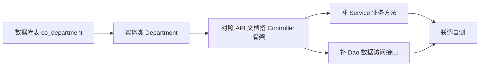

# 部门微服务动工：API 契约、开发步骤与 Department 实体类

需求和表都定稿之后，就轮到 Java 端实现了。动手写代码前有个顺序问题值得想清楚：三层结构里先写哪一层？很多新人的做法是从 Controller 开始一路往下写到 Dao，写到一半发现接口入参和实体对不上，返工重来。课程给出的做法是契约先行：实体类落定，API 文档过一遍，再回头逐层填充代码。

部门管理在系统里的定位也要先明确：它不是独立微服务，而是企业微服务下的一个子模块，实体类因此要放进企业微服务的领域包里。

## 先给结论

- 开发顺序是实体类、Controller、Service、Dao：实体类先行，因为后面每一层的出入参都依赖它；Controller 对照 API 文档搭骨架，用到 Service 和 Dao 时再逐个补。
- `Department` 实体映射 `co_department` 表，用 `@Entity` 与 `@Table(name = "co_department")` 完成 JPA 映射，主键是 String 类型，值由 IdWorker 生成。
- `pid` 字段表达部门父子结构，`companyId` 字段表达部门对企业的归属，这两个字段撑起了整张部门表的架构语义。
- 实体类放在公共模型模块中，多个微服务共享同一份定义，避免每个服务各拷一份后字段漂移。
- 部门接口遵循 RESTful 风格：POST 新增、GET 查询、PUT 修改、DELETE 删除，响应统一为带 code、success、message 的结构。

## 一、开发顺序：契约先行，三层逐层补齐

课程刻意留了个伏笔：公共代码抽取的问题后面单独讲，这一篇先看不抽取时手动写会遇到什么。实现基本 CRUD 遵守的就是经典三层约定， mermaid 把顺序画出来：



图里的关键路径是自上而下的：表结构决定实体，实体和 API 文档决定 Controller 的方法签名，Controller 在编写过程中暴露出对 Service、Dao 的依赖，再回头补齐。这种顺序的最大好处是接口契约稳定，返工概率小。

## 二、先把 API 契约摆在桌面上

API 文档此前已经准备好，这一天重新下发了一份。部门模块共五个接口：

```text
POST   /department                 添加 Department
GET    /department                 Department 全部列表
GET    /department/{departmentId}  根据 ID 查询 department
PUT    /department/{departmentId}  修改 Department
DELETE /department/{departmentId}  根据 ID 删除 Department
```

新增接口的请求字段与实体类字段基本一一对应；查询列表接口的返回结构复杂一些，除数据本身还有 code、success、message 等包装字段，这套统一响应结构此前已封装成 `Result` 对象，Controller 层直接复用。五个接口串起来就是一套标准的增删改查，与此前企业模块的写法一脉相承。

## 三、Department 实体类：注解对着表写

课程资源里提供了现成的工具代码，把 `Department.java` 拷进工程即可，不必手敲。结合建表语句看这份实体（包名已改为 `com.example`）：

```java
package com.example.domain.company;

import lombok.AllArgsConstructor;
import lombok.Data;
import lombok.NoArgsConstructor;

import javax.persistence.Entity;
import javax.persistence.Id;
import javax.persistence.Table;
import java.io.Serializable;
import java.util.Date;

/**
 * (Department)实体类
 */
@Entity
@Table(name = "co_department")
@Data
@AllArgsConstructor
@NoArgsConstructor
public class Department implements Serializable {
    private static final long serialVersionUID = -9084332495284489553L;
    //ID
    @Id
    private String id;
    /**
     * 父级ID
     */
    private String pid;
    /**
     * 企业ID
     */
    private String companyId;
    /**
     * 部门名称
     */
    private String name;
    /**
     * 部门编码，同级部门不可重复
     */
    private String code;
    /**
     * 负责人ID
     */
    private String managerId;
    /**
     * 负责人名称
     */
    private String manager;
    /**
     * 介绍
     */
    private String introduce;
    /**
     * 创建时间
     */
    private Date createTime;
}
```

这份实体有几个值得留意的细节。`@Table(name = "co_department")` 显式指定表名，实体类名是 Department，表名却是带 `co_` 前缀的 `co_department`，不指定就会按默认策略映射出错。`@Data` 负责生成 getter、setter、toString 等模板方法，`@AllArgsConstructor` 与 `@NoArgsConstructor` 成对出现，后者是 JPA 创建实体实例的硬性要求。主键 `id` 没有配自增策略，因为它的值来自应用层，这一点在 Service 编码时会体现。

## 四、pid 与 companyId：两个撑起架构的字段

九个业务字段里，`pid` 和 `companyId` 的分量远比其余字段重。

**第一，`pid` 让部门长成树。** 部门之间是父子关系，`pid` 存父部门的 `id`，顶级部门的 `pid` 可以置为约定的初始值或 null。查询某企业的全部部门后，在内存里按 `pid` 组装就能还原整棵组织树。它不设数据库外键，纯粹的逻辑关联，代价是程序要自己保证引用正确，好处是层级调整只改一个字段。

**第二，`companyId` 让部门认主。** 每一条部门记录都必须回答「我属于哪家企业」，这是 SaaS 共享表方案的隔离字段。它的值不该由前端随意传入，Controller 层保存时会强制设置，后续接上登录体系后从凭证中解析。

**第三，实体类放公共模型模块。** 部门属于企业管理域，实体却不止企业微服务要用：权限模块要按部门分配角色，员工模块要挂部门。`Department.java` 统一放在公共模型模块的 `com.example.domain.company` 包下，各微服务依赖公共模块使用，谁也不许再定义一份，否则字段不同步后接口出入参就对不上。

## 五、不抽公共代码的代价正在累积

按现在的写法，每做一个新模块都要重新定义一遍实体，`Result`、IdWorker 这类工具也要在多个微服务里各放一份，改一处 bug 就要同步 N 份拷贝。课程先让问题自然出现，再引出公共模块抽取的方案，看完后面企业微服务 Controller、Service 的完整实现，动机就会非常清楚。

## 常见误区

- **实体字段名与表列名对不上**：比如实体写 `parentId` 而表列是 `pid`，JPA 默认按驼峰转下划线映射列名，启动即报列不存在。正解是字段名与列名保持一致，或用 `@Column(name = "pid")` 显式指定。
- **只加 `@AllArgsConstructor` 不加 `@NoArgsConstructor`**：JPA 和 JSON 反序列化都需要无参构造器实例化对象，缺了它运行时报实例化失败。两个注解永远成对写。
- **主键用自增思路处理**：给 `id` 配数据库自增或手动赋值递增数字。课程方案是 String 主键加 IdWorker 雪花算法，在微服务与分表场景下不会冲突，实体层不做任何自增配置。
- **实体类直接丢进微服务模块里**：别的服务要用只能再拷一份。放公共模型模块统一依赖，字段变更只改一处。

## 面试可能被问到的问题

1. 面试官追问：「`@Entity` 和 `@Table` 各自的作用是什么？」
   答：`@Entity` 声明这是一个 JPA 管理的持久化实体，会被框架扫描并纳入映射体系；`@Table` 指定实体对应的数据库表名，不写时默认按类名映射。两者配合才能把 Department 类精确映射到 `co_department` 表。

2. 面试官追问：「主键为什么选 String 加雪花算法，而不是数据库自增？」
   答：微服务架构下多个服务可能写同一张表，分库分表后数据库自增必然冲突。雪花算法在应用层生成 64 位全局唯一 id，趋势递增对索引友好，也不通过 id 暴露业务量。

3. 面试官追问：「`@Data` 注解等价于哪些注解？」
   答：它组合了 getter、setter、`toString`、`equals`、`hashCode` 以及 `@RequiredArgsConstructor`。注意它不包含无参构造器，与 `@AllArgsConstructor` 搭配时必须手动补 `@NoArgsConstructor`，否则 JPA 实例化会失败。

4. 面试官追问：「Serializable 接口和 serialVersionUID 有什么用？」
   答：实体对象经常需要在服务间网络传输或缓存序列化，实现 `Serializable` 是序列化的前提。`serialVersionUID` 是版本号，反序列化时校验类结构是否一致，显式声明可以避免类字段微调后因自动生成的版本号变化导致的反序列化异常。

5. 面试官追问：「pid 自关联设计在删除父部门时会有什么问题？」
   答：子部门的 `pid` 会指向一条不存在的记录，树就断了。删除接口要么级联删除全部子孙部门，要么校验存在子部门时禁止删除，课程方案采用后者，删除前先查子部门数量。

## 配套资料

- 实体类工具代码：`materials/code/02/day03 SaaS-HRM系统用户权限设计概述/SaaS-HRM系统用户权限设计概述/资源/工具代码/实体类/Department.java`（正文代码出自此处，包名已改为 `com.example`）
- day13 代码生成器产出的同款实体可对照：`materials/code/02/day13-代码生成器实现/day13-代码生成器实现/资源/测试/生成代码路径/ihrm_company/src/main/java/com/ihrm/system/pojo/Department.java`
- 建表语句：`materials/code/02/day02 SAAS-HRM数据库设计与前端框架/3-3 SAAS-HRM数据库设计与前端框架/资源/ihrm.sql`
