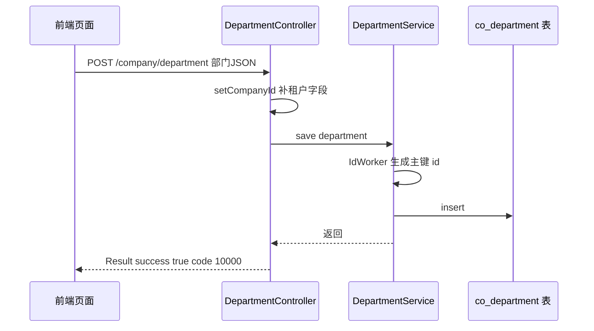

# 保存部门接口：Controller 收口，companyId 由谁说了算

Dao 和 Service 就位后只剩最外层 Web 层。保存部门接口看似只是把参数转给 Service，里面却埋着一个 SaaS 系统特有的决策点：部门必须归属某家企业，企业 id 从哪里来？前端传、写死，还是从登录状态解析？答案直接决定数据隔离是否可靠。

课程的处理很务实：先把接口骨架和固定值跑通，给企业 id 留明确占位，登录体系接入后替换，思路比代码更值得学。

## 先给结论

- `DepartmentController` 类上三个注解各司其职：`@CrossOrigin` 解决跨域，`@RestController` 声明响应走 JSON，`@RequestMapping("/company")` 统一父路径。
- 保存接口完整路径是 `POST /company/department`，POST 请求体 JSON 与 Department 实体字段一一对应，用 `@RequestBody` 直接封装成实体对象。
- `companyId` 由服务端设置而不是前端传入：本期先写死 `"1"` 占位，接入登录后从凭证解析，原则是租户归属字段永远不信前端。
- 返回值统一用 `new Result(ResultCode.SUCCESS)`，枚举里封装了 success、code、message 三个属性，与 API 文档的响应结构对齐。
- 保存链路上 Controller 只做三步：补租户字段、调 Service、包装结果；主键 id 在 Service 层由 IdWorker 生成，Controller 不碰。

## 一、Controller 类上的三个注解

在企业微服务的 controller 包下新建 `DepartmentController`，类声明完成三件事：

```java
package com.example.company.controller;

import com.example.common.entity.Result;
import com.example.common.entity.ResultCode;
import com.example.company.service.DepartmentService;
import com.example.domain.company.Department;
import org.springframework.beans.factory.annotation.Autowired;
import org.springframework.web.bind.annotation.*;

//解决跨域问题
@CrossOrigin
@RestController
@RequestMapping(value = "/company")
public class DepartmentController {

    @Autowired
    private DepartmentService departmentService;
}
```

**第一，`@CrossOrigin` 解决跨域。** 前端开发服务器与后端服务端口不同，属于非同源请求，浏览器默认拦截跨域响应，后端日志却一切正常，新手常被「后端没报错前端却失败」的现象卡住。Controller 上声明跨域许可，响应头带上允许的来源即可。

**第二，`@RestController` 声明全类返回 JSON。** 它等价于 `@Controller` 加 `@ResponseBody`，方法返回值直接写入响应体，不再走视图解析。

**第三，`@RequestMapping("/company")` 定父路径。** 部门管理是企业管理的子项，类级路径加方法级路径拼出 `company` 下的 `department`，层级化 URL 与模块归属一致，一眼能看出接口属于哪个业务域。

## 二、save 方法：从 JSON 到 Result 的三步

对照 API 文档里 POST 新增的定义，save 方法一次成型：

```java
//保存部门
@RequestMapping(value = "/department", method = RequestMethod.POST)
public Result save(@RequestBody Department department) {
    //1.设置保存的企业id：目前写死，接入登录体系后从登录用户中解析
    String companyId = "1";
    department.setCompanyId(companyId);
    //2.调用service完成部门保存
    departmentService.save(department);
    //3.构造返回结果
    return new Result(ResultCode.SUCCESS);
}
```

方法签名里有两个关键点。`@RequestBody` 把请求体 JSON 反序列化成 `Department` 对象，前提是 JSON 字段名与实体属性名一致，新增接口的请求参数恰好与实体字段一致，不需要额外的 DTO 中转。返回类型固定为 `Result`，Web 层响应对象全系统统一。

方法体的三步对应三个职责：设置 `companyId` 补租户归属字段；调用 Service 完成保存，主键生成、落库都在下层完成；`new Result(ResultCode.SUCCESS)` 包装统一响应。整条链路如下：



关键路径在 Controller 那一步 `setCompanyId`：数据库唯一必填的隔离字段在这一刻被固定下来，后面每层都不再关心它从哪来。

## 三、companyId 为什么必须服务端说了算

把「写死 companyId」当成偷懒就低估了这一步。若依赖前端传值，登录 A 企业的用户把请求体里的企业 id 改成 B 企业的，数据就写进了别人的组织架构，SaaS 隔离形同虚设。这是典型的水平越权漏洞，租户归属字段必须由服务端从可信来源获取。

可信来源是登录凭证，认证通过后凭证里携带所属企业 id，保存接口从中解析并覆盖到实体。本阶段认证体系还没搭建，课程用固定值 `"1"` 占位，代码里把位置注释得清清楚楚，将来替换一眼可寻。

部门编码 `code` 的处理原则类似，同级不可重复的校验属于业务规则，落点在 Service 层保存之前，Controller 不掺和业务判断。职责分层清晰，后面加校验、加日志才不会把 Web 层撑爆。

## 四、Result 与 ResultCode：统一响应的最小闭环

API 文档规定列表接口的响应里有 code、success、message 以及 data，这套结构由两个类支撑。枚举 `ResultCode` 定义全部响应码：

```java
public enum ResultCode {

    SUCCESS(true, 10000, "操作成功！"),
    //---系统错误返回码-----
    FAIL(false, 10001, "操作失败"),
    UNAUTHENTICATED(false, 10002, "您还未登录"),
    UNAUTHORISE(false, 10003, "权限不足"),
    SERVER_ERROR(false, 99999, "抱歉，系统繁忙，请稍后重试！");

    //操作是否成功
    boolean success;
    //操作返回码
    int code;
    //提示信息
    String message;

    ResultCode(boolean success, int code, String message) {
        this.success = success;
        this.code = code;
        this.message = message;
    }
}
```

`Result` 是承载这三个属性的响应对象，提供两个常用构造器：

```java
public Result(ResultCode code) {
    this.success = code.success;
    this.code = code.code;
    this.message = code.message;
}

public Result(ResultCode code, Object data) {
    this.success = code.success;
    this.code = code.code;
    this.message = code.message;
    this.data = data;
}
```

保存这类无数据返回的操作走 `new Result(ResultCode.SUCCESS)`；查询操作把结果塞进第二个构造器，data 带着实体或列表出去。前端先看 `success` 布尔值再按 `code` 细分处理，一套解析逻辑适配全部接口。枚举集中管理响应码还有隐性收益：哪些码已启用、各自代表什么，看一眼枚举就是完整清单，代码里不会散落魔法数字。

## 常见误区

- **漏掉 `@CrossOrigin` 后端却毫无感知**：跨域拦截发生在浏览器端，服务端日志干净得像什么都没发生，前端控制台却报 CORS 错误。排查方向别只盯着后端异常栈。
- **用 `@RequestParam` 接 POST 的 JSON 请求体**：JSON 数据在请求体里而不是 URL 参数上，参数永远拿不到 null。请求体 JSON 一律 `@RequestBody`，表单或 URL 参数才用 `@RequestParam`。
- **`companyId` 信任前端传入**：改个请求体就能跨企业写数据，属于必须堵死的越权口。租户字段一律服务端从登录态解析，前端传的一概覆盖。
- **保存接口返回裸实体或随手拼的 Map**：每个接口响应结构都不一样，前端要维护多套解析代码。统一走 `Result` 加 `ResultCode`，结构一致才谈得上统一处理。

## 面试可能被问到的问题

1. 面试官追问：「`@RestController` 和 `@Controller` 有什么区别？」
   答：`@Controller` 标记控制器类，方法返回值默认解析为视图名；`@RestController` 是 `@Controller` 加 `@ResponseBody` 的组合，方法返回值直接写入响应体，适用于前后端分离返回 JSON 的接口。

2. 面试官追问：「跨域是怎么产生的，后端如何解决？」
   答：浏览器同源策略限制非同源页面读取响应，协议、域名、端口任一不同即为非同源。解决方式是服务端在响应头声明 CORS 许可，Spring MVC 里 `@CrossOrigin` 按类或方法粒度添加 `Access-Control-Allow-Origin` 等响应头，网关层也可统一配置。

3. 面试官追问：「多租户系统里 companyId 应该在哪一层设置？」
   答：在 Web 层或统一的拦截器、切面里，从登录凭证解析后写入业务对象，Service 与 Dao 只使用不解析。核心原则是租户归属来自服务端的可信上下文，绝不采信前端提交的租户字段，否则存在水平越权风险。

4. 面试官追问：「为什么要设计统一响应体，直接返回业务对象不行吗？」
   答：统一响应体把 success、code、message、data 固定下来，前端一套解析逻辑适配所有接口，全局异常处理器也能把错误塞进同一结构。裸业务对象无法表达失败语义，出错时前端只能靠 HTTP 状态码去猜。

5. 面试官追问：「部门编码同级唯一这种校验放在哪一层做？」
   答：业务规则放 Service 层，保存前按父部门与编码查询是否已存在，存在则抛业务异常，由统一异常处理器转换为失败响应。Controller 只负责收参与结果包装，规则可以被任何入口复用。

## 配套资料

- Controller 成例（day13 代码生成器产物，与本课写法一致）：`materials/code/02/day13-代码生成器实现/day13-代码生成器实现/资源/测试/生成代码路径/ihrm_company/src/main/java/com/ihrm/system/controller/DepartmentController.java`
- 统一响应类：`materials/code/02/day01 SAAS-HRM系统概述与搭建环境/SAAS-HRM系统概述与搭建环境/资源/通用代码/common/Result.java` 与同目录 `ResultCode.java`（正文代码出自此处，包名已改为 `com.example`）
- IdWorker 工具类：`materials/code/02/day01 SAAS-HRM系统概述与搭建环境/SAAS-HRM系统概述与搭建环境/资源/通用代码/IdWorker.java`
