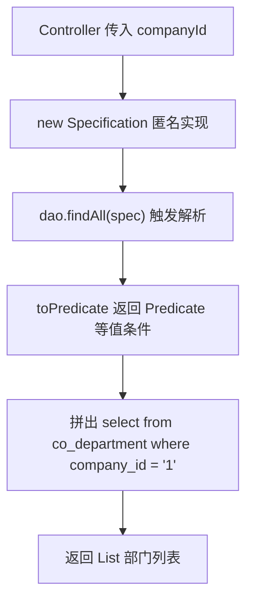

# 按企业查部门列表：Specification 条件构造与定制响应对象

查询全部部门的接口一跑起来就会发现两处不对劲。其一，`findAll` 把数据库里所有企业的部门一起返回，A 企业的管理员能看到 B 企业的组织架构，SaaS 的数据隔离形同虚设；其二，接口文档规定的 data 不是部门数组，而是一个「企业信息加部门列表」的复合对象，与 Department 实体直接对不上。查询条件与返回结构两件事，正好构成这一节的全部内容：条件交给 Specification 动态构造，结构交给专门的响应对象承载。

## 先给结论

- 列表接口是 `GET /company/department`，Controller 先钉住 companyId，再分别查企业对象与部门列表，最后组装复合响应。
- 按企业过滤改用 `Specification` 构造条件：`cb.equal(root.get("companyId").as(String.class), companyId)` 一行生成等值查询。
- `toPredicate` 的三个参数各管一摊：root 提供实体属性入口，cq 承担高级查询组合，cb 提供等值、模糊、比较等全部条件算子。
- Dao 继承的 `JpaSpecificationExecutor` 自带分页与非分页两套重载：`findAll(spec)` 返回 List，`findAll(spec, pageable)` 返回携带总条数的 Page。
- 接口文档的复合结构由 `DeptListResult` 承载：companyId、companyName、companyManage 加部门数组，构造时从 Company 对象拷贝属性，实体类保持纯粹。

## 一、接口骨架：还是先钉住 companyId

按接口文档，查询企业下的部门列表是 GET 方式，路径与保存接口同源。Controller 骨架先落下来：

```java
/**
 * 查询企业的部门列表
 * 指定企业id
 */
@RequestMapping(value = "/department", method = RequestMethod.GET)
public Result findAll() {
    //1.指定企业id：目前写死占位，接入登录体系后从登录用户中解析
    String companyId = "1";
    //2.查询企业
    Company company = companyService.findById(companyId);
    //3.查询该企业的部门列表
    List<Department> list = departmentService.findAll(companyId);
    //4.构造返回结果
    DeptListResult deptListResult = new DeptListResult(company, list);
    return new Result(ResultCode.SUCCESS, deptListResult);
}
```

与保存接口同一个原则：租户归属字段由服务端决定，前端不传 companyId。方法体四步走完，真正要补的只有两块，Service 里带条件的 `findAll(companyId)`，以及承载复合结构的 `DeptListResult`。

## 二、Specification：把 where 条件写成代码

现有 Service 的 `findAll()` 是无条件的，直接改造为接收 companyId 的版本。Spring Data JPA 的 Dao 从 `JpaSpecificationExecutor` 继承了带条件查询的入口，条件本身用 `Specification` 接口描述：

```java
public List<Department> findAll(String companyId) {
    //构造查询条件：只根据companyId查询
    Specification<Department> spec = new Specification<Department>() {
        @Override
        public Predicate toPredicate(Root<Department> root, CriteriaQuery<?> cq,
                                     CriteriaBuilder cb) {
            //根据企业id等值查询
            return cb.equal(root.get("companyId").as(String.class), companyId);
        }
    };
    return departmentDao.findAll(spec);
}
```

为什么放着方法名派生的 `findByCompanyId` 不用，绕一道 Specification？因为员工、角色等后续微服务全都要按 companyId 过滤，而 Specification 是接口，不绑定具体实体，下一节就能把它抽成泛型工具供所有 Service 复用。方法名派生查询每个实体都要单独声明一个方法，抽不起来。

`toPredicate` 的三个参数值得逐个说清。**root 是实体属性的入口。** 查询条件最终要落到「某个属性等于某个值」，属性从 `root.get("companyId")` 拿到，注意写的是实体属性名而不是数据库列名。**cq 是高级查询的载体。** 分组、去重、多条件组合这类操作靠它完成，当前的单条件查询用不上。**cb 是条件算子的集合。** 等值用 `equal`，还有 `like`、`not`、`greaterThan`、`lessThanOrEqualTo` 等，与 SQL 的 where 算子一一对应，只是换成了面向对象的写法。

整条链路串起来是这样：



关键路径在最后一步生成的 SQL：传入的 companyId 值被拼成字符串常量 `where company_id = '1'`，其他企业的数据在这层就被挡住了。

## 三、findAll 的重载家族：分页与非分页两种返回

`findAll` 不止一个重载，`JpaSpecificationExecutor` 接口把全家成员都列在那里：

```java
public interface JpaSpecificationExecutor<T> {
    Optional<T> findOne(Specification<T> spec);          //查一条
    List<T> findAll(Specification<T> spec);              //条件查全部，非分页
    List<T> findAll(Specification<T> spec, Sort sort);   //条件查全部，带排序
    Page<T> findAll(Specification<T> spec, Pageable pageable); //条件分页查询
    long count(Specification<T> spec);                   //按条件计数
}
```

非分页的 `findAll(spec)` 返回 `List<T>`，适合数据量可控的场景，本课的组织架构列表就走这条路。分页版本多收一个 `Pageable`，返回 `Page<T>`，对象里除了当前页数据还带总条数、总页数，前端分页条需要的信息一次到位。两种返回怎么选，看的是数据规模：部门列表撑死几十条，List 直接回；将来员工列表动辄上万，必须切 Page。接口留好了扩展位，切换时只需换一个重载。

## 四、DeptListResult：让响应长成文档要的样子

接口文档里 data 的结构是四层：companyId、companyName、companyManage，外加部门数组 depts。这不是 Department 实体，也不该硬塞给实体。在 domain 包下单开一个 response 子包，放响应专用的对象：

```java
package com.example.domain.company.response;

import com.example.domain.company.Company;
import com.example.domain.company.Department;
import lombok.Getter;
import lombok.NoArgsConstructor;
import lombok.Setter;
import java.util.List;

@Getter
@Setter
@NoArgsConstructor
public class DeptListResult {
    private String companyId;
    private String companyName;
    private String companyManage;
    private List<Department> depts;

    public DeptListResult(Company company, List<Department> list) {
        this.companyId = company.getId();
        this.companyName = company.getName();
        this.companyManage = company.getLegalRepresentative();
        this.depts = list;
    }
}
```

带一个接收 Company 与部门集合的构造方法，拷贝属性的动作在构造时一次做完，Controller 里一行 `new DeptListResult(company, list)` 就组装完毕。companyManage 装的是企业联系人，取自 Company 的法定代表人字段，实体里没有现成的对应属性，这正是响应对象存在的理由：接口需要什么就暴露什么，数据库长什么样不外泄。这套对象常被叫作 VO，与实体的隔离让两边可以各自演化，加展示字段不动表，改表结构不动接口契约。

## 常见误区

- **`root.get` 写成列名**：`root.get("company_id")` 直接抛异常，这里走的是实体属性，必须写 `companyId`。属性到列的映射由 JPA 完成，不要替它做一遍。
- **改造后忘了把 spec 传给 Dao**：Service 里 new 了半天条件，返回时仍写 `findAll()`，等于白构造，全表数据照旧漏出去。条件对象一定要传进 `findAll(spec)`。
- **把 `as(String.class)` 当多余代码删掉**：它是把属性值显式按字符串比对，属性类型与传入值类型存在不一致风险时这层声明是保险，删掉后在某些字段类型下比对语义会变。
- **响应直接返回 `List<Department>`**：前端拿不到企业名，接口文档的契约也被打破。复合结构必须有专门的响应对象承接，实体不直接出门。

## 面试可能被问到的问题

1. 面试官追问：「方法名派生查询和 Specification 怎么选？」
   答：固定条件的简单查询用方法名派生，编译期即可校验，直观且零样板。条件在运行期才确定、需要动态拼接、或者要在多个实体间复用同一段过滤逻辑时，用 Specification。两者可以共存，复杂度上来了再升级。

2. 面试官追问：「`toPredicate` 的三个参数分别做什么用？」
   答：root 代表查询的实体根，通过 get 拿到属性路径表达式；CriteriaQuery 承载更高级的查询结构，如分组、去重、distinct；CriteriaBuilder 是条件工厂，提供 equal、like、between、大于小于等算子，返回的 Predicate 就是最终拼进 where 的条件。

3. 面试官追问：「`findAll` 返回 List 和返回 Page 有什么区别？」
   答：List 只是结果集合，分页信息全靠调用方自己算；Page 除当前页数据外还携带总条数、总页数、是否首页末页等元信息，分页查询还自动追加 count 语句。数据量小的管理列表用 List 够用，数据量大、前端有分页条的必须用 Page。

4. 面试官追问：「接口返回为什么要专门设计一个响应对象，直接吐实体不行吗？」
   答：实体对应表结构，直接暴露会把数据模型锁死在接口契约上，加展示字段或改表都牵连前端。响应对象按接口文档定义字段，敏感字段不外泄，展示属性可自由补充，实体与契约解耦后两侧各自演化。

5. 面试官追问：「SaaS 系统里列表接口的数据隔离一般怎么做？」
   答：所有业务表带租户字段，查询在统一的层强制追加租户条件，条件来源是服务端登录上下文而不是前端参数。手写场景在 Specification 里拼 companyId，规模大后可下沉到 Hibernate 的 filter 或 MyBatis 拦截器统一处理，杜绝某个接口忘加条件导致越权。

## 配套资料

- Department 实体类（正文条件里的 `companyId` 属性出处）：`materials/code/02/day03 SaaS-HRM系统用户权限设计概述/SaaS-HRM系统用户权限设计概述/资源/工具代码/实体类/Department.java`
- DeptListResult 响应对象（正文代码出自此处，包名已改为 `com.example`）：`materials/code/02/day03 SaaS-HRM系统用户权限设计概述/SaaS-HRM系统用户权限设计概述/资源/工具代码/实体类/response/DeptListResult.java`
- 部门 Controller、Service、Dao 成例对照（day13 代码生成器产物，无条件 findAll 为其形态）：`materials/code/02/day13-代码生成器实现/day13-代码生成器实现/资源/测试/生成代码路径/ihrm_company/src/main/java/com/ihrm/system/controller/DepartmentController.java`
- 正文按 companyId 过滤的 `findAll` 为课程视频主线写法补全，Specification 写法以视频画面为准，资料包内无对应的 Service 源文件
