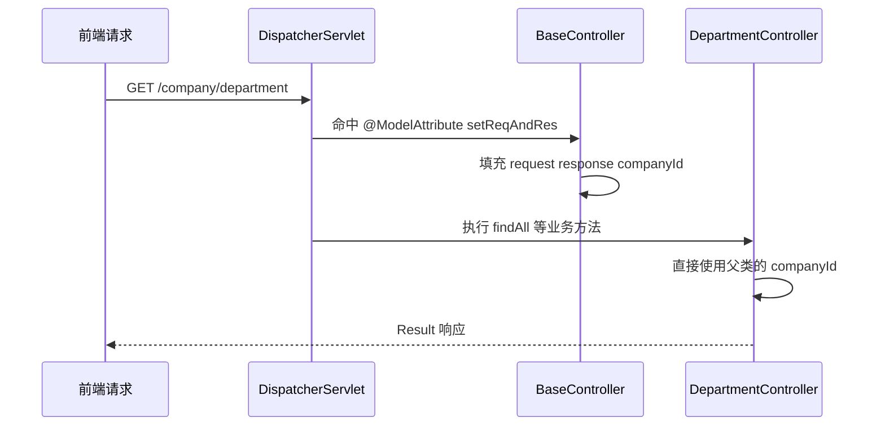

# 抽取公共代码：BaseController 与 BaseService 把 companyId 收敛到一处

部门微服务五个接口写完，回头看代码里有两块在不断重复：每个 Controller 都要声明一遍 companyId 占位值，每个 Service 都要手写一遍按企业过滤的 Specification。员工微服务、角色微服务、系统微服务马上都要开工，它们的需求一模一样，复制粘贴下去，改一次租户解析逻辑就要全局搜替换。趁模块还少，把公共逻辑下沉到 common 模块，是此刻最划算的一次重构。

## 先给结论

- 抽取的判断标准有三条：只按 companyId 查询、大量地方都要按 companyId 查、大量实体都有 companyId 属性，三条全中才值得下沉。
- `BaseController` 用 `@ModelAttribute` 标注的方法在每个 Controller 方法执行前运行，统一填充 request、response、companyId、companyName。
- `BaseService<T>` 是带泛型的父类，`getSpec(companyId)` 返回 `Specification<T>`，子类继承后一行拿到按企业查询的条件。
- 公共类放 common 模块，pom 里要补 `spring-boot-starter-data-jpa` 依赖，否则 Specification 的包都导不进来。
- 改完用 Postman 联调验收：查列表、查单条两个请求通了，说明抽取没有破坏任何现有行为。

## 一、@ModelAttribute：进 Controller 方法之前先干一件事

Controller 层的公共逻辑装进一个父类。在 common 包下新建 `BaseController`：

```java
package com.example.common.controller;

import org.springframework.web.bind.annotation.ModelAttribute;

import javax.servlet.http.HttpServletRequest;
import javax.servlet.http.HttpServletResponse;

public class BaseController {

    protected HttpServletRequest request;
    protected HttpServletResponse response;
    //企业id：目前使用固定值占位，接入登录体系后从登录用户中解析
    protected String companyId = "1";
    protected String companyName = "示例科技有限公司";

    @ModelAttribute
    public void setReqAndRes(HttpServletRequest request, HttpServletResponse response) {
        this.request = request;
        this.response = response;
    }
}
```

`@ModelAttribute` 标注在方法上时，含义是「进入本类所有 Controller 方法之前，先执行我」。子类一继承，每个请求进来都会先跑一遍 `setReqAndRes`，request 与 response 就挂到了父类的 protected 字段上，子类的方法里随手可用。companyId 与 companyName 先以固定值占位，认证体系接进来后只需改这一处，所有子类自动生效，这正是把占位值收敛到父类的全部意义。字段用 `protected` 修饰，只对子类开放，不污染对外接口。

执行顺序用一张时序图看清：



关键路径在中间两步：业务方法执行之前父类逻辑已经跑完，子类拿到的是填充完毕的现成字段。

子类接入只有一行改动。`DepartmentController` 加上 `extends BaseController`，方法体里自己声明的 companyId 全部删掉：

```java
@CrossOrigin
@RestController
@RequestMapping(value = "/company")
public class DepartmentController extends BaseController {

    @RequestMapping(value = "/department", method = RequestMethod.POST)
    public Result save(@RequestBody Department department) {
        //直接使用父类的 companyId
        department.setCompanyId(companyId);
        departmentService.save(department);
        return new Result(ResultCode.SUCCESS);
    }
}
```

## 二、BaseService：泛型化的按企业查询

Service 层的重复更为实质：每家微服务都要按 companyId 过滤，而每家实体的类型都不一样。把 Specification 的构造逻辑抽进 `BaseService`，用泛型 `T` 代表「未来某个实体」：

```java
package com.example.common.service;

import org.springframework.data.jpa.domain.Specification;

import javax.persistence.criteria.Predicate;

public class BaseService<T> {

    protected Specification<T> getSpec(String companyId) {
        Specification<T> spec = new Specification<T>() {
            @Override
            public Predicate toPredicate(Root<T> root, CriteriaQuery<?> cq,
                                         CriteriaBuilder cb) {
                //根据企业id等值查询
                return cb.equal(root.get("companyId").as(String.class), companyId);
            }
        };
        return spec;
    }
}
```

泛型不是装饰。Specification 本身带类型参数，`Specification<T>` 与实体的对应关系靠泛型传导，DepartmentService 继承 `BaseService<Department>` 之后，`getSpec` 返回的就是 `Specification<Department>`，类型在编译期就对得上。这段代码成立有三条前提，抽取当初就是照着它们做的：查询条件只有 companyId 一项，过滤逻辑单一稳定；各类业务大量按 companyId 查，复用频次够高；参与复用的实体全部具有 companyId 属性，`root.get("companyId")` 才不会落空。任何一条不满足，抽象就成了负担。

Specification 用到了 Spring Data JPA 的类，而 common 模块原本不含持久层依赖，pom 里必须补上：

```xml
<parent>
    <artifactId>hrm-parent</artifactId>
    <groupId>com.example</groupId>
    <version>1.0-SNAPSHOT</version>
</parent>
<artifactId>hrm-common</artifactId>

<dependencies>
    <!--common 里要用 Specification，引入 Spring Data JPA-->
    <dependency>
        <groupId>org.springframework.boot</groupId>
        <artifactId>spring-boot-starter-data-jpa</artifactId>
    </dependency>
</dependencies>
```

子类的变化同样是一行继承加一次调用：

```java
@Service
public class DepartmentService extends BaseService<Department> {

    public List<Department> findAll(String companyId) {
        //一行拿到按企业查询的条件
        Specification<Department> spec = getSpec(companyId);
        return departmentDao.findAll(spec);
    }
}
```

原先十几行的匿名内部类从业务代码里消失，DepartmentService 的 `findAll` 只剩两行业务语义。

## 三、联调测试：抽取之后照常能跑

重构的最后一步是证明没改坏。启动企业微服务的引导类，main 方法里 `SpringApplication.run` 拉起容器，配置类里注册 IdWorker 的 `@Bean`，雪花算法主键生成器就绪。测试用 Postman 打两个请求：

```bash
# 查询企业的部门列表
curl http://localhost:9001/company/department
# 按id查询部门
curl http://localhost:9001/company/department/105238836272664578
```

列表请求返回统一响应外壳，data 里是企业信息加部门数组；单条请求返回对应部门的完整字段。两个请求都通，说明 `@ModelAttribute` 的预填充没有干扰业务方法，`BaseService` 的条件构造生成的 SQL 与抽取前完全一致。公共代码抽取的全部价值在下一批微服务开工时兑现：新模块的 Controller 继承、Service 继承，两行写完就自带租户上下文与过滤条件。

## 常见误区

- **把 `@ModelAttribute` 方法当成普通工具方法随便调用**：它由 Spring MVC 在每次请求映射时自动触发，业务代码里再手动调用一次等于重复赋值。理解成「框架回调」而不是「我的 helper」。
- **BaseService 不加泛型**：写死 `Specification<Object>` 或裸用 Specification，子类调用时类型对不上，编译期就报错。泛型在父类声明、子类继承时绑定具体实体。
- **common 模块忘了引入 data-jpa 依赖**：Specification、Root、CriteriaBuilder 这些类全在 Spring Data JPA 里，缺依赖连编译都过不去，报的却是找不到 javax.persistence 的符号，容易误判成 JPA 版本问题。
- **把一切公共逻辑都往父类塞**：只有满足「多模块通用、逻辑稳定、字段通用」三条件才下沉，某家微服务独有的判断塞进父类，等于让所有子类背上无关逻辑。

## 面试可能被问到的问题

1. 面试官追问：「`@ModelAttribute` 标注在方法上是什么作用？」
   答：Spring MVC 在调用该 Controller 的每个业务方法之前先执行它，常用于统一填充公共数据或预处理请求参数。配合父类使用时，子类所有请求进入业务逻辑前都会先完成父类字段的赋值，相当于一次声明、处处生效的前置钩子。

2. 面试官追问：「父类字段里放 request、response 会不会有线程安全问题？」
   答：Spring MVC 默认 Controller 是单例，但每次请求的 request、response 是当前线程绑定的独立对象，赋值后立即在同一次请求内使用，请求结束引用即被覆盖，正常使用不会串。风险在于异步线程或延迟读取时引用可能指向别一次请求，这类场景要改用方法参数显式传递。

3. 面试官追问：「公共代码下沉到独立模块，依赖该怎么设计？」
   答：common 模块只放被多方复用的实体、响应结构、异常与工具基类，依赖保持最小集，用到 Specification 就引 spring-data-jpa，不引入 Web 或数据库驱动等业务模块才需要的东西。业务模块按需依赖 common，方向永远从业务指向公共，避免反向依赖造成循环。

4. 面试官追问：「泛型父类里的 Specification 为什么能在子类正常工作？」
   答：`BaseService<T>` 声明时只定义类型占位，子类继承时指定 `BaseService<Department>`，Java 的泛型擦除发生在编译期，父类方法签名中的 T 被替换为具体实体类型，编译器保证了 `getSpec` 返回类型与 Dao 泛型一致。运行期 root.get 按实际实体的元模型解析属性。

5. 面试官追问：「抽取公共代码的时机和标准你怎么把握？」
   答：重复出现两三次且逻辑稳定时才抽，过早抽象容易把还不成熟的假设固化进父类。标准是三问：是否多个模块都要用、逻辑是否会频繁变化、是否绑定在通用字段或通用结构上。三条都成立就下沉到 common，否则先容忍局部重复，等模式清晰再动手。

## 配套资料

- 部门 Controller、Service 成例对照（day13 代码生成器产物，继承式改造前的形态）：`materials/code/02/day13-代码生成器实现/day13-代码生成器实现/资源/测试/生成代码路径/ihrm_company/src/main/java/com/ihrm/system/service/DepartmentService.java`
- Department 实体类（companyId 属性是全部抽取逻辑的支点）：`materials/code/02/day03 SaaS-HRM系统用户权限设计概述/SaaS-HRM系统用户权限设计概述/资源/工具代码/实体类/Department.java`
- IdWorker 工具类（启动测试时注册为 Bean 的雪花主键生成器）：`materials/code/02/day01 SAAS-HRM系统概述与搭建环境/SAAS-HRM系统概述与搭建环境/资源/通用代码/IdWorker.java`
- 正文 BaseController、BaseService 及 common 模块 pom 为课程视频主线写法补全，资料包内无对应源文件
