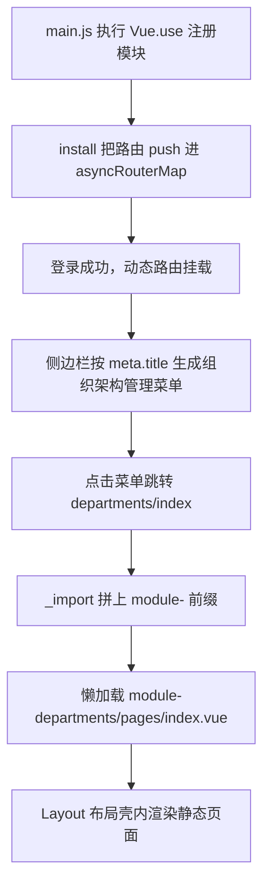

# 部门前端模块开工：复制 module-departments，注册模块挂上路由

后端部门微服务的增删改查已经闭环，接下来切到前端。新业务模块在前端工程里的落地有一套固定动作，这一节只做第一步：把组织架构模块挂进工程，验收标准很朴素，登录后左侧菜单出现「组织架构管理」，点进去能看到美工给出的静态页面。数据请求和增删改查留到后续步骤，骨架先行。

## 先给结论

- 前端开发的固定五步：建模块、写 api、页面跳转取数测试、美化页面、完成增删改查，每步验收再进下一步。
- 模块即目录：`module-departments` 下四个部件，index.js 模块入口、router 路由表、store 状态、pages 页面。
- 注册只需两行，`main.js` 里 `import` 模块后 `Vue.use(departments, store)`，install 内部把模块路由 push 进 `asyncRouterMap`。
- 路由的 `meta.title` 与 `meta.icon` 直接决定左侧菜单的文字与图标，配置路由即配置菜单。
- 启动报错先想到依赖：`node_modules` 缺失或残缺时，重新 `cnpm install` 再 `npm run dev`。

## 一、前端开发的固定五步

企业模块当天走过一遍的流程，部门模块照抄不变，顺序本身就是方法论：

1. 建模块：搭出 `module-departments` 的目录骨架。
2. 写 api：封装与后端 `/company/department` 系列接口对应的请求函数。
3. 跳转取数：页面 created 钩子调 api，请求真实后端验证数据链路。
4. 美化页面：样式结构按设计稿补齐。
5. 增删改查：列表、新增、修改、删除逐个接上。

第 2 步以后每一步都依赖第 1 步的骨架，模块挂不上、菜单出不来，后面全是空谈。

## 二、module-departments 里有什么

新模块可以拿现成模块复制改名，也可以从零手搓，本课为省时间直接使用准备好的模块，结构与 day02 的 demo 模块完全同构：

```text
module-departments/
├── index.js          # 模块入口，install 时注册路由
├── router/index.js   # 模块路由表
├── store/app.js      # 模块级状态，当前为空
└── pages/index.vue   # 页面骨架，美工给出的静态结构
```

模块入口 `index.js` 是注册动作的执行者：

```javascript
// vue-router
import {asyncRouterMap} from '@/router'
import routerMaps from './router'
// vuex
import app from './store/app'

export default {
  install(module, store) {
    // 注册路由
    asyncRouterMap.push(routerMaps[0])
    // 注册状态管理
    if (store !== undefined) {
      // store.registerModule('app', app)
    }
  }
}
```

路由表 `router/index.js` 定义模块的访问地址与菜单外观（资料包真实文件）：

```javascript
import Layout from '@/module-dashboard/pages/layout'
const _import = require('@/router/import_' + process.env.NODE_ENV)

export default [
  {
    root: true,
    path: '/departments',
    component: Layout,
    redirect: 'noredirect',
    name: 'departments',
    meta: {
      title: '组织架构管理',
      icon: 'architecture'
    },
    children: [
      {
        path: 'index',
        component: _import('departments/pages/index'),
        name: 'organizations-index',
        meta: {title: '组织架构', icon: 'architecture', noCache: true}
      }
    ]
  }
]
```

父路径 `/departments` 套子路径 `index`，拼出完整访问地址 `departments/index`；`component: Layout` 声明页面渲染在框架的布局壳里，左侧菜单与顶栏都在壳上。`pages/index.vue` 目前是纯静态结构，`el-card` 加 `el-tabs` 搭出「组织结构」页签与导入导出按钮的骨架，树形列表的坑位已经留好，样式类一应俱全，等数据接进来直接填。

## 三、注册模块与路由挂载

模块写好了不注册就是死代码。`src/main.js` 里两行完成注册：

```javascript
import departments from '@/module-departments/'
Vue.use(departments, store)
```

`Vue.use` 触发模块的 `install`，`asyncRouterMap.push(routerMaps[0])` 把 `/departments` 这条路由挂进业务路由表，登录守卫放行后动态路由生效，侧边栏遍历路由表按 `meta.title` 渲染出「组织架构管理」菜单。`_import('departments/pages/index')` 里的路径没有 module 前缀是刻意的，`_import` 函数自动拼上 `module-`，实际指向 `module-departments/pages/index.vue`。整条挂载链路如下：



关键路径在最后两步：菜单能点、页面能开，靠的是路径约定一处不差，目录名 `module-departments` 与 `_import` 的前缀拼接严格对应，改名或挪目录都会白屏。

## 四、启动踩坑与验收

`npm run dev` 启动时抛了错误，原因不复杂：`node_modules` 里的依赖此前被误删了一部分。前端的依赖目录出了问题，重装即可：

```bash
# 重新安装依赖
cnpm install
# 再启动开发服务器
npm run dev
```

启动成功后浏览器访问 `localhost:8080`，登录进入工作台，左侧菜单已经多出「组织架构管理」。点进去，`el-card` 包裹的静态页如约出现，导入导出按钮、组织结构页签、负责人区域俱全。到这一步，第 1 步「建模块」验收通过。

## 五、下一步：api/department.js 占好位置

按五步走法，下一个动作是在模块下补 api 文件，把后端五个接口封装成请求函数。写法沿用企业模块的封装套路（此段为按本课写法补全的示例，下一课接入真实数据）：

```javascript
import { createAPI, createFormAPI } from '@/utils/request'

// 查询企业的部门列表：GET /company/department
export const list = data => createAPI('/company/department', 'get', data)

// 根据id查询部门详情：GET /company/department/{id}
export const detail = data => createAPI(`/company/department/${data.id}`, 'get', data)

// 保存部门：POST /company/department
export const save = data => createFormAPI('/company/department', 'post', data)

// 根据id修改部门：PUT /company/department/{id}
export const update = data => createFormAPI(`/company/department/${data.id}`, 'put', data)

// 根据id删除部门：DELETE /company/department/{id}
export const remove = data => createAPI(`/company/department/${data.id}`, 'delete', data)
```

路径、请求方式、参数位置三样全部对齐后端接口文档，前端 api 与后端 Controller 的映射关系一目了然。day02 的 mock 文件 `company.js` 演示过统一响应外壳 `code、success、message、data` 的解析姿势，部门模块返回的正是同一套外壳，取数逻辑可以整套平移。

## 常见误区

- **模块目录名与 `_import` 前缀约定脱节**：目录改成 `department-module`，`_import('departments/pages/index')` 拼出的路径指向不存在的文件，页面白屏。目录命名遵守 `module-业务名` 约定。
- **只复制目录不注册模块**：文件齐全但 `main.js` 里没有 `Vue.use`，install 不执行，`asyncRouterMap` 里没有这条路由，菜单永远出不来。目录存在与模块注册是两件事。
- **依赖报错先怀疑代码**：`npm run dev` 一启动就抛模块找不到，多半是 `node_modules` 残缺，与业务代码无关。先 `cnpm install` 重装依赖，再查代码。
- **路由写了 `meta.title` 却不显示菜单**：父路由漏了 `root: true` 或 component 没指向 Layout，菜单渲染遍历不到这条路由。菜单是路由表的投影，查菜单问题先查路由配置。

## 面试可能被问到的问题

1. 面试官追问：「前端工程里模块化的目录设计有什么好处？」
   答：每个业务模块自带入口、路由、状态、页面四件套，模块对内自治、对外只暴露一个 install 接口。新增业务复制骨架改配置即可，删除业务移除注册即净，公共框架层保持稳定，多人协作时模块间几乎不产生文件冲突。

2. 面试官追问：「`Vue.use` 做了什么，为什么模块要提供 install 方法？」
   答：`Vue.use` 检测插件对象是否提供 install 方法，有则以插件实例与传入参数调用它。模块在 install 里完成路由注册与状态注册两件事，注册时机统一由框架调度，模块自身不需要感知应用初始化的细节，天然解耦。

3. 面试官追问：「菜单为什么不用单独配置，跟着路由走有什么讲究？」
   答：侧边栏组件遍历路由表，把带 `meta.title` 且未标记 hidden 的路由渲染成菜单项，路由即菜单的单一数据源。好处是权限控制时按规则过滤路由表，菜单自动跟着收缩，不会出现「路由可达但菜单藏不住」或「菜单在点进去 404」的错位。

4. 面试官追问：「`_import` 这种按需加载函数解决什么问题？」
   答：它把传入的模块内路径统一拼上约定前缀并转成动态 import，路由命中时才加载对应 `.vue` 文件。首屏不必打包全部业务页面，代码按模块切分，同时集中维护了路径拼接规则，前缀变更只改一处。

5. 面试官追问：「前端新模块联调前，api 层要做什么对齐？」
   答：路径与后端 Controller 的 RequestMapping 逐条核对，请求方式与后端声明一致，参数位置对齐：路径参数拼进 URL，请求体走 data。字段命名风格也要约定，后端下划线还是驼峰，转换收敛在拦截器或序列化层统一做，避免每个组件各自为战。

## 配套资料

- 部门前端模块真实文件（正文入口与路由代码出自此处）：`materials/code/02/day03 SaaS-HRM系统用户权限设计概述/SaaS-HRM系统用户权限设计概述/资源/前端代码/module-departments/index.js`，同目录下 `router/index.js`、`store/app.js`、`pages/index.vue`
- 企业模块 mock 数据（统一响应外壳的解析参照）：`materials/code/02/day02 SAAS-HRM数据库设计与前端框架/3-3 SAAS-HRM数据库设计与前端框架/资源/通用代码/company.js`
- 正文 api/department.js 为按本课写法补全的示例，本课视频尚未创建该文件，下一课接入真实数据时使用
