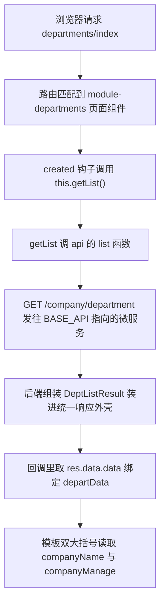

# 组织架构页接上真数据：created 发出第一个部门列表请求

api 函数安安静静躺在 `dept.js` 里，页面还不知道它的存在。点开「组织架构」，企业名称一栏仍是美工写死的占位文字，负责人一栏同样如此。页面要活起来，缺的是一次真实请求，以及把响应里的字段放进模板的正确姿势。

## 先给结论

- 取数链路固定三段：`created` 钩子调 `methods` 里的 `getList`，`getList` 调 api 的 `list`，响应在 Promise 回调里接。
- 组件 data 里先声明三个数据模型：`activeName` 页签、`departData` 企业信息、`depts` 部门数组，本节只填前两个。
- 响应对象外层是 axios 的 config、headers 等运输信息，业务数据在 `res.data`，真正的结构在 `res.data.data`。
- 接口 data 是 `DeptListResult` 结构：companyId、companyName、companyManage、depts 四个字段。
- 模板占位换成 `{{ departData.companyName }}` 与 `{{ departData.companyManage }}`，刷新即出真值。

## 一、从执行流程图到代码：请求在哪一拍发出

day02 资料里画过一张前端取数的执行流程图：页面访问一个链接，根据路由配置找到视图组件；组件的 `created` 在页面加载之前执行，它调用指定的 method；method 调 api 与服务端交互拿到数据；数据绑定到数据模型，模板跟着渲染。按这张图落代码，就是把链条上每个环节填进组件：

```vue
<script>
import { list } from '@/api/base/dept'

export default {
  data() {
    return {
      activeName: 'first',
      // 企业信息：companyId companyName companyManage depts
      departData: {},
      // 部门数组，供后续树形列表使用
      depts: []
    }
  },
  methods: {
    // 查询部门列表
    getList() {
      list().then(res => {
        console.log(res)
      })
    }
  },
  created: function() {
    this.getList()
  }
}
</script>
```

**第一，为什么放在 `created` 里调。** `created` 在实例创建完成、页面尚未渲染时执行，取数动作放这里，数据到得最早。钩子里不直接写业务，转手调 `methods` 里的 `getList`，钩子负责「什么时候」，方法负责「做什么」，职责分清楚。

**第二，为什么先 `console.log(res)`。** 第一次接一个接口，先用打印确认链路通不通：请求发出去没有、响应长什么样、字段叫什么名字，打印一次全知道。这是联调第一个接口的标准验证动作，看见数据再谈绑定。

## 二、F12 里看这条请求：外壳与内核

打开浏览器 F12 的 Network 面板刷新页面，一条 `GET /company/department` 请求出现，地址前缀正是 `BASE_API` 指向的企业微服务。响应体里能直接看到 companyId、companyName、companyManage、depts，企业信息与部门列表一次带回。

控制台打印出来的 `res` 字段多得多，config、headers、request 一应俱全，那些是 axios 这层运输工具自带的包裹。业务上只关心一个入口：`res.data` 是响应体，响应体自身又带统一外壳 `code`、`success`、`message`、`data`，真正的业务结构在 `res.data.data`。这层外壳与 day02 mock 文件 `company.js` 返回的是同一套约定：

```javascript
// 响应体结构（字段取自接口文档与后端 DeptListResult）
{
  code: 10000,          // 状态码，10000 代表执行成功
  success: true,        // 是否成功
  message: '执行成功',
  data: {
    companyId: '1',
    companyName: '某某科技股份有限公司',
    companyManage: '张三',
    depts: [
      {
        id: '106', pid: '', companyId: '1',
        name: '研发部', code: 'RD',
        managerId: 'xxx', manager: '王五',
        introduce: '', createTime: '2018-01-01'
      }
    ]
  }
}
```

外壳的 `code`、`success`、`message` 描述这次请求本身成没成功，`data` 装业务数据。前端取数永远沿着 `res.data.data` 这条路径走，别在外壳层迷路。



图里最值得盯的是倒数两步：请求层的东西到 `res.data` 为止，业务数据的所有权从回调里绑定进数据模型的那一刻，才正式交给 Vue 的响应式系统接管。

## 三、把数据放进模型，模板跟着变

验证完毕，把 `console.log` 换成真正的绑定：

```javascript
getList() {
  list().then(res => {
    // 企业信息与部门列表整体入模
    this.departData = res.data.data
  })
}
```

`departData` 一个字段接住全部四个属性，depts 虽然本节还用不上，也一并收着。数据模型有值之后，改模板。页面顶部的企业名称原本是硬编码占位：

```html
<!-- 改造前：美工写死的占位 -->
<span><strong>企业名称</strong></span>
<span>负责人</span>
```

全部内容已经进了 `departData` 模型，占位文字换成双大括号插值：

```html
<!-- 改造后：从数据模型取值 -->
<span><strong>{{ departData.companyName }}</strong></span>
<span>负责人：{{ departData.companyManage }}</span>
```

保存刷新，企业名称与负责人变成接口返回的真实数据。模板字段名与接口字段名严格一致，因为绑定时整包赋值，属性名原样带进模型；如果接口字段与设计稿叫法对不上，就在赋值处做一次映射，别让模板层猜名字。

## 常见误区

- **少写一层 data**：把 `res.data.data` 写成 `res.data`，绑进模型的是 `{code, message, data}` 这层外壳，模板里 `departData.companyName` 永远是 undefined，页面空白还不报错。记牢 axios 包一层、响应外壳再包一层。
- **在外壳层找业务字段**：对着一整页 config、headers 找 companyName，找不到就以为接口没返回。外壳描述传输过程，业务数据只在 `res.data.data`。
- **模板字段名自行发挥**：接口叫 `companyManage`，模板写成 `companyManager`，双向对不上。字段名以接口文档与响应实体为准，拿不准先打印再看。
- **绑定好了不刷新验证**：写完绑定直接进下一步，结果一个字段名手误带病上场。每接完一小段就在浏览器里确认一次，错误当场暴露成本最低。

## 面试可能被问到的问题

1. 面试官追问：「created 和 mounted 里发请求有什么区别？」
   答：`created` 时实例已建立数据观测但 DOM 还没生成，`mounted` 时页面已经渲染。两者拿数据都可行，`created` 更早，让数据到位的等待发生在渲染之前；只有依赖 DOM 的操作必须放 `mounted`。纯取数场景工程惯例选 `created`。

2. 面试官追问：「axios 响应为什么有两层 data？」
   答：外层是 axios 的响应对象，data 属性对应 HTTP 响应体，这是 axios 的封装结构；这个响应体本身又是后端定义的统一外壳，业务数据在其 data 属性里。两层相加就是 `res.data.data`，前者是客户端框架约定，后者是服务端接口契约。

3. 面试官追问：「统一响应外壳 code、success、message 有什么实际价值？」
   答：所有接口返回结构一致，前端可以用一个响应拦截器统一判断成败、统一弹错误提示，业务代码只处理 data，不用每个调用点各自解析。它把「通信是否成功」与「业务是否成功」两层语义都收敛进契约，配合 HTTP 状态码形成完整反馈。

4. 面试官追问：「页面数据是空的，你怎么排查？」
   答：先开 Network 看请求发没发：没发就查 created 与方法调用链；发了看状态码与响应体，404 查路径与前缀，200 但 data 空查后端查询条件；响应正常页面仍空，打印 `res.data.data` 确认绑定字段名，最后查模板插值拼写。自上而下分段定位，别凭感觉改代码。

5. 面试官追问：「把接口返回整体赋给一个模型对象，Vue 怎么感知变化？」
   答：赋值发生在组件实例创建后，data 里预先声明的属性在初始化时已被转成 getter/setter，后续赋值触发依赖更新，模板重新渲染。这也是为什么字段要先在 data 里声明再用，运行时才挂上去的新属性拿不到这层代理，视图不会自动更新。

## 配套资料

- 页面组件真实文件（data、getList、created 的宿主）：`materials/code/02/day03 SaaS-HRM系统用户权限设计概述/SaaS-HRM系统用户权限设计概述/资源/前端代码/module-departments/pages/index.vue`
- 响应结构出处（companyId、companyName、companyManage、depts 四字段）：`materials/code/02/day03 SaaS-HRM系统用户权限设计概述/SaaS-HRM系统用户权限设计概述/资源/工具代码/实体类/response/DeptListResult.java`
- 部门实体字段出处（depts 数组内每条记录的结构）：`materials/code/02/day03 SaaS-HRM系统用户权限设计概述/SaaS-HRM系统用户权限设计概述/资源/工具代码/实体类/Department.java`
- 统一响应外壳参照（day02 mock 文件）：`materials/code/02/day02 SAAS-HRM数据库设计与前端框架/3-3 SAAS-HRM数据库设计与前端框架/资源/通用代码/company.js`
