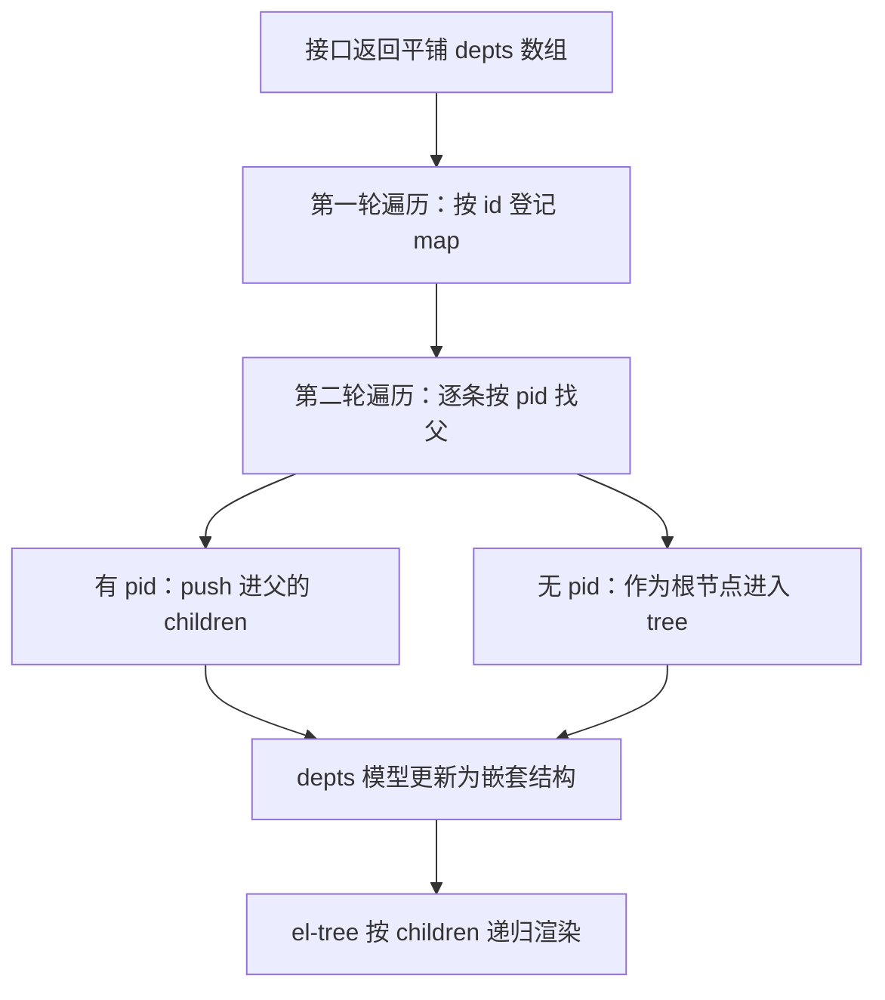

# 平铺部门数组长成树：pid 组装父子结构喂给 el-tree

企业名称与负责人到位了，页面中部依然空着，组织架构的核心恰恰是那棵部门树。打开数据库看一眼就明白落差在哪：`co_department` 表里部门是一行一行的记录，靠 pid 字段指认父部门，是平铺的；而页面上要的是研发部嵌着前端组、前端组嵌着人的层级展开，是嵌套的。两种结构之间隔着一道转换，这一节就补上它。

## 先给结论

- 接口返回的 depts 是平铺数组，每条记录带 id 与 pid；el-tree 组件只认带 children 的嵌套数组，中间必须转换。
- 转换函数放进 `utils/common.js`，页面里 `commonApi.transFormTree(数组)` 一行完成平铺转树。
- el-tree 用 `:data="depts"` 绑树，`node-key="id"` 标识节点，`default-expand-all` 让整棵树默认展开。
- `:props="{ label: 'name' }"` 告诉组件用部门对象的 name 属性当节点标题，组件默认找的字段叫 label。
- `show-checkbox` 这类用不上的能力直接关掉，组件按需配置，不背多余功能。

## 一、组件要的结构与我们手里的结构

Element UI 的 Tree 组件文档里，示例数据长这样：

```javascript
// el-tree 官方示例：嵌套数组，children 指向下一层
[{
  id: 1,
  label: '一级 1',
  children: [{
    id: 4,
    label: '二级 1-1',
    children: [{ id: 9, label: '三级 1-1-1' }]
  }]
}]
```

每一层是一个对象，有标识有标题，子层装在 `children` 数组里，装多少层随便。再看看接口实际返回的部门数据：

```javascript
// 接口返回的 depts：平铺数组，pid 指认父部门
[
  { id: '1', pid: '',  name: '总经理办' },
  { id: '2', pid: '1', name: '研发部' },
  { id: '3', pid: '2', name: '前端组' }
]
```

记录之间没有任何嵌套，层级关系全靠 pid 这一个字段表达：`研发部` 的 pid 是 `1`，父部门就是 `总经理办`。数据库用这种结构存储天经地义，改一个部门不动整棵树；但把平铺数组直接塞给 el-tree，组件只会渲染出三条并列的一级节点，父子关系全部丢失。转换的方向很明确：以 id 为索引、以 pid 为依据，把子记录挂进父记录的 children，得到嵌套数组。

## 二、transFormTree：两轮遍历把 pid 挂成 children

转换逻辑不写在页面组件里，它属于通用工具。页面组件早已预留了引入：

```javascript
import commonApi from '@/utils/common'
```

在 `utils/common.js` 里补上转换方法（资料包未收录该文件，以下为按本课写法补全的示例）：

```javascript
// 平铺数组转父子结构：id 与 pid 是唯一依据
transFormTree(list) {
  const map = {}
  // 第一轮：每条记录按 id 登记进 map，方便按 id 直达
  list.forEach(item => {
    map[item.id] = item
  })
  const tree = []
  // 第二轮：逐条找父，有 pid 挂进父的 children，没有 pid 就是根
  list.forEach(item => {
    const parent = map[item.pid]
    if (parent) {
      if (!parent.children) {
        parent.children = []
      }
      parent.children.push(item)
    } else {
      tree.push(item)
    }
  })
  return tree
}
```

**第一轮建索引，第二轮建关系。** 把每条记录的对象引用按 id 存进 map，之后判断父部门时按 pid 一步直达，不需要嵌套循环去数组里搜。 pid 为空的记录找不到父，落进 tree 数组当根节点；其余每条记录都会在第二轮里被「领养」进某个父节点的 children。children 是懒创建的，第一个子部门出现时才建数组，纯部门挂空引用。

整个过程一张图看完：



关键路径是第二轮的判定：`map[pid]` 能否取到对象引用，决定了这条记录是「孩子」还是「根」。拿到的是引用而非拷贝，所以挂在 children 里的对象与原数组里的是同一个，后续改属性两边同步。

## 三、把树交给 el-tree

页面 getList 改两行，转换结果存进 `depts` 模型：

```javascript
getList() {
  list().then(res => {
    // 企业信息整体入模
    this.departData = res.data.data
    // 平铺数组转父子结构，交给树
    this.depts = commonApi.transFormTree(res.data.data.depts)
  })
}
```

模板里落上 Tree 组件，配置逐项对着需求勾选：

```html
<el-tree
  :data="depts"
  :props="{ label: 'name' }"
  node-key="id"
  default-expand-all>
</el-tree>
```

**`node-key="id"` 是节点的身份证。** 树内部做节点标识、状态维护、后续的选中与展开控制，都靠这个唯一键，通常就是数据的 id 字段。**`default-expand-all` 控制初始形态。** 组织架构这类管理页习惯整棵展开一眼看全，勾上即可，需要收起就换成 `default-expanded-keys` 指定展开哪些节点。**`:props` 是字段映射。** 组件默认用 `label` 字段当标题、`children` 字段当下层，而部门对象里标题字段叫 name，`{ label: 'name' }` 一句映射对齐，children 恰好同名不用管。**`show-checkbox` 用不上就别开**，那是多选树的场景，这里只需要展示与点击。

保存刷新，浏览器里打印 `this.depts`：根节点带 children，children 里还有 children，平铺的三条记录已经长成树；页面上总经理办、研发部、前端组逐级缩进，层级结构与数据库里的 pid 关系完全一致。

## 常见误区

- **平铺数组直接绑给 el-tree**：组件不报错，但所有节点并列显示成一级，层级全丢。绑定之前必须先转树，这是 el-tree 的硬性数据契约。
- **id 与 pid 类型不一致**：接口里 id 是字符串 `'1'`，转树时手滑转成数字 1，`map[item.pid]` 按 pid 找父时键对不上，子部门挂不上，全部变成根节点。索引键类型必须严格一致。
- **根节点的判定漏掉**：数据库里根部门 pid 可能是空串、null 或 `'0'`，转换函数判定「找不到父就是根」能同时兼容这几种取值；如果单独写 `if (item.pid === '')` 这类判断，换一种空值写法就漏。
- **忘了配置 props 映射**：节点只显示空白或复选框，因为组件在对象里找 label 字段找不到。部门对象的标题叫 name，`:props="{ label: 'name' }"` 必须配上。

## 面试可能被问到的问题

1. 面试官追问：「平铺列表转树形，有哪些思路，复杂度差多少？」
   答：朴素做法双重循环，每条记录遍历全表找父，O(n²)；改进做法先一轮把所有记录按 id 存进哈希表，第二轮按 pid 直达父节点，O(n) 时间 O(n) 额外空间。数据量小差别不明显，部门、菜单、地区这类动辄几百上千条的列表，哈希表方案是标准解。

2. 面试官追问：「el-tree 的 node-key 是做什么的？」
   答：它是每个节点的唯一标识，组件内部维护节点状态、做 diff 更新、支持 setSelected 与 getDefaultCheckedKeys 这类按 id 定位节点的 API，都依赖 node-key 指定的字段。不配置的话，整棵树只能靠对象引用定位，展开与选中状态在数据刷新后容易错乱。

3. 面试官追问：「props 配置除了 label 还能映射什么？」
   答：还能映射 children、disabled、isLeaf 等字段。后端返回的数据结构字段名千差万别，props 相当于一层适配器，让组件按约定的字段名工作，数据侧不用为了迁就组件改名。children 同名时可以省略，异名时必须显式映射。

4. 面试官追问：「部门层级很深、数量很大时，树渲染怎么优化？」
   答：默认全展开改为按需展开，初始只渲染根层；数据用懒加载，展开节点时再请求子节点，el-tree 提供 load 函数支持；配合 node-key 与局部更新避免整树重渲。极端场景上虚拟滚动，只渲染视口内的节点。

5. 面试官追问：「转树时如果数据里存在环，比如 pid 指向自己，会发生什么？」
   答：挂在 map 里的对象被自己收进 children，渲染时递归陷入死循环，浏览器栈溢出。健壮的转换函数要检测访问过的节点，发现环时跳过或抛错；正常业务数据不该有环，防御代码是兜底而非主路径。

## 配套资料

- 页面组件真实文件（import commonApi、data 模型、getList 的出处）：`materials/code/02/day03 SaaS-HRM系统用户权限设计概述/SaaS-HRM系统用户权限设计概述/资源/前端代码/module-departments/pages/index.vue`
- 部门实体真实文件（id 与 pid 字段定义）：`materials/code/02/day03 SaaS-HRM系统用户权限设计概述/SaaS-HRM系统用户权限设计概述/资源/工具代码/实体类/Department.java`
- 响应结构真实文件（depts 数组的来源）：`materials/code/02/day03 SaaS-HRM系统用户权限设计概述/SaaS-HRM系统用户权限设计概述/资源/工具代码/实体类/response/DeptListResult.java`
- 正文 transFormTree 为按本课写法补全的示例，资料包未收录 utils/common.js，el-tree 配置为按本课最终形态整理
