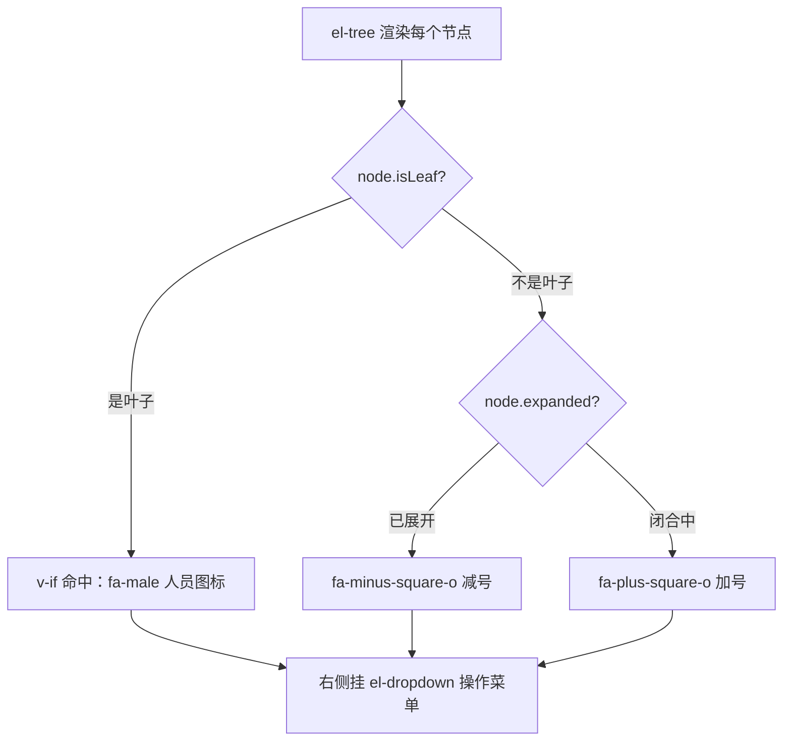

# 树形列表的定制渲染：slot-scope 拿到 node 与 data，图标跟着状态走

部门树已经能按层级缩进显示，但离设计稿还差一层皮：Element 默认渲染出来的节点只有一行名字，需求里叶子部门前面要有人员小图标，父部门要有展开与闭合状态图标，每个部门右边还要挂出「添加子部门」「查看待分配员工」的操作菜单。这些细节 el-tree 不会替你决定，组件把节点渲染权交了出来，接住它就是本节的事。

## 先给结论

- el-tree 的默认插槽配合 `slot-scope="{ node, data }"`，把包装后的节点对象与原始部门数据同时交给页面，节点内容完全自定义。
- `node` 是组件包装的节点对象，带 isLeaf、expanded 等运行状态；`data` 是原始部门对象，带 id、name、pid 等业务字段。
- 叶子节点 `v-if="node.isLeaf"` 显示 `fa-male` 人员图标，非叶子节点 `v-else` 分支负责加减号。
- 加减号切换的依据是 `node.expanded`：已展开显示减号，闭合显示加号，用动态 class 绑定。
- 操作下拉从页面头部整段复制过来，叶子与父节点共用同一套菜单，入口参数换成当前节点的 id。

## 一、slot-scope：把节点渲染权交还页面

改造前的节点内容就是一行标题，模板里只有组件本体：

```html
<el-tree :props="{ label: 'name' }" :data="depts" node-key="id" default-expand-all>
  <div class="generalClass" slot-scope="{ node, data }" style="width:99%">
    <span>{{ node.label }}</span>
  </div>
</el-tree>
```

el-tree 会为每个节点渲染一遍这段插槽内容，`slot-scope="{ node, data }"` 是解构写法，一次接住两个对象。**node 是组件视角的节点**，里面除了数据还有组件运行时状态：是否叶子节点 `isLeaf`、是否已展开 `expanded`、层级 `level` 等；**data 是业务视角的部门对象**，就是接口返回的那条记录，id、name、pid、manager 全在。`node.label` 是经过 `props` 映射后的标题值，等价于 `data.name`，显示标题用哪个都行，判断状态必须用 node。

页面头部那套「操作」下拉（el-dropdown 加两个菜单项）此前只挂在公司这一层，节点上要用的是同款结构，直接整段复制过来就是，不需要另起炉灶。

## 二、叶子与非叶子：v-if 与 v-else 分流

页面美工留下的注释里其实已经写清了图标配色的规则：

```html
<!-- 构造树形列表
  叶子 <i class="fa fa-male"></i>
  非叶子 展开 <i class="fa fa-minus-square-o"> 闭合 <i class="fa fa-plus-square-o">
-->
```

规则翻译成渲染逻辑：部门下面没有子部门的（叶子），显示一个小人，意思是这个部门下可以管人；有子部门的（非叶子），显示加减号，意思是这层可以展开收起。分支的判定字段组件已经算好，直接问 node：

```html
<div class="generalClass" slot-scope="{ node, data }" style="width:99%">
  <!-- 叶子节点：没有子部门，显示人员图标 -->
  <span v-if="node.isLeaf">
    <i class="fa fa-male"></i>
    <span>{{ node.label }}</span>
  </span>
  <!-- 非叶子节点：显示展开控制图标 -->
  <span v-else>
    <span>{{ node.label }}</span>
  </span>
</div>
```

`v-if` 与 `v-else` 必须紧挨着写在同级元素上，Vue 才能把它们识别成一对分支。`isLeaf` 的值是组件根据节点有没有 children 自动算出来的，不用自己去数 data.children 的长度。

## 三、展开状态图标与操作菜单

非叶子节点的图标要在加减号之间切换，切换依据是展开状态，动态 class 绑定一行解决：

```html
<i :class="node.expanded ? 'fa fa-minus-square-o' : 'fa fa-plus-square-o'"></i>
```

`node.expanded` 是组件维护的展开状态，点击展开箭头它立刻翻转，class 表达式随之重算，减号加号自动切换。课程里演示时这两个样式一开始正好写反，展开显示加号、闭合显示减号，刷新一看不对，把三目两侧对调就正确了。判断依据本身没错，错在经验直觉：「加号=展开」想当然了，实际约定是加号代表「点我展开」，也就是闭合态。

节点右侧的操作菜单与头部同款，入口参数换成当前节点的部门 id：

```html
<el-tree :props="{ label: 'name' }" :data="depts" node-key="id" default-expand-all>
  <div class="generalClass" slot-scope="{ node, data }" style="width:99%">
    <span v-if="node.isLeaf">
      <i class="fa fa-male"></i>
      <span>{{ node.label }}</span>
    </span>
    <span v-else>
      <i :class="node.expanded ? 'fa fa-minus-square-o' : 'fa fa-plus-square-o'"></i>
      <span>{{ node.label }}</span>
    </span>
    <!-- 节点右侧操作菜单，与页面头部结构一致 -->
    <span class="fr">
      <el-dropdown>
        <span class="el-dropdown-link">
          操作<i class="el-icon-arrow-down el-icon--right"></i>
        </span>
        <el-dropdown-menu slot="dropdown">
          <el-dropdown-item>
            <el-button type="text" @click="handlAdd(data.id)">添加子部门</el-button>
          </el-dropdown-item>
          <el-dropdown-item>
            <el-button type="text" @click="handleList(data.id)">查看待分配员工</el-button>
          </el-dropdown-item>
        </el-dropdown-menu>
      </el-dropdown>
    </span>
  </div>
</el-tree>
```

一次渲染的完整决策过程如下：



图里的三岔口都由组件状态驱动：isLeaf 决定走哪个分支，expanded 决定显示哪个图标，页面代码只声明「什么状态画什么」，状态翻转时视图自动跟。

## 四、缩进与行高：几个样式补丁

结构对了，最后是观感。资料包页面组件的样式区里备好了一批针对树节点的补丁，挑关键的落进 scoped 样式：

```scss
// 节点行高与字号，与页面整体节奏对齐
.el-tree-node__content {
  font-size: 14px;
  line-height: 36px;
}
// 自定义节点区的内边距，控制缩进与留白
.generalClass {
  font-size: 14px;
  line-height: 36px;
  color: #000000;
}
.custom-tree-node {
  padding-left: 20px;
}
// 去掉组件默认展开箭头的内边距，图标由自定义渲染接管
.el-tree-node__content > .el-tree-node__expand-icon {
  padding: 0px;
}
```

最后一处值得留神，el-tree 自带一个展开箭头图标，自定义渲染接管图标职责后，默认箭头的内边距要清零，否则节点左侧会出现两套图标叠放的怪相。刷新页面，叶子部门挂小人，父部门加减号随点击切换，操作菜单悬停即出，缩进行高与设计稿对齐，树形列表的展示层到此收工。

## 常见误区

- **展开闭合图标写反**：直觉里加号对应展开，实际约定是加号代表闭合待展开。写完必须点一遍验证，发现反了把三目两侧对调即可，不必改判断字段。
- **判断叶子时去数 children**：自己写 `data.children && data.children.length` 判断也能通，但组件已经提供了 `node.isLeaf`，语义更准还免于处理 children 未定义的情况。状态问 node，数据取 data，各回各家。
- **slot-scope 挂错了元素**：作用域插槽要挂在 el-tree 内层的内容元素上（本例是 `div.generalClass`），写在 el-tree 标签自身上收不到 node 与 data，节点渲染退回默认样式。
- **操作菜单忘了传节点 id**：从头部复制下拉结构后，`handlAdd('')` 的空串原样保留，菜单点了不知道操作的是哪个部门。复制结构的同时把参数换成 `data.id`，插槽里的 data 就是为这一步准备的。

## 面试可能被问到的问题

1. 面试官追问：「slot-scope 作用域插槽的原理是什么？」
   答：普通插槽的内容在父组件作用域编译，拿不到子组件内部数据；作用域插槽把内容定义成接收参数的函数，子组件渲染节点时调用这个函数，把 node、data 等内部状态作为实参传入。数据在子组件、模板结构由父组件定义，两边协作完成渲染，el-tree 每渲染一个节点就调用一次。

2. 面试官追问：「isLeaf 是怎么判断出来的？」
   答：组件根据节点的 children 判定，children 为空或不存在即为叶子。配合懒加载场景，isLeaf 还可以由数据里的标记字段通过 props 映射指定。它省掉了页面层重复数组的样板判断，也让组件自身的展开箭头显示逻辑有了统一依据。

3. 面试官追问：「node.expanded 翻转后，图标为什么能自动切换？」
   答：expanded 是响应式属性，:class 里的三目表达式在渲染时建立了对它的依赖。展开点击翻转状态，依赖触发组件重新渲染，class 字符串重算，减号加号切换。整个过程是 Vue 数据驱动视图的标准链路，页面代码里没有任何手动操作 DOM 的语句。

4. 面试官追问：「一个节点的操作菜单要区分权限，比如只能看不能删，怎么落地？」
   答：插槽拿到的是完整 data，菜单项上加 v-if，判断条件可以是节点自身属性（如部门类型），也可以是登录态里携带的权限点列表。权限判断收敛在插槽这个渲染层，组件与数据都不用感知，不同角色渲染出不同菜单项，接口侧再做一次校验兜底。

5. 面试官追问：「自定义节点里为什么推荐用 node.label 而不是 data.name？」
   答：两者当前值相等，但 node.label 是组件按 props 映射取到的标题，字段映射改了它自动跟着变，data.name 则绑死了具体字段名。用组件语义层的取值，页面代码对配置的耦合更低，换数据源或改映射时改动面最小。

## 配套资料

- 页面组件真实文件（树形列表注释块、el-dropdown 结构、树节点样式全部出自此处）：`materials/code/02/day03 SaaS-HRM系统用户权限设计概述/SaaS-HRM系统用户权限设计概述/资源/前端代码/module-departments/pages/index.vue`
- 部门实体真实文件（节点 data 里的业务字段定义）：`materials/code/02/day03 SaaS-HRM系统用户权限设计概述/SaaS-HRM系统用户权限设计概述/资源/工具代码/实体类/Department.java`
- 正文 el-tree 最终形态为按本课视频写法整理，两个事件方法 handlAdd 与 handleList 的弹窗实现留待增删改查章节
