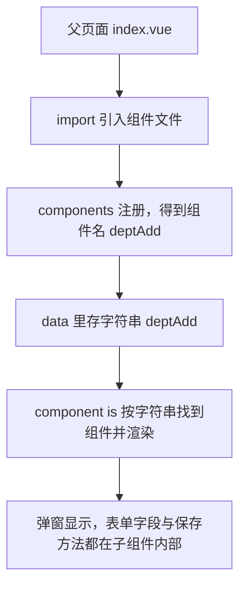

# 部门前端收尾：删除确认、Message 提示与弹窗组件抽取

部门管理走到增删改查的最后一件：删除。删的 API 调用本身只有几行，真正的工作量在体验层。现在的页面有两个明显的不友好：操作结果靠原生 alert 弹出，点一下就要手动关一次；删除这种不可逆操作，点完按钮没有任何确认，手一抖数据就没了。另外 index.vue 里已经堆了列表、弹窗、十几个表单字段和保存逻辑，再往里塞代码就该爆炸了。这一节做完删除功能，顺手把提示换成组件化方案，再把弹窗抽成独立组件。

## 先给结论

- 删除调 `deleteById`，成功后重新加载页面数据，接口函数早已备好在 `api/base/dept.js`。
- 消息提示用 `this.$message`，文字取响应体的 message 字段，类型按 success 字段在 success 与 error 之间切换。
- 危险操作用 `this.$confirm` 二次确认，点确定走 then，点取消走 catch，catch 是组件自带的默认行为。
- 弹窗抽组件三步：定义 `components/add.vue`，父页面 import 引入并注册，数据交互改成通过 `$refs` 给子组件赋值。
- 动态组件 `<component v-bind:is>` 的查找顺序：先找模型里绑定的字符串，再按这个字符串找注册过的组件。

## 一、删除：补上 CRUD 的最后一环

树节点操作菜单里已经留了删除入口，现在给它接上真正的动作。删除部门必然要把当前部门的 id 传过去，请求层对应的函数在部门 api 文件里早就写好了：

```javascript
// api/base/dept.js：根据 id 删除部门
export const deleteById = data => createAPI(`/company/department/${data.id}`, 'delete', data)
```

页面方法把 id 包成对象传进去，成功后重新加载列表：

```javascript
handleDelete(id) {
    deleteById({ id: id }).then(res => {
        if (res.data.success) {
            // 删除成功，重新加载整个页面数据
            location.reload()
        }
    })
}
```

逻辑与保存、更新一脉相承：调 api 函数、在 then 里看响应体的 success 标志。功能到这里就已经通了，但直接发布出去会被吐槽，删除前没有确认，删除后没有任何提示，成败全靠页面自己猜。

## 二、Message：让操作反馈不再生硬

Element UI 为这类场景提供了现成的消息提示组件 Message，文档里的说明很短：message 指要显示的文字，type 指主题，主题有 success、warning、info、error 四种。两个值填好就能用：

```javascript
// 成功与失败给出不同主题的提示
this.$message({
    message: res.data.message,                            // 提示文字取响应体的消息
    type: res.data.success ? 'success' : 'error'          // 按后端执行结果切主题
})
```

这段写法可以直接替换掉页面里所有 alert：删除成功绿一条，失败红一条，保存与更新也一样。文字不再自己硬编码，取的是后端响应体里的 message，后端说什么前端就展示什么，两边口径天然一致。

## 三、$confirm：删除前多问一句

删除是危险操作，点按钮立刻执行风险太高。Element UI 的 MessageBox 组件给出了确认框的标准写法，点确定与点取消各触发一个回调：

```javascript
this.$confirm('确定删除该部门吗？', '提示', {
    confirmButtonText: '确定',
    cancelButtonText: '取消',
    type: 'warning'
}).then(() => {
    // 点确定：真正执行删除
}).catch(() => {
    // 点取消：组件默认的 catch 行为，给个提示即可
    this.$message({
        type: 'info',
        message: '已取消删除'
    })
})
```

这个调用返回 Promise，then 代表点了确定，catch 代表点了取消。catch 不写也不会报错，组件对取消有自己的默认处理，课程里选择在 catch 里给一条 info 提示，让用户知道刚才那一下没有被忽略。把真正发请求的代码搬进 then，完整的删除方法就成型了：

```javascript
handleDelete(id) {
    this.$confirm('确定删除该部门吗？', '提示', {
        confirmButtonText: '确定',
        cancelButtonText: '取消',
        type: 'warning'
    }).then(() => {
        deleteById({ id: id }).then(res => {
            this.$message({
                message: res.data.message,
                type: res.data.success ? 'success' : 'error'
            })
            if (res.data.success) {
                location.reload()
            }
        })
    }).catch(() => {
        this.$message({
            type: 'info',
            message: '已取消删除'
        })
    })
}
```

两层 then 嵌套读起来有点深，语义却很清楚：外层等用户决策，内层等服务端结果，两个异步各自把关。

## 四、把弹窗抽成组件：三步走

功能齐了，回头看 index.vue：列表、新增修改的弹窗、表单字段、保存更新方法全在一个文件里，页面又长又乱。Vue 支持把页面以组件化的形式拆开，思路类似插件化，页面退化成一个容器，需要哪个组件就引入哪个组件。落地一共三步。

**第一步，定义组件。** 在 `components` 目录下建一个文件，比如 `add.vue`，把弹窗该有的东西搬进去：结构上放 el-dialog 加表单字段，数据里放表单对象与弹窗开关，方法里放调 api 完成保存与更新的逻辑。子组件里声明一个 `parentId` 属性，用来接收从父页面传进来的上级部门 id。抽取完这一步，index.vue 里的代码立刻清爽很多。

**第二步，引入并注册。** 父页面里 import 进来，再用 components 选项登记：

```javascript
import deptAdd from '@/components/add'
export default {
    components: { deptAdd },      // 注册组件，键名就是组件名
    data() {
        return {
            deptAdd: 'deptAdd',   // 模型里存组件名的字符串
            depts: []
        }
    }
}
```

**第三步，动态挂载。** 模板里用 component 标签配合 is 指令把组件渲染出来：

```html
<component v-bind:is="deptAdd" ref="addDept"></component>
```

is 后面绑的是模型名称，它的查找顺序是：先找 data 里的 `deptAdd`，里面存的是字符串 `deptAdd`，再拿这个字符串去 components 注册表里找同名组件，找到就渲染。想换弹窗，改 data 里这个字符串就够了，页面结构一行不动。整条链路如下：



图里关键的一环是最后一步的按名查找：模型字符串与注册键名必须完全一致，大小写差一个字母组件就渲染不出来，页面只会留下一块空白。

## 五、父组件调子组件：$refs 搭桥

组件一拆，新问题马上出现：添加子部门的入口按钮在父页面，弹窗开关 dialogVisible 和表单数据却在子组件里，父页面怎么把值送进去。办法是给组件挂一个 ref，然后通过 `this.$refs` 直接访问子组件实例：

```javascript
// 添加子部门：把上级部门 id 交给子组件，再打开弹窗
handleAdd(parentId) {
    this.$refs.addDept.parentId = parentId
    this.$refs.addDept.dialogVisible = true
}
// 修改：先查出部门详情，交给子组件回显，再打开弹窗
handleUpdate(id) {
    find(id).then(res => {
        this.$refs.addDept.dept = res.data.data
        this.$refs.addDept.dialogVisible = true
    })
}
```

`addDept` 是组件标签上声明的 ref 名，`$refs.addDept` 拿到的就是子组件实例，子组件里声明过的 parentId、dept、dialogVisible 都能直接赋值。新增场景传 parentId，修改场景传整条部门记录，弹窗打开与数据回显一次完成。父页面从此只负责入口与调度，表单校验、字段组织、请求发送全部收进子组件，职责边界就此划清。

## 常见误区

- **入口方法跟着弹窗一起搬走了**：抽组件时把 handleAdd、handleUpdate 也复制进了子组件，结果树节点菜单点了没反应。入口按钮在父页面，这两个方法必须留在父页面，要搬走的是弹窗结构与保存逻辑。
- **注册写法随意**：写成 `components: (deptAdd)` 这类括号表达式，组件实际没有以期望的名字登记，is 按名查找落空，页面不报错也不渲染。注册必须是对象形式 `components: { deptAdd }`，并且与 data 里 is 绑定的字符串对上。
- **忘了挂 ref**：`this.$refs.addDept` 报 undefined，十有八九是模板里的组件标签漏写 `ref="addDept"`。$refs 靠这个属性做索引，名字还要与方法里引用的完全一致。
- **提示文字自己硬编码**：`$message` 里写死「删除成功」，后端实际执行失败时前端照样报喜。文字取响应体的 message，主题按 success 字段切换，展示永远与真实结果对齐。

## 面试可能被问到的问题

1. 面试官追问：「Vue 父子组件之间有哪些通信方式？」
   答：父传子用 props，子传父用 $emit 触发事件，父组件还可以通过 $refs 直接拿到子组件实例读写它的属性或调用方法。跨层级与兄弟组件则借助事件总线或状态管理。本课的场景是父页面掌握入口、子组件持有弹窗状态，用 $refs 赋值最直接。

2. 面试官追问：「动态组件 component 加 is 是怎么工作的？」
   答：is 绑定一个组件名字符串，渲染时先取模型里这个字符串的当前值，再在 components 注册表里找同名组件，找到就创建并挂载。切换字符串的值就切换组件，多个弹窗、多种表单按需出现的页面可以用它把容器写得非常薄。

3. 面试官追问：「$refs 有什么使用限制？」
   答：ref 不是响应式的，$refs 只在组件渲染完成后才有内容，在 created 钩子里访问子组件 ref 会拿到 undefined，通常放在 mounted 之后或者事件回调里使用。它也不该拿来在模板里做数据绑定，那是 props 的职责。

4. 面试官追问：「$confirm 与 $message 有什么区别？」
   答：$message 是轻量消息条，出现在页面顶部，只做展示不阻断操作；$confirm 是模态确认框，返回 Promise，用户点了确定或取消才会继续。需要用户决策的用 $confirm，纯结果反馈用 $message，两者经常组合出现。

5. 面试官追问：「删除功能为什么要做二次确认，前端确认就够了吗？」
   答：二次确认防的是误操作，属于体验层的保险。它挡不住绕过页面的直接请求，真正的安全边界在后端，接口侧还要做登录态、权限与业务校验。前端确认降低误删概率，后端校验兜住底线，两层配合才完整。

## 配套资料

- 页面组件真实文件（操作下拉、样式与页面骨架出自此处）：`materials/code/02/day03 SaaS-HRM系统用户权限设计概述/SaaS-HRM系统用户权限设计概述/资源/前端代码/module-departments/pages/index.vue`
- 部门 api 真实文件（deleteById、find 等五个请求函数）：`materials/code/02/day04 权限分配与jwt概述/权限分配与jwt概述/资源/前端代码/api/base/dept.js`
- 同类抽取组件的真实参考（员工弹窗组件 add.vue，el-dialog 加保存后 $emit 通知父页面刷新）：`materials/code/02/day03 SaaS-HRM系统用户权限设计概述/SaaS-HRM系统用户权限设计概述/资源/前端代码/module-employees/components/add.vue`
- 视频里现场抽取的 `components/add.vue` 未包含在资料包中，正文按本课写法补全
