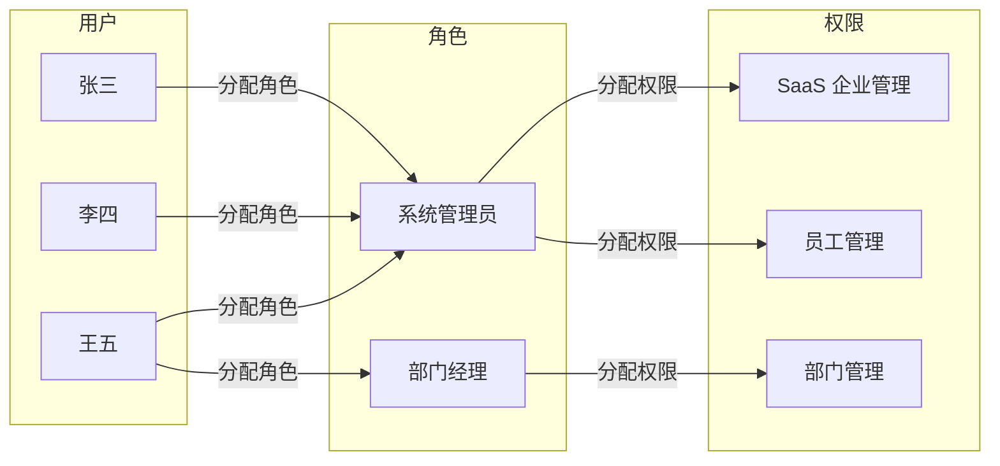

# RBAC 权限模型的设计思路：在用户与权限之间加一层角色

给系统做权限，最直觉的做法是把权限一条条发给用户：张三能用员工管理，李四能用部门管理，王五能看薪酬。人少的时候这么干没毛病，用户一多就露馅了：新员工入职要挨个配一遍，收回某项权限要在几十个账号上重复同样的操作，漏掉一个就是事故。RBAC 模型就是冲着这个麻烦来的，它只做了一件事，在用户和权限中间插进一个角色，权限管理瞬间从「对人」变成「对岗」。

## 先给结论

- RBAC 全称 Role-Based Access Control，基于角色的权限访问控制，核心是在用户与权限之间加入角色这一层。
- 传统直连方式下用户与权限两两维护，分配与回收都要按人操作，成本随人数线性增长。
- RBAC 把维护动作拆成两步：给角色分配权限，给用户指派角色，用户借角色间接获得权限。
- 一个用户可以持多个角色，权限自动叠加；一个角色可以挂多个权限，也可以被多个用户持有。
- 企业应用里 RBAC 是权限控制的主流模型，课程项目中的用户、角色、权限三套实体正是按它设计的。

## 一、RBAC 是什么

RBAC 的全称是 Role-Based Access Control，翻译过来叫基于角色的权限访问控制。它在用户和权限这两个概念之间加入了一个角色概念，通过角色去关联用户、关联权限，实现对访问的控制。

它的价值集中在两点：**划分权限方便，回收权限也方便。** 对每个用户划分权限，只需要给他指派合适的角色；要收回某类权限，改角色的权限列表就行，所有持有该角色的用户同步生效。正因为这两个特点，RBAC 成了企业级系统做访问控制时应用最广泛的模型。

## 二、传统直连方式为什么撑不住

先把最原始的摆出来。左边是用户，右边是权限，两边直接连线：张三拥有 SaaS 企业管理与员工管理两个权限，李四也拥有员工管理，还多一个部门管理。这种分配方式就是逐个告诉每个用户「你有这个权限」。

麻烦在维护。想同时收回张三和李四的员工管理权限，得对两个人分别操作；新来一个王五要用同样的三个权限，还得单独给他设置一遍。用户与权限是多对多的网状关系，每加一个人、每调一次权限，线都画在人身上，操作次数等于人数乘以权限数。用户量一大，这张网没法手工维护，于是 RBAC 的思路登场：把中间这坨连线全部打断，不直接管理用户与权限的关系。

## 三、加一层角色：两步完成授权

RBAC 的做法是在中间加一个角色层。系统里先定义角色，比如「系统管理员」，再把权限挂在角色上：系统管理员拥有 SaaS 企业管理、员工管理。之后授权用户只做一件事，把人指派成某个角色。

前面的例子重演一遍：张三指派成系统管理员，李四也指派成系统管理员，两人自然而然具备了系统管理员携带的全部权限。王五新入职要用这两个权限，直接指派同一个角色，不用再逐条勾权限。角色还能叠加：王五除了系统管理员还兼部门经理，而部门经理这个角色挂了部门管理权限，那就再给他指派部门经理，三项权限自动集于一身。



图里的两条边标签就是 RBAC 落地时仅有的两个维护动作：分配角色、分配权限。权限的变更收敛在角色一侧，人员的进出收敛在指派动作上，原来「人数 × 权限数」的网状维护被压成了两个一对多的管理界面。讲义里的样例把这套思想画得更完整：管理员角色挂系统设置与雇员管理，人事经理挂雇员与招聘管理，招聘专员挂招聘管理，薪酬专员挂薪酬管理，六个用户各自指派角色后，能看到哪些模块一目了然。

## 四、RBAC 家族：0、1、2 三个级别

课程采用的是最基础的 RBAC0，也就是上面这套「用户、角色、权限」三层结构，它已经覆盖绝大多数管理系统的需求。了解这个家族的另外两个成员，有助于在看开源权限框架时不迷路：

- **RBAC1**：在 RBAC0 基础上给角色引入层级，角色可以继承角色。总经理角色继承部门经理角色，就自动拥有后者的全部权限，适合组织层级明显的场景。
- **RBAC2**：在 RBAC0 基础上加入约束，典型的是互斥角色（同一用户不能同时持有两个冲突角色，比如申请人与审批人）与基数约束（一个角色最多多少人持有）。

三个级别是叠加关系，RBAC0 是地基，实际项目里用得最多的也正是它。

## 五、模型先行：实体关系在代码里的样子

思想定了，实现就是三套实体加两条关系。课程资料里的角色实体已经把话说得很明白，角色与用户多对多、角色与权限多对多（包名已改为 `com.example`）：

```java
@Entity
@Table(name = "pe_role")
@Getter
@Setter
public class Role implements Serializable {
    @Id
    private String id;
    private String name;          // 角色名
    private String description;   // 说明
    private String companyId;     // 企业 id，SaaS 场景下角色属于某个租户

    // 角色与用户：多对多，由 User 一侧维护中间表
    @JsonIgnore
    @ManyToMany(mappedBy = "roles")
    private Set<User> users = new HashSet<User>(0);

    // 角色与权限：多对多，中间表 pe_role_permission
    @JsonIgnore
    @ManyToMany
    @JoinTable(name = "pe_role_permission",
            joinColumns = {@JoinColumn(name = "role_id", referencedColumnName = "id")},
            inverseJoinColumns = {@JoinColumn(name = "permission_id", referencedColumnName = "id")})
    private Set<Permission> permissions = new HashSet<Permission>(0);
}
```

`@ManyToMany` 一出来，角色这一层在数据模型里就坐实了。用户一侧同样声明与角色的多对多关系，中间表由 JPA 按注解生成。授权之后想知道一个用户到底能访问什么，按模型的连线把三张表串起来查一遍即可，下面这条 SQL 是按本课表名补全的示例：

```sql
-- 示例：查询某用户拥有的全部权限编码（表名取自本课实体，SQL 为按主流写法补全）
SELECT DISTINCT p.code, p.name
FROM bs_user u
JOIN pe_user_role ur ON ur.user_id = u.id
JOIN pe_role r       ON r.id = ur.role_id
JOIN pe_role_permission rp ON rp.role_id = r.id
JOIN pe_permission p ON p.id = rp.permission_id
WHERE u.id = '1';
```

用户、角色、权限三张主表加上两张中间表，查询路径与模型图完全同构：先问这个人是什么角色，再问这个角色有哪些权限。

## 常见误区

- **给用户直接配权限**：系统图省事留了「用户直连权限」的口子，用得越多越是灾难，回收权限时根本说不清某个权限散落在多少人身上。坚持只走角色，个别特例也建一个专用角色来表达。
- **角色粒度设计过粗或过细**：一个「超级管理员」角色包打天下，权限没法细分；反过来按页面按钮逐个造角色，角色表比用户表还大。粒度对齐岗位职责，权限点的组合交给角色。
- **以为角色是用户的分组**：分组是集合概念，RBAC 里角色是权限的载体，同一个用户持多个角色时权限取并集。理解成「组」容易把继承、互斥这些语义搅在一起。
- **权限变更后认为要重新登录**：RBAC 只解决「谁能干什么」的静态模型，权限在会话中间变化时如何生效，取决于系统把权限缓存在哪里、校验发生在哪一层，这是后面接口鉴权要解决的问题，模型本身不含答案。

## 面试可能被问到的问题

1. 面试官追问：「说一下 RBAC 模型的核心思想。」
   答：在用户与权限之间加入角色层，用户与角色多对多，角色与权限多对多。授权拆成给角色配权限、给用户派角色两步，权限分配与回收都收敛到角色维度，避免了用户与权限直连时的网状维护。

2. 面试官追问：「为什么用户和权限中间不直接连，非要隔一层角色？」
   答：直连时关系数量是人数乘以权限数，且每条都要人工维护，分配与回收都按人操作。加角色层后权限挂在少数角色上，人只需要指派角色，维护量从网状降到两个一对多，权限复用和批量生效都靠这一层实现。

3. 面试官追问：「RBAC1 和 RBAC2 与 RBAC0 的区别？」
   答：RBAC1 增加角色层级与继承，上层角色自动获得下层角色的权限；RBAC2 增加约束，最典型的是互斥角色与基数限制。三者为叠加关系，管理类系统通常用 RBAC0，审批流、财务类系统会引入 RBAC2 的互斥约束。

4. 面试官追问：「用户同时有多个角色，权限怎么算？」
   答：取并集。用户拥有的权限是他所有角色权限的集合，SQL 上表现为用户、角色、权限经两张中间表的多表 join 后去重。若引入 RBAC2 的互斥约束，则要在指派角色时先校验冲突。

5. 面试官追问：「角色删除时中间表里的关联怎么办？」
   答：删除角色前要处理它的两条关联：用户角色中间表中该角色的记录、角色权限中间表中该角色的记录，要么级联删除，要么先做业务校验阻止删除仍被持有的角色。只删角色主表会留下悬挂外键，用户权限计算会出错。

## 配套资料

- 角色实体真实文件（@ManyToMany 声明用户与权限两条多对多关系，中间表 pe_role_permission）：`materials/code/02/day03 SaaS-HRM系统用户权限设计概述/SaaS-HRM系统用户权限设计概述/资源/工具代码/实体类/Role.java`
- 用户实体真实文件（与角色的多对多关系及中间表 pe_user_role）：`materials/code/02/day03 SaaS-HRM系统用户权限设计概述/SaaS-HRM系统用户权限设计概述/资源/工具代码/实体类/User.java`
- 权限实体真实文件（权限名称、类型、编码等字段定义）：`materials/code/02/day04 权限分配与jwt概述/权限分配与jwt概述/资源/实体类/Permission.java`
- 本课为设计思想课，无建表 SQL 资料包，文中查询示例按本课实体的表名与主流写法补全
