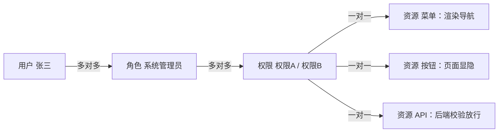
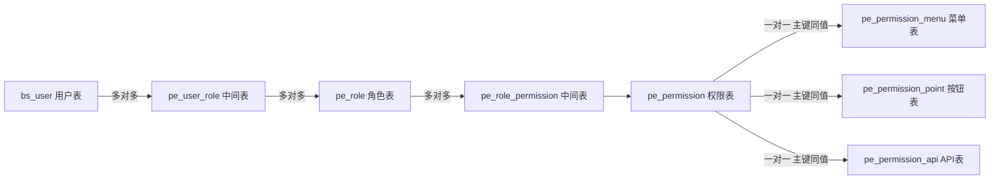

# 把权限拆成资源：SaaS 权限控制的设计思路与八张表

需求分析阶段留下了一个悬而未决的问题：菜单、按钮、API 三类东西都要受权限管，可经典 RBAC 的权限表里只有一个笼统的「权限」，它凭什么区分自己是一条菜单还是一个接口？这一篇就是这个问题的收口：在用户、角色、权限三件套之上再补一层「资源」，每种粒度各归其位，最终八张表把整个权限体系钉牢。

## 先给结论

- 权限升格为「资源」：一个权限就是一个具体资源，它可能是菜单、按钮或 API 接口，三者必居其一。
- 权限表加 `type` 字段区分类型：1 为菜单，2 为功能（按钮），3 为 API。
- 权限表与菜单表、按钮表、API 表各是一对一，三张子表的主键与权限表主键同值。
- 关系链四句话：用户对角色多对多，角色对权限多对多，权限对资源一对一。
- 全套共八张表；将来要新增权限粒度，只需加一张子表、加一个 `type` 值，主结构纹丝不动。

## 一、权限即资源：给权限找一个具体落点

经典 RBAC 里，「权限」是个抽象概念，授权到权限这一层就结束了。SaaS 平台的麻烦在于权限要落到三种完全不同的载体上：菜单权限决定前端渲染哪些导航项，按钮权限决定页面上的操作按钮显不显示，API 权限决定后端接口放不放行。三种载体差异巨大，却共用一套授权体系，硬塞进一张表里字段就对不齐。

解法是引入「资源」这一层：权限不再悬在半空，每个权限必然指向一个具体资源。张三是系统管理员，持有权限 A 和权限 B；权限 A 是一个菜单，前端发现他有这条权限就把菜单渲染出来；权限 B 是一个 API，请求到达后端时检查他的角色集合里有没有这条权限，有则放行，没有则直接拒绝并返回未授权的提示。



图里最值得看的是最后一段：权限到资源的三条线各自独立，一个权限只会连上其中一个资源。用户到角色、角色到权限都是多对多的组合关系，唯独权限到资源是一对一的落点关系，这个不对称正是整套设计的支点。

## 二、为什么权限和资源必须一对一

一个权限对应几个资源？答案只能是一个。张三的权限 A 如果既对应「组织架构」这个菜单，又对应「添加部门」这个按钮，授权语义就含混了：撤销这条权限时，到底是收走菜单还是收走按钮？角色持有这条权限的粒度也没法细分。反过来，一个菜单权限和一个按钮权限就该拆成两条独立的权限记录，各挂各的资源，各授各的权。

把四种关系放在一起看就清楚了：

| 关系 | 基数 | 原因 |
|---|---|---|
| 用户 : 角色 | 多对多 | 一个人可以身兼数职，一个职位可以有多人担任 |
| 角色 : 权限 | 多对多 | 一个角色配多条权限，一条权限可以进多个角色 |
| 权限 : 菜单 | 一对一 | 一条菜单权限只落在一个菜单资源上 |
| 权限 : 按钮 / API | 一对一 | 同上，粒度到具体操作或具体接口为止 |

一句话概括：组合关系发生在「人」的这一侧，落点关系发生在「物」的那一侧。中间表只出现在多对多的位置，一对一的位置上用主键同值就够了，不需要关联表。

## 三、type 字段：一张权限表管住三种粒度

三张子表怎么和权限主表对上号？在权限表上加类型字段，靠它决定这一条权限去哪张子表里找细节。课程实体类里的写法（包名已改为 `com.example`）：

```java
@Entity
@Table(name = "pe_permission")
@Getter @Setter @NoArgsConstructor
@DynamicInsert(true)
@DynamicUpdate(true)
public class Permission implements Serializable {
    @Id
    private String id;          // 主键，与子表 id 同值
    private String name;        // 权限名称
    private Integer type;       // 权限类型 1为菜单 2为功能 3为API
    private String code;        // 权限标识，按钮显隐判断就靠它
    private String description; // 权限描述
    private String pid;         // 父权限 id，菜单下挂按钮、按钮下挂 API
    private Integer enVisible;  // 企业可见性 0不可见 1可见
}
```

`pid` 是这套模型里容易忽视的一笔。权限之间并不平级：一个菜单底下可能挂多个按钮，一个按钮背后可能又对应若干 API。资料包的初始化数据里就有现成的三层链：员工管理是一条 `type=1` 的菜单权限，「用户删除按钮」是 `type=2` 的按钮权限且 `pid` 指向这条菜单，「删除用户 api」是 `type=3` 的 API 权限且 `pid` 指向那个按钮。菜单、按钮、API 就靠 `pid` 串成了父子树。

## 四、八张表全景：两多对多加三一对一

表结构在 RBAC 五表的基础上向资源侧展开，全貌如下：



从左到右读这张图：用户表和角色表靠 `pe_user_role` 拆解多对多，角色表和权限表靠 `pe_role_permission` 拆解多对多，权限表再按 `type` 分流到三张子表。两张中间表都是联合主键，`pe_user_role` 的主键就是 `role_id` 加 `user_id` 两列，天然防止重复授权。三张子表的实体都很薄，只放本类型专属的字段，比如按钮表和菜单表（包名已改为 `com.example`）：

```java
@Entity
@Table(name = "pe_permission_point")
@Getter @Setter
public class PermissionPoint implements Serializable {
    @Id
    private String id;          // 与权限主表 id 同值
    private String pointClass;  // 权限代码
    private String pointIcon;   // 展示图标
    private String pointStatus; // 状态
}

@Entity
@Table(name = "pe_permission_menu")
@Getter @Setter
public class PermissionMenu implements Serializable {
    @Id
    private String id;          // 与权限主表 id 同值
    private String menuIcon;    // 菜单图标
    private String menuOrder;   // 排序号
}
```

API 子表的 `apiUrl` 与 `apiMethod` 在需求分析一篇里已经出现过，三者合起来正好覆盖前端菜单、前端按钮、后端接口三个控制点。查询时先看主表的 `type`：是 1 就去菜单表补全图标和排序，是 2 就去按钮表补全代码，是 3 就去 API 表补全地址和方法，主表永远只管公共字段。

## 五、这样设计的好处：扩展只做加法

对比把菜单、按钮、API 的字段全部塞进一张权限表的「宽表」做法，主子表结构的优势在扩展时暴露得最充分。哪天要控制到更细的粒度，比如文件下载权、页面样式权，做法是加一张 `pe_permission_file` 之类的子表，在 `type` 里约定一个 4，主表结构、两张中间表、授权流程全部原样复用。宽表做法则要不断往表里加列，空列越积越多，每加一种粒度所有老数据都要陪跑。

这套结构还有一个隐性收益：权限主表根本不需要知道自己代表什么。它只存名称、类型、编码、描述这些共性字段，类型专属的细节全在子表里。权限表因此保持稳定，变的只是子表的数量，符合「易变的拆出去、稳定的留下来」这张经典药方。

## 常见误区

- **一条权限挂多个资源**：图省事把「打开员工管理菜单且能点删除按钮」存成一条权限，撤销时两样一起丢，粒度也无法单独调整。正解是一条权限只落一个资源，两条需求拆两条权限分别授权。
- **子表另起炉灶发新主键**：子表的意义就是与主表一对一，主键必须与主表 `id` 同值。子表自己生成主键再靠外键关联，查询就得多 join 一次，一对一的简洁性荡然无存。
- **把 `type` 当权限等级**：1、2、3 是类型不是层级，菜单不比 API 高级。真正的层级关系由 `pid` 表达，`type` 只回答「去哪张子表找细节」这一个问题。
- **忽略 `enVisible` 的存在**：`en_visible` 标记这条权限对租户企业是否可见，平台专属的权限置 0 后租户管理员在授权列表里根本看不到，这层过滤漏了就会把平台内部权限发到租户手上。

## 面试可能被问到的问题

1. 面试官追问：「SaaS 平台的权限模型和经典 RBAC 有什么区别？」
   答：RBAC 的骨架保留，用户对角色、角色对权限仍是多对多；区别在于权限之下补了资源层，权限表用 `type` 区分菜单、按钮、API 三种粒度，各粒度的专属字段拆到一对一的子表里。这样同一套授权体系能同时驱动前端菜单渲染、按钮显隐和后端接口校验。

2. 面试官追问：「为什么权限和资源设计成一对一，而不是一张大表？」
   答：一个权限必须只对应一个资源，授权语义才唯一，撤销和粒度调整才可预测。若做成大表，三种载体的字段差异只能靠一堆可空列硬撑，扩展新粒度就得改表加列；主子表结构让主表保持共性字段，类型细节下沉到子表，扩展只加表不改老结构。

3. 面试官追问：「权限之间的父子关系是怎么表达的，解决什么问题？」
   答：权限主表里有 `pid` 字段指向父权限。菜单下挂按钮、按钮下配 API，形成菜单、按钮、API 的父子树。它的价值是授权联动：给角色勾选一条菜单权限时，界面能顺着 `pid` 把下面的按钮和 API 一并带出来，数据校验也能保证子权限不会脱离父权限单独存在。

4. 面试官追问：「一个请求到达后端，API 权限的判定流程是怎样的？」
   答：先从登录态拿到用户 id，顺着用户角色中间表查角色集合，再顺着角色权限中间表汇总权限集合，过滤出 `type=3` 的 API 权限，用其子表的接口地址与请求方式和当前请求匹配，命中则放行，否则拒绝。整个判定不依赖前端传来的任何权限信息。

5. 面试官追问：「如果要新增一种权限粒度，比如控制文件下载，表结构怎么动？」
   答：加一张 `pe_permission_file` 子表，主键与权限主表 `id` 同值，权限 `type` 约定新值 4，子表放文件相关专属字段。主表、两张中间表和授权流程都不用改，这是主子表结构「扩展只做加法」的直接体现。

6. 面试官追问：「两张多对多中间表还有什么设计细节？」
   答：联合主键防重复授权，`pe_user_role` 的主键就是用户 id 加角色 id，同一对关系插两次直接报主键冲突。中间表只放关系列不加业务字段，级联删除要显式处理：删用户先清中间表对应行，否则残留孤行会让权限汇总出错。

## 配套资料

- 权限主表实体（`type`、`pid`、`enVisible` 字段）：`materials/code/02/day03 SaaS-HRM系统用户权限设计概述/SaaS-HRM系统用户权限设计概述/资源/工具代码/实体类/Permission.java`
- 按钮子表与菜单子表实体：`materials/code/02/day03 SaaS-HRM系统用户权限设计概述/SaaS-HRM系统用户权限设计概述/资源/工具代码/实体类/PermissionPoint.java`、`materials/code/02/day03 SaaS-HRM系统用户权限设计概述/SaaS-HRM系统用户权限设计概述/资源/工具代码/实体类/PermissionMenu.java`
- API 子表实体：`materials/code/02/day03 SaaS-HRM系统用户权限设计概述/SaaS-HRM系统用户权限设计概述/资源/工具代码/实体类/PermissionApi.java`
- 八张表的建表语句与 `pid` 三层链示例数据：`materials/code/02/day02 SAAS-HRM数据库设计与前端框架/3-3 SAAS-HRM数据库设计与前端框架/资源/ihrm.sql`（`pe_permission`、`pe_user_role`、`pe_role_permission` 等表）
- 正文关系图中的表名均取自实体类 `@Table` 注解与上述建表脚本，未做虚构
