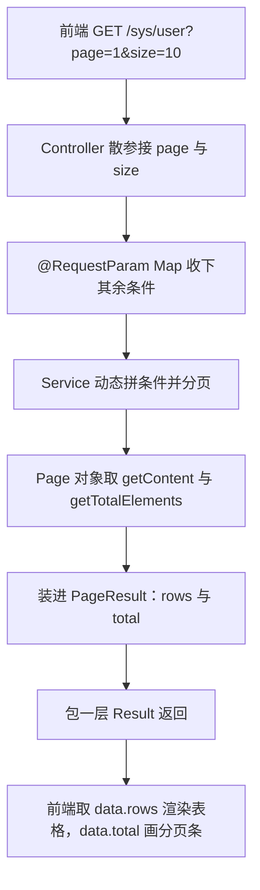

# 用户 Controller 与前端页面对接：五个接口换壳登场，分页结果装进 PageResult

Dao 与 Service 都就位了，用户模块的后端只剩 Controller 一层。这一层几乎没有新知识，套路与企业、部门两个微服务完全一致：复制一份现成的 Controller，改掉类名与访问路径，增删改查四个接口就齐了。真正的新东西只有一个分页查询接口，它要回答两个问题：页码、筛选条件这些参差不齐的参数怎么接，JPA 查回来的 `Page` 对象怎么包装成前端认得的结构。前端员工模块接上之后跑一轮联调，还能顺手揪出一个查询条件的隐蔽 bug。

## 先给结论

- Controller 从部门模块整套复制，全局替换单词之后真正要动手的只有三处：类上的访问路径改成 `/sys`、注入换成 UserService、save 里补企业归属字段。
- 系统模块的接口统一挂 `/sys` 前缀，`/sys/user` 系列对应 `UserController`，前端的 api 封装与开发代理都认这个前缀。
- 分页接口的参数分两路接收：`page`、`size` 写成方法散参，其余条件用 `@RequestParam Map` 一把抓，转手传给 Service。
- JPA 返回的 `Page<User>` 不直接出接口，拆出总条数与数据列表，装进公共模型 `PageResult` 再包一层 `Result`。
- 前端列表页只认 `data.rows` 与 `data.total`；联调时发现未传 `hasDept` 参数会漏数据，Service 层改成「不传就不拼条件」。

## 一、Controller 骨架：复制、替换、改三处

从企业模块把部门的 Controller 整个复制到系统模块的 `com.example.system.controller` 包下，改名为 `UserController`，然后把里面的 `department` 全局替换成 `user`。替换完之后，逐段检查下来只剩三处需要人工动手。

第一处是类上的注解。跨域声明、REST 声明照旧，访问路径从企业模块的 `/company` 换成 `/sys`，系统模块的所有接口统一以它开头：

```java
package com.example.system.controller;

import com.example.common.controller.BaseController;
import com.example.common.entity.Result;
import com.example.common.entity.ResultCode;
import com.example.domain.system.User;
import com.example.system.service.UserService;
import org.springframework.beans.factory.annotation.Autowired;
import org.springframework.web.bind.annotation.*;

// 1.解决跨域
@CrossOrigin
// 2.声明 restController
@RestController
// 3.设置访问路径：系统模块的接口统一挂在 /sys 下
@RequestMapping(value = "/sys")
public class UserController extends BaseController {

    @Autowired
    private UserService userService;
}
```

继承 `BaseController` 这一步别丢，它提供了当前企业 id 等公共属性，保存接口要用。

第二处是注入对象，`DepartmentService` 换成 `UserService`。第三处在 save 里，马上展开。

## 二、保存用户：企业归属的两个值在 Controller 补

部门保存时只补了一个企业 id，用户保存要补两个：`companyId` 标记归属企业，`companyName` 冗余存一份企业名称。

```java
/**
 * 保存用户
 */
@RequestMapping(value = "/user", method = RequestMethod.POST)
public Result save(@RequestBody User user) {
    // 企业id：由 BaseController 提供，当前写死占位，接入认证后自动解析
    user.setCompanyId(companyId);
    // 冗余存一份企业名称，查询用户时直接展示，省一次企业服务的调用
    user.setCompanyName(companyName);
    // 调用service保存
    userService.save(user);
    // 返回结果
    return new Result(ResultCode.SUCCESS);
}
```

`companyId` 与 `companyName` 都是父类 `BaseController` 里的属性，子类直接用。冗余这步是拿空间换查询：用户列表页要显示企业名称，存一份就不用每查一次用户都去调企业服务，代价是企业改名时要记得同步，这是冗余字段的常规取舍。

## 三、改、删、查三件套：路径参数的固定姿势

剩余三个单条操作接口连业务逻辑都不用写，全部是对 Service 的转调：

```java
/**
 * 修改用户
 */
@RequestMapping(value = "/user/{id}", method = RequestMethod.PUT)
public Result update(@PathVariable(value = "id") String id, @RequestBody User user) {
    // 1.把路径上的id设置到对象里
    user.setId(id);
    // 2.调用service更新
    userService.update(user);
    // 3.返回结果
    return new Result(ResultCode.SUCCESS);
}

/**
 * 根据id删除用户
 */
@RequestMapping(value = "/user/{id}", method = RequestMethod.DELETE)
public Result delete(@PathVariable(value = "id") String id) {
    userService.deleteById(id);
    return new Result(ResultCode.SUCCESS);
}

/**
 * 根据id查询用户
 */
@RequestMapping(value = "/user/{id}", method = RequestMethod.GET)
public Result findById(@PathVariable(value = "id") String id) {
    User user = userService.findById(id);
    return new Result(ResultCode.SUCCESS, user);
}
```

到这里为止，任何一个微服务的 CRUD 都长一个样：`POST /sys/user` 保存、`PUT /sys/user/{id}` 修改、`DELETE /sys/user/{id}` 删除、`GET /sys/user/{id}` 单查。写熟一个，其余模块就是体力活。

## 四、分页查询：参数两路走，结果装 PageResult

列表接口是接口文档里最复杂的一条：`GET /sys/user` 支持页码 `page`、每页条数 `size`，还支持 `hasDept`（是否已分配部门）、`departmentId` 等筛选条件。参数的处理分两路：

**第一，page 与 size 走方法散参。** 这两个参数每次请求基本都会传，直接声明成 `int` 形参，Spring MVC 自动按参数名绑定，类型转换顺手完成。

**第二，其余条件走 Map 一把抓。** 筛选条件可有可无、数量还会涨，逐个声明形参太啰嗦，声明一个 `Map` 形参并加上 `@RequestParam`，Spring MVC 会把所有请求参数收进这个 Map：

```java
/**
 * 分页查询企业用户列表
 * page：页码；size：每页条数；map：departmentId、hasDept 等筛选条件
 */
@RequestMapping(value = "/user", method = RequestMethod.GET)
public Result findAll(int page, int size, @RequestParam Map<String, Object> map) {
    // 1.调用service完成条件加分页查询
    Page<User> pageUser = userService.findAll(map, page, size);
    // 2.构造分页返回结果：total 总条数，rows 当前页数据
    PageResult<User> pageResult = new PageResult<>(pageUser.getTotalElements(),
            pageUser.getContent());
    // 3.返回结果
    return new Result(ResultCode.SUCCESS, pageResult);
}
```

Service 返回的是 Spring Data JPA 的 `Page<User>` 对象，它除了数据还携带分页元信息。直接把它序列化给前端并不合适，课程的做法是抽一个公共分页模型，住在公共实体模块里，全系统的分页接口共用：

```java
package com.example.common.entity;

import lombok.AllArgsConstructor;
import lombok.Builder;
import lombok.Getter;
import lombok.NoArgsConstructor;
import lombok.Setter;

import java.util.List;

/**
 * 公共分页返回模型
 */
@Getter
@Setter
@Builder
@NoArgsConstructor
@AllArgsConstructor
public class PageResult<T> {
    // 总条数
    private Long total;
    // 当前页数据列表
    private List<T> rows;
}
```

`Page` 上取两样东西就够了：`getContent()` 拿当前页数据列表装进 `rows`，`getTotalElements()` 拿总条数装进 `total`。最终响应体的结构如下：

```json
{
  "success": true,
  "code": 10000,
  "message": "操作成功！",
  "data": {
    "total": 9,
    "rows": [
      { "id": "1063705482939735040", "username": "a002", "departmentName": "测试部" }
    ]
  }
}
```

一条分页请求从进到出的完整链路如下：



链路的末环就是前后端的分页契约：只要接口守住 `total` 加 `rows` 两个字段，前端的分页组件就能全站复用，不必每个模块各写一套取数逻辑。

## 五、前端接上之后：联调揪出漏数据的 bug

前端员工（用户）模块从资料复制进工程后，列表页的取数代码只有几行，核心是认准分页契约：

```javascript
doQuery(params) {
    list(this.requestParameters)
      .then(res => {
        this.dataList = res.data.data.rows
        this.counts = res.data.data.total
      })
},
```

`requestParameters` 里放着 `page` 与 `size`，翻页时改这两个值再调 `doQuery`。资料里的 api 文件把五个接口封装成五个函数，路径与 Controller 一一对齐：

```javascript
import {createAPI} from '@/utils/request'

export const list = data => createAPI('/sys/user', 'get', data)
export const add = data => createAPI('/sys/user', 'post', data)
export const update = data => createAPI(`/sys/user/${data.id}`, 'put', data)
export const remove = data => createAPI(`/sys/user/${data.id}`, 'delete', data)
export const detail = data => createAPI(`/sys/user/${data.id}`, 'get', data)
```

模块怎么复制、代理怎么把请求从 9001 分流到 9002，是前端侧的正戏，下一篇专门展开。这一轮联调里更值得记录的是一个问题：修完代理配置、重启服务，页面数据出来了，更新、新增员工也都正常，但列表里的数据「不太对」，部分刚提交的员工怎么刷都不出现。

按接口文档回查后端查询条件，问题出在 `hasDept` 的处理上：员工列表页并不总是传这个参数，Service 里的拼装却把「没传」也当成了有效值，导致查询结果只落在一个分支里。修复思路是把三种情况拆干净：参数没传就不拼这个条件，查全部用户；传了才按 `0` 或 `1` 区分未分配与已分配：

```java
// 根据请求的hasDept判断是否分配到部门：没传就不拼这个条件
if (!StringUtils.isEmpty(map.get("hasDept"))) {
    if ("0".equals(map.get("hasDept"))) {
        // 0：查未分配部门的用户
        list.add(cb.isNull(root.get("departmentId")));
    } else {
        // 1：查已分配部门的用户
        list.add(cb.isNotNull(root.get("departmentId")));
    }
}
```

重启微服务再刷新页面，列表数据恢复正常。可选条件在拼装时永远要多问一句「不传代表什么」，默认语义想清楚，这类 bug 在联调阶段就能掐死。

## 常见误区

- **Map 形参漏写 `@RequestParam`**：Spring MVC 看到一个没有注解的 `Map` 参数，会把它当作 Model 对象处理，进来的永远是空 Map，所有筛选条件悄悄失效且不报任何错。Map 收查询参数时注解必须有。
- **替换了类名忘了改路径**：类叫 `UserController`，`@RequestMapping` 上还写着 department，前端按 `/sys/user` 请求直接 404。复制改造后先核对注解里的路径，再核对方法体。
- **把 `Page` 对象直接返回给前端**：序列化出来的 JSON 带着一长串分页元数据，字段名还随 Spring Data 版本漂移，前端取数脆弱。统一转成 `PageResult`，契约只有 `total` 与 `rows` 两项。
- **冗余字段忘了赋值**：`companyName` 没人在保存时写，列表页的企业名称列永远空白。冗余字段的纪律是「写入方明确」，谁冗余谁负责填。

## 面试可能被问到的问题

1. 面试官追问：「`@RequestParam Map` 是怎么把请求参数收集起来的？有什么限制？」
   答：Spring MVC 发现 `Map` 参数带有 `@RequestParam` 时，会把本次请求的所有查询参数与表单参数装进这个 Map。限制有两点：它收不到 JSON 请求体，键值都是字符串，复杂类型要自己转型；泛型信息在运行期被擦除，键名拼错编译期查不出来，工程上更推荐查询对象 DTO。

2. 面试官追问：「为什么不直接把 JPA 的 `Page` 对象序列化返回？」
   答：`Page` 是框架内部模型，序列化后带有 pageable、sort 等大量分页元数据，字段结构随 Spring Data 版本变化，前端依赖它会变得脆弱。转成自定义的 `PageResult` 之后契约稳定，total 加 rows 两个字段足以支撑任何分页组件，也让接口层与持久层解耦。

3. 面试官追问：「每个微服务的 CRUD 接口几乎一模一样，工程上怎么消除这种重复？」
   答：可以分层收敛：公共逻辑抽到 `BaseController` 这类父类，接口路径与返回模型全站统一；更进一步是用代码生成器按表结构生成实体、Dao、Service、Controller 的模板代码，把体力活交给工具，人只维护差异部分。

4. 面试官追问：「接口路径统一挂 `/sys` 这样的模块前缀有什么实际用途？」
   答：至少三处受益：接口按业务域分组，一眼可辨归属；开发环境的代理、生产环境的网关都能按前缀把请求路由到对应微服务；前端 api 层也能按同样前缀组织文件，前后端映射关系自解释。

5. 面试官追问：「分页接口的页码从 1 还是从 0 开始，谁负责转换？」
   答：对外契约面向人，从 1 开始；Spring Data JPA 内部的 `PageRequest` 页码从 0 起算，映射到 SQL 的 limit 与 offset。转换收敛在服务层一处完成，Controller 与前端都按自然页码传参，别把减 1 的差一错误散落到每个调用方。

6. 面试官追问：「联调时列表返回的数据不对，你的排查顺序是什么？」
   答：先看前端请求发出了什么参数，再看后端 Controller 收到了什么，然后检查条件拼装逻辑对每种参数组合的处理，最后开 SQL 日志核对真实执行的查询。可选参数的「未传」语义是最常见的出错点，这轮排查里 `hasDept` 未传被误当有效值正是典型。

## 配套资料

- 系统模块 Controller 成例（基础 CRUD 与类注解写法的对照版）：`materials/code/02/day13-代码生成器实现/day13-代码生成器实现/资源/测试/生成代码路径/ihrm_company/src/main/java/com/ihrm/system/controller/UserController.java`
- 用户实体类：`materials/code/02/day03 SaaS-HRM系统用户权限设计概述/SaaS-HRM系统用户权限设计概述/资源/工具代码/实体类/User.java`
- 前端用户 api（正文代码出处，day04 资料包中的 `api/base/users.js` 与之同源）：`materials/code/02/day03 SaaS-HRM系统用户权限设计概述/SaaS-HRM系统用户权限设计概述/资源/工具代码/工具/userApi/users.js`
- 前端员工列表页（doQuery 与 PageTool 的用法）：`materials/code/02/day03 SaaS-HRM系统用户权限设计概述/SaaS-HRM系统用户权限设计概述/资源/前端代码/module-employees/pages/index.vue`
- `PageResult` 为公共实体模块的类，正文代码按课程演示画面与 day13 成例整理，包名统一改为 `com.example`
